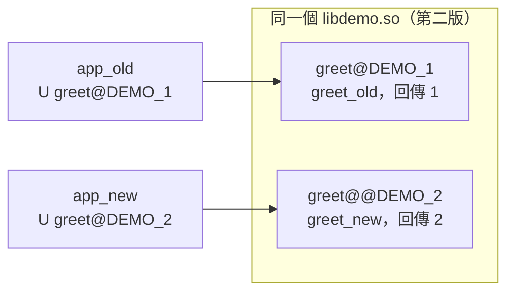

# `hello.c` 怎麼變成能跑的程式？—— 前處理、編譯、組譯、連結四個階段

> 課程：[Linux 與系統程式系統化學習](../learning/課程目錄.md#linux-與系統程式系統化學習)｜第 ① 站第 1 課
> 日期：2026-09-22
> 情境：系統化學習路線的第 ① 站第 1 課（見 [Linux與系統程式的系統化學習路線.md](../learning/Linux與系統程式的系統化學習路線.md)），
> 對應 CS:APP 第 1 章 1.1～1.4 節
> 適用範圍：實測本機 Ubuntu 24.04、x86-64、gcc 13.3.0、GNU binutils 2.42；所有輸出都是本機實際執行結果
> 相關：[fd是什麼-行程的檔案描述符表.md](../linux/fd是什麼-行程的檔案描述符表.md)、
> [root執行腳本也Permission-denied-缺執行位元.md](../linux/root執行腳本也Permission-denied-缺執行位元.md)（`execve`）、
> [bin與sbin的差別-以及怎麼正確找到執行檔.md](../linux/bin與sbin的差別-以及怎麼正確找到執行檔.md)

**一句話結論：`gcc hello.c` 不是一個動作，而是四個程式接力：前處理器把 `#include` 貼進來（`.i`，
還是 C）、編譯器翻成組合語言（`.s`）、組譯器翻成機器碼但留下「洞」（`.o`，呼叫外部函式的位址是 0）、
連結器把洞接上函式庫。而 `puts` 這種函式庫函式，直到**程式執行時**才由動態載入器填上真正的位址。
`gcc` 本身只是總指揮（driver）。最後程式印出文字，靠的是一個 `write(1, ...)` 系統呼叫——
C 語言與作業系統的交界就在這裡。**

---

## 目錄

- [一、四個階段總覽](#一四個階段總覽)
- [二、前處理：`#include` 只是複製貼上](#二前處理include-只是複製貼上)
- [三、編譯：C 變成組合語言（以及一個意外）](#三編譯c-變成組合語言以及一個意外)
- [四、組譯：機器碼裡的「洞」](#四組譯機器碼裡的洞)
- [五、連結：把洞接上，但 `puts` 還是沒接完](#五連結把洞接上但-puts-還是沒接完)
- [六、執行：從 `execve` 到 `write`](#六執行從-execve-到-write)
- [七、本課用到的工具與選項](#七本課用到的工具與選項)
- [八、動手作業](#八動手作業)
- [九、作業解說：四題背後的原因](#九作業解說四題背後的原因)
- [十、三個名字很像的檔案：`ld`、`ld-linux-x86-64.so.2`、`libc.so.6`](#十三個名字很像的檔案ldld-linux-x86-64so2libcso6)
- [十一、課後討論](#十一課後討論)
- [自我測驗](#自我測驗)

---

## 一、四個階段總覽

實驗用的程式：

```c
#include <stdio.h>

#define GREETING "hello, world"

int main(void)
{
    printf("%s\n", GREETING);
    return 0;
}
```

```
hello.c ──前處理（cpp）──► hello.i ──編譯（cc1）──► hello.s ──組譯（as）──► hello.o ──連結（ld）──► hello
  C 原始碼               還是 C，但展開了          x86-64 組合語言         可重定位目的檔         可執行檔
  116 bytes              822 行、21323 bytes       667 bytes              1504 bytes            15960 bytes
```

`gcc` 自己不做這些事，它是**總指揮（compiler driver）**，依序呼叫別的程式。`gcc -v` 會把它實際
執行的命令印出來（本機輸出，節錄）：

```
/usr/libexec/gcc/x86_64-linux-gnu/13/cc1 ... hello.c ...     ← 前處理＋編譯（cc1 內含前處理器）
as -v --64 -o /tmp/ccDQyhD0.o /tmp/ccS7uQYu.s                ← 組譯
/usr/libexec/gcc/x86_64-linux-gnu/13/collect2 ... -dynamic-linker /lib64/ld-linux-x86-64.so.2 ...
                                                              ← 連結（collect2 是 gcc 包在 ld 外面的一層）
```

平常中間檔寫到 `/tmp` 用完就刪。`gcc -save-temps hello.c -o hello` 會把 `.i`、`.s`、`.o` 都留下來，
或用 `-E`／`-S`／`-c` 讓它停在某一階段（第七節）。

---

## 二、前處理：`#include` 只是複製貼上

```sh
gcc -E hello.c -o hello.i
```

前處理器（preprocessor）處理所有 `#` 開頭的指令（directive），輸出**還是 C**：

- `#include <stdio.h>`：把 `/usr/include/stdio.h`（以及它再 include 的檔案）**整個貼進來**。
  116 bytes 的檔案變成 822 行，裡面有這一行：
  ```c
  extern int printf (const char *__restrict __format, ...);
  ```
  這只是**宣告（declaration）**——告訴編譯器「有一個叫 `printf` 的函式，參數長這樣」，
  **沒有**它的程式碼。程式碼在 libc 裡，要到連結時才會碰到。
- `#define GREETING "hello, world"`：純文字取代。`hello.i` 的結尾變成：
  ```c
  printf("%s\n", "hello, world");
  ```

**重點：真正的編譯器從來沒看過 `#include` 與 `#define`**，它看到的是已經展開好的一大份 C。
所以巨集寫錯時，錯誤訊息常常很奇怪——編譯器在罵的是展開後的樣子。

---

## 三、編譯：C 變成組合語言（以及一個意外）

```sh
gcc -S -O0 hello.c -o hello.s
```

`hello.s` 的核心部分（去掉除錯用的 `.cfi_*` 指令）：

```asm
    .section .rodata
.LC0:
    .string "hello, world"          ← 字串常數放在唯讀資料區（read-only data）

    .text                           ← 以下是程式碼區
    .globl main                     ← main 是全域符號，連結器看得到
main:
    endbr64                         ← CPU 的控制流程防護標記，先略過
    pushq %rbp                      ← 建立這個函式的堆疊框（stack frame）
    movq  %rsp, %rbp
    leaq  .LC0(%rip), %rax          ← 取字串的位址
    movq  %rax, %rdi                ← 放進 %rdi：第 1 個參數
    call  puts@PLT                  ← 呼叫 puts（！）
    movl  $0, %eax                  ← 回傳值 0 放進 %eax
    popq  %rbp
    ret
```

兩個觀念：

1. **參數怎麼傳、回傳值放哪，是約定好的。** x86-64 Linux 遵循 System V AMD64 ABI
   （Application Binary Interface，應用程式二進位介面）：第 1 個整數／指標參數放 `%rdi`，
   回傳值放 `%eax`／`%rax`。所以 `return 0;` 變成 `movl $0, %eax`。第 ③ 站會細講堆疊框。
2. **意外：程式寫的是 `printf`，組合語言卻是 `puts`。** `printf("%s\n", 字串)` 的效果
   跟 `puts(字串)` 完全一樣（`puts` 本來就會補換行），而 `puts` 不用解析格式字串、比較快，
   gcc 就**自動換掉了**——即使是 `-O0`（不最佳化）。這是 gcc 對標準函式庫函式的內建知識
   （builtin）。加 `-fno-builtin` 就會老實地保留：
   ```
   $ gcc -O0 -fno-builtin -S hello.c -o nb.s && grep call nb.s
       call printf@PLT
   ```

**教訓：編譯器只保證「行為相同」，不保證「照你寫的字面去做」。** 之後讀 kernel、除錯效能問題時，
要看的是編譯器實際產生的東西，而不是原始碼的字面。

---

## 四、組譯：機器碼裡的「洞」

```sh
gcc -c hello.c -o hello.o
file hello.o
# hello.o: ELF 64-bit LSB relocatable, x86-64, version 1 (SYSV), not stripped
```

`.o` 是 **ELF**（Executable and Linkable Format，可執行與可連結格式）的**可重定位目的檔
（relocatable object file）**——已經是機器碼，但還不能執行。用 `objdump` 反組譯，並加 `-r` 顯示重定位資訊：

```
$ objdump -dr hello.o
  12:	e8 00 00 00 00       	call   17 <main+0x17>
			13: R_X86_64_PLT32	puts-0x4
```

`e8` 是 call 指令，後面四個 byte 應該是「要跳去哪」——**全是 0**。組譯器不知道 `puts` 在哪裡
（它根本不在這個檔案裡），所以留了一個洞，並記下一筆**重定位項目（relocation entry）**：
「位移 `0x13` 的地方，將來要填上 `puts` 的位址」。字串 `.LC0` 的位址（`lea 0x0(%rip)`）也是同樣的洞。

`nm` 列出目的檔的**符號表（symbol table）**，看得更直接：

```
$ nm hello.o
0000000000000000 T main      ← T：定義在程式碼區（text），這個檔案提供它
                 U puts      ← U：未定義（undefined），這個檔案需要別人提供
```

---

## 五、連結：把洞接上，但 `puts` 還是沒接完

```sh
gcc hello.o -o hello
file hello
# hello: ELF 64-bit LSB pie executable, x86-64, ..., dynamically linked,
#        interpreter /lib64/ld-linux-x86-64.so.2, ...
```

連結器（linker）做兩件事：

1. **符號解析（symbol resolution）**：每個 `U` 都要找到某個地方的定義。
2. **重定位（relocation）**：決定每段程式與資料最後放在哪個位址，把第四節的洞填上。

它還會加入你沒寫的東西：C 執行期的啟動碼（startup code）。**程式不是從 `main` 開始執行的**——
是啟動碼先設定好環境，再呼叫 `main`，`main` 回傳後再用它的回傳值結束行程。

但看連結後的符號表：

```
$ nm hello | grep -E " main| puts"
0000000000001149 T main
                 U puts@GLIBC_2.2.5     ← 還是 U！
```

**`puts` 在連結之後仍然未定義。** 因為這是**動態連結（dynamic linking）**：`puts` 的程式碼
在共享函式庫 `libc.so.6` 裡，連結器只記下「需要 glibc 2.2.5 版介面的 `puts`」，
真正的位址要等**執行時**才填。`file` 輸出裡的 `interpreter /lib64/ld-linux-x86-64.so.2`
就是負責這件事的**動態載入器（dynamic loader）**。`ldd` 列出執行時需要的函式庫：

```
$ ldd ./hello
	linux-vdso.so.1 (0x00007b51555aa000)                   ← 核心直接映射進來的特殊區塊
	libc.so.6 => /lib/x86_64-linux-gnu/libc.so.6 (...)
	/lib64/ld-linux-x86-64.so.2 (...)                      ← 動態載入器本身
```

動態連結的好處是：每支程式不必各塞一份 libc，而且 libc 修了安全漏洞，所有程式重開就生效。
代價是執行時要多做一次載入與解析。（`gcc -static` 可以做靜態連結，把 libc 整份放進去——第 ① 站
之後的作業會比較兩者。）

> 2026-09-29 補充：「執行時才填」填的**不是**第四節那 4 個 `00 00 00 00`。那個洞連結時就由 `ld` 填好了，
> 填的是「跳到執行檔自己的 `puts@plt`」（本機實測：`hello.o` 裡是 `e8 00 00 00 00`，連結後的 `hello` 變成 `e8 f0 fe ff ff  call 1050 <puts@plt>`）。
> `puts@plt` 再去查一張表 `.got`，執行時 `ld.so` 把 `puts` 在 `libc.so.6` 裡的真正位址填進的是 **`.got`**。
> 所以分工是：**程式碼裡的洞由 `ld` 填，函式庫的位址由 `ld.so` 填進另一張表**。`.plt`／`.got` 怎麼運作，第 5 課（函式呼叫）讀組合語言時再看。

---

## 六、執行：從 `execve` 到 `write`

`strace` 記錄程式做的每一個**系統呼叫（system call）**——程式請核心幫忙做事的唯一入口。
本機 `strace ./hello` 的輸出（節錄，去掉記憶體保護等細節）：

```
execve("./hello", ["./hello"], ...) = 0                         ① 核心載入 ELF，看到 interpreter，先把 ld.so 跑起來
openat(AT_FDCWD, "/etc/ld.so.cache", O_RDONLY|O_CLOEXEC) = 3   ② ld.so 查函式庫在哪
openat(AT_FDCWD, "/lib/x86_64-linux-gnu/libc.so.6", ...) = 3   ③ 打開 libc
read(3, "\177ELF\2\1\1\3...", 832) = 832                       ④ 讀它的 ELF 標頭（開頭就是 \177ELF）
mmap(..., PROT_READ|PROT_EXEC, MAP_PRIVATE|MAP_FIXED|..., 3, 0x28000) = ...
                                                                ⑤ 把 libc 的程式碼映射進記憶體
close(3) = 0
write(1, "hello, world\n", 13) = 13                             ⑥ puts 最後做的事：寫 13 bytes 到 fd 1
exit_group(0) = ?                                               ⑦ main 回傳 0 → 行程以 0 結束
```

串起三件你已經知道的事：

- ① `execve` 就是 [root 執行腳本那篇](../linux/root執行腳本也Permission-denied-缺執行位元.md) 裡
  「需要 x 位元」的那個系統呼叫。腳本的 `#!/bin/sh` 和 ELF 的 interpreter 是同一個概念：
  核心讀開頭，決定要先啟動誰。
- ⑥ **`printf`／`puts` 不是魔法，最後是 `write(1, ...)`**——對 fd 1（標準輸出）寫入。
  fd 1 接到終端機、檔案還是管線，`hello` 不知道也不在乎（見 [fd是什麼](../linux/fd是什麼-行程的檔案描述符表.md)）。
- ⑦ `return 0` → `exit_group(0)` → shell 裡的 `$?` 是 0。

`strace -c` 統計了整個過程：**34 次系統呼叫**，其中真正「印字」的只有 1 次 `write`，
其餘幾乎都是動態載入器在準備環境。這個數字第 ② 站會再用到。

---

## 七、本課用到的工具與選項

### `gcc`：控制停在哪個階段

`gcc` 的選項有上千個，**這裡只列「控制編譯階段與觀察過程」這一類**；完整清單見 `man gcc`（Overall Options 一節是這一類的來源）。

| 選項 | 作用 | 產出 |
|---|---|---|
| `-E` | 只做前處理，停下來 | C（預設印到 stdout，用 `-o` 存檔） |
| `-S` | 做到編譯，停下來 | 組合語言 `.s` |
| `-c` | 做到組譯，停下來，不連結 | 目的檔 `.o` |
| （都不加） | 四個階段全做 | 可執行檔（沒有 `-o` 時叫 `a.out`） |
| `-o <檔名>` | 指定輸出檔名 | — |
| `-v` | 印出實際呼叫的每個子程式與參數 | — |
| `-save-temps` | 全部做完，但保留 `.i`、`.s`、`.o` | — |
| `-O0`／`-O1`／`-O2`／`-O3`／`-Os` 等 | 最佳化等級，`-O0` 是不最佳化（預設）；全部等級與實驗見 [gcc最佳化等級](./gcc最佳化等級-O0到O3差在哪.md) | — |
| `-fno-builtin` | 不把標準函式庫函式當成內建知識處理（本課用來阻止 `printf`→`puts`） | — |
| `-static` | 靜態連結，把函式庫程式碼放進可執行檔 | — |

### 觀察工具

| 工具 | 本課的用法 | 看什麼 | 完整說明 |
|---|---|---|---|
| `file` | `file hello.o` | 檔案類型：relocatable／executable、動態或靜態、interpreter | `man file` |
| `nm` | `nm hello.o` | 符號表 | `man nm` |
| `objdump` | `-d` 反組譯、`-r` 顯示重定位、`--no-show-raw-insn` 不印機器碼位元組 | 機器碼與洞 | `man objdump` |
| `ldd` | `ldd ./hello` | 執行時需要哪些共享函式庫 | `man ldd`（注意：`ldd` 可能真的執行程式，不要對不信任的檔案用） |
| `strace` | `strace ./hello`；`-f` 連子行程一起追；`-c` 只印統計 | 系統呼叫 | `man strace` |

`nm` 的符號類型字母，**這裡只列本課與下一課會遇到的**（完整清單見 `man nm`）。大寫是全域、小寫是只在本檔可見（`static`），
本機用一個小檔案實測（當初的檔案沒有保存，這是重建版，2026-09-24 重新實測）。`symbols.c` 完整原始碼：

```c
int counter = 5;              /* 有初始值的全域變數 */
static int hidden = 1;        /* 有初始值，但加了 static：只在本檔可見 */
int zeroed;                   /* 沒有初始值的全域變數 */
const int answer = 42;        /* 唯讀的全域常數 */
extern int elsewhere;         /* 宣告：定義在別的檔案 */

static void helper(void)      /* 只在本檔可見的函式 */
{
}

int use_all(void)             /* 一般的函式 */
{
    helper();
    return counter + hidden + zeroed + answer + elsewhere;
}
```

```
$ gcc -c symbols.c -o symbols.o && nm symbols.o
0000000000000000 R answer
0000000000000000 D counter
                 U elsewhere
0000000000000000 t helper
0000000000000004 d hidden
000000000000000b T use_all
0000000000000000 B zeroed
```

`nm` 每行三欄：位址（在所屬區段裡的位置，`.o` 還沒連結，所以多半是 0）、類型字母、符號名稱。`U` 那一行沒有位址，因為它不在這個檔案裡。

| 字母 | 意思 | 對應的 C |
|---|---|---|
| `T`／`t` | 程式碼區（text） | 函式 |
| `D`／`d` | 已初始化的資料區（data） | `int counter = 5;`（`static int hidden = 1;` 是 `d`） |
| `B`／`b` | 未初始化的資料區（BSS） | `int zeroed;` |
| `R`／`r` | 唯讀資料區（read-only） | `const int answer = 42;` |
| `U` | 未定義，需要別人提供 | `extern int elsewhere;`、呼叫的外部函式 |

---

## 八、動手作業

在自己的機器上做一遍（不要只看本文的輸出）：

1. 寫出 `hello.c`，用 `-E`、`-S`、`-c` 各停一次，`ls -l` 比較四個檔案的大小。
2. 在 `hello.i` 裡找到 `printf` 的宣告；想一想：如果刪掉 `#include <stdio.h>`，會在哪個階段出錯？實際試試看，看錯誤訊息是什麼。
3. 把 `printf("%s\n", GREETING);` 改成 `printf("hi %d\n", 42);`，再看 `.s`——這次還會變成 `puts` 嗎？為什麼？
4. `gcc -static hello.c -o hello_static`，比較 `ls -l`、`file`、`ldd`、`strace -c` 的結果跟動態版有什麼不同。
5. （有 CS:APP 的話）讀第 1 章 1.1～1.4 節。

做完把觀察到的結果（尤其是第 2、3、4 題）貼回來，一起對答案。

---

## 九、作業解說：四題背後的原因

> 補充日期：2026-09-22。第一次出作業時沒有標明「哪些原因本課教過、哪些是新觀念」，
> 這一節把沒教過的部分補齊，並標出教過的部分在哪一節。輸出都是本機實測。

### 第 1 題：`.o` 1.5K，連結後為什麼變成 16K？（新觀念：ELF 的區段與分頁對齊）

`.i` 變大是第二節教過的：`stdio.h` 整份貼進來了。`hello` 變大則有兩個第五節沒講的原因：

1. **連結器加了很多「讓程式能被載入、能動態連結」的東西。** `size -A hello` 列出 27 個區段（section），
   真正的程式碼 `.text` 只有 263 bytes，其餘像 `.dynsym`／`.dynstr`（要向 libc 要哪些符號）、
   `.plt`／`.got`（呼叫 `puts` 時跳轉用的表格）、`.dynamic`（給動態載入器看的清單，496 bytes）、
   `.interp`（動態載入器的路徑，28 bytes），加起來也才約 2K。
   `nm hello` 也從 `.o` 的 2 個符號變成 30 個，多出 `_start`、`__libc_start_main` 等啟動碼的符號。
2. **真正把檔案撐到 16K 的是「分頁對齊」。** `readelf -l hello` 看到 4 個 `LOAD` 區塊，
   每個的 `Align` 都是 `0x1000`（4096 bytes，一個記憶體分頁）：
   ```
   LOAD  Offset 0x000000  ...  R      Align 0x1000
   LOAD  Offset 0x001000  ...  R E    ← 程式碼（可執行），從第 2 頁開始
   LOAD  Offset 0x002000  ...  R      ← 唯讀資料
   LOAD  Offset 0x002db8  ...  RW     ← 可寫資料
   ```
   權限不同的內容要放在不同的分頁，執行時核心才能給它們不同的保護（程式碼不可寫、資料不可執行），
   所以檔案裡每一段都從新的一頁開始，中間補空白。約 2K 的內容分散在 4 頁，檔案就是 16K 左右。
   分頁是第 ③ 站虛擬記憶體的主題，這裡先知道「檔案配置要跟記憶體分頁對齊」即可。

### 第 2 題：刪掉 `#include` 為什麼只是警告，程式還能跑？（部分教過，關鍵一句沒明講）

- **出問題的階段是編譯（`cc1`），不是前處理。** 少了 `#include` 只是少貼一段文字，前處理器沒有錯可報。
  編譯器看到 `printf(...)` 卻沒有宣告，才發出 `implicit declaration` 警告。
- **本課教過的部分**：第二節說宣告只是告訴編譯器「參數長這樣」，程式碼在 libc；第四、五節說
  `.o` 裡記的是「要填上 `puts` 的位址」，連結器用**名字**去找定義。
- **本課沒明講、但這題的關鍵：連結器只看名字，不看型別。** 宣告是**給編譯器用的**——
  編譯器要靠它決定參數放哪個暫存器、回傳值從哪裡拿。缺了宣告，編譯器沿用 C89 的舊規則（C99 起已從標準移除，但 gcc 13 仍以警告的方式容許）
  「猜」這是一個回傳 `int` 的函式；連結時再照名字 `printf` 找到 libc 裡的真函式。
  `printf` 剛好猜得夠接近，所以能跑。
- **猜錯時會怎樣**（本機實測；原始檔當初沒有保存，這是重建版，2026-09-24 重新實測）：`half.c` 定義一個回傳 `double` 的函式，
  `main.c` 不宣告就呼叫它。

  `half.c`：
  ```c
  double half(double x)
  {
      return x / 2;
  }
  ```
  `main.c`：
  ```c
  #include <stdio.h>
  
  int main(void)
  {
      printf("half(10) = %f\n", half(10));   /* 故意沒有宣告 half */
      return 0;
  }
  ```
  ```
  $ gcc main.c half.c -o bad && ./bad
  main.c:5:31: warning: implicit declaration of function ‘half’ [-Wimplicit-function-declaration]
  main.c:5:25: warning: format ‘%f’ expects argument of type ‘double’, but argument 2 has type ‘int’ [-Wformat=]
  half(10) = 0.000000        ← 錯的！編譯器把 10 當 int 放進整數暫存器、把回傳值當 int 讀
  ```
  第二則警告也是同一個原因：編譯器以為 `half` 回傳 `int`，所以抱怨 `%f` 配上了 `int`。
  補上宣告的 `main_fixed.c`：
  ```c
  #include <stdio.h>
  
  double half(double x);        /* 補上宣告 */
  
  int main(void)
  {
      printf("half(10) = %f\n", half(10));
      return 0;
  }
  ```
  ```
  $ gcc main_fixed.c half.c -o good && ./good
  half(10) = 5.000000
  ```
  連結器兩次都「成功」，
  因為它只比對名字 `half`。**這就是為什麼一定要 `#include` 正確的標頭檔**：型別錯了，
  沒有任何一個階段會擋下來，只會在執行時得到錯誤的結果。
- 本機 gcc 13 預設 C17（`__STDC_VERSION__` 為 `201710L`），這種情況只是警告；
  據 gcc 14 的變更說明，新版已把隱式宣告改成預設錯誤（本機未實測 gcc 14）。

### 第 3 題：`printf("hi %d\n", 42)` 為什麼不會換成 `puts`？（新觀念：`puts` 能做什麼）

第三節只說了「`printf("%s\n", s)` 跟 `puts(s)` 效果一樣」，沒說 `puts` 的能力範圍：

- `puts(s)` **只能**做一件事：把字串 `s` 原封不動寫出去，再補一個換行。它不認得任何 `%` 格式。
- `%d` 的意思是「把一個整數轉成十進位文字」：`42` 這個數值要變成 `'4'`、`'2'` 兩個字元。
  這個轉換只有 `printf` 會做。

所以 gcc 能換的條件是：**格式字串的效果剛好等於「印一個現成字串加換行」**——例如
`printf("%s\n", s)`，或完全沒有 `%` 且以 `\n` 結尾的 `printf("hello\n")`。一旦需要轉換數值，
就只能真的呼叫 `printf`。

### 第 4 題：靜態版為什麼大 50 倍、為什麼沒有 `openat`？（第五、六節教過，這裡把兩節接起來）

- **大小**：`-static` 把 libc 裡用到的程式碼**複製進執行檔**（第五節）。`size` 顯示程式碼區從 1375 bytes
  變成 668305 bytes；`nm hello_static` 找得到 `_IO_puts` 這個真正的實作，動態版裡只有 `U puts@GLIBC_2.2.5`。
  會這麼大，是因為 `puts` 牽動了 libc 的緩衝輸出、多語系、錯誤處理等一整串相依的程式碼。
- **沒有 `openat`**：動態版的 2 次 `openat` 是動態載入器打開 `/etc/ld.so.cache` 和 `libc.so.6`
  （第六節的 ②③），8 次 `mmap` 裡大多是把 libc 映射進記憶體。靜態版沒有 interpreter（`file` 輸出裡沒有），
  `execve` 之後直接從自己的啟動碼開始跑，libc 已經在自己身上，**沒有東西需要打開**，
  所以系統呼叫從 34 次降到 16 次。
- **兩者都只有 1 次 `write`**：不論怎麼連結，「印字」最終都是同一個系統呼叫。連結方式只影響
  「程式碼從哪裡來」，不影響程式請核心做的事。

### 自我測驗第 5 題延伸：「找不到版本符號」是怎麼回事

連結時，`ld` 會把「這支程式需要 libc 的哪些**符號版本（symbol version）**」寫進執行檔；
執行時，動態載入器 `ld-linux-x86-64.so.2` 會逐一檢查目標機器的 `libc.so.6` 有沒有提供。本機實測：

```
$ objdump -T hello | grep GLIBC
... (GLIBC_2.34)  __libc_start_main      ← 啟動碼要的
... (GLIBC_2.2.5) puts
... (GLIBC_2.2.5) __cxa_finalize

$ readelf -V hello
Version needs section '.gnu.version_r' contains 1 entry:
  000000: Version: 1  File: libc.so.6  Cnt: 2
  0x0010:   Name: GLIBC_2.2.5 ...
  0x0020:   Name: GLIBC_2.34  ...

$ ldd --version
ldd (Ubuntu GLIBC 2.39-0ubuntu8.9) 2.39
```

- `GLIBC_2.2.5` 是 x86-64 版 glibc 最早的版本，幾乎任何機器都有，**不是會出問題的那一個**。
- 真正的門檻是 `GLIBC_2.34`：在本機（glibc 2.39）編出來的程式，拿到 glibc 比 2.34 舊的機器上就會失敗，
  錯誤訊息的典型形式是 `` version `GLIBC_2.34' not found (required by ./hello) ``（本機未重現）。
- 所以這個問題是**連結時記下要求、執行時才被檢查**。位址不同不是問題——把位址填好正是動態載入器的工作。
- `-static` 版沒有這張需求表（`ldd` 回 `not a dynamic executable`），libc 的程式碼已經在執行檔裡，
  就不會有這種錯誤；代價是檔案大、libc 的安全修補要重新編譯才會帶進去。
- 實務上的做法：在**最舊**的目標系統上編譯（或用它的容器），需求版本就不會超過目標機器。

> 課後討論：[第十一節第 1 章〈函式也有版本：`libc.so.6` 裡的 `GLIBC_2.34` 是什麼〉](#1-函式也有版本libcso6-裡的-glibc_234-是什麼)

## 十、三個名字很像的檔案：`ld`、`ld-linux-x86-64.so.2`、`libc.so.6`

> 補充日期：2026-09-23。自我測驗第 2 題複習了四次，錯誤從「只答 `ld`」變成「`puts` 的程式碼在 `ld-linux-x86-64.so.2`」——
> 根因是**把三個不同的檔案當成同一個**。用提示讓人再想一次已經沒有效果，這一節換個方式，用實驗把三者分開。輸出都是本機實測。

**一句話：`ld` 在編譯時寫一張「需求單」然後就結束了；執行時由 `ld-linux-x86-64.so.2` 照著需求單，
去 `libc.so.6` 裡把 `puts` 找出來接上。`puts` 的程式碼從頭到尾都在 `libc.so.6`，不在另外兩個檔案裡。**

### 1. 三個檔案，三個角色

| 檔案 | 是什麼 | 什麼時候跑 | 做什麼 | 裡面有 `puts` 的程式碼嗎 |
|---|---|---|---|---|
| `/usr/bin/ld` | 連結器（linker） | **編譯時**（`gcc` 的最後一步） | 產生執行檔，並在裡面寫下兩件事：「需要 `libc.so.6`」和「請用 `/lib64/ld-linux-x86-64.so.2` 載入我」 | 沒有 |
| `/lib64/ld-linux-x86-64.so.2` | 動態載入器（dynamic loader，又叫 `ld.so`） | **執行時**（`execve` 之後、`main` 之前） | 照執行檔裡的需求，打開 `libc.so.6`、`mmap` 進記憶體、把 `puts` 的位址填好 | **沒有** |
| `/lib/x86_64-linux-gnu/libc.so.6` | C 標準函式庫（共享函式庫） | 自己不「跑」，是被載入的 | 提供 `puts`、`printf`、`malloc` 等函式的程式碼 | **有** |

比喻：`ld` 是寫施工單的設計師，交出施工單就下班了；`ld-linux-x86-64.so.2` 是現場工頭，開工那天才來，照單去倉庫搬材料；
`libc.so.6` 是倉庫，`puts` 是倉庫裡的一件材料。**工頭不是倉庫**——這就是第 2 題的錯誤所在。

名字會混，是因為前兩個都叫 `ld`：這個名字一般認為來自早期 Unix 的 loader／link editor（載入器／連結編輯器），
`ld.so` 則是「給 `.so`（shared object，共享物件）用的 ld」。沿用同一個字根，卻是兩支完全不同的程式。

### 2. 實驗一：`puts` 的程式碼在哪個檔案

```
$ nm -D /lib/x86_64-linux-gnu/libc.so.6 | grep -w puts
0000000000087cc0 W puts@@GLIBC_2.2.5

$ nm -D /lib64/ld-linux-x86-64.so.2 | grep -w puts
（沒有任何輸出）
```

- `libc.so.6` 裡有 `puts`，而且有位址 `0x87cc0`（相對於函式庫開頭）——**有位址就代表程式碼在這裡**。
  對照 `hello` 裡的 `U puts@GLIBC_2.2.5`：`U` 是「未定義、沒有位址、要別人提供」。
- `ld-linux-x86-64.so.2` 裡**找不到** `puts`。它是一支 23 萬 bytes 的小程式，只會載入和接線，不會印字。
- 為什麼要加 `-D`：共享函式庫發行時把一般的符號表刪掉了（`nm libc.so.6` 會回 `no symbols`），
  只留下給動態連結用的**動態符號表（dynamic symbol table）**，`-D` 就是讀這一份。
- `W` 是**弱符號（weak symbol）**：第七節的字母表沒列到。意思是「這裡有定義，但如果別處有同名的強符號，以別處為準」，
  glibc 用它讓同一個函式有多個名字（`puts` 其實就是 `_IO_puts`，第九節的 `-static` 實驗看得到）。對本題來說，當成 `T` 看就好。

### 3. 實驗二：`ld` 在執行檔裡寫了什麼

```
$ readelf -d hello | grep NEEDED
 0x0000000000000001 (NEEDED)             Shared library: [libc.so.6]

$ readelf -l hello | grep interpreter
      [Requesting program interpreter: /lib64/ld-linux-x86-64.so.2]
```

這兩行都是 **`ld` 在編譯時寫進 `hello` 的**，也就是「需求單」：

- `NEEDED libc.so.6`：「我需要 `libc.so.6`」——**材料在哪個倉庫**。
- `interpreter /lib64/ld-linux-x86-64.so.2`：「請用這支程式來載入我」——**找哪個工頭**。

你在 `gcc -v` 看到的 `-dynamic-linker /lib64/ld-linux-x86-64.so.2`，就是 `collect2` 告訴 `ld`「工頭請寫這一個」的參數。
**`ld` 只是把這個路徑抄進檔案，並沒有執行它。**

### 4. 實驗三：編譯時跑了哪些程式、執行時又跑了哪些

`strace -f -e trace=execve` 只追蹤「啟動了哪些程式」（`-f` 連子行程一起追，`-e trace=execve` 只看 `execve`）：

```
$ strace -f -e trace=execve gcc hello.c -o hello2      （只留成功的，省略 as 在 PATH 裡逐一尋找失敗的那些行）
execve("/usr/bin/gcc", ...)
execve("/usr/libexec/gcc/x86_64-linux-gnu/13/cc1", ...)
execve("/usr/bin/as", ...)
execve("/usr/libexec/gcc/x86_64-linux-gnu/13/collect2", ...)
execve("/usr/bin/ld", ...)                              ← ld 在這裡跑，然後結束

$ strace -f -e trace=execve ./hello
execve("./hello", ["./hello"], ...) = 0                 ← 執行時只有這一個，ld 完全沒出現
hello, world
```

- **執行時 `ld` 根本不存在**。所以「執行時由 `ld` 接起來」或「`collect2` 的時候叫 `ld-linux`」都不可能。
- 執行時也看不到 `execve("/lib64/ld-linux-x86-64.so.2")`：它不是被另外啟動的，而是**核心在處理 `execve("./hello")` 時，
  讀到 interpreter 欄位，就把它一起載入、先從它開始跑**（見 [ELF的interpreter是什麼](./ELF的interpreter是什麼-動態載入器與井字號驚嘆號.md) 第二節）。

### 5. 實驗四：看工頭實際接線

動態載入器有一個除錯開關 `LD_DEBUG`，設了它，工頭會把自己做的事印出來：

```
$ LD_DEBUG=bindings ./hello 2>&1 | grep -w puts
     40885:	binding file ./hello [0] to /lib/x86_64-linux-gnu/libc.so.6 [0]: normal symbol `puts' [GLIBC_2.2.5]
```

逐段讀：「**binding**（接線）：把 `./hello` 裡對 `puts`（版本 `GLIBC_2.2.5`）的需求，接到 `/lib/x86_64-linux-gnu/libc.so.6`」。
印出這一行的，就是 `ld-linux-x86-64.so.2`——**誰接線（載入器）和接到哪裡（libc）在同一行裡分得清清楚楚**。

再回頭看自己跑的 `strace ./hello`，`main` 還沒開始之前的那一段：

```
openat(AT_FDCWD, "/lib/x86_64-linux-gnu/libc.so.6", O_RDONLY|O_CLOEXEC) = 3   ← 工頭去開倉庫
read(3, "\177ELF...", 832) = 832                                              ← 讀倉庫的 ELF 檔頭
mmap(..., PROT_READ|PROT_EXEC, ..., 3, 0x28000) = 0x78eabae28000              ← 把 libc 的程式碼區映射進來
```

這些系統呼叫是**載入器**發出的（`hello` 自己的 `main` 還沒開始跑），它打開的是 **`libc.so.6`**——因為 `puts` 在那裡。

`LD_DEBUG` 的全部選項（`LD_DEBUG=help /bin/true` 實測，共 11 個，這裡全列）：

| 值 | 印出什麼 |
|---|---|
| `libs` | 搜尋共享函式庫時找了哪些路徑 |
| `reloc` | 重定位（把位址填進洞）的處理過程 |
| `files` | 每個輸入檔案的載入進度 |
| `symbols` | 查找每個符號時查了哪些函式庫的符號表 |
| `bindings` | 每個符號最後被接到哪個函式庫（本節用的） |
| `versions` | 符號版本的需求（第 5 題「找不到 `GLIBC_2.34`」就是這一層在檢查） |
| `scopes` | 符號搜尋的範圍（scope）資訊 |
| `all` | 上面七個全部 |
| `statistics` | 重定位的統計數字 |
| `unused` | 找出載入了卻沒用到的共享函式庫（DSO，Dynamic Shared Object，動態共享物件） |
| `help` | 印出這份說明後結束 |

可以用逗號同時開多個（`LD_DEBUG=libs,bindings`）；輸出預設寫到 stderr，設 `LD_DEBUG_OUTPUT=<檔名>` 可以改寫到檔案。
`LD_DEBUG` 對 `-static` 的程式沒有作用——靜態執行檔沒有載入器。

**本節用到的其他工具選項**（都只列本節用到的，不是全部）：

- `nm -D`：讀動態符號表。`nm --help` 共 36 個選項，完整清單見 `man nm`；符號類型字母的完整清單也在 `man nm`。
- `readelf -d`（dynamic 區段）、`readelf -l`（程式標頭）：全部選項見 [readelf完整選項參考](./readelf完整選項參考.md)。
- `strace -f`、`-e trace=execve`：`strace` 選項很多，完整清單見 `man strace` 或 `strace -h`，這裡只用到兩個。

### 附：musl 不一樣——載入器和函式庫是同一個檔案

上面三個檔案分開，是 **glibc**（你的 Ubuntu）的設計。OpenWrt 路由器用的 musl 不同（2026-09-23 在路由器上實測）：

```
root@OpenWrt:~# ls -l /lib/ld-musl-aarch64.so.1 /lib/libc.so
lrwxrwxrwx  1 root root       7 ... /lib/ld-musl-aarch64.so.1 -> libc.so     ← 載入器只是個符號連結
-rwxr-xr-x  1 root root  590852 ... /lib/libc.so

$ nm -D libc.so | grep -w puts          （把路由器的 libc.so 複製回本機看）
000000000005aa98 T puts
```

musl 的載入器和 C 函式庫是**同一個檔案**，所以在 musl 上，「`puts` 在載入器那個檔案裡」反而是對的。
但**角色**還是三個：連結時寫需求單的 `ld`、執行時接線的載入器、提供 `puts` 的函式庫——只是後兩個角色由同一個檔案扮演。
在 glibc 上它們是兩個檔案，**你本機的答案仍然是 `libc.so.6`**。詳見 [GNU是什麼](../linux/GNU是什麼-Linux核心與GNU工具的分工.md) 第四節。

### 6. 用這三個角色重答三題

- **第 2 題**：`puts` 的程式碼在 `libc.so.6`。連結時 `ld` 只寫需求單（`NEEDED libc.so.6`、interpreter 路徑、版本需求）；
  執行時 `ld-linux-x86-64.so.2` 打開 `libc.so.6`，把 `puts` 的位址接上。
- **第 3 題**：組譯器只看 `hello.s`，`puts` 在 `libc.so.6`（另一個檔案），它沒打開過，所以不可能知道位址。
- **第 5 題**：版本需求在**連結時**由 `ld` 寫進需求單，在**執行時**由 `ld-linux-x86-64.so.2` 檢查（`LD_DEBUG=versions` 就是這一步）。

---

## 十一、課後討論

讀完正文之後的追問與延伸，一個主題一章；正文被問到的地方有連結指過來。

- [第 1 章](#1-函式也有版本libcso6-裡的-glibc_234-是什麼)：函式也有版本：`libc.so.6` 裡的 `GLIBC_2.34` 是什麼

### 1. 函式也有版本：`libc.so.6` 裡的 `GLIBC_2.34` 是什麼

> 2026-11-05 課後提問（複習 hello 5 之後）：
> - 「libc.so.6有很多類似GLIBC_2.34的東西嗎?」
> - 「我不太懂,我以爲只有庫有版本,函式也有版本嗎?」
>
> 正文出處：[第九節〈自我測驗第 5 題延伸：「找不到版本符號」是怎麼回事〉](#自我測驗第-5-題延伸找不到版本符號是怎麼回事)——那段講的是執行檔**需要**哪些版本；這一章講 `libc.so.6` 這一邊**提供**哪些版本，以及版本為什麼標在函式上。

#### 兩層版本：庫的版本與函式（符號）的版本

| | 第一層：庫的版本 | 第二層：函式（符號）的版本 |
|---|---|---|
| 長什麼樣 | `libc.so.6` 的 `6`（這個名字叫 soname） | `puts@GLIBC_2.2.5`、`memcpy@GLIBC_2.14` |
| 標在誰身上 | 整個檔案 | **每一個**對外提供的函式 |
| 執行檔記在哪 | 動態區段的 `NEEDED libc.so.6`（[第十節〈實驗二〉](#3-實驗二ld-在執行檔裡寫了什麼)） | 符號名稱後面的 `@版本`（`nm`、`objdump -T` 看得到），版本清單在 `.gnu.version_r`（`readelf -V`） |
| 什麼時候變 | 整個庫不相容才換號；glibc 從 2.0（1997 年）起一直是 `.6` | 某個函式改了行為，就替**那一個函式**加一個新版本 |

所以 `GLIBC_2.34` 不是「這個庫是 2.34 版」，而是一個**版本標籤**：「這個函式的這個樣子，是 glibc 2.34 起才有的」。
`ld.so` 找函式時比對的是**名字＋版本**，不只是名字。

**為什麼要有第二層**：glibc 想改某個函式、又有舊程式依賴舊行為時，如果只有第一層，只能把整個庫改名成 `libc.so.7`——所有要求 `libc.so.6` 的舊程式都得留著舊的庫或重新連結。
有了第二層，同一個 `libc.so.6` 裡放兩份實作：舊程式記的是舊版本，就拿到舊的；新程式連結時拿到新版本。

#### 實驗一：自己做一個函式有兩個版本的 `.so`

`libdemo.so` 的 `greet()` 第一版回傳 1、第二版回傳 2。檔案都在 [`examples/symver/`](../small-project/s1-01-hello-compile/examples/symver/)。

主程式 `app.c`（檔案：[`app.c`](../small-project/s1-01-hello-compile/examples/symver/app.c)），兩次都用同一份：

```c
#include <stdio.h>

int greet(void);

int main(void)
{
    printf("greet() 回傳 %d\n", greet());
    return 0;
}
```

第一版 `v1/demo.c`（檔案：[`v1/demo.c`](../small-project/s1-01-hello-compile/examples/symver/v1/demo.c)）與版本腳本 `v1/demo.map`（檔案：[`v1/demo.map`](../small-project/s1-01-hello-compile/examples/symver/v1/demo.map)）。
版本腳本（version script）是交給 `ld` 的設定檔：`DEMO_1 { global: greet; local: *; };` 的意思是「定義一個版本叫 `DEMO_1`，`greet` 屬於它、對外可見，其他符號一律不對外」：

```c
int greet(void) { return 1; }      /* 第一版：回傳 1 */
```

```text
DEMO_1 { global: greet; local: *; };
```

**① 用第一版做 `libdemo.so`、連結 `app_old`：執行檔記下的是 `greet@DEMO_1`**

```bash
gcc -Wall -fPIC -shared v1/demo.c -Wl,--version-script=v1/demo.map -o libdemo.so   # -Wl,--version-script：把版本腳本交給 ld
gcc -Wall app.c -L. -ldemo -Wl,-rpath,'$ORIGIN' -o app_old && ./app_old
nm app_old | grep greet
```

```text
greet() 回傳 1
                 U greet@DEMO_1
```

- `app_old` 要的不只是 `greet`，而是 `greet@DEMO_1`：連結時 `ld` 把版本一起寫進了執行檔（跟正文第九節 `hello` 的 `puts@GLIBC_2.2.5` 一樣）。

第二版 `v2/demo.c`（檔案：[`v2/demo.c`](../small-project/s1-01-hello-compile/examples/symver/v2/demo.c)）：兩份實作，用 gcc 的 `symver` 屬性（attribute）把它們標成**同一個名字 `greet` 的兩個版本**。`@` 是舊版本（只給已經連結到它的舊程式），`@@` 是預設版本（新程式連結時拿到它）：

```c
/* 第二版：greet 改成回傳 2，但舊版保留給舊程式 */
__attribute__((symver("greet@DEMO_1")))  int greet_old(void) { return 1; }
__attribute__((symver("greet@@DEMO_2"))) int greet_new(void) { return 2; }
```

**② 第二版把舊版本拿掉：舊程式跑不起來**

版本腳本 `v2/demo-drop.map`（檔案：[`v2/demo-drop.map`](../small-project/s1-01-hello-compile/examples/symver/v2/demo-drop.map)）只讓 `DEMO_2` 對外，`DEMO_1` 裡什麼都不放：

```text
DEMO_1 { local: *; };
DEMO_2 { } DEMO_1;
```

```bash
gcc -Wall -fPIC -shared v2/demo.c -Wl,--version-script=v2/demo-drop.map -o libdemo.so   # 換掉 libdemo.so
nm -D libdemo.so | grep greet
./app_old                                                                               # app_old 不重新連結
```

```text
0000000000001108 T greet@@DEMO_2
./app_old: symbol lookup error: ./app_old: undefined symbol: greet, version DEMO_1
```

- `libdemo.so` 裡**有** `greet`，但只有 `DEMO_2` 版；`app_old` 要的是 `DEMO_1`，對不上就失敗。名字對、版本不對，一樣算找不到。
- 這跟正文第九節的 `` version `GLIBC_2.34' not found `` 是同一個機制，方向相反：那裡是程式要的版本**太新**（舊機器的 libc 還沒有），這裡是程式要的版本**太舊**（新的庫把它拿掉了）。

**③ 第二版保留舊版本：舊程式拿舊的、新程式拿新的**

版本腳本 `v2/demo.map`（檔案：[`v2/demo.map`](../small-project/s1-01-hello-compile/examples/symver/v2/demo.map)）讓兩個版本都對外；`DEMO_2 { … } DEMO_1;` 最後的 `DEMO_1` 表示「`DEMO_2` 接在 `DEMO_1` 後面」：

```text
DEMO_1 { global: greet; local: *; };
DEMO_2 { global: greet; } DEMO_1;
```

```bash
gcc -Wall -fPIC -shared v2/demo.c -Wl,--version-script=v2/demo.map -o libdemo.so
nm -D libdemo.so | grep greet
./app_old                                                                    # 舊程式，不重新連結
gcc -Wall app.c -L. -ldemo -Wl,-rpath,'$ORIGIN' -o app_new && ./app_new      # 用第二版連結的新程式
nm app_new | grep greet
```

```text
0000000000001108 T greet@@DEMO_2
00000000000010f9 T greet@DEMO_1
greet() 回傳 1
greet() 回傳 2
                 U greet@DEMO_2
```

- 第 1～2 行：同一個 `libdemo.so` 裡有兩個 `greet`，**位址不同**，是兩份程式碼。
- 第 3 行：`app_old` 照它記的 `greet@DEMO_1` 拿到舊版，還是回傳 1——換了庫，舊程式的行為不變。
- 第 4～5 行：`app_new` 連結時拿到預設的 `@@DEMO_2`，回傳 2。
- `readelf -d` 看兩支程式的 `NEEDED` 都只有 `libdemo.so`、`libc.so.6`：第一層完全沒變，差別全在第二層。



**圖一要看的重點**：`ld.so` 用「名字＋版本」配對，所以同一個檔案裡同名的兩個函式不會打架；舊程式在連結時就決定了要哪一個。

#### 實驗二：`libc.so.6` 定義了哪些版本

本機 glibc 是 2.39（`ldd --version` 印出 `ldd (Ubuntu GLIBC 2.39-0ubuntu8.9) 2.39`）。`readelf -V` 的 `Version definition` 一段列出這個庫**定義**的版本：

```bash
readelf -V /lib/x86_64-linux-gnu/libc.so.6 | sed -n '/Version definition/,/Version needs/p' | grep -c "Name: GLIBC"
readelf -V /lib/x86_64-linux-gnu/libc.so.6 | sed -n '/Version definition/,/Version needs/p' | grep -o "Name: [A-Z_0-9.]*" | sed 's/Name: //' | tr '\n' ' '
```

```text
40
GLIBC_2.2.5 GLIBC_2.2.6 GLIBC_2.3 GLIBC_2.3.2 GLIBC_2.3.3 GLIBC_2.3.4 GLIBC_2.4 GLIBC_2.5 GLIBC_2.6 GLIBC_2.7 GLIBC_2.8 GLIBC_2.9 GLIBC_2.10 GLIBC_2.11 GLIBC_2.12 GLIBC_2.13 GLIBC_2.14 GLIBC_2.15 GLIBC_2.16 GLIBC_2.17 GLIBC_2.18 GLIBC_2.22 GLIBC_2.23 GLIBC_2.24 GLIBC_2.25 GLIBC_2.26 GLIBC_2.27 GLIBC_2.28 GLIBC_2.29 GLIBC_2.30 GLIBC_2.31 GLIBC_2.32 GLIBC_2.33 GLIBC_2.34 GLIBC_2.35 GLIBC_2.36 GLIBC_2.38 GLIBC_2.39 GLIBC_ABI_DT_RELR GLIBC_PRIVATE
```

- 38 個 `GLIBC_2.x` 對應 glibc 的發行版本：最舊的 `GLIBC_2.2.5` 是 x86-64 版 glibc 的起點，最新的就是本機的 2.39。
- 另外兩個不是版本號：`GLIBC_PRIVATE` 是 glibc 內部各個檔案之間用的，一般程式不該依賴；`GLIBC_ABI_DT_RELR` 是「支援一種新的壓縮重定位格式（`DT_RELR`）」的能力標記。
- 中間沒有 2.19～2.21、2.37：推斷是這幾版在 x86-64 上沒有新增或改版任何對外的符號，所以沒有留下版本名稱（未另外查證）。

每個版本各掛了多少個符號（`objdump -T` 的版本欄；有括號的是舊版本、沒括號的是預設版本，這裡兩種一起算）：

```bash
objdump -T /lib/x86_64-linux-gnu/libc.so.6 | grep -oE ' GLIBC_[0-9.]+ ' | sort | uniq -c | sort -k2 -V
```

```text
   1502  GLIBC_2.2.5
      2  GLIBC_2.2.6
     88  GLIBC_2.3
     13  GLIBC_2.3.2
     16  GLIBC_2.3.3
（中間省略）
    213  GLIBC_2.34
      5  GLIBC_2.35
     18  GLIBC_2.36
     41  GLIBC_2.38
     76  GLIBC_2.39
```

- 1502 個從 x86-64 一開始就有。之後每一版只掛「那一版新增或改版」的函式，所以大多只有幾個到幾十個。
- 2.34 特別多：glibc 2.34 把原本獨立的 `libpthread.so`、`libdl.so` 併進了 `libc.so.6`，這些函式都多了一個 `GLIBC_2.34` 的名字（下一段）。

#### 同一個函式有好幾個版本：同一份程式碼，或兩份不同的程式碼

```bash
objdump -T /lib/x86_64-linux-gnu/libc.so.6 | grep -E ' (__libc_start_main|pthread_create|dlopen)$'
```

```text
000000000009cca0 g    DF .text	00000000000010a7 (GLIBC_2.2.5) pthread_create
000000000009cca0 g    DF .text	00000000000010a7  GLIBC_2.34  pthread_create
000000000002a200 g    DF .text	000000000000014e  GLIBC_2.34  __libc_start_main
000000000002a200 g    DF .text	000000000000014e (GLIBC_2.2.5) __libc_start_main
00000000000982d0 g    DF .text	0000000000000094 (GLIBC_2.2.5) dlopen
00000000000982d0 g    DF .text	0000000000000094  GLIBC_2.34  dlopen
```

- 每個函式兩個版本、**位址一樣**：程式碼是同一份，只是掛了兩個版本名稱。舊程式要 `@GLIBC_2.2.5`、新程式要 `@GLIBC_2.34`，都找得到。
- 第一欄是位址；`(GLIBC_2.2.5)` 有括號＝隱藏的舊版本（新程式連結不到），沒括號＝預設版本。
- 正文第九節說新編的程式「門檻是 `GLIBC_2.34`」，就是因為啟動碼要的是 `__libc_start_main@GLIBC_2.34`。

```bash
nm -D /lib/x86_64-linux-gnu/libc.so.6 | grep -E ' (memcpy|realpath)@'
```

```text
00000000000ba970 T memcpy@GLIBC_2.2.5
00000000000b1820 i memcpy@@GLIBC_2.14
0000000000046730 T realpath@@GLIBC_2.3
0000000000185970 T realpath@GLIBC_2.2.5
```

- 這次**位址不同**：兩份程式碼，行為不一樣。跟實驗一的 `greet` 是同一種做法：改行為時加新版本，舊版本留給舊程式。
  `memcpy` 在 2.14 換了實作；據說原因是有舊程式拿 `memcpy` 複製重疊的記憶體、剛好依賴舊行為，所以舊程式拿到的 `@GLIBC_2.2.5` 照舊（這段歷史未在本機查證）。
- `nm` 的寫法：`@@` 是預設版本、單一 `@` 是舊版本，跟 `objdump -T` 的「沒括號／有括號」是同一件事。`memcpy@@GLIBC_2.14` 的類型 `i` 表示 IFUNC（執行時依 CPU 挑一個最快的實作），不影響版本的讀法。

#### 一支程式的門檻怎麼決定

`cp.c`（檔案：[`cp.c`](../small-project/s1-01-hello-compile/examples/libcver/cp.c)）呼叫 `memcpy` 與 `puts`：

```c
#include <stdio.h>
#include <string.h>

int main(void)
{
    char dst[16];
    volatile size_t n = 6;          /* volatile：不讓 gcc 把 memcpy 直接展開成 mov */
    memcpy(dst, "hello", n);
    puts(dst);
    return 0;
}
```

```bash
gcc -Wall -O0 cp.c -o cp && ./cp
nm cp | grep GLIBC
```

```text
hello
                 w __cxa_finalize@GLIBC_2.2.5
                 U __libc_start_main@GLIBC_2.34
                 U memcpy@GLIBC_2.14
                 U puts@GLIBC_2.2.5
                 U __stack_chk_fail@GLIBC_2.4
```

- 連結時 `ld` 替每個用到的函式記下它**當下的預設版本**（`@@` 那個）：`memcpy` 記 2.14、`puts` 記 2.2.5、啟動碼的 `__libc_start_main` 記 2.34、堆疊保護的 `__stack_chk_fail` 記 2.4。
- 能在哪台機器跑，看**最大的那個**：這裡是 2.34。目標機器的 glibc ≥ 2.34 就能跑，比 2.34 舊就報 `` version `GLIBC_2.34' not found ``。
- 所以規則是單向的：**新的 glibc 能跑舊程式**（glibc 從不刪舊版本，對照實驗一 ③），**舊的 glibc 不一定能跑新程式**（對照實驗一 ② 的反方向）。

**一句話**：`libc.so.6` 的 `6` 是整個庫的版本，幾十年沒變；真正在變的是每個函式身上的版本標籤，執行檔連結時把「名字＋版本」記下來，`ld.so` 執行時照「名字＋版本」配對。

## 自我測驗

> 參考答案寫在每題下面（2026-10-06 使用者指定）。作答時先遮住答案、自己想過再對照。

1. `gcc hello.c` 背後實際是哪幾個程式在接力？為什麼說 `gcc` 是「總指揮」？
   > **參考答案**【[第一節](../html/c/hello.c怎麼變成能跑的程式-編譯的四個階段.html#一四個階段總覽)】（2026-10-23 改寫成核心關鍵格式）
   >
   > 核心關鍵：
   > 1. 接力的是 `cc1`（前處理＋編譯，C → 組合語言）→ `as`（組合語言 → 機器碼的 `.o`）→ `ld`（由 `collect2` 呼叫，連結成執行檔）。
   > 2. `gcc` 自己不做任何轉換，只依序呼叫它們、在中間傳遞暫存檔，所以叫總指揮（driver）。
   >
   > 詳細說明：`gcc -v hello.c` 看得到它實際執行的每個命令。`as` 產生的 `.o` 還有洞、不能執行，連結之後才是執行檔。
2. `hello.i` 裡有 `printf` 的宣告，卻沒有它的程式碼。那它的程式碼在哪？是在哪個時間點、由誰把「呼叫 `printf`」和「`printf` 的程式碼」接起來的？
   > **參考答案**【[第五節](../html/c/hello.c怎麼變成能跑的程式-編譯的四個階段.html#五連結把洞接上但-puts-還是沒接完)〈2026-09-29 補充〉、[第六節](../html/c/hello.c怎麼變成能跑的程式-編譯的四個階段.html#六執行從-execve-到-write)、[第十節](../html/c/hello.c怎麼變成能跑的程式-編譯的四個階段.html#十三個名字很像的檔案ldld-linux-x86-64so2libcso6)】（2026-10-23 改寫成核心關鍵格式）
   >
   > 核心關鍵：
   > 1. 程式碼在 **`libc.so.6`**（`printf` 在本課被換成 `puts`）。
   > 2. **執行時**由動態載入器 `ld-linux-x86-64.so.2` 接起來：`execve` 後它先跑，照需求單打開 `libc.so.6`、映射進記憶體，再把 `puts` 的真正位址填進 `.got`。
   >
   > 詳細說明：這一步要成立，**連結時** `ld` 得先做好兩件事：把 `call` 後面的洞（`hello.o` 裡的 `00 00 00 00`）填成跳到 `puts@plt`，並在執行檔裡寫下需求單（`NEEDED libc.so.6`、interpreter 路徑、需要的符號版本）。CPU 執行 `call` 只是照那 4 個 byte 跳，不是「接」。`LD_DEBUG=bindings ./hello` 看得到載入器接線這一步。`ld` 和 `ld-linux-x86-64.so.2` 是兩個不同的程式。（2026-10-07 複習時使用者爭論後修訂為「以執行時為主、連結時為前提」，所以連結時那半放在詳細說明。）
3. `hello.o` 裡「呼叫 `puts`」的地方，要跳去的位址為什麼暫時是 0（空著）？什麼資訊讓連結器知道之後要把它填成什麼？
   （2026-09-23 改寫：原題要讀懂機器碼 `e8 00 00 00 00`，屬於第 ① 站第 4、5 課的組合語言範圍，改成不需要讀機器碼的問法。）
   > **參考答案**【[第四節](../html/c/hello.c怎麼變成能跑的程式-編譯的四個階段.html#四組譯機器碼裡的洞)】（2026-10-10 改寫成核心關鍵格式）
   >
   > 核心關鍵：
   > 1. 組譯器一次只處理 `hello.s` 這一個檔案，`puts` 的程式碼在別的檔案（`libc.so.6`），組譯時不知道它的位址，只能先填 0 占位。
   > 2. 組譯器同時記下一筆重定位項目 `13: R_X86_64_PLT32 puts-0x4`（「位移 0x13 的地方，將來填上 `puts` 的位址」）；連結器照這筆項目去找名叫 `puts` 的符號，把位址填進那 4 個 byte。
   >
   > 詳細說明：`objdump -dr` 的 `-r` 會把重定位項目印在對應指令的下面。同一段裡的 `lea 0x0(%rip),%rax` 也是同樣情況：字串 `"hello, world"` 放在 `.rodata`，位址到連結時才決定，所以也有一筆 `R_X86_64_PC32 .rodata-0x4`。
4. 連結完成後 `nm hello` 仍然顯示 `U puts@GLIBC_2.2.5`，這是連結失敗嗎？為什麼？
   > **參考答案**【[第五節](../html/c/hello.c怎麼變成能跑的程式-編譯的四個階段.html#五連結把洞接上但-puts-還是沒接完)】（2026-10-23 改寫成核心關鍵格式）
   >
   > 核心關鍵：
   > 1. 不是連結失敗：這是動態連結，`puts` 的程式碼在 `libc.so.6`、不在 `hello` 裡，所以 `hello` 的符號表裡它仍是 `U`（未定義）。
   > 2. 連結器只記下「需要 glibc 提供的 `puts`（版本 `GLIBC_2.2.5`）」，真正的位址等執行時由動態載入器載入 `libc.so.6` 後才填上。
   >
   > 詳細說明：真正連結失敗時，`ld` 會報 `undefined reference` 而且不產生執行檔。`@GLIBC_2.2.5` 是符號版本需求，第 5 題的「找不到版本符號」就是從這裡來的。
5. 情境題：你把一支動態連結的程式複製到另一台機器，執行時出現找不到 `libc.so.6` 某個版本符號的錯誤。從本課的哪個階段可以解釋這件事？如果改用 `-static` 編譯，這個問題還會發生嗎？為什麼？
   > **參考答案**【[第九節](../html/c/hello.c怎麼變成能跑的程式-編譯的四個階段.html#九作業解說四題背後的原因)〈自我測驗第 5 題延伸：「找不到版本符號」是怎麼回事〉】（2026-10-12 改寫成核心關鍵格式）
   >
   > 核心關鍵：
   >
   > 1. **連結時**：`ld` 把需要的符號版本（例如 `GLIBC_2.34`）寫進執行檔。
   > 2. **執行時**：動態載入器檢查目標機器的 `libc.so.6` 有沒有提供這個版本，沒有就報 `` version `GLIBC_2.34' not found ``。
   > 3. `-static` 不會發生：libc 的程式碼已經整份複製進執行檔，不再找外部的 `libc.so.6`。
   >
   > 詳細說明：一句話：「連結時記下要求、執行時才被檢查」。`readelf -V hello` 看得到版本需求；真正的門檻是 2.34（`__libc_start_main`），不是 `puts` 的 2.2.5。`-static` 的代價是檔案大，而且 libc 的安全修補要重新編譯才會帶進去。
