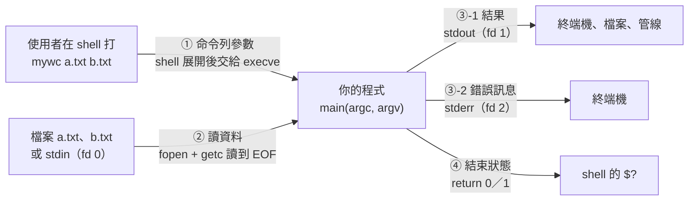
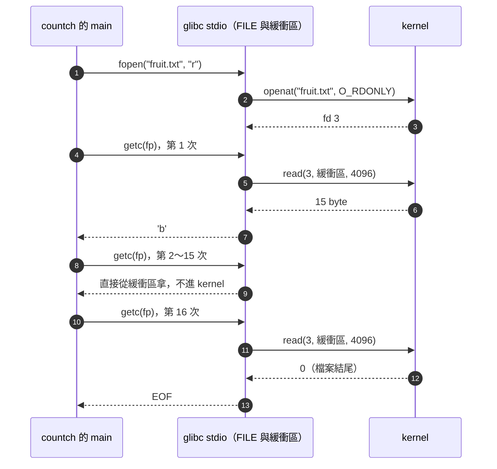

# 寫自己的 `wc` 與 `cat`：命令列參數、讀到 `EOF`，以及 `errno` 錯誤處理

> 課程：[Linux 與系統程式系統化學習](../learning/課程目錄.md#linux-與系統程式系統化學習)｜第 ① 站第 8 課
> 建立日期：2026-10-31
> 情境：第 ① 站的畢業專案是「用 C 寫幾個小工具（`wc`、`cat` 的簡化版）」。前七課學的是程式**怎麼變成**能跑的東西；這一課要寫一支**真正的命令列工具**，
> 所以要先學它跟外界打交道的四個介面：命令列參數（`argc`／`argv`）、讀資料直到 `EOF`、錯誤回報（`errno`、`perror`）、輸出到 `stdout`／`stderr` 與結束狀態。
> 對應教材：K&R《The C Programming Language》第 1.5 節（字元輸入與輸出）、第 5.10 節（命令列參數）、第 7 章（輸入與輸出）、附錄 B1（`<stdio.h>`）；
> CS:APP 第 8.5 節之前的「系統呼叫錯誤處理」小節（`errno` 慣例）。
> 對應檔案：範例原始碼在 [`small-project/s1-08-wc-cat/examples/`](../small-project/s1-08-wc-cat/examples/)（會進 git）；作業寫在 `small-project/s1-08-wc-cat/hw1/`～`hw3/`（使用者自己寫，會進 git）。
> 適用範圍：Ubuntu 24.04、x86-64、gcc 13.3、glibc 2.39、GNU coreutils 9.4（`wc`、`cat`）、strace 6.8；本課的輸出都是本機實測。

**一句話結論：命令列工具只靠四個介面跟外界溝通——`argv` 是 shell 先展開好、交給 `execve` 的字串陣列；資料用 `getc` 一個 byte 一個 byte 讀到 `EOF`（所以接收的變數一定要是 `int`）；失敗時函式用回傳值（`NULL`、`EOF`）告訴你「失敗了」，`errno` 才告訴你「為什麼」；錯誤訊息寫 `stderr`、結果寫 `stdout`，最後用結束狀態告訴呼叫者成功與否。**

---

## 目錄

- [零、開課複習：第 7 課卡住的觀念](#零開課複習第-7-課卡住的觀念)
- [一、本課在做什麼：一支命令列工具的四個介面](#一本課在做什麼一支命令列工具的四個介面)
- [二、命令列參數：`argc` 與 `argv`](#二命令列參數argc-與-argv)
- [三、讀到 `EOF`：`getc` 為什麼回傳 `int`](#三讀到-eofgetc-為什麼回傳-int)
- [四、開檔與錯誤：`fopen`、`errno`、`perror`、`strerror`](#四開檔與錯誤fopenerrnoperrorstrerror)
- [五、`stdout` 與 `stderr`，以及結束狀態](#五stdout-與-stderr以及結束狀態)
- [六、接起來：`countch` 與用 `strace` 看它做了哪些系統呼叫](#六接起來countch-與用-strace-看它做了哪些系統呼叫)
- [七、`wc` 與 `cat` 的精確行為：作業的規格](#七wc-與-cat-的精確行為作業的規格)
- [八、本課用到的函式、工具與完整清單在哪](#八本課用到的函式工具與完整清單在哪)
- [九、動手作業](#九動手作業)
- [自我測驗](#自我測驗)

---

## 零、開課複習：第 7 課卡住的觀念

第 7 課的作業與自我測驗批改後，記成「第 8 課開頭先複習」的觀念如下。這些題目 11-01 的複習（[`review/2026-11-01-函式庫-組語.md`](../review/2026-11-01-函式庫-組語.md)）都會考，這裡只講解、不另外出題。

1. **`mov D(%rip),%rax` 是「讀」那格，不是拿那格的位址**：`%rip` 加 `D` 算出 GOT 那格的位址，`mov` 把那格**裡面裝的值**（變數的位址）讀進 `%rax`；要拿格子本身的位址才用 `lea`。
   出處：[第 7 課第九節第 1 章](./靜態與動態函式庫-ar與.a、-fPIC與.so、執行時怎麼找到.so.md#1-0x2ec8-和-0x3fd0-各是什麼mov-0x2ec8riprax-的兩個數字)。
2. **變數不能延遲綁定**：函式第一次呼叫會先經過 PLT 跳板，跳板有機會叫 `ld.so` 去查；讀變數就是一條 `mov`，中間沒有任何可以插手的地方，所以變數的 GOT 那格一定要在**載入時**就填好。
   出處：[第九節第 4 章](./靜態與動態函式庫-ar與.a、-fPIC與.so、執行時怎麼找到.so.md#4-plt-存函式位址got-存變數位址嗎plt-是跳板以及延遲綁定)。
3. **複製重定位（`R_X86_64_COPY`）**：只在**主程式自己**用到 `.so` 的變數時才發生；`ld` 在執行檔的 `.bss` 留一格（大小照連結時那份 `.so`），`ld.so` 載入時把初值複製進來，之後 `.so` 自己也改讀主程式那份。`.so` 換版後大小不合，`ld.so` 會警告 `has different size`。
   出處：[第九節第 3 章](./靜態與動態函式庫-ar與.a、-fPIC與.so、執行時怎麼找到.so.md#3-主程式只寫-extern-int-counter變數放進執行檔複製重定位)。
4. **填 GOT 的是執行時的 `ld.so`，不是連結時的 `ld`**：`ld` 只在檔案裡寫下「這格要填誰」的重定位紀錄。
5. **`.got.plt` 裡的位址 ＝ 這個行程的載入基底 ＋ 檔案內位置**：兩個行程的基底因 ASLR 不同，所以數字不同；檔案裡看到的值只是初值。
   出處：[第九節第 8 章](./靜態與動態函式庫-ar與.a、-fPIC與.so、執行時怎麼找到.so.md#8-ldso-填進格子的是什麼這個行程裡的虛擬位址)。
6. **寫入時複製讓 `.text` 不能被改**：如果 `ld.so` 把位址直接寫進 `.text`，被寫到的那一頁就會被複製成這個行程自己的一份，不再共用——所以才要把「會變的東西」集中到 GOT。
7. **`--as-needed`**：讀到 `.so` 那一刻，此刻的未定義符號清單裡沒人需要它就丟掉；`-l` 一定要寫在用到它的檔案後面。
   出處：[第九節第 15 章](./靜態與動態函式庫-ar與.a、-fPIC與.so、執行時怎麼找到.so.md#15-ld-還沒讀到-maino怎麼知道誰需要什麼未定義符號清單與---as-needed)。
8. **錯誤出在哪個階段，從第一個會失敗的階段看**：找不到 `.h` 是前處理（`fatal error: xxx.h`），沒給 `-l` 是連結（`undefined reference`），找不到 `.so` 是執行（`error while loading shared libraries`）。
   出處：[第九節第 11 章](./靜態與動態函式庫-ar與.a、-fPIC與.so、執行時怎麼找到.so.md#11-做-so-需要-h-嗎include-管編譯-l-管連結)。

---

## 一、本課在做什麼：一支命令列工具的四個介面

前七課一直在用 `wc`、`cat`、`nm`、`readelf` 這些工具，但都把它們當黑盒子。這一課要自己寫兩支：`mywc`（數行、字、byte）與 `mycat`（把檔案依序印出來）。
寫之前先看一支命令列工具**只透過哪幾個地方**跟外界溝通——寫對這四個介面，你的工具就能像 `wc` 一樣被 shell、管線、腳本使用：



圖要看的重點：程式本身不知道「使用者打了什麼字」「輸出接到哪裡」——它只拿到 ① 一個字串陣列、② 一個可以讀的資料流、③ 兩個可以寫的資料流、④ 回傳一個數字。

| 介面 | 本課的哪一節 | 已經在哪裡學過一部分 |
|---|---|---|
| ① 命令列參數 | [第二節](#二命令列參數argc-與-argv) | 第 5 課在 gdb 裡看過 `main` 的 `%rdi`＝`argc`、`%rsi`＝`argv`（[第 5 課第三節](./x86-64組合語言入門二-call與ret、堆疊框、參數與呼叫慣例.md#三call-與-ret用-gdb-一條一條走)） |
| ② 讀資料 | [第三節](#三讀到-eofgetc-為什麼回傳-int)、[第四節](#四開檔與錯誤fopenerrnoperrorstrerror) | `char` 是 1 byte 的整數、有號（[字元是什麼](./字元是什麼-char就是1byte的整數與ASCII和UTF-8.md#跟第-2-課的連結char-有號讀到中文會變負數)） |
| ③ 輸出與錯誤 | [第五節](#五stdout-與-stderr以及結束狀態) | fd 0／1／2 與重新導向（[輸出重新導向與dev-null](../linux/輸出重新導向與dev-null.md#一三個標準檔案描述符)）、`stdout` 的緩衝（[第 7 課第九節第 14 章](./靜態與動態函式庫-ar與.a、-fPIC與.so、執行時怎麼找到.so.md#14-fflushstdout-是什麼printf-先寫進緩衝區)） |
| ④ 結束狀態 | [第五節](#五stdout-與-stderr以及結束狀態) | `return` 的值變成 `$?`（[分號與結束狀態](../linux/分號與結束狀態-命令串接與錢字號問號.md#三結束狀態0255-這個數字從哪來)） |

**跟主線的位置**：第 ① 站的最後一塊。下一站 ② 行程會把這張圖的每個箭頭拆開——`execve` 怎麼把 `argv` 放上堆疊、fd 是什麼、`$?` 是怎麼從子行程傳回 shell 的。這一課先從「程式這一邊」把它們用對。

---

## 二、命令列參數：`argc` 與 `argv`

### `main` 的兩個參數

```c
int main(int argc, char *argv[])
```

| 位置 | 型別 | 是什麼 |
|---|---|---|
| `argc` | `int` | argument count，參數的**個數**，**包含程式名稱本身**，所以至少是 1 |
| `argv` | `char *argv[]`（等於 `char **argv`） | argument vector，一個陣列，每一格是一個指向字串的指標；`argv[0]` 是程式名稱，`argv[1]`～`argv[argc-1]` 是使用者給的參數，**`argv[argc]` 固定是 `NULL`** |

`char *argv[]` 寫在參數列裡時就是 `char **argv`（陣列當參數會退化成指標，[第 3 課第三節](./陣列、字串與指標運算-C不檢查邊界與用gdb找segfault.md#三陣列名稱什麼時候變成指標什麼時候不會)〈函式參數寫成 `int a[]`，其實就是 `int *a`〉），兩種寫法完全一樣。名字 `argc`／`argv` 只是慣例，叫別的也可以，但大家都這樣寫。

### 實驗：把 `argv` 一格一格印出來

`args.c`（檔案：[`args.c`](../small-project/s1-08-wc-cat/examples/args/args.c)）完整原始碼：

```c
#include <stdio.h>

int main(int argc, char *argv[])
{
    printf("argc = %d\n", argc);
    for (int i = 0; i < argc; i++)
        printf("argv[%d] = \"%s\"\n", i, argv[i]);
    printf("argv[%d] = %p\n", argc, (void *)argv[argc]);   /* 最後一格固定是 NULL */
    return 0;
}
```

編譯與執行（資料夾裡先放兩個空檔 `a.txt`、`b.txt`）：

```text
$ gcc -Wall args.c -o args
$ touch a.txt b.txt
$ ./args
argc = 1
argv[0] = "./args"
argv[1] = (nil)
$ ./args hello "two words" '*.txt' *.txt -
argc = 7
argv[0] = "./args"
argv[1] = "hello"
argv[2] = "two words"
argv[3] = "*.txt"
argv[4] = "a.txt"
argv[5] = "b.txt"
argv[6] = "-"
argv[7] = (nil)
$ ./args ""
argc = 2
argv[0] = "./args"
argv[1] = ""
argv[2] = (nil)
```

逐行看：

- **不帶參數時 `argc` 是 1**：`argv[0]` 是 `"./args"`，就是你在 shell 打的那個字串（用完整路徑執行，`argv[0]` 就是完整路徑）。`argv[1]` 已經是 `NULL`（印成 `(nil)`）。
- **`"two words"` 是一格**：shell 用空白切參數，引號裡的空白不切。程式拿到的字串裡**沒有引號**——引號是給 shell 看的，shell 用完就拿掉了。
- **`'*.txt'` 和 `*.txt` 不一樣**：單引號裡的 `*.txt` 原樣傳進來；沒加引號的 `*.txt` 被 shell **換成**符合的檔名 `a.txt`、`b.txt`，程式拿到的是兩格，根本看不到 `*`。
- **`-` 只是一個普通字串**：`wc -`、`cat -` 的「`-` 代表標準輸入」是**程式自己**看到 `argv[i]` 是 `"-"` 才決定的慣例，shell 不管。作業要自己處理。
- **`""` 也算一格**：空字串的參數，`argc` 照樣加 1。

### 誰把 `*.txt` 換成檔名：shell，在 `execve` 之前

用 `strace` 只看 `execve`（第 1 課用過的「啟動一支程式」的系統呼叫）：

```text
$ strace -e trace=execve ./args '*.txt' *.txt
execve("./args", ["./args", "*.txt", "a.txt", "b.txt"], 0x7fff540f5dc8 /* 91 vars */) = 0
```

`execve` 的第二個參數就是**已經展開好的字串陣列**——shell 先展開萬用字元（glob）、處理引號、切好每一格，再把這個陣列交給 kernel，kernel 放到新程式的堆疊上，C 的啟動程式碼再把它交給 `main` 當 `argv`。所以**程式沒有辦法知道使用者原本打的是 `*.txt` 還是 `a.txt b.txt`**。

沒有任何檔案符合時，bash 和 zsh 的處理不一樣（在一個空資料夾裡跑）：

```text
$ bash -c '../args *.txt; echo "exit=$?"'
argc = 2
argv[0] = "../args"
argv[1] = "*.txt"
argv[2] = (nil)
exit=0
$ zsh -c '../args *.txt; echo "exit=$?"'
zsh:1: no matches found: *.txt
exit=1
```

- **bash**：沒有符合的就把 `*.txt` 原樣傳進去，程式會收到一個叫 `*.txt` 的參數（`wc *.txt` 因此會說 `wc: '*.txt': No such file or directory`）。
- **zsh**（本機的登入 shell 是 `/usr/bin/zsh`）：預設直接報錯 `no matches found`，**程式根本沒有被執行**，`exit=1` 是 zsh 自己給的。

圖：`./args hello "two words"` 時 `argv` 在記憶體裡的樣子（位址是通用名字，不是實測值）：

```text
argv ──▶ ┌──────────┐
         │ argv[0] ─┼──▶ "./args\0"
         ├──────────┤
         │ argv[1] ─┼──▶ "hello\0"
         ├──────────┤
         │ argv[2] ─┼──▶ "two words\0"
         ├──────────┤
         │ argv[3]  │  = NULL   ← argv[argc]，迴圈也可以用「走到 NULL 為止」來停
         └──────────┘
  每一格是 8 byte 的指標（char *），字串本身在別的地方，各自以 '\0' 結尾
```

圖要看的重點：`argv` 是「指標的陣列」，不是一大串字；每個參數是獨立的 C 字串，所以 `argv[2][0]` 是 `'t'`、`argv[2][3]` 是 `' '`。

---

## 三、讀到 `EOF`：`getc` 為什麼回傳 `int`

### 一次讀一個 byte：`getchar`、`getc`

| 函式 | 宣告（`<stdio.h>`） | 做什麼 |
|---|---|---|
| `getchar` | `int getchar(void);` | 從標準輸入（`stdin`）讀一個 byte |
| `getc` | `int getc(FILE *stream);` | 從指定的 `FILE`（例如 `fopen` 打開的檔案）讀一個 byte；`getc(stdin)` 等於 `getchar()` |
| `fgetc` | `int fgetc(FILE *stream);` | 跟 `getc` 一樣；差別是 `getc` 允許被實作成巨集（macro），`fgetc` 一定是真的函式 |
| `putchar` | `int putchar(int c);` | 把一個 byte 寫到 `stdout` |
| `putc`／`fputc` | `int putc(int c, FILE *stream);` | 把一個 byte 寫到指定的 `FILE`（例如 `stdout`、`stderr`）；兩者的差別同 `getc`／`fgetc` |

**回傳值**：讀到東西時回傳那個 byte 的值，範圍 **0～255**（當成 `unsigned char` 再轉成 `int`）；**沒有東西可讀了**（讀完、或出錯）回傳 `EOF`。
`EOF`（End Of File）是 `<stdio.h>` 定義的巨集，glibc 是 **−1**。

所以 `getchar` 有 **257 種**可能的回傳值：256 種 byte ＋ 1 個 `EOF`。`char` 只有 256 種值，**裝不下**——這就是它回傳 `int` 的原因。

### 實驗：數 `stdin` 有幾個 byte

`getbytes.c`（檔案：[`getbytes.c`](../small-project/s1-08-wc-cat/examples/eof/getbytes.c)）完整原始碼：

```c
#include <stdio.h>

int main(void)
{
    int c;                 /* 一定要用 int：要裝得下 0～255 再加上 EOF */
    long n = 0;

    while ((c = getchar()) != EOF)
        n++;
    printf("讀到 %ld 個 byte，EOF = %d\n", n, EOF);
    return 0;
}
```

`while ((c = getchar()) != EOF)` 拆開讀：先呼叫 `getchar()`，把回傳值存進 `c`，整個 `(c = getchar())` 的值就是剛存進去的值，再拿它跟 `EOF` 比。**外層括號不能省**：`c = getchar() != EOF` 會因為 `!=` 優先順序比 `=` 高，變成把「比較的結果（0 或 1）」存進 `c`。

準備一個 5 byte 的檔案，中間有一個 `0xff`（`printf` 的 `\xff` 寫出一個值是 255 的 byte）：

```text
$ gcc -Wall getbytes.c -o getbytes
$ printf 'AB\xffCD' > ff.bin
$ od -An -tx1 ff.bin
 41 42 ff 43 44
$ ./getbytes < ff.bin
讀到 5 個 byte，EOF = -1
$ printf 'hello\n' | ./getbytes
讀到 6 個 byte，EOF = -1
$ ./getbytes < /dev/null
讀到 0 個 byte，EOF = -1
```

- `< ff.bin`：shell 把檔案接到程式的 `stdin`（fd 0），程式完全不知道檔名，只是從 `stdin` 讀。
- `printf 'hello\n' |`：管線把前一個程式的輸出接到 `stdin`，`\n` 也是 1 byte，所以是 6。
- `/dev/null`：讀它立刻就是檔案結尾，第一次 `getchar()` 就回傳 `EOF`。
- 從鍵盤輸入時，在一行開頭按 **Ctrl-D**，終端機會讓這次 `read` 回傳 0 個 byte，`getchar` 因此回傳 `EOF`（這裡需要互動的終端機，**未實測**；終端機的行為在 [PTY是什麼](../linux/PTY是什麼-終端機模擬器與虛擬終端.md) 有講）。

### 錯誤示範：用 `char` 接 `getchar()`

`charbug.c`（檔案：[`charbug.c`](../small-project/s1-08-wc-cat/examples/eof/charbug.c)）只差一個型別：

```c
#include <stdio.h>

int main(void)
{
    char c;                /* 錯誤示範：用 char 裝 getchar() 的回傳值 */
    long n = 0;

    while ((c = getchar()) != EOF)
        n++;
    printf("讀到 %ld 個 byte\n", n);
    return 0;
}
```

分別用預設（x86-64 上 `char` 是**有號**的）和 `-funsigned-char`（讓 `char` 變成無號，ARM 上的 Linux 預設就是這樣）編：

```text
$ gcc -Wall charbug.c -o charbug
$ gcc -Wall -funsigned-char charbug.c -o charbug_u
$ ./charbug < ff.bin
讀到 2 個 byte
$ timeout 2 ./charbug_u < ff.bin; echo "exit=$?"
exit=124
```

（兩個都沒有警告：`-Wall` 抓不到這個錯。`timeout 2` 是 2 秒後砍掉程式，被砍時 `timeout` 回傳 124。）

| 版本 | 讀到 `0xff` 時 | 讀到檔案結尾時 | 結果 |
|---|---|---|---|
| `int c`（`getbytes`） | `c` ＝ 255，≠ −1，繼續 | `c` ＝ −1，＝ `EOF`，停 | 正確：5 個 |
| 有號 `char c`（`charbug`） | 255 存進有號 `char` 變成 **−1**；比較時 `c` 升成 `int` 還是 −1，**＝ `EOF`，提早停** | （到不了） | 錯：只數到 `A`、`B` 兩個 |
| 無號 `char c`（`charbug_u`） | 255 存進無號 `char` 還是 255，繼續 | `EOF`（−1）存進無號 `char` 變成 **255**；比較時是 255 ≠ −1，**永遠不等於 `EOF`** | 錯：無窮迴圈，`getchar` 一直回傳 `EOF`、一直被當成 255 |

為什麼 255 存進有號 `char` 會變 −1：`char` 只有 8 位元，255 的位元是 `11111111`，當有號數讀就是 −1（二補數，[第 2 課第五節](./C的資料在記憶體裡長怎樣-位元組、指標、位元組順序與有號無號.md#五有號整數二補數)；存進比較小的型別只留低位元，[第 2 課第六節](./C的資料在記憶體裡長怎樣-位元組、指標、位元組順序與有號無號.md#六有號與無號之間的轉換位元不變換個讀法)）。`EOF` 的 −1 存進 8 位元也是 `11111111`——**一旦存進 `char`，「byte 255」和「`EOF`」就變成同一個位元樣式，再也分不出來**。用 `int` 接，兩者是 `0x000000ff` 和 `0xffffffff`，不會混。

這個錯在純文字（ASCII）檔案上不會出現，因為 ASCII 的值都 ≤ 127；但中文的 UTF-8 會出現 0x80～0xff 的 byte（[字元是什麼〈`char` 有號，讀到中文會變負數〉](./字元是什麼-char就是1byte的整數與ASCII和UTF-8.md#跟第-2-課的連結char-有號讀到中文會變負數)），二進位檔更是什麼值都有。

---

## 四、開檔與錯誤：`fopen`、`errno`、`perror`、`strerror`

### `fopen`：打開檔案，拿到一個 `FILE *`

```c
FILE *fopen(const char *pathname, const char *mode);
int fclose(FILE *stream);
```

| 位置 | 是什麼 |
|---|---|
| `pathname` | 檔案路徑字串，例如 `argv[1]` |
| `mode` | 開啟模式字串，本課只用 `"r"`（讀）；全部的模式見[第八節](#八本課用到的函式工具與完整清單在哪)〈`fopen` 的模式〉 |
| 回傳值 | 成功：一個 `FILE *`，之後傳給 `getc`、`fclose`；**失敗：`NULL`，並且設定 `errno`** |

`FILE` 是 stdio 用來記住「這個檔案讀到哪、緩衝區在哪」的結構；`stdin`、`stdout`、`stderr` 也是 `FILE *`，程式開始時就已經打開好了，不用 `fopen`。用完的檔案要 `fclose`：它會把還沒寫出去的緩衝區寫出去、釋放 `FILE`，並關掉底下的檔案描述符（fd）。

### 錯誤回報的慣例：回傳值說「失敗了」，`errno` 說「為什麼」

C 函式庫與系統呼叫幾乎都用同一套慣例（`man 3 errno`）：

1. **函式用回傳值表示失敗**：`fopen` 回傳 `NULL`、`getc` 回傳 `EOF`、系統呼叫回傳 −1。每個函式的失敗回傳值不同，要看它的 man page 的 RETURN VALUE 一節。
2. **失敗時把原因寫進 `errno`**：`errno` 是 `<errno.h>` 宣告的一個整數（glibc 裡每個執行緒各一份），值是 `ENOENT`（2）、`EACCES`（13）這種錯誤碼。
3. **成功時不保證動 `errno`**：所以 `errno` 只有在「回傳值說失敗了」之後**馬上**讀才有意義。

把錯誤碼翻成文字的兩個函式：

| 函式 | 宣告 | 做什麼 |
|---|---|---|
| `strerror` | `char *strerror(int errnum);`（`<string.h>`） | 回傳錯誤碼對應的說明字串，例如 `strerror(2)` → `"No such file or directory"`；**不印**，要自己印 |
| `perror` | `void perror(const char *s);`（`<stdio.h>`） | 把 `s`、`": "`、`strerror(errno)`、換行**印到 `stderr`**；`s` 是 `NULL` 或空字串時只印說明字串 |

### 實驗：四種開檔結果

`openfail.c`（檔案：[`openfail.c`](../small-project/s1-08-wc-cat/examples/errno/openfail.c)）完整原始碼：

```c
#include <errno.h>
#include <stdio.h>
#include <string.h>

int main(int argc, char *argv[])
{
    if (argc != 2) {
        fprintf(stderr, "用法：%s 檔名\n", argv[0]);
        return 2;
    }

    FILE *fp = fopen(argv[1], "r");
    if (fp == NULL) {
        int saved = errno;                       /* 先存起來：之後呼叫的函式可能改掉 errno */
        printf("fopen 失敗：errno = %d\n", saved);
        printf("strerror(errno) = \"%s\"\n", strerror(saved));
        errno = saved;
        perror(argv[1]);                         /* 印到 stderr：「<參數>: <strerror 的字串>」 */
        return 1;
    }

    int c = getc(fp);
    if (c == EOF && ferror(fp))                  /* EOF 有兩種原因：讀完了，或出錯了 */
        perror("getc");
    else
        printf("第一個 byte 讀到了：%d\n", c);
    fclose(fp);
    return 0;
}
```

準備四種情況：不存在的檔案、沒有讀取權限的檔案（`chmod 000`，**用一般使用者跑**；root 不受權限限制，會讀得到）、一個目錄、一個正常檔案：

```sh
gcc -Wall openfail.c -o openfail
echo hi > ok.txt
echo secret > locked.txt && chmod 000 locked.txt
mkdir adir
```

在終端機上執行（輸出直接顯示在終端機）：

```text
$ ./openfail nofile.txt; echo "exit=$?"
fopen 失敗：errno = 2
strerror(errno) = "No such file or directory"
nofile.txt: No such file or directory
exit=1
$ ./openfail locked.txt; echo "exit=$?"
fopen 失敗：errno = 13
strerror(errno) = "Permission denied"
locked.txt: Permission denied
exit=1
$ ./openfail adir; echo "exit=$?"
getc: Is a directory
exit=0
$ ./openfail ok.txt; echo "exit=$?"
第一個 byte 讀到了：104
exit=0
$ ./openfail ''; echo "exit=$?"
fopen 失敗：errno = 2
strerror(errno) = "No such file or directory"
No such file or directory
exit=1
$ ./openfail; echo "exit=$?"
用法：./openfail 檔名
exit=2
```

逐個看：

- **`nofile.txt`**：`errno` ＝ 2，名字是 `ENOENT`（Error NO ENTry，沒有這個目錄項目）。`perror(argv[1])` 印出「`nofile.txt: No such file or directory`」——**把檔名放在前面**，使用者才知道是哪個檔案出錯；`wc`、`cat` 的錯誤訊息也是這個格式，只是前面再加程式名稱（`wc: nofile.txt: …`）。
- **`locked.txt`**：`errno` ＝ 13，`EACCES`（ACCESS denied）。檔案存在，但沒有讀取權限。
- **`adir`**：**`fopen` 成功了**——打開目錄來讀，kernel 允許；是第一次真的讀（`getc` 底下的 `read` 系統呼叫）才失敗，`errno` ＝ 21，`EISDIR`（Is a directory）。所以**錯誤不一定發生在開檔，讀的時候也要檢查**。這支程式在這裡印了訊息卻回傳 0，是範例偷懶，作業不能這樣。
- **`ok.txt`**：第一個 byte 是 `'h'` ＝ 104。
- **`''`（空字串）**：空的路徑一樣是 `ENOENT`；`perror` 的參數是空字串，所以只印說明，前面沒有「`: `」。
- **沒給參數**：程式自己檢查 `argc`，用法錯誤印到 `stderr`、回傳 2（命令列工具常用 2 表示「用法錯誤」，跟「執行失敗」的 1 分開）。

`errno` 的值是 kernel 給的。用 `strace` 看 `nofile.txt` 那次的系統呼叫（`openat` 是 `fopen` 底下真正開檔的系統呼叫，下一節再看）：

```text
$ strace ./countch nofile.txt n 2>&1 | grep -E 'nofile|write'
openat(AT_FDCWD, "nofile.txt", O_RDONLY) = -1 ENOENT (No such file or directory)
write(2, "nofile.txt: No such file or dire"..., 38) = 38
```

kernel 讓 `openat` 回傳 −1 並帶回 `ENOENT`；glibc 把 `ENOENT` 存進 `errno`、讓 `fopen` 回傳 `NULL`；`perror` 讀 `errno`，用 `write(2, …)` 寫到 fd 2，也就是 `stderr`。（`countch` 是[第六節](#六接起來countch-與用-strace-看它做了哪些系統呼叫)的範例，開檔失敗的處理跟 `openfail` 一樣。）

### 實驗：成功的呼叫不會把 `errno` 清成 0

`stale.c`（檔案：[`stale.c`](../small-project/s1-08-wc-cat/examples/errno/stale.c)，跟 `openfail` 放在同一個資料夾，用到同一個 `ok.txt`）完整原始碼：

```c
#include <errno.h>
#include <stdio.h>
#include <string.h>

int main(void)
{
    FILE *bad = fopen("nofile.txt", "r");      /* 失敗：設 errno */
    printf("失敗之後：bad = %p, errno = %d\n", (void *)bad, errno);

    FILE *good = fopen("ok.txt", "r");         /* 成功：不會把 errno 清成 0 */
    printf("成功之後：good = %p, errno = %d (%s)\n", (void *)good, errno, strerror(errno));

    errno = 0;                                 /* 要拿 errno 判斷，得自己先清 */
    FILE *good2 = fopen("ok.txt", "r");
    printf("先清 0 再成功：errno = %d\n", errno);

    fclose(good);
    fclose(good2);
    return 0;
}
```

```text
$ gcc -Wall stale.c -o stale && ./stale
失敗之後：bad = (nil), errno = 2
成功之後：good = 0x612d78eab2a0, errno = 2 (No such file or directory)
先清 0 再成功：errno = 0
```

第二行是重點：`good` 明明開成功了，`errno` 卻還是 2——那是**上一次失敗留下來的**。如果寫成「`fopen` 之後看 `errno` 是不是 0 來判斷成功」，這裡就會誤判成失敗。所以：

- **先看回傳值**（`NULL`、`EOF`、−1）判斷有沒有失敗，失敗了才去讀 `errno`；
- 讀 `errno` 要**緊接在**失敗的呼叫後面。中間呼叫的任何函式（包括 `printf`）都可能在內部失敗又成功、改掉 `errno`。`openfail.c` 先把 `errno` 存進 `saved`、印完再放回去給 `perror` 用，就是這個原因；只呼叫一次 `perror` 的話，直接緊接著呼叫就好。
- 少數函式只能靠 `errno` 判斷（回傳值沒有專門表示失敗的值），這時才要先 `errno = 0` 再呼叫——第三行示範的就是這個寫法。本課的函式都不需要。

### `EOF` 有兩種意思：讀完了，或出錯了

`getc` 回傳 `EOF` 時有兩種可能：**真的讀到檔案結尾**，或者**讀的時候出錯**（例如上面的目錄 `EISDIR`、磁碟讀取錯誤 `EIO`）。迴圈 `while ((c = getc(fp)) != EOF)` 兩種情況都會停，停下來之後要問 `FILE` 自己：

| 函式 | 宣告 | 回傳 |
|---|---|---|
| `ferror` | `int ferror(FILE *stream);` | 這個 `FILE` 發生過讀寫錯誤 → 非 0 |
| `feof` | `int feof(FILE *stream);` | 這個 `FILE` 讀到過檔案結尾 → 非 0 |
| `clearerr` | `void clearerr(FILE *stream);` | 把上面兩個記號都清掉 |

所以讀檔迴圈的標準寫法是：迴圈照常用 `!= EOF` 停，**停下來之後用 `ferror` 檢查**，是錯誤就回報、算失敗。`openfail.c` 的 `if (c == EOF && ferror(fp))` 就是這樣分辨出「目錄讀不了」和「空檔案」。

### 本課會遇到的錯誤碼

本機 glibc 定義了 **131 個**錯誤碼，下表只列本課（開檔、讀寫檔）會遇到的 9 個。全部 131 個可以用下面的 `errlist.c` 印出來，或看 `man 3 errno`。

| 錯誤碼 | 值 | `strerror` 的字串 | 什麼時候會遇到 |
|---|---|---|---|
| `ENOENT` | 2 | No such file or directory | 檔案或路徑中的某個目錄不存在、空字串路徑 |
| `EIO` | 5 | Input/output error | 硬體讀寫錯誤 |
| `EBADF` | 9 | Bad file descriptor | 對已經關掉的 fd 讀寫 |
| `EACCES` | 13 | Permission denied | 沒有讀取（或路徑上目錄的進入）權限 |
| `ENOTDIR` | 20 | Not a directory | 路徑中間有一段不是目錄，例如 `ok.txt/x` |
| `EISDIR` | 21 | Is a directory | 對目錄 `read` |
| `EMFILE` | 24 | Too many open files | 這個行程打開的檔案太多（忘了 `fclose` 會累積） |
| `ENOSPC` | 28 | No space left on device | 寫入時磁碟滿了 |
| `EPIPE` | 32 | Broken pipe | 寫到一個讀的那端已經關掉的管線（第 ② 站會遇到） |

`errlist.c`（檔案：[`errlist.c`](../small-project/s1-08-wc-cat/examples/errno/errlist.c)）完整原始碼：

```c
#define _GNU_SOURCE            /* strerrorname_np 是 GNU 擴充 */
#include <stdio.h>
#include <string.h>

int main(void)
{
    for (int e = 1; e < 200; e++) {
        const char *name = strerrorname_np(e);
        if (name != NULL)
            printf("%3d  %-16s %s\n", e, name, strerror(e));
    }
    return 0;
}
```

```text
$ gcc -Wall errlist.c -o errlist && ./errlist | wc -l
131
$ ./errlist | head -5
  1  EPERM            Operation not permitted
  2  ENOENT           No such file or directory
  3  ESRCH            No such process
  4  EINTR            Interrupted system call
  5  EIO              Input/output error
```

（`strerrorname_np` 回傳錯誤碼的**名字**，`np` 是 non-portable，只有 glibc 有；`#define _GNU_SOURCE` 要寫在所有 `#include` 前面才能用 GNU 擴充。）

---

## 五、`stdout` 與 `stderr`，以及結束狀態

### 結果寫 `stdout`，錯誤寫 `stderr`

`perror` 固定寫到 `stderr`；自己印錯誤訊息時用 `fprintf(stderr, ...)`（`fprintf` 跟 `printf` 一樣，只是第一個參數指定寫到哪個 `FILE`）。分開的理由是**使用者重新導向時，兩者會被分到不同地方**：

```text
$ ./openfail nofile.txt > out.txt 2> err.txt
$ cat out.txt
fopen 失敗：errno = 2
strerror(errno) = "No such file or directory"
$ cat err.txt
nofile.txt: No such file or directory
$ ./openfail nofile.txt 2>/dev/null; echo "exit=$?"
fopen 失敗：errno = 2
strerror(errno) = "No such file or directory"
exit=1
```

- `> out.txt` 只導 fd 1（`stdout`），`2> err.txt` 導 fd 2（`stderr`）。語法逐字拆解見 [輸出重新導向與dev-null](../linux/輸出重新導向與dev-null.md#三重新導向語法逐字拆解)。
- 想像 `mywc *.txt > report.txt`：如果錯誤訊息也寫 `stdout`，`report.txt` 裡就會混進「`nofile.txt: No such file or directory`」，下一個讀 `report.txt` 的程式會把它當成資料；使用者自己反而在終端機上看不到出錯。錯誤寫 `stderr`，報告乾淨、錯誤照樣顯示在終端機上。

### 輸出順序為什麼會變：`stdout` 有緩衝、`stderr` 沒有

同一個 `./openfail nofile.txt`，輸出接到管線時順序不一樣：

```text
$ ./openfail nofile.txt 2>&1 | cat
nofile.txt: No such file or directory
fopen 失敗：errno = 2
strerror(errno) = "No such file or directory"
```

`stderr` 那行跑到最前面了。原因是第 7 課課後討論學過的緩衝（[第 7 課第九節第 14 章](./靜態與動態函式庫-ar與.a、-fPIC與.so、執行時怎麼找到.so.md#14-fflushstdout-是什麼printf-先寫進緩衝區)）：`stdout` 接到管線時是**全緩衝**，兩行 `printf` 先存在緩衝區，`return` 時才寫出去；`stderr` **不緩衝**，`perror` 馬上寫。接到終端機時 `stdout` 是行緩衝，每遇到 `\n` 就寫，所以看到的是程式裡的順序。
這不影響正確性（各自的內容都對），只是提醒：**不要靠兩個資料流的相對順序**，作業比對輸出時要分開比。

### 結束狀態：`return` 的值

`main` 回傳的數字就是結束狀態，shell 用 `$?` 看得到（[分號與結束狀態〈程式自己決定〉](../linux/分號與結束狀態-命令串接與錢字號問號.md#程式自己決定return-或-exit-的值)）。命令列工具的慣例：

| 結束狀態 | 意思 | 例子 |
|---|---|---|
| 0 | 全部成功 | `wc one.txt` |
| 1 | 執行時有失敗（但可能已經處理了一部分） | `wc one.txt nofile.txt`：印了 `one.txt` 的結果，結束狀態仍是 1 |
| 2 | 用法錯誤（參數不對），通常什麼都沒做 | `openfail` 沒給檔名；`ls --bogus`、`grep --bogus x` 都回傳 2 |

「用法錯誤回 2」只是慣例，不是每個工具都遵守：本機 `wc --bogus`、`cat --bogus` 印出 `unrecognized option` 後回傳的是 **1**（GNU coreutils 的 `wc`、`cat` 不分「用法錯誤」和「執行失敗」）。所以判斷別人的工具時要看它的 man page 的 EXIT STATUS 一節；自己寫的工具則照自己的規格（作業的規格寫在題目裡）。

`<stdlib.h>` 另外定義了 `EXIT_SUCCESS`（0）和 `EXIT_FAILURE`（1），寫 `return EXIT_FAILURE;` 跟 `return 1;` 在 Linux 上一樣。在 `main` 以外的函式裡要直接結束程式，用 `exit(1)`——它跟 `main` 裡的 `return 1` 一樣會先把緩衝區寫出去。

**為什麼 `wc`、`cat` 遇到一個壞檔案不馬上停**：使用者打 `wc *.txt`，其中一個檔案沒有權限，他要的還是其他檔案的結果。所以這些工具的做法是：**每個檔案各自處理，壞的印錯誤到 `stderr`、記下「有失敗過」，繼續下一個；全部做完，有失敗過就回傳 1**。腳本用 `if wc ... ; then` 判斷時，才知道結果不完整。第七節的實測會看到 `wc` 和 `cat` 都是這樣。

---

## 六、接起來：`countch` 與用 `strace` 看它做了哪些系統呼叫

把前三節組合成一支完整的小工具：數一個檔案裡某個字元出現幾次。它**只處理一個檔案、一個字元**，作業的 `mywc`、`mycat` 要處理多個檔案、標準輸入、總計，比它多很多。

`countch.c`（檔案：[`countch.c`](../small-project/s1-08-wc-cat/examples/countch/countch.c)）完整原始碼：

```c
#include <stdio.h>

/* 用法：./countch 檔名 字元 —— 數這個檔案裡有幾個該字元 */
int main(int argc, char *argv[])
{
    if (argc != 3 || argv[2][0] == '\0' || argv[2][1] != '\0') {
        fprintf(stderr, "用法：%s 檔名 單一字元\n", argv[0]);
        return 2;
    }

    FILE *fp = fopen(argv[1], "r");
    if (fp == NULL) {
        perror(argv[1]);
        return 1;
    }

    int target = (unsigned char)argv[2][0];
    long hits = 0;
    int c;
    while ((c = getc(fp)) != EOF)
        if (c == target)
            hits++;

    if (ferror(fp)) {                 /* 迴圈停下來，是讀完了還是出錯？ */
        perror(argv[1]);
        fclose(fp);
        return 1;
    }
    fclose(fp);

    printf("%ld %s\n", hits, argv[1]);
    return 0;
}
```

幾個細節：

- `argv[2][0] == '\0' || argv[2][1] != '\0'`：第二個參數要**剛好一個字元**——第 0 個不是結尾（不是空字串）、第 1 個是結尾。
- `(unsigned char)argv[2][0]`：`getc` 回傳的是 0～255，`argv` 的 `char` 卻是有號的；要比較就先把它轉成同一個範圍，不然搜中文的 byte（≥ 0x80）會變成負數，永遠比不到。
- 讀完先檢查 `ferror`，再 `fclose`；錯誤路徑也要 `fclose`。

```text
$ gcc -Wall countch.c -o countch
$ printf 'banana\nbandana\n' > fruit.txt
$ ./countch fruit.txt a; echo "exit=$?"
6 fruit.txt
exit=0
$ ./countch nofile.txt a; echo "exit=$?"
nofile.txt: No such file or directory
exit=1
$ ./countch fruit.txt ab; echo "exit=$?"
用法：./countch 檔名 單一字元
exit=2
$ ./countch adir a; echo "exit=$?"
adir: Is a directory
exit=1
```

（`adir` 是上一節建的目錄；這次 `fopen` 成功、`getc` 失敗，靠 `ferror` 抓到，回傳 1。）

### 用 `strace` 看 `fopen`、`getc`、`printf` 底下是哪些系統呼叫

`strace -o tr.txt` 把追蹤結果寫進檔案（不跟程式的輸出混在一起），再挑出跟這個檔案有關的那幾行（前面還有幾十行是 `ld.so` 載入 `libc.so.6`，第 1 課看過，這裡略過）：

```text
$ strace -o tr.txt ./countch fruit.txt n
4 fruit.txt
$ sed -n '1p;33,41p' tr.txt
execve("./countch", ["./countch", "fruit.txt", "n"], 0x7fff17e93a30 /* 91 vars */) = 0
openat(AT_FDCWD, "fruit.txt", O_RDONLY) = 3
fstat(3, {st_mode=S_IFREG|0664, st_size=15, ...}) = 0
read(3, "banana\nbandana\n", 4096)      = 15
read(3, "", 4096)                       = 0
close(3)                                = 0
fstat(1, {st_mode=S_IFREG|0664, st_size=0, ...}) = 0
write(1, "4 fruit.txt\n", 12)           = 12
exit_group(0)                           = ?
+++ exited with 0 +++
```

| C 這邊 | 系統呼叫 | 說明 |
|---|---|---|
| shell 執行程式 | `execve(..., ["./countch", "fruit.txt", "n"], ...)` | 第二節講的 `argv` 陣列 |
| `fopen(argv[1], "r")` | `openat(..., "fruit.txt", O_RDONLY) = 3` | kernel 回傳 **fd 3**（0、1、2 已經被 `stdin`、`stdout`、`stderr` 用掉）；`"r"` 變成 `O_RDONLY` |
| 第一次 `getc` | `fstat(3, ...)`、`read(3, ..., 4096) = 15` | stdio 先問檔案資訊來決定緩衝區大小，然後**一次讀 4096 byte** 進緩衝區；這個檔案只有 15 byte，全部讀進來 |
| 之後 14 次 `getc` | （沒有系統呼叫） | 直接從緩衝區拿，不進 kernel |
| 第 16 次 `getc` | `read(3, ..., 4096) = 0` | 緩衝區用完再讀，`read` 回傳 **0 表示檔案結尾** → `getc` 回傳 `EOF` |
| `fclose(fp)` | `close(3)` | |
| `printf` → `return 0` | `fstat(1, ...)`、`write(1, "4 fruit.txt\n", 12)` | 第一次寫 `stdout` 時 stdio 先 `fstat(1)` 看它接到什麼；這次實測是在不是終端機的環境跑（`S_IFREG`：一般檔案），所以是全緩衝、`return` 時才寫出去。在終端機上跑會看到 `S_IFCHR`（字元裝置），行緩衝，遇到 `\n` 就寫 |

（`n` 在 `banana` 裡 2 個、`bandana` 裡 2 個，所以是 4。）

圖：`countch` 讀檔時誰呼叫誰（位址、大小對應上面的 `strace` 輸出）：



圖要看的重點：`getc` 是「一次一個 byte」的**介面**，但底下的系統呼叫是「一次一大塊」。所以作業用 `getc` 一個一個讀，速度不會因為呼叫次數多而慢到哪去。讀一個 10000 byte 的檔案，`read` 只會被呼叫 4 次（4096 ＋ 4096 ＋ 1808 ＋ 0）：

```text
$ head -c 10000 /dev/zero > big.bin
$ strace -e trace=read ./countch big.bin x 2>&1 | grep -v ELF
read(3, "\0\0\0\0\0\0\0\0\0\0\0\0\0\0\0\0\0\0\0\0\0\0\0\0\0\0\0\0\0\0\0\0"..., 4096) = 4096
read(3, "\0\0\0\0\0\0\0\0\0\0\0\0\0\0\0\0\0\0\0\0\0\0\0\0\0\0\0\0\0\0\0\0"..., 4096) = 4096
read(3, "\0\0\0\0\0\0\0\0\0\0\0\0\0\0\0\0\0\0\0\0\0\0\0\0\0\0\0\0\0\0\0\0"..., 4096) = 1808
read(3, "", 4096)                       = 0
0 big.bin
+++ exited with 0 +++
```

（`grep -v ELF` 去掉 `ld.so` 讀 `libc.so.6` 檔頭的那一行。）緩衝區該多大、不經過 stdio 直接用 `read`／`write` 會怎樣，是第 ⑤ 站（檔案與 I/O）的主題；這一課只要知道 `getc` 底下有緩衝區、`read` 回傳 0 就是檔案結尾。

---

## 七、`wc` 與 `cat` 的精確行為：作業的規格

作業要寫出跟 GNU `wc`、`cat` 行為一致的簡化版。這一節用實測把「一致」講清楚。測試檔都用 `printf` 建（`od -c` 把每個 byte 印出來，`\n` 是換行、`\t` 是 tab）：

```text
$ printf 'hello world\n' > one.txt
$ printf 'no newline at end' > nonl.txt
$ printf '  lots   of\t\tspace  \n\n\nend\n' > spaces.txt
$ : > empty.txt
$ od -c spaces.txt
0000000           l   o   t   s               o   f  \t  \t   s   p   a
0000020   c   e          \n  \n  \n   e   n   d  \n
0000033
```

（`: > empty.txt`：`:` 是什麼都不做的命令，`>` 把檔案截成 0 byte。）

### `wc` 數的三個數字

```text
$ wc one.txt
 1  2 12 one.txt
$ wc nonl.txt
 0  4 17 nonl.txt
$ wc spaces.txt
 4  4 27 spaces.txt
$ wc empty.txt
0 0 0 empty.txt
```

三欄依序是**行數、字數、byte 數**，最後是檔名：

| 欄 | `wc --help` 的定義 | 精確地說 | 例子 |
|---|---|---|---|
| 行數（`-l`） | print the **newline** counts | 數 **`\n` 這個 byte 出現幾次**，不是「有幾行字」 | `nonl.txt` 有一行字但沒有 `\n` → **0**；`spaces.txt` 有 4 個 `\n`（中間兩個空行也算）→ 4 |
| 字數（`-w`） | a word is a non-zero-length sequence of **printable** characters delimited by white space | 被空白隔開的一段、**裡面至少有一個可印字元**，算一個字；空白連續好幾個也只是分隔。不可印又不是空白的 byte（控制字元、0x7f 以上）**不算字、也不切字**，細節見下面〈第三種 byte〉 | `spaces.txt`：`lots`、`of`、`space`、`end` → 4；開頭、中間、結尾多餘的空白不影響 |
| byte 數（`-c`） | print the byte counts | 檔案總共幾個 byte，`\n` 也算 | `one.txt`：`hello world` 11 個＋`\n` ＝ 12 |

「空白」是哪些 byte：C 的 `<ctype.h>` 有 `isspace(int c)`，在預設的 C 語系下，它對下面 6 個值回傳非 0。`spaces.c`（檔案：[`spaces.c`](../small-project/s1-08-wc-cat/examples/ctype/spaces.c)）完整原始碼：

```c
#include <ctype.h>
#include <stdio.h>

int main(void)
{
    for (int c = 0; c <= 255; c++)          /* isspace 只能吃 0～255 或 EOF */
        if (isspace(c))
            printf("%3d  0x%02x\n", c, c);
    return 0;
}
```

```text
$ gcc -Wall spaces.c -o spaces && ./spaces
  9  0x09
 10  0x0a
 11  0x0b
 12  0x0c
 13  0x0d
 32  0x20
```

依序是 `\t`（tab）、`\n`（換行）、`\v`（垂直 tab）、`\f`（換頁）、`\r`（歸位）、空格。`isspace` 的參數**只能是 0～255 或 `EOF`**，傳負數是未定義行為——所以傳 `getc` 的回傳值（`int`，0～255）沒問題，傳有號的 `char` 就可能出事，理由同第三節。

`wc` 跟 `isspace` 的判斷一致，`\v`、`\f`、`\r` 也會切字：

```text
$ printf 'a\vb\fc\rd\n' | wc -w
4
```

#### 第三種 byte：不是空白、也不可印

`wc --help` 說的是「**可印**字元（printable characters）組成的一段」。C 語系下每個 byte 可以分成三類，`<ctype.h>` 的 `isprint(int c)` 判斷可不可印（參數規定跟 `isspace` 一樣：0～255 或 `EOF`）。`classes.c`（檔案：[`classes.c`](../small-project/s1-08-wc-cat/examples/ctype/classes.c)）把 0～255 分類、印出每一類的範圍：

```c
#include <ctype.h>
#include <stdio.h>

/* 把 0～255 分成三類：空白、可印（不含空白）、其他；印出每一類的範圍 */
int main(void)
{
    const char *name[] = { "空白（isspace）", "可印、不是空白（isprint 且非 isspace）", "其他（兩者都不是）" };
    int prev = -1, start = 0;

    for (int c = 0; c <= 256; c++) {
        int kind = -1;
        if (c <= 255)
            kind = isspace(c) ? 0 : isprint(c) ? 1 : 2;
        if (kind != prev) {
            if (prev != -1)
                printf("0x%02x～0x%02x  %s\n", start, c - 1, name[prev]);
            prev = kind;
            start = c;
        }
    }
    return 0;
}
```

```text
$ gcc -Wall -Wextra classes.c -o classes && ./classes
0x00～0x08  其他（兩者都不是）
0x09～0x0d  空白（isspace）
0x0e～0x1f  其他（兩者都不是）
0x20～0x20  空白（isspace）
0x21～0x7e  可印、不是空白（isprint 且非 isspace）
0x7f～0xff  其他（兩者都不是）
```

注意空格 0x20 **同時**是 `isspace` 和 `isprint`（空格印得出來，只是看不見），所以分類時要**先判斷 `isspace`**。

「其他」那一類（控制字元 0x00～0x08、0x0e～0x1f，以及 0x7f～0xff，包含 UTF-8 中文的每一個 byte）在 `wc` 裡的行為，用 `LC_ALL=C` 實測（`printf` 的 `\x01` 寫出值是 1 的 byte）：

| 輸入 | `LC_ALL=C wc -w` | 讀法 |
|---|---|---|
| `\x01\n` | 0 | 只有「其他」byte，沒有可印字元 → 不算字 |
| `\xff\n` | 0 | 同上 |
| `\x01a\n` | 1 | `a` 開始一個字 |
| `a\x01b\n` | 1 | `\x01` **不切字**：`a`、`\x01`、`b` 是同一個字 |
| `a\x01 b\n` | 2 | 切字的是空格，不是 `\x01` |
| `\xff a\n` | 1 | `\xff` 不算字，`a` 算一個 |
| `a\xffb\n` | 1 | 同 `a\x01b` |
| `\x01\x02 a\n` | 1 | 前兩個 byte 不算字 |

所以 `wc` 判斷字數，可以想成每個 byte 依類別做一件事：**空白** → 「現在不在字裡」；**可印** → 如果現在不在字裡，字數加 1、變成「在字裡」；**其他** → 什麼都不改。
所以內容全是 0x80 以上 byte 的時候，C 語系下一個字都數不到：

```text
$ printf '\xe4\xb8\xad\xe6\x96\x87 \xff\xfe\n' | LC_ALL=C wc -w
0
$ printf '\xe4\xb8\xad\xe6\x96\x87 \xff\xfe\n' | wc -w
1
```

（前 6 個 byte 是「中文」兩個字的 UTF-8。）在 UTF-8 語系下 `wc` 會把 3 個 byte 合成一個字元再判斷，中文字算可印，所以數出 1 個字（`\xff\xfe` 不是合法的 UTF-8，不算）——這就是下一段的語系問題。

**語系（locale）的例外**：`wc` 會照目前的語系判斷，本機是 `LANG=en_US.UTF-8`。UTF-8 的「不換行空格」（U+00A0，byte 是 `c2 a0`）在 UTF-8 語系下算空白，在 C 語系下不算：

```text
$ printf 'a\xc2\xa0b\n' | wc -w
2
$ printf 'a\xc2\xa0b\n' | LC_ALL=C wc -w
1
```

C 程式沒呼叫 `setlocale` 時固定是 C 語系，所以作業的 `mywc` 會跟 **`LC_ALL=C wc`** 一致。同樣的理由，`wc -m`（字元數）在 UTF-8 下把一個中文字算 1 個、C 語系下等於 byte 數；作業不用做 `-m`。

### 多個檔案、標準輸入、錯誤

```text
$ wc one.txt nonl.txt spaces.txt; echo "exit=$?"
 1  2 12 one.txt
 0  4 17 nonl.txt
 4  4 27 spaces.txt
 5 10 56 total
exit=0
$ wc one.txt nofile.txt nonl.txt; echo "exit=$?"
 1  2 12 one.txt
wc: nofile.txt: No such file or directory
 0  4 17 nonl.txt
 1  6 29 total
exit=1
$ printf 'a b\nc\n' | wc
      2       3       6
$ printf 'a b\nc\n' | wc - one.txt
      2       3       6 -
      1       2      12 one.txt
      3       5      18 total
$ wc /tmp; echo "exit=$?"
wc: /tmp: Is a directory
      0       0       0 /tmp
exit=1
```

- **兩個以上的檔案**才印最後一行 `total`（三欄各自加總）。
- **壞檔案**：錯誤印到 `stderr`（格式「`wc: <檔名>: <strerror>`」），**繼續處理下一個**，`total` 不含壞檔案，結束狀態 1。
- **沒有參數**：讀 `stdin`，**不印檔名**；參數是 `-` 時也讀 `stdin`，檔名印成 `-`。
- **目錄**：開得起來、讀的時候 `EISDIR`，`wc` 印錯誤，還是印了一行 0（這是 GNU `wc` 的細節，作業不要求印那行 0）。
- **欄寬**：GNU `wc` 讀檔案時先用 `fstat` 拿檔案大小，用「總 byte 數有幾位數」決定欄寬（所以上面是寬 2）；讀 `stdin` 時不知道大小，固定寬 7。作業**一律用寬 7**（`printf("%7ld %7ld %7ld %s\n", ...)`），比對時只比數字。

### `cat`：依序把每個檔案的 byte 原樣寫到 `stdout`

```text
$ cat one.txt nonl.txt one.txt
hello world
no newline at endhello world
$ cat one.txt nofile.txt one.txt; echo "exit=$?"
hello world
cat: nofile.txt: No such file or directory
hello world
exit=1
$ printf 'from stdin\n' | cat one.txt - one.txt
hello world
from stdin
hello world
$ cat /tmp; echo "exit=$?"
cat: /tmp: Is a directory
exit=1
```

- **原樣**：`cat` 不加、不改任何 byte。`nonl.txt` 沒有 `\n`，所以下一個檔案的內容直接接在同一行。
- **錯誤處理**跟 `wc` 同一套：印到 `stderr`、繼續、結束狀態 1。
- **沒有參數或 `-`**：讀 `stdin`。`-` 可以出現在中間，`cat f - g` 就是先 `f`、再 `stdin`、再 `g`（`cat --help` 的 Examples 就是這個）。
- `cat` 底下一次 `read` 131072 byte（`strace -o tr.txt cat one.txt nonl.txt` 可以看到 `read(3, "hello world\n", 131072) = 12`），比 stdio 的 4096 大——GNU `cat` 不用 stdio，自己管緩衝區。作業用 `getc`／`putc` 就好，結果一樣。

另外 GNU `cat` 會擋一件事：

```text
$ cp one.txt self.txt; cat self.txt >> self.txt; echo "exit=$?"
cat: self.txt: input file is output file
exit=1
```

輸入和輸出是同一個檔案、又是附加（`>>`）時，`cat` 讀到的永遠是自己剛寫進去的東西，會一直讀不到結尾；GNU `cat` 先比對兩邊是不是同一個檔案，是就拒絕。作業**不要求**做這個檢查，也**不要**用自己的 `mycat` 試 `>>` 同一個檔案（會一直寫到磁碟滿）。

### `wc` 的全部選項

`wc --help`（coreutils 9.4）一共 **9 個**選項（長短兩種寫法算一個），全部列出：

| 選項 | 做什麼 |
|---|---|
| `-c`, `--bytes` | 只印 byte 數 |
| `-m`, `--chars` | 只印字元數（照語系，UTF-8 下一個中文字算 1） |
| `-l`, `--lines` | 只印換行數 |
| `-w`, `--words` | 只印字數 |
| `-L`, `--max-line-length` | 印最長那一行的**顯示寬度** |
| `--files0-from=F` | 從檔案 `F` 讀要處理的檔名清單（檔名之間用 `\0` 分隔，不是換行，所以檔名裡有空白、換行也不怕）；`F` 是 `-` 就從 `stdin` 讀清單 |
| `--total=WHEN` | 什麼時候印 `total` 那行：`auto`（預設，兩個以上的檔案才印）、`always`、`only`（只印 total）、`never` |
| `--help` | 印說明 |
| `--version` | 印版本 |

**選項的順序不影響輸出的順序**：不管怎麼寫，欄位固定照「行、字、字元、byte、最長行」排。只給部分選項就只印那幾欄：

```text
$ wc -l one.txt
1 one.txt
$ wc -w -l one.txt
 1  2 one.txt
$ wc -lc one.txt
 1 12 one.txt
$ wc -c < one.txt
12
```

`-w -l` 印出來還是「行、字」；`-lc` 是 `-l -c` 合在一起寫（單一字母的選項可以合併）；`< one.txt` 是從 `stdin` 讀，所以沒有檔名。

### `cat` 的全部選項

`cat --help`（coreutils 9.4）一共 **12 個**選項（長短兩種寫法算一個），全部列出：

| 選項 | 做什麼 |
|---|---|
| `-A`, `--show-all` | 等於 `-vET` |
| `-b`, `--number-nonblank` | 只替非空的行編號；跟 `-n` 一起給時以 `-b` 為準 |
| `-e` | 等於 `-vE` |
| `-E`, `--show-ends` | 在每行結尾（`\n` 前面）印 `$` |
| `-n`, `--number` | 替所有輸出的行編號 |
| `-s`, `--squeeze-blank` | 連續好幾個空行壓成一個 |
| `-t` | 等於 `-vT` |
| `-T`, `--show-tabs` | tab 印成 `^I` |
| `-u` | 被忽略（POSIX 要求的「不緩衝」選項，GNU `cat` 本來就不用 stdio 緩衝） |
| `-v`, `--show-nonprinting` | 不可見的字元用 `^` 和 `M-` 表示（換行和 tab 除外） |
| `--help` | 印說明 |
| `--version` | 印版本 |

用同一個檔案試每個選項（內容：`a`、tab、`b`、換行，三個空行，`c`、byte `0x01`、byte `0xe4`、換行）：

```text
$ printf 'a\tb\n\n\n\nc\x01\xe4\n' > opt.txt
$ cat -n opt.txt
     1	a	b
     2	
     3	
     4	
     5	c�
$ cat -b opt.txt
     1	a	b


     2	c�
$ cat -s opt.txt
a	b

c�
$ cat -E opt.txt
a	b$
$
$
$
c�$
$ cat -T opt.txt
a^Ib


c�
$ cat -v opt.txt
a	b


c^AM-d
$ cat -A opt.txt
a^Ib$
$
$
$
c^AM-d$
```

- `-n` 每一行都編號，`-b` 跳過空行，`-s` 把三個空行壓成一個。
- `�`：`0x01` 印出來看不見，`0xe4` 單獨一個不是合法的 UTF-8，終端機畫成 `�`。
- `-v`：`0x01` 印成 `^A`（Ctrl-A，`A` 是第 1 個字母），`0xe4` 印成 `M-d`（`M-` 表示最高位元是 1：`0xe4 − 0x80 = 0x64` ＝ `'d'`）。
- `-e`、`-t` 分別等於 `-vE`、`-vT`，`-u` 的輸出跟不加一樣，就不重貼。

作業的 `mycat` 不做任何選項，只做「依序原樣輸出」。

---

## 八、本課用到的函式、工具與完整清單在哪

### 本課用到的 C 函式

| 標頭檔 | 函式 | 在哪一節 |
|---|---|---|
| `<stdio.h>` | `getchar`、`getc`、`fgetc`、`putchar`、`putc`、`fputc`、`fopen`、`fclose`、`printf`、`fprintf`、`perror`、`ferror`、`feof`、`clearerr` | 第三、四、五節 |
| `<string.h>` | `strerror`、`strerrorname_np`（GNU） | 第四節 |
| `<errno.h>` | `errno`（變數）、`ENOENT` 等錯誤碼巨集 | 第四節 |
| `<ctype.h>` | `isspace`、`isprint` | 第七節 |
| `<stdlib.h>` | `exit`、`EXIT_SUCCESS`、`EXIT_FAILURE` | 第五節 |

### `<stdio.h>` 的完整清單在哪

`man 3 stdio` 的〈List of functions〉列了 stdio 的 **59 個**函式，本課用到其中 14 個（上表第一列）。這是**參考**，不用背；寫程式時需要某個功能再查：

| 類別 | 函式（`man 3 stdio` 列的全部 59 個，依用途分組） |
|---|---|
| 開關檔 | `fopen`、`fdopen`、`freopen`、`fclose`、`fmemopen`、`fopencookie`、`open_memstream`、`open_wmemstream`、`tmpfile` |
| 一次一個字元／字 | `fgetc`、`getc`、`getchar`、`getw`、`ungetc`、`fputc`、`putc`、`putchar`、`putw` |
| 一次一行 | `fgets`、`gets`（已從 C11 移除，絕對不要用：不知道緩衝區多大，會越界）、`fputs`、`puts` |
| 一次一塊 | `fread`、`fwrite` |
| 格式化輸出 | `printf`、`fprintf`、`sprintf`、`vprintf`、`vfprintf`、`vsprintf` |
| 格式化輸入 | `scanf`、`fscanf`、`sscanf`、`vscanf`、`vfscanf`、`vsscanf` |
| 狀態 | `feof`、`ferror`、`clearerr`、`fileno`（取出底下的 fd） |
| 錯誤訊息 | `perror`、`strerror`、`sys_errlist`、`sys_nerr`（後兩個是舊介面，glibc 已不提供） |
| 位置 | `fseek`、`ftell`、`rewind`、`fgetpos`、`fsetpos` |
| 緩衝 | `fflush`、`fpurge`、`setbuf`、`setbuffer`、`setlinebuf`、`setvbuf` |
| 檔名與暫存檔 | `remove`、`mktemp`、`tempnam`、`tmpnam` |

每個函式的細節看 `man 3 <函式名>`（例如 `man 3 fopen`）；同一個 man page 常常講好幾個函式（`man 3 fgetc` 同時講 `fgetc`、`getc`、`getchar`、`ungetc`）。

### `fopen` 的模式

`man 3 fopen` 定義的 6 種基本模式，加上 glibc 的擴充字母，全部列出：

| 模式 | 做什麼 | 檔案不存在時 |
|---|---|---|
| `"r"` | 讀，從頭開始 | 失敗（`ENOENT`） |
| `"r+"` | 讀和寫，從頭開始 | 失敗 |
| `"w"` | 寫；檔案已存在就**截成 0 byte** | 建立 |
| `"w+"` | 讀和寫；已存在就截成 0 | 建立 |
| `"a"` | 附加：每次寫都寫到結尾 | 建立 |
| `"a+"` | 讀和附加；glibc 的讀取位置從頭開始（BSD、macOS 從結尾） | 建立 |
| 加 `b`（例如 `"rb"`） | 只為了跟 ISO C 相容，在 Linux 等 POSIX 系統上**沒有作用** | — |
| 加 `e`（glibc） | 用 `O_CLOEXEC` 開檔：執行別的程式（`execve`）時自動關掉這個 fd（第 ② 站） | — |
| 加 `x`（glibc） | 獨佔建立：檔案已存在就失敗（`EEXIST`） | — |
| 加 `m`（glibc） | 讀檔時嘗試用 `mmap` 取代 `read`（第 ③ 站） | — |
| 加 `c`（glibc） | 開檔與之後的讀寫不當作執行緒取消點（第 ④ 站） | — |
| 加 `,ccs=字元集` | 把資料流設成寬字元，讀寫時轉換字元集 | — |

### `strace`

本課用到的 `strace` 選項是 `-e trace=<系統呼叫>`（只追蹤指定的系統呼叫）與 `-o <檔案>`（追蹤結果寫進檔案，不跟程式的 `stderr` 混在一起）。`strace -h` 列了 **72 個**選項，這裡只用 2 個；完整見 `man strace` 或 `strace -h`。

### `wc`、`cat`

兩個工具的全部選項在第七節〈`wc` 的全部選項〉〈`cat` 的全部選項〉；完整文件 `info '(coreutils) wc invocation'`、`info '(coreutils) cat invocation'`。

---

## 九、動手作業

作業在 [`small-project/s1-08-wc-cat/`](../small-project/s1-08-wc-cat/README.md)：`hw1/` 寫 `mycat`、`hw2/` 寫 `mywc`、`hw3/` 替 `mywc` 加上 `-l`／`-w`／`-c` 選項。程式自己寫，題目附了測試指令與要貼的輸出。

---

## 自我測驗

> 參考答案寫在每題下面（第一次作答、批改完才會補上）；作答時先遮住答案。作答寫在 [`small-project/s1-08-wc-cat/quiz.md`](../small-project/s1-08-wc-cat/quiz.md)。

1. 下面的 `charbug.c` 用 `char` 接 `getchar()` 的回傳值。用 `printf 'AB\xffCD' > ff.bin` 做一個 5 byte 的檔案（第 3 個 byte 是 `0xff`），在 x86-64 Ubuntu 上 `gcc -Wall charbug.c -o charbug && ./charbug < ff.bin`，只印出「讀到 2 個 byte」；改用 `gcc -Wall -funsigned-char charbug.c -o charbug_u` 編，`./charbug_u < ff.bin` 卻永遠停不下來。(1) 為什麼預設版只數到 2？(2) 為什麼 `-funsigned-char` 版停不下來？(3) `getchar` 為什麼要回傳 `int`，不能直接回傳 `char`？

   ```c
   /* charbug.c */
   #include <stdio.h>

   int main(void)
   {
       char c;                /* 錯誤示範：用 char 裝 getchar() 的回傳值 */
       long n = 0;

       while ((c = getchar()) != EOF)
           n++;
       printf("讀到 %ld 個 byte\n", n);
       return 0;
   }
   ```

2. 下面的 `stale.c` 在同一個資料夾執行（`ok.txt` 存在、`nofile.txt` 不存在：`echo hi > ok.txt`），編譯 `gcc -Wall stale.c -o stale && ./stale`，第二行印出「成功之後：good = 0x612d78eab2a0, errno = 2 (No such file or directory)」。(1) `good` 開成功了，`errno` 為什麼還是 2？(2) 所以要怎麼判斷一個函式有沒有失敗？什麼時候讀 `errno` 才有意義？(3) 同學把錯誤處理寫成下面第二段那樣：`fopen` 失敗後先 `printf("開檔失敗\n");` 再 `perror(argv[1]);`。這樣寫有什麼風險？

   ```c
   /* stale.c */
   #include <errno.h>
   #include <stdio.h>
   #include <string.h>

   int main(void)
   {
       FILE *bad = fopen("nofile.txt", "r");      /* 失敗：設 errno */
       printf("失敗之後：bad = %p, errno = %d\n", (void *)bad, errno);

       FILE *good = fopen("ok.txt", "r");         /* 成功：不會把 errno 清成 0 */
       printf("成功之後：good = %p, errno = %d (%s)\n", (void *)good, errno, strerror(errno));

       errno = 0;                                 /* 要拿 errno 判斷，得自己先清 */
       FILE *good2 = fopen("ok.txt", "r");
       printf("先清 0 再成功：errno = %d\n", errno);

       fclose(good);
       fclose(good2);
       return 0;
   }
   ```

   ```c
   /* 同學的寫法（片段） */
   FILE *fp = fopen(argv[1], "r");
   if (fp == NULL) {
       printf("開檔失敗\n");
       perror(argv[1]);
       return 1;
   }
   ```

3. 下面的 `countch.c` 數一個檔案裡某個字元有幾個。`mkdir adir && ./countch adir a` 印出「`adir: Is a directory`」、結束狀態 1。(1) 錯誤是在 `fopen` 那一步還是之後才發生的？為什麼？(2) 如果把 `while` 迴圈後面的 `if (ferror(fp)) { ... }` 整段刪掉，`./countch adir a` 會印出什麼、結束狀態是多少？為什麼這樣是錯的？

   ```c
   /* countch.c */
   #include <stdio.h>

   /* 用法：./countch 檔名 字元 —— 數這個檔案裡有幾個該字元 */
   int main(int argc, char *argv[])
   {
       if (argc != 3 || argv[2][0] == '\0' || argv[2][1] != '\0') {
           fprintf(stderr, "用法：%s 檔名 單一字元\n", argv[0]);
           return 2;
       }

       FILE *fp = fopen(argv[1], "r");
       if (fp == NULL) {
           perror(argv[1]);
           return 1;
       }

       int target = (unsigned char)argv[2][0];
       long hits = 0;
       int c;
       while ((c = getc(fp)) != EOF)
           if (c == target)
               hits++;

       if (ferror(fp)) {                 /* 迴圈停下來，是讀完了還是出錯？ */
           perror(argv[1]);
           fclose(fp);
           return 1;
       }
       fclose(fp);

       printf("%ld %s\n", hits, argv[1]);
       return 0;
   }
   ```

   編譯：`gcc -Wall countch.c -o countch`

4. 情境題：用第 3 題的 `countch`（`./countch 檔名 字元` 把「次數 檔名」用 `printf` 印到 `stdout`、回傳 0；開檔失敗時用 `perror(檔名)` 印到 `stderr`、回傳 1；完整原始碼在第 3 題），`printf 'banana\n' > fruit.txt` 之後執行 `./countch fruit.txt a > result.txt; ./countch nofile.txt a >> result.txt; echo "exit=$?"`。(1) 終端機上會看到哪幾行？`result.txt` 裡有什麼？為什麼？(2) 用 `printf 'hello world\n' > one.txt; printf 'no newline at end' > nonl.txt` 建兩個檔案（`nofile.txt` 不存在），GNU `wc one.txt nofile.txt nonl.txt` 印了兩個檔案的結果、一行錯誤和 `total`，結束狀態卻是 1。為什麼這類工具遇到壞檔案不馬上停，但最後要回傳 1？

5. 情境題：資料夾裡有 `a.txt`、`b.txt` 兩個檔案，用下面的 `args.c`。(1) `./args '*.txt' *.txt` 的 `argc` 是多少？`argv[1]`～`argv[argc]` 各是什麼？為什麼 `'*.txt'` 和 `*.txt` 的結果不一樣？(2) 誰把 `*.txt` 換成檔名、在什麼時候？程式有沒有辦法知道使用者原本打的是 `*.txt`？為什麼？(3) 換到一個**沒有任何 `.txt`** 的資料夾執行 `../args *.txt`，在 bash 和 zsh 下各會怎樣？

   ```c
   /* args.c */
   #include <stdio.h>

   int main(int argc, char *argv[])
   {
       printf("argc = %d\n", argc);
       for (int i = 0; i < argc; i++)
           printf("argv[%d] = \"%s\"\n", i, argv[i]);
       printf("argv[%d] = %p\n", argc, (void *)argv[argc]);   /* 最後一格固定是 NULL */
       return 0;
   }
   ```

   編譯：`gcc -Wall args.c -o args`
