# 靜態與動態函式庫 —— `ar` 與 `.a`、`-fPIC` 與 `.so`、`-L`／`-l`、執行時怎麼找到 `.so`

> 課程：[Linux 與系統程式系統化學習](../learning/課程目錄.md#linux-與系統程式系統化學習)｜第 ① 站第 7 課
> 日期：2026-10-23
> 情境：系統化學習路線第 ① 站第 7 課（原本跟第 6 課排在一起，第 6 課份量太多而拆出來）。對應 CS:APP 第 7.6.2 節（與靜態函式庫連結）、7.10～7.12 節（動態連結與共享函式庫、位置無關程式碼 PIC）；
> 執行時的搜尋順序以本機 `man ld.so`（glibc 2.39）為準。
> 適用範圍：實測本機 Ubuntu 24.04、x86-64、gcc 13.3.0、GNU ar／ld 2.42、glibc 2.39；所有輸出都是本機實際產生的。輸出裡很長的實驗資料夾路徑以 `…/` 省略
> 對應檔案：每個實驗的完整原始碼都寫在它出現的那一節；同樣的檔案放在
> [`small-project/s1-07-libraries/examples/`](../small-project/s1-07-libraries/examples/)（會進 git，編譯產物不進），一個實驗一個子資料夾；作業在 [`small-project/s1-07-libraries/`](../small-project/s1-07-libraries/)
> 相關：[hello.c怎麼變成能跑的程式](./hello.c怎麼變成能跑的程式-編譯的四個階段.md)（第 1 課：動態連結、`puts@plt`、`ld` 與 `ld.so` 的分工）、
> [objdump能不能代替ldd找依賴庫](./objdump能不能代替ldd找依賴庫-需求單與實際載入.md)（`NEEDED` 需求單、`-L` 只給 `ld` 看）、
> [ELF的interpreter是什麼](./ELF的interpreter是什麼-動態載入器與井字號驚嘆號.md)（`ld.so` 的全部選項）、
> [多檔案的C程式](./多檔案的C程式-標頭檔、static與extern、連結錯誤與make.md)（第 6 課：符號表、`UND`／`GLOBAL`、`multiple definition`）

**一句話結論：函式庫就是「先編好的 `.o`」。靜態函式庫 `.a` 只是用 `ar` 把幾個 `.o` 包在一起，連結時 `ld` 由左往右掃，只把「目前還缺的符號」所在的那幾個 `.o` 整個複製進執行檔，所以 `-l` 要寫在用到它的檔案後面。
動態函式庫 `.so` 由 `gcc -shared` 做成，連結時 `ld` 只寫下 `NEEDED libcalc.so` 這個名字；真正的程式碼要等**執行時**由 `ld.so` 找到檔案、載入、接線。
`.so` 的程式碼要用 `-fPIC` 編：它被載入到哪個位址、它的全域變數最後用的是哪一份，都要到載入時才知道，所以要透過可寫的 GOT 間接存取，程式碼本身才能保持唯讀、讓所有行程共用。
`-L` 只給連結時的 `ld` 看；執行時 `ld.so` 照 `RPATH` → `LD_LIBRARY_PATH` → `RUNPATH` → `/etc/ld.so.cache` → `/lib`、`/usr/lib` 的順序找，所以要嘛把路徑寫進執行檔（`-Wl,-rpath,'$ORIGIN'`），要嘛裝到系統目錄再跑 `ldconfig`。**

---

## 目錄

- [零、開課複習：第 6 課卡住的觀念](#零開課複習第-6-課卡住的觀念)
- [一、本課在做什麼：函式庫就是先編好的 `.o`](#一本課在做什麼函式庫就是先編好的-o)
- [二、靜態函式庫：用 `ar` 把 `.o` 包成 `.a`](#二靜態函式庫用-ar-把-o-包成-a)
- [三、`-L` 與 `-l`：連結時去哪裡找、找什麼名字](#三-l-與--l連結時去哪裡找找什麼名字)
- [四、動態函式庫：`-shared` 與 `-fPIC`](#四動態函式庫-shared-與--fpic)
- [五、執行時怎麼找到 `.so`](#五執行時怎麼找到-so)
- [六、換掉 `.so` 不用重新連結，以及 SONAME](#六換掉-so-不用重新連結以及-soname)
- [七、本課用到的工具、選項與完整清單在哪](#七本課用到的工具選項與完整清單在哪)
- [八、動手作業](#八動手作業)
- [九、課後討論](#九課後討論)
- [自我測驗](#自我測驗)

---

## 零、開課複習：第 6 課卡住的觀念

第 6 課的作業與自我測驗批改後，記成「第 7 課開頭先複習」的觀念如下。這些題目已經排進複習（今天的大複習也有考），這裡只講解、不另外出題。

1. **定義的 `.c` 引入自己的標頭檔，是讓「編譯器」檢查，不是把兩邊「連接」起來**：`mathx.c` 引入 `mathx.h` 之後，編譯器在同一個編譯單元裡同時看到宣告和定義，兩者不一致就報 `conflicting types`。連接是連結器的事，而連結器只比名字。
   出處：[第 6 課第三節](./多檔案的C程式-標頭檔、static與extern、連結錯誤與make.md#三標頭檔把宣告寫一次讓兩邊都檢查)〈定義的那個 `.c` 為什麼也要 `#include` 自己的標頭檔〉。
2. **不報錯 ≠ 型別對**：沒有標頭檔把型別帶到兩邊時，編譯、連結都會過，錯誤要到**執行**才看得到（印出垃圾數字）。所以實驗一定要跑到最後一步、看輸出，不能停在「沒有錯誤訊息」。本課每一題作業都會要求貼上實際輸出。
   出處：[第 6 課第四節](./多檔案的C程式-標頭檔、static與extern、連結錯誤與make.md#四符號表o-之間靠名字接起來)〈三種錯誤，各發生在哪一步〉。
3. **`extern` 只是宣告，整個程式要「恰好一個」`.c` 寫定義**：只有 `extern int hits;` 而沒有任何 `.c` 寫 `int hits = 0;`，連結時就是 `undefined reference to 'hits'`；`-fcommon` 只會把**沒有初值**的同名定義合併成**一份**（不是各自一份）。
   出處：[第 6 課第六節](./多檔案的C程式-標頭檔、static與extern、連結錯誤與make.md#六extern全域變數的宣告與定義)。
4. **函式是不是定義，看有沒有本體 `{ ... }`**：`extern` 那套規則是給全域變數的；函式宣告本來就預設 `extern`。標頭檔裡寫了函式本體，兩個 `.c` 都引入就是兩份定義 → `multiple definition`。
5. **include guard 只在一個 `.c` 裡有效**：它擋的是「同一個編譯單元貼兩次」；兩個 `.c` 是分開編譯的，各貼一次，guard 擋不住。
6. **區域變數沒有符號**：它的位址是 `-0x14(%rbp)` 這種「執行時的 `%rbp` 加偏移」，編譯器自己就寫得出來，不用連結器填，所以不需要名字。
7. **`make -n` 只印不執行；`-MP` 為每個標頭檔加一條空規則**：刪掉某個標頭檔時，`make` 才不會因為 `.d` 裡還列著它而報「沒有規則可以做出目標」。
   出處：[第 6 課第七節](./多檔案的C程式-標頭檔、static與extern、連結錯誤與make.md#七make只重編改過的檔案)。
8. **連結時的 `ld` vs 執行時的 `ld.so`**（第 1 課就開始卡的觀念）：本課整課都在講這兩個時間點，第三節講 `ld` 在找什麼，第五節講 `ld.so` 在找什麼。

---

## 一、本課在做什麼：函式庫就是先編好的 `.o`

第 6 課把程式拆成好幾個 `.c`，各自編成 `.o` 再連結。如果有一組函式（例如一套數學函式）很多程式都要用，每個程式都把那些 `.c` 抄一份、重編一次，太浪費。**函式庫（library）**就是「先編好、讓很多程式拿去連結的一組 `.o`」。

有兩種做法，差在**函式的機器碼什麼時候、被放到哪裡**：

| | 靜態函式庫（static library） | 動態函式庫／共享函式庫（shared library） |
|---|---|---|
| 檔名 | `libcalc.a`（a ＝ archive，封存檔） | `libcalc.so`（so ＝ shared object，共享目的檔） |
| 怎麼做 | `ar` 把幾個 `.o` 包在一起（第二節） | `gcc -shared`，`.o` 要用 `-fPIC` 編（第四節） |
| 連結時 `ld` 做什麼 | 把**用得到的 `.o`** 整個複製進執行檔 | 只檢查符號找得到，在執行檔寫下 `NEEDED libcalc.so` |
| 執行時 | 不需要 `libcalc.a`，程式碼已經在執行檔裡 | `ld.so` 要找到 `libcalc.so`、載入、接線（第五節） |
| 函式庫修了 bug | 每個程式都要重新連結 | 換掉 `.so`，程式重新執行就生效（第六節） |

第 1 課其實已經用過動態函式庫：`hello` 用到的 `puts` 就在 `libc.so.6` 裡，`nm hello` 看到 `U puts`、`ldd hello` 看到 `libc.so.6 => /lib/x86_64-linux-gnu/libc.so.6`（[第 1 課第五節](./hello.c怎麼變成能跑的程式-編譯的四個階段.md#五連結把洞接上但-puts-還是沒接完)）。`gcc -static` 則是改用 libc 的靜態版 `libc.a`。本課自己做一個函式庫，把兩種都從頭走一次。

本課所有實驗共用同一組原始碼：一個有兩個函式的小函式庫 `calc`，和一個只用到其中一個函式的 `main.c`。

`calc.h`（檔案：[`calc.h`](../small-project/s1-07-libraries/examples/calc/calc.h)）：

```c
#ifndef CALC_H
#define CALC_H

int calc_add(int a, int b);
int calc_mul(int a, int b);

#endif
```

`add.c`（檔案：[`add.c`](../small-project/s1-07-libraries/examples/calc/add.c)）：

```c
#include "calc.h"

int calc_add(int a, int b)
{
    return a + b;
}
```

`mul.c`（檔案：[`mul.c`](../small-project/s1-07-libraries/examples/calc/mul.c)）：

```c
#include "calc.h"

int calc_mul(int a, int b)
{
    return a * b;
}
```

`main.c`（檔案：[`main.c`](../small-project/s1-07-libraries/examples/calc/main.c)）——**只用 `calc_add`，沒用 `calc_mul`**：

```c
#include <stdio.h>
#include "calc.h"

int main(void)
{
    printf("%d\n", calc_add(2, 3));
    return 0;
}
```

---

## 二、靜態函式庫：用 `ar` 把 `.o` 包成 `.a`

### 實驗：做出 `libcalc.a`

在 `examples/calc/` 裡：

```
$ gcc -Wall -c add.c mul.c            # 一次編兩個，得到 add.o、mul.o
$ ar rcs libcalc.a add.o mul.o        # 包成 libcalc.a
$ ls -l libcalc.a add.o mul.o
-rw-rw-r-- 1 set set 1232 Oct 23 10:47 add.o
-rw-rw-r-- 1 set set 2682 Oct 23 10:47 libcalc.a
-rw-rw-r-- 1 set set 1232 Oct 23 10:47 mul.o
$ file libcalc.a
libcalc.a: current ar archive
```

`ar rcs libcalc.a add.o mul.o` 的文法是 `ar <操作字母><修飾字母…> <封存檔> <成員檔…>`（全部選項見第七節）：

- `r`（replace，操作）：把後面的檔案放進封存檔；同名的成員已經存在就**取代**它，不存在就加在最後。
- `c`（create，修飾）：封存檔不存在時要建立它，**不要印警告**（沒有 `c` 也會建立，只是多印一行 `ar: creating libcalc.a`）。
- `s`（修飾）：順便建立**索引（archive index）**，見下面。
- `libcalc.a`：封存檔的名字。**一定要叫 `lib<名字>.a`**，`-l` 才找得到（第三節）。
- `add.o mul.o`：要放進去的成員（member）。

`.a` 的大小 2682 ≈ 1232 × 2 加一點檔頭：它真的只是把兩個 `.o` 接在一起的封存檔，跟 `tar` 是同一類東西，**沒有重新編譯、也沒有連結**。看裡面有什麼：

```
$ ar t libcalc.a                      # t ＝ 列出成員
add.o
mul.o
$ ar tv libcalc.a                     # v ＝ 詳細
rw-r--r-- 0/0   1232 Jan  1 08:00 1970 add.o
rw-r--r-- 0/0   1232 Jan  1 08:00 1970 mul.o
$ nm -s libcalc.a                     # nm 會逐個成員列符號；-s 多印索引
Archive index:
calc_add in add.o
calc_mul in mul.o

add.o:
0000000000000000 T calc_add

mul.o:
0000000000000000 T calc_mul
```

- `ar tv` 的擁有者 `0/0`、日期 1970：Ubuntu 的 `ar` 預設用 `D`（deterministic，確定性）模式，時間與擁有者一律寫 0，同樣的輸入每次產生一模一樣的 `.a`（方便比對、重現建置）。要記錄真實時間用 `U`。
- **`Archive index`（索引）**就是 `s` 建的：一張「哪個符號在哪個成員裡」的表。連結器查這張表，就不用把每個成員的符號表都讀一遍。

沒有索引會怎樣？用大寫 `S`（不建索引）做一個試試（`m2.c` 是 `main.c` 的複本）：

```
$ ar rcS libnoidx.a add.o mul.o
$ gcc -Wall m2.c -L. -lnoidx -o x
/usr/bin/ld: ./libnoidx.a: error adding symbols: archive has no index; run ranlib to add one
collect2: error: ld returned 1 exit status
```

GNU `ld` 拒絕沒有索引的封存檔。訊息裡的 `ranlib` 是專門補索引的工具，`ranlib libnoidx.a` 跟 `ar s libnoidx.a` 效果一樣（`ar --help` 對 `s` 的說明就是 `act as ranlib`）。

### 連結：只拉需要的成員

```
$ gcc -Wall main.c -L. -lcalc -o app_static
$ ./app_static
5
$ nm app_static | grep calc
000000000000117d T calc_add
```

`-L.` 是「去目前目錄找函式庫」，`-lcalc` 是「找 `libcalc`」（第三節詳講）。重點在 `nm`：**執行檔裡只有 `calc_add`，沒有 `calc_mul`**。對照把兩個 `.o` 直接寫在命令列上：

```
$ gcc main.c add.o mul.o -o app_objs
$ nm app_objs | grep calc
000000000000117d T calc_add
0000000000001195 T calc_mul
```

命令列上直接寫的 `.o` **一律整個放進去**，不管有沒有人用；封存檔裡的成員則是**有人需要才拉進來**。用 `-Wl,--verbose` 讓 `ld` 印出它打開了哪些檔案（`-Wl,` 是「把後面的選項轉交給 `ld`」，見第七節）：

```
$ gcc main.c -L. -lcalc -Wl,--verbose -o app 2>&1 | grep libcalc
attempt to open ./libcalc.so failed
attempt to open ./libcalc.a succeeded
./libcalc.a
(./libcalc.a)add.o
```

最後一行 `(./libcalc.a)add.o`：只從 `libcalc.a` 拿了 `add.o`。（第一行是 `ld` 先找 `.so`、找不到才用 `.a`，第三節講。這個輸出是在只放 `libcalc.a` 的資料夾跑的。）

**拉進來的單位是「整個 `.o`」，不是單一函式。** 把兩個函式寫在同一個檔案 `both.c`（檔案：[`both.c`](../small-project/s1-07-libraries/examples/calc/both.c)）：

```c
#include "calc.h"

int calc_add(int a, int b)
{
    return a + b;
}

int calc_mul(int a, int b)
{
    return a * b;
}
```

```
$ gcc -c both.c
$ ar rcs libboth.a both.o
$ gcc main.c -L. -lboth -o app_both
$ nm app_both | grep calc
000000000000117d T calc_add
0000000000001195 T calc_mul
```

`main` 只要 `calc_add`，但 `calc_add` 所在的 `both.o` 被整個拉進來，`calc_mul` 也跟著進來了。所以 libc 這種大函式庫的原始碼大多是「一個函式一個 `.c`」，靜態連結時才不會帶進一堆用不到的東西。

### 順序：`ld` 由左往右只掃一次

把 `-lcalc` 寫到 `main.c` 前面：

```
$ gcc -Wall -L. -lcalc main.c -o app_bad
/usr/bin/ld: /tmp/ccHsQw8y.o: in function `main':
main.c:(.text+0x13): undefined reference to `calc_add'
collect2: error: ld returned 1 exit status
```

`ld` 照命令列的順序處理輸入檔，手上維持一張「目前還沒找到定義的符號」清單（第 6 課的 `UND`）：

1. 先遇到 `libcalc.a`：這時清單裡沒有 `calc_add`（`main.o` 還沒讀；清單裡只有 gcc 自動放在前面的啟動檔帶進來的 `main` 等幾個符號），沒有人需要 `calc_add`，所以**一個成員都不拉**，然後就略過了。
2. 再遇到 `main.c` 編出來的暫存 `.o`（訊息裡的 `/tmp/ccHsQw8y.o`）：清單多了 `calc_add`。
3. 命令列結束，`calc_add` 還在清單上 → `undefined reference`。`ld` **不會回頭**重掃 `libcalc.a`。

> 課後討論：[第九節第 15 章〈`ld` 還沒讀到 `main.o`，怎麼知道誰需要什麼：未定義符號清單與 `--as-needed`〉](#15-ld-還沒讀到-maino怎麼知道誰需要什麼未定義符號清單與---as-needed)

規則：**函式庫要寫在用到它的檔案後面**。函式庫之間也一樣：`libA.a` 用到 `libB.a` 的函式，就寫 `-lA -lB`。

兩個函式庫**互相**需要對方時（A 的某個成員用到 B，B 的成員又用到 A 裡另一個還沒被拉進來的成員），只掃一次怎麼排都不夠，有兩種解法：

- 寫兩次：`-lA -lB -lA`；
- 用群組：`-Wl,--start-group -lA -lB -Wl,--end-group`，`ld` 會在群組裡**反覆掃**，直到不再有新的符號被解決。

（本機實測過；作業第 2 題要你自己做出這個情況。）

`.so` 在 Ubuntu 上也有順序問題，原因不同，第四節最後講。

---

## 三、`-L` 與 `-l`：連結時去哪裡找、找什麼名字

`-lcalc` 的意思是「找一個叫 `libcalc` 的函式庫」：`ld` 自動在前面補 `lib`、後面補 `.so` 或 `.a`。所以：

| 寫法 | 意思 |
|---|---|
| `-lcalc` | 在每個搜尋目錄裡依序試 `libcalc.so`、`libcalc.a`，先找到誰用誰 |
| `-l:libcalc.a` | 冒號後面是**完整檔名**，不補 `lib` 和副檔名；用來強制選 `.a` |
| `libcalc.a`（直接寫路徑） | 當成一般輸入檔；`.a` 照樣只拉需要的成員 |
| `-L 資料夾` | 把資料夾加進搜尋目錄，**排在系統預設目錄前面**；可以寫很多個，依序搜尋 |

`-L` 和 `-l` 是兩件事：`-L` 管「去哪裡找」，`-l` 管「找什麼名字」。

```
$ gcc -Wall main.c -lcalc -o app_bad2          # 沒給 -L.
/usr/bin/ld: cannot find -lcalc: No such file or directory
collect2: error: ld returned 1 exit status
$ gcc -Wall main.c libcalc.a -o app_file && ./app_file
5
$ gcc -Wall main.c -L. -l:libcalc.a -o app_colon && ./app_colon
5
```

`cannot find -lcalc` 是**連結時**找不到檔案（跟第 6 課的 `undefined reference` 不同：那是檔案找到了，但裡面沒有那個符號）。

**沒給 `-L` 時，`ld` 去哪裡找？** 去它內建的預設目錄。`ld --verbose` 會印出它內建的連結腳本，裡面的 `SEARCH_DIR` 就是：

```
$ ld --verbose | grep -o 'SEARCH_DIR("[^"]*")' | tr '\n' ' '
SEARCH_DIR("=/usr/local/lib/x86_64-linux-gnu") SEARCH_DIR("=/lib/x86_64-linux-gnu") SEARCH_DIR("=/usr/lib/x86_64-linux-gnu") SEARCH_DIR("=/usr/lib/x86_64-linux-gnu64") SEARCH_DIR("=/usr/local/lib64") SEARCH_DIR("=/lib64") SEARCH_DIR("=/usr/lib64") SEARCH_DIR("=/usr/local/lib") SEARCH_DIR("=/lib") SEARCH_DIR("=/usr/lib") SEARCH_DIR("=/usr/x86_64-linux-gnu/lib64") SEARCH_DIR("=/usr/x86_64-linux-gnu/lib")
```

（開頭的 `=` 代表「相對於 sysroot」，本機的 sysroot 就是 `/`。）透過 `gcc` 連結時，gcc 還會再加上自己的目錄（例如 `/usr/lib/gcc/x86_64-linux-gnu/13/`，`libgcc.a` 放在那裡），`gcc -print-search-dirs` 的 `libraries:` 那一行列出全部。

**同一個目錄裡同時有 `.so` 和 `.a` 時，預設選 `.so`。** 第四節做出 `libcalc.so` 之後，同一個 `-L. -lcalc` 就會變成動態連結：

```
$ gcc main.c -L. -lcalc -Wl,--verbose -o /dev/null 2>&1 | grep libcalc
attempt to open ./libcalc.so succeeded
./libcalc.so
```

要改用 `.a` 有三種寫法：`-l:libcalc.a`、直接寫 `libcalc.a`，或 `-static`（**所有**函式庫都改用 `.a`，連 libc 也是）：

```
$ gcc -Wall -static main.c -L. -lcalc -o app_full
$ file app_full
app_full: ELF 64-bit LSB executable, x86-64, version 1 (GNU/Linux), statically linked, ...
$ ls -l app_full app_static
-rwxrwxr-x 1 set set 785392 Oct 23 10:49 app_full
-rwxrwxr-x 1 set set  16024 Oct 23 10:47 app_static
```

`app_static` 只有 `libcalc` 是靜態的，libc 仍是動態（`libc.so.6`）；`app_full` 連 libc 都放進去，785 KB。

順帶一提：`-lc`（libc）是 gcc 自動加的，所以平常不用寫。`gcc -print-file-name=libc.so` 找到的 `libc.so` 甚至不是 ELF，而是一個**文字檔**（連結腳本），告訴 `ld`「真正要用的是 `libc.so.6` 加 `libc_nonshared.a`」：

```
$ cat $(gcc -print-file-name=libc.so) | tail -1
GROUP ( /lib/x86_64-linux-gnu/libc.so.6 /usr/lib/x86_64-linux-gnu/libc_nonshared.a  AS_NEEDED ( /lib64/ld-linux-x86-64.so.2 ) )
```

---

## 四、動態函式庫：`-shared` 與 `-fPIC`

### 實驗：做出 `libcalc.so`

一樣在 `examples/calc/`：

```
$ gcc -Wall -fPIC -c add.c -o add.pic.o
$ gcc -Wall -fPIC -c mul.c -o mul.pic.o
$ gcc -shared add.pic.o mul.pic.o -o libcalc.so
$ file libcalc.so
libcalc.so: ELF 64-bit LSB shared object, x86-64, version 1 (SYSV), dynamically linked, BuildID[sha1]=862b..., not stripped
$ nm -D libcalc.so                    # -D：只看「動態符號表」，也就是對外公開的名字
00000000000010f9 T calc_add
0000000000001111 T calc_mul
                 w __cxa_finalize
                 w __gmon_start__
                 w _ITM_deregisterTMCloneTable
                 w _ITM_registerTMCloneTable
```

- `-fPIC`（Position-Independent Code，位置無關程式碼）：產生「不管被載入到哪個位址都能跑」的程式碼，下面詳講為什麼一定要。
- `-shared`：叫 `ld` 輸出共享函式庫，而不是執行檔。`.so` 跟執行檔一樣是**連結過**的 ELF（`readelf -h` 的 Type 是 `DYN`，[ELF 那篇](./ELF是什麼-可執行與可連結格式的兩種視角.md)講過 PIE 執行檔也是 `DYN`），這點跟 `.a` 只是封存檔完全不同。
- `nm -D` 的小寫 `w` 是弱符號（weak），找不到也沒關係；那四個是 gcc 啟動碼帶進來的，跟我們無關。

用它連結（這時資料夾裡 `libcalc.a`、`libcalc.so` 都有，`-lcalc` 選 `.so`）：

```
$ gcc -Wall main.c -L. -lcalc -o app_dyn
$ readelf -d app_dyn | grep NEEDED
 0x0000000000000001 (NEEDED)             Shared library: [libcalc.so]
 0x0000000000000001 (NEEDED)             Shared library: [libc.so.6]
$ nm app_dyn | grep calc
                 U calc_add
$ ./app_dyn
./app_dyn: error while loading shared libraries: libcalc.so: cannot open shared object file: No such file or directory
```

對照第二節的 `app_static`（`T calc_add`）：動態連結後 `calc_add` 仍是 `U`，執行檔裡沒有它的程式碼，只有 `NEEDED libcalc.so` 這張需求單。連結成功、執行卻失敗——這是 [objdump 那篇第四節](./objdump能不能代替ldd找依賴庫-需求單與實際載入.md#四找不到函式庫時兩者各看到什麼)看過的情況：`-L.` 只給 `ld` 看，執行時的 `ld.so` 不知道要去目前目錄找。第五節解決它。

### 為什麼一定要 `-fPIC`：先看不加會怎樣

`add.c`、`mul.c` 不加 `-fPIC` 其實也做得成 `.so`（原因下面揭曉），要用一個**有全域變數**的檔案才看得出差別。（這一節的範例為了短，都不附 `.h`、由呼叫端自己寫宣告；為什麼可以這樣、正式的函式庫又該怎麼附，見[第九節第 11 章〈做 `.so` 需要 `.h` 嗎？`#include` 管編譯、`-l` 管連結〉](#11-做-so-需要-h-嗎include-管編譯-l-管連結)。）`count.c`（檔案：[`count.c`](../small-project/s1-07-libraries/examples/pic/count.c)）：

```c
int counter = 0;

int bump(void)
{
    counter = counter + 1;
    return counter;
}
```

```
$ gcc -Wall -c count.c -o count.o            # 沒加 -fPIC
$ gcc -shared count.o -o libcount.so
/usr/bin/ld: count.o: warning: relocation against `counter' in read-only section `.text'
/usr/bin/ld: count.o: relocation R_X86_64_PC32 against symbol `counter' can not be used when making a shared object; recompile with -fPIC
/usr/bin/ld: final link failed: bad value
collect2: error: ld returned 1 exit status
$ gcc -Wall -fPIC -c count.c -o count.pic.o  # 加 -fPIC
$ gcc -shared count.pic.o -o libcount.so     # 成功
```

比較兩個 `.o` 裡 `bump` 讀 `counter` 的方式（`objdump -dr`，第 4、5 課教過；`-r` 把重定位項目印在指令下面）：

```asm
# 沒加 -fPIC：count.o
   8:	mov    0x0(%rip),%eax        # 直接讀「%rip + 某個距離」那 4 byte，就是 counter 本身
			a: R_X86_64_PC32	counter-0x4     # 洞：連結時填「這裡到 counter 的距離」
   e:	add    $0x1,%eax             # %eax + 1
  11:	mov    %eax,0x0(%rip)        # 直接寫回 counter
			13: R_X86_64_PC32	counter-0x4
```

```asm
# 加了 -fPIC：count.pic.o
   8:	mov    0x0(%rip),%rax        # 讀「%rip + 某個距離」那 8 byte——這不是 counter，是「counter 的位址」
			b: R_X86_64_REX_GOTPCRELX	counter-0x4   # 洞：填「這裡到 GOT 裡 counter 那一格的距離」
   f:	mov    (%rax),%eax           # 再照這個位址去讀，才是 counter 的值
  11:	lea    0x1(%rax),%edx        # %edx = counter + 1（用 lea 做加法，第 4 課）
  14:	mov    0x0(%rip),%rax        # 再拿一次 counter 的位址
			17: R_X86_64_REX_GOTPCRELX	counter-0x4
  1b:	mov    %edx,(%rax)           # 寫回 counter
```

差別：沒加 `-fPIC` 時，程式碼假設「`counter` 就在離這條指令固定距離的地方」，一條 `mov` 直接讀；加了 `-fPIC` 時，程式碼先去一張表讀出 `counter` 的位址，再照位址間接讀。這張表叫 **GOT（Global Offset Table，全域偏移表）**——第 1 課第五節提過「`ld.so` 把 `puts` 的真正位址填進 `.got`」，就是它。

看做好的 `libcount.so`：

```
$ objdump -d --no-show-raw-insn libcount.so | sed -n '/<bump>:/,/ret/p'
00000000000010f9 <bump>:
    10f9:	endbr64
    10fd:	push   %rbp
    1101:	mov    0x2ec8(%rip),%rax        # 3fd0 <counter-0x3c>
    1108:	mov    (%rax),%eax
    ...
$ readelf -r libcount.so | grep counter
000000003fd0  000500000006 R_X86_64_GLOB_DAT 000000000000400c counter + 0
```

`ld` 把洞填成「到 `0x3fd0` 的距離」，`0x3fd0` 就是 GOT 裡 `counter` 那一格；`readelf -r` 的 `R_X86_64_GLOB_DAT ... counter` 是留給 `ld.so` 的指示：「載入時，把 `counter` 的真正位址寫進 `0x3fd0`」。

> 課後討論：[第九節第 1 章〈`0x2ec8` 和 `0x3fd0` 各是什麼：`mov 0x2ec8(%rip),%rax` 的兩個數字〉](#1-0x2ec8-和-0x3fd0-各是什麼mov-0x2ec8riprax-的兩個數字)

### 為什麼不能直接用固定距離：`counter` 最後不一定是這一份

`.so` 被載入到哪個位址每次都不同（ASLR），但這不是主因——`%rip` 相對定址本來就不管載入位址，`counter` 跟 `bump` 在同一個 `.so` 裡，距離是固定的。真正的原因是：**`.so` 裡的全域符號，最後被使用的可能不是它自己那一份。**

實驗：主程式自己也定義一個 `counter`。`usecount.c`（檔案：[`usecount.c`](../small-project/s1-07-libraries/examples/pic/usecount.c)）：

```c
#include <stdio.h>

int counter = 100;
int bump(void);

int main(void)
{
    printf("bump() = %d\n", bump());
    printf("counter = %d\n", counter);
    return 0;
}
```

```
$ gcc -Wall usecount.c -L. -lcount -Wl,-rpath,'$ORIGIN' -o usecount   # -rpath 第五節講，讓它找得到 libcount.so
$ ./usecount
bump() = 101
counter = 101
```

`libcount.so` 的 `bump` 加的是**主程式的** `counter`（100 → 101），不是自己那份（0）。`LD_DEBUG=bindings` 讓 `ld.so` 印出每個符號接到誰（`LD_DEBUG` 全部選項見第七節）：

```
$ LD_DEBUG=bindings ./usecount 2>&1 | grep -E "counter|bump"
      9705:	binding file …/pic/libcount.so [0] to ./usecount [0]: normal symbol `counter'
      9705:	binding file ./usecount [0] to …/pic/libcount.so [0]: normal symbol `bump'
```

第一行：`libcount.so` 裡對 `counter` 的參照，接到了 `./usecount`。`ld.so` 找符號時**先找執行檔、再依 `NEEDED` 順序找各個 `.so`**，第一個找到的贏，這叫**符號插入（symbol interposition）**。同樣兩份定義如果是靜態連結，就是第 6 課的錯誤：

```
$ gcc usecount.c count.o -o us2
/usr/bin/ld: count.o:(.bss+0x0): multiple definition of `counter'; /tmp/ccWE88lB.o:(.data+0x0): first defined here
```

> 課後討論：[第九節第 2 章〈兩份 `counter`：接 `.so` 為什麼不算重複定義〉](#2-兩份-counter接-so-為什麼不算重複定義)、[第九節第 3 章〈主程式只寫 `extern int counter;`：變數放進執行檔（複製重定位）〉](#3-主程式只寫-extern-int-counter變數放進執行檔複製重定位)

所以 `.so` 在**做的時候**不知道它的全域變數最後是哪一份，要等**載入時** `ld.so` 決定，這個決定只能寫在一張表裡——GOT。

反過來驗證：如果 `counter` 是 `static`（`LOCAL`，第 6 課第五節），別人不可能插入，不加 `-fPIC` 也做得成 `.so`。`count_static.c`（檔案：[`count_static.c`](../small-project/s1-07-libraries/examples/pic/count_static.c)）只差第一行：

```c
static int counter = 0;

int bump(void)
{
    counter = counter + 1;
    return counter;
}
```

```
$ gcc -Wall -c count_static.c -o cs.o && gcc -shared cs.o -o libcs.so
$                                            # 沒有錯誤
```

`add.c`、`mul.c` 不加 `-fPIC` 也做得成，也是同一個道理：它們沒有存取全域變數，而呼叫函式本來就經過 PLT（第 1 課的 `puts@plt`），不需要改程式碼。

> 課後討論：[第九節第 4 章〈PLT 存函式位址、GOT 存變數位址嗎？PLT 是跳板，以及延遲綁定〉](#4-plt-存函式位址got-存變數位址嗎plt-是跳板以及延遲綁定)、[第九節第 5 章〈用圖看 PLT 與 GOT：函式（圖一～圖四）與變數（圖五～圖八）〉](#5-用圖看-plt-與-got函式圖一圖四與變數圖五圖八)

**那為什麼不讓 `ld.so` 載入時直接改 `.text` 裡的距離就好？** 第一行警告 `relocation against 'counter' in read-only section '.text'` 說的就是這件事：那樣要在載入時改寫程式碼，而 `.text` 是唯讀的。更重要的是，**共享函式庫的「共享」是指同一份 `.text` 的實體記憶體分頁，給所有用它的行程共用**；如果每個行程都要把自己的位址寫進 `.text`，每個行程就得各自複製一份，共享就沒了。PIC 的設計是：程式碼完全不改、大家共用；要因行程而異的位址集中放在**可寫的 GOT**，每個行程一份。

> 課後討論：[第九節第 6 章〈兩支程式都用 `libcount.so`，記憶體裡是同一份嗎？〉](#6-兩支程式都用-libcountso記憶體裡是同一份嗎)；函式那邊與虛擬／實體位址接著看第 7～10 章

整理：

| | 沒加 `-fPIC`（Ubuntu 預設是 `-fPIE`） | `-fPIC` |
|---|---|---|
| 讀全域變數 | `%rip` 加固定距離，直接讀（假設它就在旁邊） | 先從 GOT 讀出位址，再間接讀 |
| 適合 | 執行檔（PIE：執行檔自己的符號不會被別人插入） | 共享函式庫 |
| 拿來做 `.so` | 存取全域變數就失敗：`recompile with -fPIC` | 成功 |

- Ubuntu 的 gcc 預設 `-fPIE`（Position-Independent Executable）：也是位置無關，但假設「全域符號就定義在執行檔自己裡面」，所以可以直接讀。這就是為什麼不加 `-fPIC` 的 `.o` 拿來做 `.so` 會失敗。
- `-fpic`（小寫）與 `-fPIC`：`man gcc` 說小寫版在某些架構上 GOT 有大小上限、比較快；**在 x86-64 上兩者產生的程式碼一樣**（本機用 `count.c` 實測：`-fpic` 與 `-fPIC` 編出的 `objdump -dr` 完全相同）。習慣上寫 `-fPIC`。

### `.so` 在 Ubuntu 上也有順序問題

把 `-lcalc`（這時是 `.so`）寫到 `main.c` 前面：

```
$ gcc -Wall -L. -lcalc main.c -o x_so_order
/usr/bin/ld: /tmp/ccu0Jn5q.o: in function `main':
main.c:(.text+0x13): undefined reference to `calc_add'
collect2: error: ld returned 1 exit status
```

原因：Ubuntu 的 gcc 預設會傳 `--as-needed` 給 `ld`（`gcc -v` 印出的 `collect2` 那一行看得到）。它的意思是「`.so` 只有在**目前有人需要它的符號**時才寫進 `NEEDED`」；遇到 `-lcalc` 時還沒有人需要 `calc_add`，`libcalc.so` 就被丟掉了。所以不管 `.a` 還是 `.so`，一律把 `-l` 寫在後面。

> 課後討論：[第九節第 12 章〈`.so` 之間為什麼順序幾乎不重要、(a) 為什麼還是失敗（作業 2-3）〉](#12-so-之間為什麼順序幾乎不重要a-為什麼還是失敗作業-2-3)、[第九節第 15 章〈`ld` 還沒讀到 `main.o`，怎麼知道誰需要什麼：未定義符號清單與 `--as-needed`〉](#15-ld-還沒讀到-maino怎麼知道誰需要什麼未定義符號清單與---as-needed)

---

## 五、執行時怎麼找到 `.so`

### `ld.so` 去了哪些地方找

第四節的 `app_dyn` 執行失敗。`LD_DEBUG=libs` 讓 `ld.so` 印出搜尋過程：

```
$ LD_DEBUG=libs ./app_dyn
      9712:	find library=libcalc.so [0]; searching
      9712:	 search cache=/etc/ld.so.cache
      9712:	 search path=/lib/x86_64-linux-gnu/glibc-hwcaps/x86-64-v3:/lib/x86_64-linux-gnu/glibc-hwcaps/x86-64-v2:/lib/x86_64-linux-gnu:/usr/lib/x86_64-linux-gnu/glibc-hwcaps/x86-64-v3:/usr/lib/x86_64-linux-gnu/glibc-hwcaps/x86-64-v2:/usr/lib/x86_64-linux-gnu:/lib/glibc-hwcaps/x86-64-v3:/lib/glibc-hwcaps/x86-64-v2:/lib:/usr/lib/glibc-hwcaps/x86-64-v3:/usr/lib/glibc-hwcaps/x86-64-v2:/usr/lib		(system search path)
      9712:	  trying file=/lib/x86_64-linux-gnu/glibc-hwcaps/x86-64-v3/libcalc.so
      9712:	  trying file=/lib/x86_64-linux-gnu/glibc-hwcaps/x86-64-v2/libcalc.so
      9712:	  trying file=/lib/x86_64-linux-gnu/libcalc.so
      ...（中間 8 行同樣是 trying file=，省略）
      9712:	  trying file=/usr/lib/libcalc.so
      9712:	
./app_dyn: error while loading shared libraries: libcalc.so: cannot open shared object file: No such file or directory
```

（開頭的 9712 是行程 ID。）讀法：先查快取 `/etc/ld.so.cache`，沒有；再一個一個試系統目錄，全部沒有 → 放棄。`glibc-hwcaps/x86-64-v3` 這類子目錄是給「針對新款 CPU 最佳化的版本」放的，`ld.so` 會先試，這裡用不到。**當前目錄從頭到尾不在名單上**，`-L.` 也不在。

完整的搜尋順序（`man ld.so` 的 DESCRIPTION，本機 glibc 2.39）：

0. `NEEDED` 裡的名字**有斜線**（例如連結時直接寫了 `./libcalc.so` 這種路徑）就直接照那個路徑開，不搜尋。沒有斜線才走下面的順序。
1. 執行檔的 **`DT_RPATH`**（只有在沒有 `DT_RUNPATH` 時才用；已不建議使用）。
2. 環境變數 **`LD_LIBRARY_PATH`**（setuid 這類程式會忽略它，避免被拿來注入函式庫）。
3. 執行檔的 **`DT_RUNPATH`**。**只用來找這個檔案自己的 `NEEDED`**，不會套用到依賴的依賴；`DT_RPATH` 則會套用到整棵依賴樹。
4. 快取檔 **`/etc/ld.so.cache`**（`ldconfig` 產生的，見下面）。
5. 預設目錄 `/lib`、`/usr/lib`（加上本機的多架構目錄 `/lib/x86_64-linux-gnu` 等）。

`DT_RPATH`、`DT_RUNPATH`、`DT_NEEDED` 是 `readelf -d` 看到的動態區段項目（`readelf -d` 顯示時去掉 `DT_` 前綴，寫成 `RPATH`、`RUNPATH`、`NEEDED`）。下面一個一個試。

### 方法一：`LD_LIBRARY_PATH`（臨時用）

```
$ LD_LIBRARY_PATH=. ./app_dyn
5
```

`LD_LIBRARY_PATH` 是冒號分隔的目錄清單，**只對這一次執行有效**（寫在命令前面，就只設給這個命令）。開發時測試很方便；但要使用者每次都設它，或寫進 `~/.bashrc` 讓所有程式都受影響，都不是好的發布方式。

### 方法二：`-Wl,-rpath`——把路徑寫進執行檔

```
$ gcc -Wall main.c -L. -lcalc -Wl,-rpath,'$ORIGIN' -o app_rp
$ readelf -d app_rp | grep -E 'NEEDED|RUNPATH|RPATH'
 0x0000000000000001 (NEEDED)             Shared library: [libcalc.so]
 0x0000000000000001 (NEEDED)             Shared library: [libc.so.6]
 0x000000000000001d (RUNPATH)            Library runpath: [$ORIGIN]
$ ./app_rp
5
```

逐段拆 `-Wl,-rpath,'$ORIGIN'`：

- `-Wl,`：gcc 把逗號後面的東西拆開、轉交給 `ld`。所以 `ld` 收到的是 `-rpath $ORIGIN` 兩個參數。
- `-rpath 目錄`：`ld` 的選項，把目錄寫進輸出檔的動態區段。Ubuntu 的 `ld` 預設寫成 `RUNPATH`（第 3 步）；加 `--disable-new-dtags` 會寫成舊式的 `RPATH`（第 1 步），下面比較。
- `$ORIGIN`：**不是 shell 變數**，是 `ld.so` 認得的字串（man page 叫 dynamic string token）：執行時換成「**寫著這個 `RUNPATH` 的那個檔案**所在的目錄」。寫在執行檔裡，就是執行檔的目錄；寫在某個 `.so` 裡，就是那個 `.so` 的目錄（本機實測：`lib/libt.so` 帶 `RUNPATH $ORIGIN`，就能找到同在 `lib/` 的依賴）。所以一定要用**單引號**包起來，不然 shell 會先把 `$ORIGIN` 換成空字串。

`$ORIGIN` 的好處是：程式和函式庫一起搬到別的地方，只要相對位置不變就找得到。

```
$ mkdir -p ../moved/bin && cp app_rp ../moved/bin/
$ cd ../moved/bin && ./app_rp            # 只搬了執行檔
./app_rp: error while loading shared libraries: libcalc.so: cannot open shared object file: No such file or directory
$ cp …/calc/libcalc.so . && ./app_rp     # libcalc.so 也放到執行檔旁邊
5
```

寫絕對路徑（`-Wl,-rpath,/home/.../calc`）也可以，但程式只能在那台機器、那個路徑下跑。

### `RPATH` 和 `RUNPATH` 差在哪：跟 `LD_LIBRARY_PATH` 誰優先

準備兩個版本的函式庫，`v1/` 是正常的，`v2/` 的 `calc_add` 多加 1000，一看輸出就知道用了哪一個（檔案在 [`examples/search/`](../small-project/s1-07-libraries/examples/search/)；`calc.h`、`mul.c`、`main.c` 跟第一節一樣）。

`v1/add.c`（檔案：[`v1/add.c`](../small-project/s1-07-libraries/examples/search/v1/add.c)）：

```c
#include "../calc.h"

int calc_add(int a, int b)
{
    return a + b;
}
```

`v2/add.c`（檔案：[`v2/add.c`](../small-project/s1-07-libraries/examples/search/v2/add.c)）：

```c
#include "../calc.h"

int calc_add(int a, int b)
{
    return a + b + 1000;
}
```

```
$ for v in v1 v2; do gcc -Wall -fPIC -shared $v/add.c mul.c -o $v/libcalc.so; done
$ gcc -Wall main.c -Lv1 -lcalc -Wl,-rpath,'$ORIGIN/v1' -o app_runpath
$ gcc -Wall main.c -Lv1 -lcalc -Wl,--disable-new-dtags,-rpath,'$ORIGIN/v1' -o app_rpath
$ ./app_runpath
5
$ LD_LIBRARY_PATH=v2 ./app_runpath
1005
$ ./app_rpath
5
$ LD_LIBRARY_PATH=v2 ./app_rpath
5
```

（`gcc -fPIC -shared $v/add.c mul.c` 是把「編成 `-fPIC` 的 `.o`」和「`-shared` 連結」合成一步，跟第四節分兩步一樣。）

兩個執行檔都把 `v1` 寫進去了，差在設了 `LD_LIBRARY_PATH=v2` 時：

- `app_runpath`（`RUNPATH`，第 3 步）：`LD_LIBRARY_PATH`（第 2 步）排在前面，所以用了 `v2` → 1005。
- `app_rpath`（`RPATH`，第 1 步）：排在 `LD_LIBRARY_PATH` 前面，`v1` 先被找到 → 5。

`LD_DEBUG=libs` 直接印出這個順序（只留 `libcalc.so` 那一段）：

```
$ LD_LIBRARY_PATH=v2 LD_DEBUG=libs ./app_runpath 2>&1 | grep -A4 'find library=libcalc'
      9781:	find library=libcalc.so [0]; searching
      9781:	 search path=v2/glibc-hwcaps/x86-64-v3:v2/glibc-hwcaps/x86-64-v2:v2		(LD_LIBRARY_PATH)
      9781:	  trying file=v2/glibc-hwcaps/x86-64-v3/libcalc.so
      9781:	  trying file=v2/glibc-hwcaps/x86-64-v2/libcalc.so
      9781:	  trying file=v2/libcalc.so
$ LD_LIBRARY_PATH=v2 LD_DEBUG=libs ./app_rpath 2>&1 | grep -A4 'find library=libcalc'
      9783:	find library=libcalc.so [0]; searching
      9783:	 search path=…/search/v1/glibc-hwcaps/x86-64-v3:…/search/v1/glibc-hwcaps/x86-64-v2:…/search/v1		(RPATH from file ./app_rpath)
      9783:	  trying file=…/search/v1/glibc-hwcaps/x86-64-v3/libcalc.so
      9783:	  trying file=…/search/v1/glibc-hwcaps/x86-64-v2/libcalc.so
      9783:	  trying file=…/search/v1/libcalc.so
```

每一段 `search path=` 最後的括號就是它來自哪一步：`(LD_LIBRARY_PATH)`、`(RPATH from file ./app_rpath)`。`$ORIGIN` 已經被換成實際的目錄。

**為什麼新的 `RUNPATH` 故意排在 `LD_LIBRARY_PATH` 後面？** `RPATH` 寫死在執行檔裡、又排第一，使用者完全沒辦法用 `LD_LIBRARY_PATH` 臨時換一個版本（例如換成有除錯資訊的版本來查 bug）。`RUNPATH` 讓使用者的設定優先。所以新程式用 `RUNPATH`（`ld` 預設），`man ld.so` 也標明 `DT_RPATH` 已不建議使用。

**`RUNPATH` 只管直接依賴**（上面第 3 步）：如果 `libcalc.so` 自己又需要 `libhelper.so`，執行檔的 `RUNPATH` **不會**拿來找 `libhelper.so`；要嘛 `libcalc.so` 自己也帶 `RUNPATH`，要嘛用 `RPATH`（會套用到整棵依賴樹）。這個情況作業第 4 題要你自己做出來。

> 課後討論：[第九節第 13 章〈連結時 `ld` 為什麼要找「依賴的依賴」：`-rpath-link` 與 `-rpath`（作業 4-3）〉](#13-連結時-ld-為什麼要找依賴的依賴-rpath-link-與--rpath作業-4-3)

### 方法三：裝到系統目錄，跑 `ldconfig`

系統上的函式庫（`libc.so.6`、`libz.so.1`……）不需要任何設定就找得到，是因為第 4 步的快取。`/etc/ld.so.cache` 是一個二進位檔，記著「函式庫名字 → 完整路徑」，由 **`ldconfig`** 掃描設定檔列出的目錄產生：

```
$ cat /etc/ld.so.conf
include /etc/ld.so.conf.d/*.conf
$ cat /etc/ld.so.conf.d/libc.conf /etc/ld.so.conf.d/x86_64-linux-gnu.conf
# libc default configuration
/usr/local/lib
# Multiarch support
/usr/local/lib/x86_64-linux-gnu
/lib/x86_64-linux-gnu
/usr/lib/x86_64-linux-gnu
$ ldconfig -p | head -1
1639 libs found in cache `/etc/ld.so.cache'
$ ldconfig -p | grep 'libz\.so'
	libz.so.1 (libc6,x86-64) => /lib/x86_64-linux-gnu/libz.so.1
	libz.so.1 (libc6) => /lib/i386-linux-gnu/libz.so.1
	libz.so (libc6,x86-64) => /lib/x86_64-linux-gnu/libz.so
```

`ldconfig -p`（print cache）只是讀快取，一般使用者就能跑。自己的函式庫要裝成系統函式庫的步驟是（要 root，**本機未實測**，以免改動系統）：

```
$ sudo cp libcalc.so /usr/local/lib/
$ sudo ldconfig                 # 重新掃描、更新 /etc/ld.so.cache
```

**`cp` 之後忘了跑 `ldconfig`**，快取裡沒有這筆，`ld.so` 還是會在第 5 步的預設目錄找。`/usr/local/lib` 不在第 5 步的 `/lib`、`/usr/lib` 裡（見上面 `LD_DEBUG` 的 `system search path`），所以照樣找不到——裝了函式庫卻 `cannot open shared object file`，常見原因就是這個。`/etc/ld.so.conf.d/` 底下可以再加自己的 `.conf` 檔，把別的目錄加進掃描名單。

### 三種方法怎麼選

| 方法 | 寫在哪 | 影響範圍 | 適合 |
|---|---|---|---|
| `LD_LIBRARY_PATH` | 環境變數 | 這次執行（或整個 shell） | 開發、臨時測試另一個版本 |
| `-Wl,-rpath,'$ORIGIN/...'` | 執行檔的 `RUNPATH` | 這個執行檔 | 程式和函式庫一起發布、放在相對位置 |
| 裝到 `/usr/local/lib` ＋ `ldconfig` | 系統快取 | 整台機器的所有程式 | 系統套件、很多程式共用的函式庫 |

---

## 六、換掉 `.so` 不用重新連結，以及 SONAME

### 換掉 `.so`：程式不用重新連結

接著第五節的 `examples/search/`：用 `v2` 的 `libcalc.so` 蓋掉 `v1` 那份，**`app_runpath` 不重新連結**，直接再跑一次：

```
$ cp v2/libcalc.so v1/libcalc.so
$ ./app_runpath
1005
```

執行檔沒動，行為卻變了：因為 `calc_add` 的程式碼不在執行檔裡，每次執行時才從 `v1/libcalc.so` 載入。反過來，第二節的 `app_static` 已經把 `add.o` 複製進去了，之後 `libcalc.a` 怎麼改都影響不到它，要拿到修正必須**重新連結**。

這就是動態函式庫最大的好處，也是代價：libc 修了安全漏洞，更新套件後所有程式重開就生效；但如果新版 `.so` 的函式改了參數或行為，所有舊程式也會一起壞掉。下面的 SONAME 就是為了處理「不相容的新版」。

### SONAME：`NEEDED` 記的是哪個名字

看系統的 `libz`：

```
$ ls -l /usr/lib/x86_64-linux-gnu/libz.so*
lrwxrwxrwx 1 root root     11 Aug 25 18:41 /usr/lib/x86_64-linux-gnu/libz.so -> libz.so.1.3
lrwxrwxrwx 1 root root     11 Aug 25 18:41 /usr/lib/x86_64-linux-gnu/libz.so.1 -> libz.so.1.3
-rw-r--r-- 1 root root 113000 Aug 25 18:41 /usr/lib/x86_64-linux-gnu/libz.so.1.3
$ readelf -d /usr/lib/x86_64-linux-gnu/libz.so.1 | grep SONAME
 0x000000000000000e (SONAME)             Library soname: [libz.so.1]
```

同一個函式庫有三個名字：

| 名字 | 例子 | 是什麼 | 誰用它 |
|---|---|---|---|
| 真實名稱（real name） | `libz.so.1.3` | 真正的檔案，版本號最完整 | 只有符號連結指向它 |
| **SONAME** | `libz.so.1` | 寫在 `.so` 自己的動態區段裡；**只在不相容時才換數字** | 執行時：`NEEDED` 記的就是它，`ld.so` 找的也是它 |
| 連結名稱（linker name） | `libz.so` | 給 `-lz` 用的符號連結 | 連結時：`ld` 照 `-lz` 找到它 |

（本機 `dpkg -S` 查得：`libz.so` 屬於開發套件 `zlib1g-dev`，`libz.so.1` 屬於執行用的 `zlib1g`。只裝 `zlib1g` 時沒有 `libz.so`，程式能執行，但不能用 `-lz` 連結。）

自己做一個帶 SONAME 的版本，在 [`examples/soname/`](../small-project/s1-07-libraries/examples/soname/)（`calc.h`、`add.c`、`mul.c`、`main.c` 跟第一節一樣）：

```
$ gcc -Wall -fPIC -shared -Wl,-soname,libcalc.so.1 add.c mul.c -o libcalc.so.1.0.0
$ ln -sf libcalc.so.1.0.0 libcalc.so.1       # SONAME → 真實檔案
$ ln -sf libcalc.so.1 libcalc.so             # 連結名稱 → SONAME
$ ls -l libcalc*
lrwxrwxrwx 1 set set    12 Oct 23 10:48 libcalc.so -> libcalc.so.1
lrwxrwxrwx 1 set set    16 Oct 23 10:48 libcalc.so.1 -> libcalc.so.1.0.0
-rwxrwxr-x 1 set set 15176 Oct 23 10:48 libcalc.so.1.0.0
$ readelf -d libcalc.so.1.0.0 | grep SONAME
 0x000000000000000e (SONAME)             Library soname: [libcalc.so.1]
$ gcc -Wall main.c -L. -lcalc -Wl,-rpath,'$ORIGIN' -o app
$ readelf -d app | grep NEEDED
 0x0000000000000001 (NEEDED)             Shared library: [libcalc.so.1]
 0x0000000000000001 (NEEDED)             Shared library: [libc.so.6]
$ ./app
5
$ rm libcalc.so && ./app                     # 刪掉連結名稱
5
```

- `-Wl,-soname,libcalc.so.1`：叫 `ld` 在做出來的 `.so` 裡寫下 `SONAME libcalc.so.1`。
- 連結 `app` 時，`ld` 照 `-lcalc` 打開的是 `libcalc.so`（一路連到 `libcalc.so.1.0.0`），但寫進 `NEEDED` 的**不是檔名，是那個檔案裡的 SONAME** `libcalc.so.1`。第四節的 `libcalc.so` 沒有 SONAME，`ld` 才退而記下檔名 `libcalc.so`。
- 所以執行時只需要 `libcalc.so.1`；刪掉連結名稱 `libcalc.so` 照樣能跑（它只在連結時用）。

這套命名讓**不相容的新版可以跟舊版並存**：新版 SONAME 改成 `libcalc.so.2`，舊程式的 `NEEDED` 寫的是 `.so.1`，繼續用舊檔；重新連結的新程式記下 `.so.2`。相容的修正（只修 bug、不改介面）則維持 SONAME `.so.1`，只換真實檔案（`.so.1.0.0` → `.so.1.0.1`）並把 `libcalc.so.1` 指過去，所有舊程式自動用到修正版。（`ldconfig` 會依各 `.so` 的 SONAME 自動建立這些 SONAME 符號連結，`-X` 選項可以關掉這個行為。）

### 靜態 vs 動態：整理

| | 靜態（`.a`） | 動態（`.so`） |
|---|---|---|
| 執行檔大小 | 較大（用到的 `.o` 都複製進去；`-static` 的 `app_full` 785 KB） | 較小（`app_dyn` 16 KB，只有需求單） |
| 執行時需要函式庫檔案嗎 | 不需要，拿到哪台同架構的 Linux 都能跑 | 需要，而且要找得到、版本相容 |
| 記憶體 | 每個程式各一份 | `.text` 由所有行程共用 |
| 函式庫更新 | 要重新連結每個程式 | 換掉 `.so`，重新執行就生效 |
| 連結時找不到符號 | `undefined reference` | 一樣（`ld` 會檢查 `.so` 裡有沒有這個符號） |
| 典型錯誤 | 順序錯（第二節） | 執行時找不到（第五節）、版本不合（第 1 課第九節的 `GLIBC_2.34`） |

---

## 七、本課用到的工具、選項與完整清單在哪

### `ar`：全部選項（`ar --help` 實測，GNU ar 2.42）

文法：`ar [-]<一個操作字母>[修飾字母…] [--選項] [成員名] [數量] 封存檔 檔案…`。前面的 `-` 可加可不加（`ar rcs` ＝ `ar -rcs`）；**一次只能有一個操作**，修飾字母可以好幾個，黏在操作字母後面。

**操作（8 個，一次選一個）**：

| 操作 | 做什麼 | 可配的修飾 |
|---|---|---|
| `d` | 從封存檔刪除成員 | |
| `m` | 搬動成員在封存檔裡的位置 | `a`、`b` |
| `p` | 把成員的內容印到標準輸出 | |
| `q` | 快速附加（quick append）：直接加在最後，**不檢查**有沒有同名成員 | `f` |
| `r` | 取代或插入：同名就取代，沒有就加入（最常用） | `a`、`b`、`f`、`u` |
| `s` | 只建立／更新索引（＝ `ranlib`） | |
| `t` | 列出成員 | `O`、`v` |
| `x` | 把成員取出成檔案 | `o` |

**只對某些操作有效的修飾（command specific modifiers，10 個）**：

| 修飾 | 做什麼 |
|---|---|
| `a` | 放在指定成員（命令列的 `成員名`）**之後** |
| `b` | 放在指定成員**之前**（同 `i`） |
| `D` | 時間戳記與 uid／gid 一律寫 0（**本機預設**，第二節 `ar tv` 看到的 1970、`0/0`） |
| `U` | 寫入真實的時間戳記與 uid／gid |
| `N` | 有好幾個同名成員時，指定第 `數量` 個 |
| `f` | 截短放進去的檔名 |
| `P` | 比對成員時用完整路徑 |
| `o` | 取出時保留原本的日期 |
| `O` | 列出時顯示每個成員在封存檔裡的位移 |
| `u` | 只取代比封存檔裡更新的檔案 |

**通用修飾與選項（12 個）**：

| 修飾／選項 | 做什麼 |
|---|---|
| `c` | 需要建立封存檔時不印警告 |
| `s` | 建立索引（第二節的 `Archive index`） |
| `l <文字>` | 記錄這個函式庫的依賴（同 `--record-libdeps`） |
| `S` | **不**建立索引（第二節的 `archive has no index`） |
| `T` | 已淘汰，改用 `--thin` |
| `v` | 詳細輸出 |
| `V` | 印出版本 |
| `@<檔案>` | 從檔案讀取選項 |
| `--target=BFDNAME` | 指定目的檔格式 |
| `--output=DIRNAME` | 取出時放到哪個資料夾 |
| `--record-libdeps=<文字>` | 同 `l` |
| `--thin` | 做「瘦封存檔」：只記成員的路徑，不複製內容 |

另外還有 `--plugin <名字>`（載入外掛，給 LTO 用）與 `-M`（從標準輸入讀 MRI 腳本，相容舊工具用）。完整說明見 `man ar`。

本課用到：`rcs`（建立）、`rcS`（不建索引）、`t`／`tv`（列出）。`ranlib` 只做 `ar s` 這一件事。

### `gcc`：本課新用到的選項

gcc 的選項有上千個，完整見 `man gcc`（Link Options、Code Gen Options 兩節）。本課新用到 8 個：

| 選項 | 做什麼 | 出處 |
|---|---|---|
| `-L 資料夾` | 加進連結時的函式庫搜尋目錄（排在預設目錄前） | 第三節 |
| `-l名字` | 連結 `lib名字.so` 或 `lib名字.a`（`.so` 優先）；`-l:檔名` 用完整檔名 | 第三節 |
| `-static` | 所有函式庫都用靜態版，產生靜態執行檔 | 第三節 |
| `-shared` | 輸出共享函式庫 | 第四節 |
| `-fPIC`／`-fpic` | 產生位置無關程式碼，全域符號經 GOT 存取 | 第四節 |
| `-fPIE`（本機預設） | 給執行檔用的位置無關程式碼 | 第四節 |
| `-Wl,選項,參數` | 把逗號分開的選項轉交給 `ld` | 第二、五節 |
| `-print-search-dirs`、`-print-file-name=檔名` | 印出 gcc 的搜尋目錄、找到某個檔案的完整路徑 | 第三節 |

`-v`（印出每個步驟）第 6 課教過，第四節用它看到 `collect2` 收到 `--as-needed`。

### `ld`：本課透過 `-Wl,` 用到的選項

`ld --help` 有 407 行選項說明，這裡**只列本課用到的 10 個**，完整見 `ld --help` 或 `info ld`（`man ld` 是同一份內容的精簡版）：

| `ld` 選項 | 寫成 gcc 參數 | 做什麼 |
|---|---|---|
| `--verbose` | `-Wl,--verbose` | 印出內建連結腳本（`SEARCH_DIR`）與每個打開的檔案 |
| `-rpath 目錄` | `-Wl,-rpath,'$ORIGIN'` | 把執行時的搜尋目錄寫進輸出檔（預設成 `RUNPATH`） |
| `--disable-new-dtags` | `-Wl,--disable-new-dtags` | `-rpath` 改寫成舊式 `RPATH`（`--enable-new-dtags` 是相反，本機預設） |
| `-soname 名字` | `-Wl,-soname,libcalc.so.1` | 在做出來的 `.so` 裡寫下 SONAME |
| `-rpath-link 目錄` | `-Wl,-rpath-link,lib` | **只給連結時用**：`ld` 檢查「`.so` 的依賴的依賴」時去哪裡找；不寫進輸出檔（作業第 4 題用到） |
| `--as-needed`／`--no-as-needed` | （Ubuntu 的 gcc 預設傳 `--as-needed`） | `.so` 只在有人用到它的符號時才寫進 `NEEDED` |
| `--start-group … --end-group` | `-Wl,--start-group -lA -lB -Wl,--end-group` | 群組裡的封存檔反覆掃，解決互相依賴 |
| `--allow-shlib-undefined`／`--no-allow-shlib-undefined` | `-Wl,--allow-shlib-undefined` | 允許／不允許 `.so` 裡有找不到定義的符號；做執行檔時預設是不允許（第九節第 12 章，作業 2-3 補教） |

（表裡是 8 列、10 個選項：`--as-needed` 與 `--no-as-needed`、`--allow-shlib-undefined` 與 `--no-allow-shlib-undefined` 各算兩個。`ld --help` 的 407 行是以 `  -` 開頭的選項行，整份輸出含各模擬器（emulation）的專用選項共 506 行。）

### 執行時：`ld.so` 的環境變數、`LD_DEBUG`、`ldconfig`

- `ld.so` 本身的 14 個命令列選項見 [ELF的interpreter是什麼第三節](./ELF的interpreter是什麼-動態載入器與井字號驚嘆號.md#三它自己也是一支程式可以直接執行)。
- **環境變數**：`man ld.so` 的 ENVIRONMENT 一節列了 21 個 `LD_*` 變數，本課**只用了 2 個**：`LD_LIBRARY_PATH`（第五節）、`LD_DEBUG`（第四、五節）；`ldd` 那篇用過的 `LD_TRACE_LOADED_OBJECTS` 也在這 21 個裡。其他（`LD_PRELOAD`、`LD_BIND_NOW`……）見 `man ld.so`。

**`LD_DEBUG` 的全部值**（`LD_DEBUG=help /bin/true` 實測，共 11 個，可以用逗號同時給好幾個）：

| 值 | 印出什麼 |
|---|---|
| `libs` | 函式庫的搜尋路徑（第五節） |
| `reloc` | 重定位的處理過程 |
| `files` | 每個輸入檔的處理進度 |
| `symbols` | 符號表的查詢過程 |
| `bindings` | 每個符號接到哪個檔案（第四節） |
| `versions` | 版本依賴（例如 `GLIBC_2.34`） |
| `scopes` | 符號的查詢範圍 |
| `all` | 以上全部 |
| `statistics` | 重定位的統計 |
| `unused` | 找出沒用到的 `.so` |
| `help` | 印出這份說明然後結束 |

輸出預設印到標準錯誤（所以第四、五節要 `2>&1` 才能 `grep`）；設 `LD_DEBUG_OUTPUT=檔名` 可以改寫進檔案。

**`ldconfig` 的全部選項**（`ldconfig --help` 實測，共 15 個）：

| 選項 | 做什麼 |
|---|---|
| `-c`、`--format=FORMAT` | 快取格式：`new`（預設）、`old`、`compat` |
| `-C CACHE` | 用指定的檔案當快取，而不是 `/etc/ld.so.cache` |
| `-f CONF` | 用指定的設定檔，而不是 `/etc/ld.so.conf` |
| `-i`、`--ignore-aux-cache` | 忽略輔助快取檔 |
| `-l` | 手動處理命令列給的個別函式庫檔案（建立它的 SONAME 符號連結） |
| `-n` | 只處理命令列給的目錄、不建快取 |
| `-N` | 不建快取（但仍更新符號連結） |
| `-p`、`--print-cache` | 印出快取內容（第五節） |
| `-r ROOT` | 把 ROOT 當成根目錄（給還沒開機的系統映像用） |
| `-v`、`--verbose` | 詳細輸出 |
| `-X` | 不更新符號連結 |
| `-?`、`--help` | 說明 |
| `--usage` | 簡短的用法 |
| `-V`、`--version` | 版本 |

不加選項的 `sudo ldconfig`：掃描 `/etc/ld.so.conf` 列出的目錄與預設目錄，更新 SONAME 符號連結、重建快取。

### 觀察工具

- `nm`：第 1、6 課教過（`nm --help` 共 36 個選項，完整見 `man nm`）；本課多用了 `-s`（封存檔的索引）與 `-D`（動態符號表），以及符號字母 `w`（弱符號）；第九節第 15 章用了 `-u`（只列未定義的）與 `--defined-only`（只列有定義的）。
- `readelf -d`：動態區段，本課看的項目是 `NEEDED`、`SONAME`、`RUNPATH`、`RPATH`；`readelf -r`：重定位項目（`R_X86_64_GLOB_DAT`）。`readelf` 全部選項見 [readelf完整選項參考](./readelf完整選項參考.md)。
- `objdump -dr`：第 4、5 課教過。
- `ldd`：全部 6 個選項見 [objdump 那篇第六節](./objdump能不能代替ldd找依賴庫-需求單與實際載入.md#六本篇用到的工具選項)。
- `ln -s 目標 連結名`：建立符號連結；`-f` 是已存在就先刪掉。完整見 `ln --help`。

---

## 八、動手作業

作業在 [`small-project/s1-07-libraries/`](../small-project/s1-07-libraries/README.md)，共 5 題。題目、要寫的檔案與作答框都在該資料夾的 `README.md`。

---

## 九、課後討論

這一節收第 7 課的**課後提問與討論**，一個主題一章。正文裡被問到的地方有一行「課後討論」連結跳到這裡，每章開頭的「正文出處」再連回正文。
各章最好接在它的正文出處後面讀；第 7～10 章是同一串討論，要照順序讀。

- [第 1 章](#1-0x2ec8-和-0x3fd0-各是什麼mov-0x2ec8riprax-的兩個數字)：`0x2ec8` 和 `0x3fd0` 各是什麼：`mov 0x2ec8(%rip),%rax` 的兩個數字
- [第 2 章](#2-兩份-counter接-so-為什麼不算重複定義)：兩份 `counter`：接 `.so` 為什麼不算重複定義
- [第 3 章](#3-主程式只寫-extern-int-counter變數放進執行檔複製重定位)：主程式只寫 `extern int counter;`：變數放進執行檔（複製重定位）
- [第 4 章](#4-plt-存函式位址got-存變數位址嗎plt-是跳板以及延遲綁定)：PLT 存函式位址、GOT 存變數位址嗎？PLT 是跳板，以及延遲綁定
- [第 5 章](#5-用圖看-plt-與-got函式圖一圖四與變數圖五圖八)：用圖看 PLT 與 GOT：函式（圖一～圖四）與變數（圖五～圖八）
- [第 6 章](#6-兩支程式都用-libcountso記憶體裡是同一份嗎)：兩支程式都用 `libcount.so`，記憶體裡是同一份嗎？
- [第 7 章](#7-函式那邊plt-跳板共用gotplt-每個行程各一份)：函式那邊：PLT 跳板共用、`.got.plt` 每個行程各一份
- [第 8 章](#8-ldso-填進格子的是什麼這個行程裡的虛擬位址)：`ld.so` 填進格子的是什麼：這個行程裡的虛擬位址
- [第 9 章](#9-虛擬位址怎麼變成實體位址核心準備頁表cpu-的-mmu-翻譯)：虛擬位址怎麼變成實體位址：核心準備頁表，CPU 的 MMU 翻譯
- [第 10 章](#10-整理四個容易搞錯的地方)：整理：四個容易搞錯的地方
- [第 11 章](#11-做-so-需要-h-嗎include-管編譯-l-管連結)：做 `.so` 需要 `.h` 嗎？`#include` 管編譯、`-l` 管連結
- [第 12 章](#12-so-之間為什麼順序幾乎不重要a-為什麼還是失敗作業-2-3)：`.so` 之間為什麼順序幾乎不重要、(a) 為什麼還是失敗（作業 2-3）
- [第 13 章](#13-連結時-ld-為什麼要找依賴的依賴-rpath-link-與--rpath作業-4-3)：連結時 `ld` 為什麼要找「依賴的依賴」：`-rpath-link` 與 `-rpath`（作業 4-3）
- [第 14 章](#14-fflushstdout-是什麼printf-先寫進緩衝區)：`fflush(stdout)` 是什麼：`printf` 先寫進緩衝區
- [第 15 章](#15-ld-還沒讀到-maino怎麼知道誰需要什麼未定義符號清單與---as-needed)：`ld` 還沒讀到 `main.o`，怎麼知道誰需要什麼：未定義符號清單與 `--as-needed`
- [第 16 章](#16-got-算一頁嗎區段載入段與頁寫入時複製一次複製一頁)：`.got` 算一頁嗎：區段、載入段與頁，寫入時複製一次複製一頁

### 1. `0x2ec8` 和 `0x3fd0` 各是什麼：`mov 0x2ec8(%rip),%rax` 的兩個數字

> 2026-10-25 課後提問：「請問0x3fd0, 跟 0x2ec8 是指$rip到got裏counter的位址的距離嗎?」
>
> 正文出處：[第四節〈為什麼一定要 `-fPIC`：先看不加會怎樣〉](#為什麼一定要--fpic先看不加會怎樣)裡 `libcount.so` 的 `objdump -d` 那段（`1101:	mov    0x2ec8(%rip),%rax        # 3fd0 <counter-0x3c>`）

只有一個是距離：

| 數字 | 是什麼 | 怎麼來的 |
|---|---|---|
| `0x2ec8` | **距離**：從**下一條指令**（`0x1108`）到 GOT 裡 `counter` 那一格 | 指令本身裡的 `D`，`ld` 填的洞 |
| `0x3fd0` | **位址**：GOT 裡 `counter` 那一格本身在哪（`.so` 內的位址，執行時再加載入位址） | `objdump` 幫你算好的 `下一條指令 ＋ D` |
| `0x400c` | **位址**：`counter` 本身在哪（`.bss`） | `readelf -r` 的 `Sym. Value` |

公式就是[第 4 課第三節](./x86-64組合語言入門-暫存器、mov與lea、cmp與條件跳躍.md#三指令的文法助憶符大小後綴運算元)〈`D(%rip)`：位址 ＝ 下一條指令的位址 ＋ D。〉那一段：`%rip` 指的是**下一條**指令（`mov` 從 `0x1101` 開始、長 7 byte，下一條在 `0x1108`），不是這一條：

```
0x1108 ＋ 0x2ec8 ＝ 0x3fd0     ← GOT 那一格（右邊註解的 3fd0）
```

證據是同一個函式裡另外兩次拿 `counter` 的位址，`D` 都不一樣，算出來卻都是 `0x3fd0`——因為指令的位置不同，到同一格的距離自然不同：

```
$ objdump -d --no-show-raw-insn libcount.so | sed -n '/<bump>:/,/ret/p'
00000000000010f9 <bump>:
    10f9:	endbr64
    10fd:	push   %rbp
    10fe:	mov    %rsp,%rbp
    1101:	mov    0x2ec8(%rip),%rax        # 3fd0 <counter-0x3c>
    1108:	mov    (%rax),%eax
    110a:	lea    0x1(%rax),%edx
    110d:	mov    0x2ebc(%rip),%rax        # 3fd0 <counter-0x3c>
    1114:	mov    %edx,(%rax)
    1116:	mov    0x2eb3(%rip),%rax        # 3fd0 <counter-0x3c>
    111d:	mov    (%rax),%eax
    111f:	pop    %rbp
    1120:	ret
```

`0x1114 ＋ 0x2ebc ＝ 0x3fd0`、`0x111d ＋ 0x2eb3 ＝ 0x3fd0`。

**`<counter-0x3c>` 不是說「這裡是 `counter`」**：GOT 的格子沒有自己的符號名字，`objdump` 只好找一個附近的符號來標，寫成「`counter` 往前 `0x3c`」：`0x400c − 0x3c ＝ 0x3fd0`。它只是**位置的標籤**，跟「這格裝的是 `counter` 的位址」沒有關係——剛好這個 `.so` 很小，最近的符號就是 `counter`。真正說明這格裝什麼的是 `readelf -r` 那一行：第一欄 `000000003fd0` 是要被填的格子（Offset），`R_X86_64_GLOB_DAT` 說「填一個符號的位址」，`counter` 是要填誰。用 `readelf -S` 也看得到 `0x3fd0` 落在 `.got` 裡，`0x400c` 落在 `.bss` 裡：

```
$ readelf -S -W libcount.so | grep -E '\.got|\.bss'
  [ 9] .plt.got          PROGBITS        0000000000001030 001030 000010 10  AX  0   0 16
  [17] .got              PROGBITS        0000000000003fc0 002fc0 000028 08  WA  0   0  8
  [18] .got.plt          PROGBITS        0000000000003fe8 002fe8 000018 08  WA  0   0  8
  [20] .bss              NOBITS          0000000000004008 003008 000008 00  WA  0   0  4
$ objdump -s -j .got libcount.so          # 檔案裡這幾格全是 0：還沒填
 3fc0 00000000 00000000 00000000 00000000  ................
 3fd0 00000000 00000000 00000000 00000000  ................
 3fe0 00000000 00000000                    ........
```

所以兩條指令合起來是兩次讀記憶體：

1. `mov 0x2ec8(%rip),%rax`：讀 `0x3fd0` 那格的 8 byte——讀到的是 **`counter` 的位址**，放進 `%rax`；
2. `mov (%rax),%eax`：照這個位址再讀 4 byte——這才是 **`counter` 的值**。

執行時用 gdb 驗證「`ld.so` 真的把 `counter` 的位址填進那一格」。`callbump.c`（檔案：[`callbump.c`](../small-project/s1-07-libraries/examples/pic/callbump.c)）完整原始碼：

```c
#include <stdio.h>

int bump(void);

int main(void)
{
    printf("%d\n", bump());
    return 0;
}
```

```
$ gcc -Wall -fPIC -c count.c -o count.pic.o && gcc -shared count.pic.o -o libcount.so
$ gcc -Wall callbump.c -L. -lcount -Wl,-rpath,'$ORIGIN' -o callbump
$ gdb -q -batch -ex 'break bump' -ex run -ex 'info proc mappings' -ex 'p &counter' -ex 'x/gx 0x7ffff7fb6000 + 0x3fd0' ./callbump
Breakpoint 1, 0x00007ffff7fb7101 in bump () from ./libcount.so
      0x7ffff7fb6000     0x7ffff7fb7000     0x1000        0x0  r--p   ./libcount.so    ← 載入位址（第一段，offset 0）
      ...
$1 = (<data variable, no debug info> *) 0x7ffff7fba00c <counter>      ← 0x7ffff7fb6000 ＋ 0x400c
0x7ffff7fb9fd0:	0x00007ffff7fba00c                                     ← 0x7ffff7fb6000 ＋ 0x3fd0 那格，裝的就是 &counter
```

（`info proc mappings` 只留 `libcount.so` 第一段；gdb 預設關掉 ASLR，所以載入位址每次一樣，才能把 `0x7ffff7fb6000` 寫死在命令裡。）檔案裡是 0 的格子，載入後變成 `0x7ffff7fba00c`，正好是 `&counter`。

### 2. 兩份 `counter`：接 `.so` 為什麼不算重複定義

> 2026-10-25 課後提問：「不算重複定義嗎?」（指 `usecount.c` 自己定義 `int counter = 100;`，`libcount.so` 裡也定義了 `counter`）
>
> 正文出處：[第四節〈為什麼不能直接用固定距離：`counter` 最後不一定是這一份〉](#為什麼不能直接用固定距離counter-最後不一定是這一份)的 `usecount.c` 實驗

正文 `gcc usecount.c count.o` 的 `multiple definition` 是連結器 `ld` 的檢查（第 6 課），它只管**會被放進同一個輸出檔的定義**。`ld` 對 `.o` 和 `.so` 的處理方式不一樣：

| 連結時給 `ld` 的東西 | `ld` 怎麼處理 | 兩邊都定義 `counter` |
|---|---|---|
| `.o`（或從 `.a` 拉進來的成員） | 把內容**複製進**輸出檔 | 輸出檔裡有兩份 → `multiple definition` |
| `.so` | **不複製**，只讀它的動態符號表：用來解決還沒定義的符號，並把它的名字記進 `NEEDED` | 輸出檔裡只有執行檔自己那份，`.so` 那份留在 `.so` 裡 → 不報錯 |

所以連結成功以後，兩份 `counter` 都還在，各在各的檔案裡（本機實測；`nm -D` 看的是 `.so` 的動態符號表）：

```
$ nm usecount | grep -w counter
0000000000004010 D counter      ← 執行檔自己的（.data，初值 100）
$ nm -D libcount.so | grep -w counter
000000000000400c B counter      ← .so 自己的（.bss，初值 0）
```

兩份都在，但只會用到一份：要等**執行時**由 `ld.so` 照「先執行檔、再依 `NEEDED` 順序」挑，第一個找到的贏——就是正文[第四節〈為什麼不能直接用固定距離：`counter` 最後不一定是這一份〉](#為什麼不能直接用固定距離counter-最後不一定是這一份)講的符號插入。`libcount.so` 的 GOT 裡 `counter` 那一格填的是執行檔那份的位址，`.so` 自己那份初值 0 的 `counter` 從頭到尾沒人用。

這是 ELF 刻意允許的：讓執行檔（或 `LD_PRELOAD` 先載入的函式庫）能蓋掉函式庫裡的同名符號，例如自己寫一個 `malloc` 取代 glibc 的。代價就是 `.so` 做的時候不知道最後用哪一份，只能經過 GOT——也就是下一段的結論。

反過來，主程式**不定義**、只寫 `extern int counter;` 時，`counter` 會被放進執行檔裡（複製重定位），見下一章（[第 3 章](#3-主程式只寫-extern-int-counter變數放進執行檔複製重定位)）。

### 3. 主程式只寫 `extern int counter;`：變數放進執行檔（複製重定位）

> 2026-10-26 課後提問：「usecount.c 我不想用usecount自己的counter 是不是只要改成extern int counter;」
>
> 正文出處：[第四節〈為什麼不能直接用固定距離：`counter` 最後不一定是這一份〉](#為什麼不能直接用固定距離counter-最後不一定是這一份)的 `usecount.c` 實驗；接著[第 2 章](#2-兩份-counter接-so-為什麼不算重複定義)

正文的 `usecount.c` 自己定義了 `int counter = 100;`，結果 `bump` 加的是主程式那一份。如果主程式**不想要**自己的 `counter`，只要把定義改成宣告 `extern int counter;`——主程式和 `bump` 就會用同一個 `counter`，初值是 `count.c` 的 0。但實測發現那一份**放在執行檔裡**，不在 `libcount.so` 裡。

`usecount2.c`（檔案：[`usecount2.c`](../small-project/s1-07-libraries/examples/pic/usecount2.c)）完整原始碼：

```c
#include <stdio.h>

extern int counter;        /* 只宣告：counter 定義在 libcount.so 裡 */
int bump(void);

int main(void)
{
    printf("bump() = %d\n", bump());
    printf("counter = %d\n", counter);
    printf("&counter = %p\n", (void *)&counter);
    return 0;
}
```

```text
$ cd small-project/s1-07-libraries/examples/pic
$ gcc -Wall -fPIC -c count.c -o count.pic.o && gcc -shared count.pic.o -o libcount.so
$ gcc -Wall usecount2.c -L. -lcount -Wl,-rpath,'$ORIGIN' -o usecount2
$ ./usecount2
bump() = 1
counter = 1                      ← 主程式讀到的就是 bump 加的那一個
&counter = 0x6267d9794010        ← 0x62… 開頭：落在執行檔的範圍，不是 libcount.so（0x7…）
$ nm usecount2 | grep -w counter
0000000000004010 B counter       ← 原始碼只寫了 extern，執行檔的 .bss 裡卻有一個 counter
$ nm -D libcount.so | grep -w counter
000000000000400c B counter       ← libcount.so 自己那一份也還在
$ readelf -r usecount2 | grep counter
000000004010  000800000005 R_X86_64_COPY     0000000000004010 counter + 0
$ objdump -d --no-show-raw-insn usecount2 | grep counter
    118c:	mov    0x2e7e(%rip),%eax        # 4010 <counter@@Base>     ← main 直接讀，不經過 GOT
    11a8:	lea    0x2e61(%rip),%rax        # 4010 <counter@@Base>     ← &counter 也是直接算
$ LD_DEBUG=bindings ./usecount2 2>&1 | grep "counter'"
binding file …/libcount.so [0] to ./usecount2 [0]: normal symbol `counter'
binding file ./usecount2 [0] to …/libcount.so [0]: normal symbol `counter'
```

為什麼會這樣：

1. **主程式是用 `-fPIE` 編的**（Ubuntu 的預設，不是 `-fPIC`）。編譯器假設「執行檔用到的全域變數都在執行檔自己裡面」，所以用 `%rip` ＋ 固定距離直接讀（`mov 0x2e7e(%rip),%eax`），不經過 GOT——比較快。
2. 可是 `counter` 定義在 `.so` 裡，距離不可能固定。連結器 `ld` 的解法：**在執行檔的 `.bss` 裡替 `counter` 留一個位置**（`0x4010`，跟 `.so` 裡的大小一樣），再寫一個 `R_X86_64_COPY` 重定位：「載入時，把 `.so` 裡 `counter` 的初值複製到這裡」。這叫**複製重定位（copy relocation）**。
3. 執行時 `ld.so` 做兩件事，就是 `LD_DEBUG` 的那兩行：
   - 第二行（`./usecount2 to libcount.so`）：處理 `COPY`，去 `libcount.so` 找 `counter`，把它的初值（0）複製進執行檔的 `0x4010`；
   - 第一行（`libcount.so to ./usecount2`）：處理 `libcount.so` 的 GOT（`GLOB_DAT counter`），照「先找執行檔」的規則找到執行檔那一份，把**執行檔的 `&counter`** 填進 `libcount.so` 的 GOT。
4. 結果 `bump`（經過 GOT）和 `main`（直接讀）用的都是執行檔的 `0x4010`；`libcount.so` 自己的 `counter`（`0x400c`）一直在記憶體裡，只是沒人用。

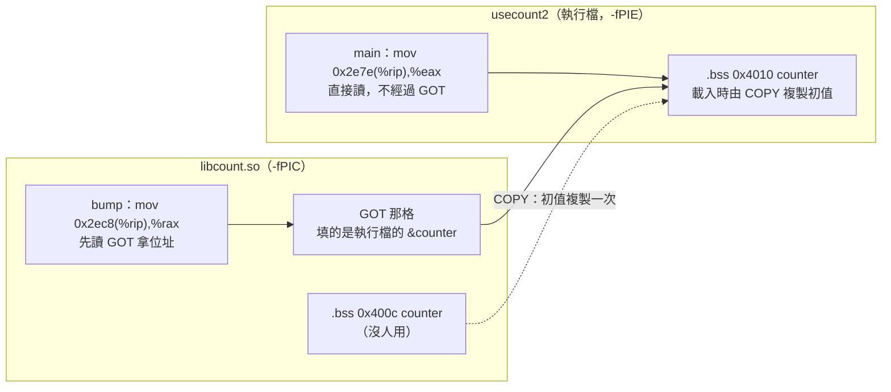

這張圖要看的是：**兩條實線最後都指到執行檔的 `counter`**；`.so` 自己那一份只在載入時被讀一次初值。這也再一次說明 `.so` 為什麼一定要經過 GOT（[第四節〈為什麼不能直接用固定距離：`counter` 最後不一定是這一份〉](#為什麼不能直接用固定距離counter-最後不一定是這一份)）：就算主程式根本沒有定義 `counter`，最後用的那一份還是可能不在 `.so` 自己裡面。

**代價：執行檔記住了變數的大小。** 執行檔 `.bss` 裡留給 `counter` 的位置，大小是**連結時**照當時的 `.so` 決定的。把 `count.c` 改成 `long counter`（[`count_v2.c`](../small-project/s1-07-libraries/examples/pic/count_v2.c)）重做 `libcount.so`、`usecount2` 不重新連結：

```c
long counter = 0;          /* v2：從 int（4 byte）改成 long（8 byte） */

int bump(void)
{
    counter = counter + 1;
    return (int)counter;
}
```

```text
$ gcc -Wall -fPIC -c count_v2.c -o count_v2.pic.o && gcc -shared count_v2.pic.o -o libcount.so
$ ./usecount2
./usecount2: Symbol `counter' has different size in shared object, consider re-linking
bump() = 1
counter = 1
&counter = 0x5e82b3c6a010
```

`ld.so` 發現執行檔留的 4 byte 和 `.so` 現在的 8 byte 不一樣，警告要重新連結（這次剛好還印對，是因為值很小，高位的 byte 都是 0）。這是函式庫通常**不直接把全域變數給外面用、而是提供函式**（例如 `get_counter()`）的原因之一：函式走 PLT，執行檔不必知道它的大小。

### 4. PLT 存函式位址、GOT 存變數位址嗎？PLT 是跳板，以及延遲綁定

> 2026-10-26 課後提問：「plt是不是專存全域函式的位址,got存全域變數的位址?」
>
> 正文出處：[第四節〈為什麼不能直接用固定距離：`counter` 最後不一定是這一份〉](#為什麼不能直接用固定距離counter-最後不一定是這一份)最後「`add.c`、`mul.c` 不加 `-fPIC` 也做得成……呼叫函式本來就經過 PLT」那一段

不是。**PLT 不存位址，它是程式碼（每個函式一小段跳板）；變數和函式的位址都存在 GOT 裡**，只是分在兩個區段：

| 區段 | 是什麼 | 權限（`readelf -S` 的 `Flg`） | 放什麼 |
|---|---|---|---|
| `.plt`、`.plt.sec` | **程式碼** | `AX`（可執行、唯讀） | 每個函式一段跳板，例如 `say@plt` |
| `.got` | **資料**（位址表） | `WA`（可寫） | 全域**變數**的位址，重定位類型 `R_X86_64_GLOB_DAT`（[第 1 章](#1-0x2ec8-和-0x3fd0-各是什麼mov-0x2ec8riprax-的兩個數字) `counter` 那格） |
| `.got.plt` | **資料**（位址表，也是 GOT 的一部分） | `WA`（可寫） | **函式**的位址，重定位類型 `R_X86_64_JUMP_SLOT` |

（`.plt.got` 名字跟 `.got.plt` 很像，但它是另一種跳板，給不走下面「延遲綁定」的函式用，例如 `__cxa_finalize`，這裡不展開。）

實驗：`libgreet.so` 的 `greet()` 呼叫 `say()`。`greet.c`（檔案：[`greet.c`](../small-project/s1-07-libraries/examples/pic/greet.c)）完整原始碼：

```c
#include <stdio.h>

void say(void)
{
    printf("say() in libgreet.so\n");
}

void greet(void)
{
    say();
}
```

主程式 `greet_main.c`（檔案：[`greet_main.c`](../small-project/s1-07-libraries/examples/pic/greet_main.c)）也定義一個 `say()`——順便看到函式也會被符號插入，跟正文的 `counter` 一樣：

```c
#include <stdio.h>

void greet(void);

void say(void)
{
    printf("say() in main\n");
}

int main(void)
{
    greet();
    return 0;
}
```

```
$ gcc -Wall -fPIC -c greet.c -o greet.pic.o && gcc -shared greet.pic.o -o libgreet.so
$ gcc -Wall greet_main.c -L. -lgreet -Wl,-rpath,'$ORIGIN' -o greet_app
$ ./greet_app
say() in main                                  ← 函式庫裡的 greet() 呼叫到主程式的 say()
$ objdump -d --no-show-raw-insn libgreet.so | sed -n '/<greet>:/,/ret/p'
0000000000001153 <greet>:
    ...
    115b:	call   1070 <say@plt>              ← 不是直接 call say，是 call 跳板
    ...
$ objdump -d --no-show-raw-insn -j .plt.sec libgreet.so | sed -n '/say@plt>:/,+3p'
0000000000001070 <say@plt>:
    1070:	endbr64
    1074:	jmp    *0x2f8e(%rip)        # 4008 <say@@Base+0x2ecf>
    107a:	nopw   0x0(%rax,%rax,1)
$ readelf -SW libgreet.so | grep -E '\.plt|\.got'
  [ 9] .rela.plt         RELA            0000000000000530 000530 000030 18  AI  4  23  8
  [11] .plt              PROGBITS        0000000000001020 001020 000030 10  AX  0   0 16
  [12] .plt.got          PROGBITS        0000000000001050 001050 000010 10  AX  0   0 16
  [13] .plt.sec          PROGBITS        0000000000001060 001060 000020 10  AX  0   0 16
  [22] .got              PROGBITS        0000000000003fc8 002fc8 000020 08  WA  0   0  8
  [23] .got.plt          PROGBITS        0000000000003fe8 002fe8 000028 08  WA  0   0  8
$ readelf -r libgreet.so | grep say
000000004008  000700000007 R_X86_64_JUMP_SLO 0000000000001139 say + 0
```

讀法：

1. `jmp *0x2f8e(%rip)`：`*` 表示「跳到**記憶體裡存的**那個位址」，不是跳到 `0x4008` 本身。`0x2f8e` 的算法跟 [第 1 章](#1-0x2ec8-和-0x3fd0-各是什麼mov-0x2ec8riprax-的兩個數字) 的 `counter` 一樣：下一條 `0x107a ＋ 0x2f8e ＝ 0x4008`。
2. `0x4008` 落在 `.got.plt`（`0x3fe8` 起，長 `0x28`），`readelf -r` 說這格是 `JUMP_SLOT`、要填 `say`。
3. 所以呼叫函式也是兩步：`call say@plt` 跳到跳板（程式碼）→ 跳板讀 `.got.plt` 那格存的位址、跳過去。跟變數「先從 `.got` 讀出位址、再照位址讀」是同一個樣子。

**那為什麼函式要多一層跳板？延遲綁定（lazy binding）。** 用 gdb 看 `say` 那格在第一次呼叫前後的值（gdb 關掉 ASLR，`libgreet.so` 載入在 `0x7ffff7fb6000`，所以那格在 `0x7ffff7fb6000 + 0x4008`；`greet+13` 是 `call` 的下一條 `0x1160`）：

```
$ gdb -q -batch -ex 'break greet' -ex run -ex 'x/gx 0x7ffff7fb6000+0x4008' \
      -ex 'break *greet+13' -ex c -ex 'x/gx 0x7ffff7fb6000+0x4008' -ex 'p &say' ./greet_app
0x7ffff7fba008 <say@got.plt>:	0x00007ffff7fb7040     ← 呼叫前：指回 libgreet.so 自己的 .plt（0x1040），不是 say
0x7ffff7fba008 <say@got.plt>:	0x0000555555555169     ← 呼叫過一次後：變成主程式的 say
$1 = (<text variable, no debug info> *) 0x555555555169 <say>
```

1. 一開始那格不放 `say` 的位址，而是指回 `.plt` 裡一段「叫 `ld.so` 去查」的程式碼；
2. **第一次**呼叫時，`ld.so` 才去找 `say` 是哪一份（這裡是主程式的），把答案寫回那格；
3. 之後再呼叫，跳板讀到的就是 `say` 的真正位址，直接跳過去，`ld.so` 不再介入。

好處是程式啟動時不必一次查完所有函式（很多可能根本沒被呼叫）。**變數做不到**：讀變數就是一條 `mov (%rax),%eax`，中間沒有跳板可以插入「先去查」的程式碼，所以 `.got` 裡變數那格一定要在載入時就填好（[第 1 章](#1-0x2ec8-和-0x3fd0-各是什麼mov-0x2ec8riprax-的兩個數字) `counter` 那格就是載入時填的）。

反過來驗證：把 `greet.c` 的 `say` 改成 `static void say(void)` 重做 `libgreet.so`，`greet_app` 不重新連結，執行印出 `say() in libgreet.so`，反組譯變成直接 `call 1119 <say>`、沒有 `@plt`——`LOCAL` 的函式不可能被插入，就不必經過 PLT／GOT，跟 `static int counter` 不需要 GOT 是同一個道理。

### 5. 用圖看 PLT 與 GOT：函式（圖一～圖四）與變數（圖五～圖八）

> 2026-10-26 課後提問：「關於這段可以用圖表表示嗎?我比較好理解?」（指[第 4 章](#4-plt-存函式位址got-存變數位址嗎plt-是跳板以及延遲綁定)整段）

圖一～圖四用的都是[第 4 章](#4-plt-存函式位址got-存變數位址嗎plt-是跳板以及延遲綁定) `libgreet.so`／`greet_app` 實驗的實測位址（`readelf -SW`、`objdump`、gdb 的輸出）。

**圖一：PLT 和 GOT 各在哪裡、放什麼**（對照[第 4 章](#4-plt-存函式位址got-存變數位址嗎plt-是跳板以及延遲綁定)的 `readelf -SW libgreet.so` 那幾行）

```text
libgreet.so（檔案裡的位址）

  ┌─────────────── 程式碼：唯讀、可執行（AX）───────────────┐
  │ .plt      0x1020   「去叫 ld.so 查位址」的共用程式碼        │
  │ .plt.sec  0x1070   say@plt 跳板：                          │
  │                      jmp *(0x4008)  ← 照 0x4008 那格存的位址跳 │
  │ .text     0x1153   greet:                                  │
  │                      call say@plt   ← 不直接 call say        │
  └────────────────────────────────────────────────────────────┘

  ┌─────────────── 資料：可寫（WA）── 這兩個都是 GOT ──────────┐
  │ .got      0x3fc8   存「變數」的位址（例如 counter）          │
  │                    載入時就由 ld.so 填好                     │
  │ .got.plt  0x3fe8   存「函式」的位址                          │
  │           └ 0x4008：say 的那格（JUMP_SLOT）                  │
  │                    第一次呼叫時才填                          │
  └────────────────────────────────────────────────────────────┘
```

**PLT 是程式碼，不存位址；函式和變數的位址都存在 GOT**，只是函式在 `.got.plt`、變數在 `.got`。

**圖二：第一次呼叫 `say()`（延遲綁定）**（對照[第 4 章](#4-plt-存函式位址got-存變數位址嗎plt-是跳板以及延遲綁定) gdb 第一次 `x/gx` 印出的 `0x00007ffff7fb7040`）

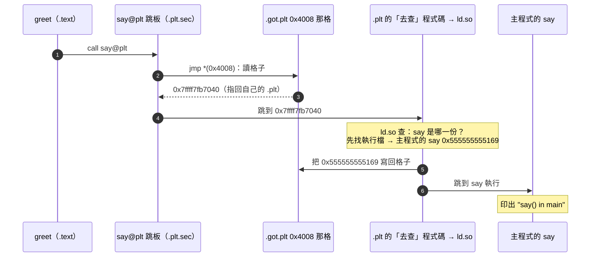

`0x7ffff7fb7040` ＝ 載入基底 `0x7ffff7fb6000` ＋ `0x1040`，落在 `.plt`（`0x1020` 起、長 `0x30`）裡。

**圖三：第二次以後**（對照 gdb 第二次 `x/gx` 印出的 `0x0000555555555169`，就是 `p &say`）

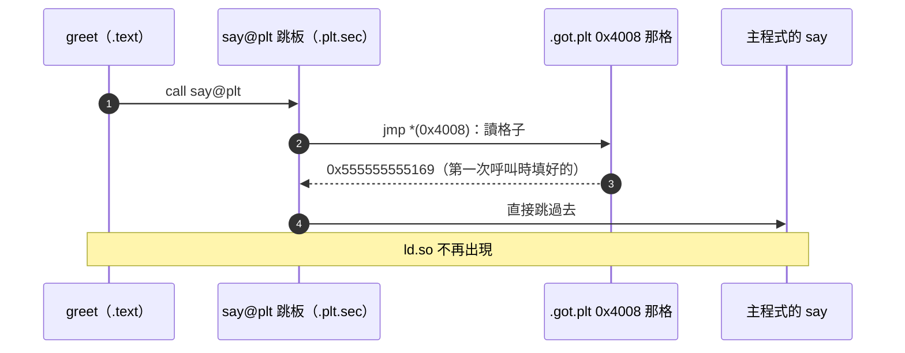

**圖四：函式和變數並排比較**

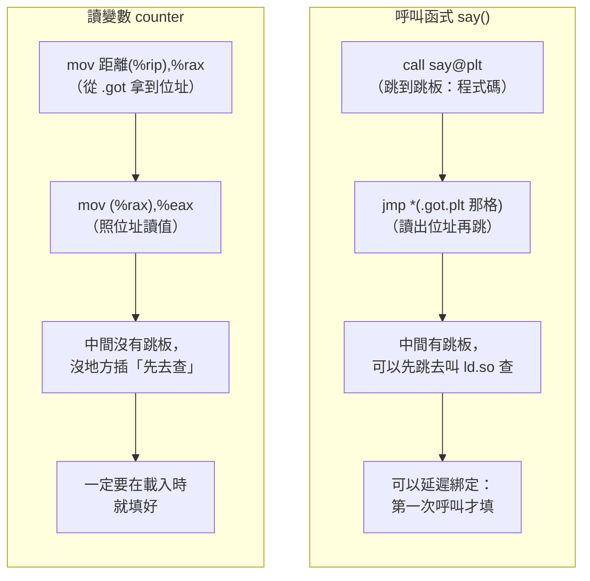

兩邊是同一個樣子：**先從 GOT 讀出位址，再照位址走**。函式多了一段跳板程式碼，才有辦法把「查位址」延到第一次呼叫。

| | PLT（`.plt`／`.plt.sec`） | GOT：`.got` | GOT：`.got.plt` |
|---|---|---|---|
| 是什麼 | 程式碼（跳板） | 資料（位址表） | 資料（位址表） |
| 權限 | `AX`：可執行、唯讀 | `WA`：可寫 | `WA`：可寫 |
| 放什麼 | 每個函式一段 `xxx@plt` | 變數的位址 | 函式的位址 |
| 什麼時候填好 | 連結時就寫好 | 載入時 | 第一次呼叫時 |

**變數那邊：圖五～圖八**

> 2026-10-26 課後提問：「目前畫出plt的流程了,got可以也畫嗎?」（指圖一～圖四，問變數 `counter` 走 `.got` 的流程）

用的是[第四節〈為什麼一定要 `-fPIC`：先看不加會怎樣〉](#為什麼一定要--fpic先看不加會怎樣)與[第四節〈為什麼不能直接用固定距離：`counter` 最後不一定是這一份〉](#為什麼不能直接用固定距離counter-最後不一定是這一份)的 `libcount.so` 實驗，完整原始碼都在那兩節：`count.c`（[檔案](../small-project/s1-07-libraries/examples/pic/count.c)）、`callbump.c`（[檔案](../small-project/s1-07-libraries/examples/pic/callbump.c)）、`usecount.c`（[檔案](../small-project/s1-07-libraries/examples/pic/usecount.c)）。圖裡的位址是 2026-10-26 重新實測的，建檔與量測的指令：

```sh
cd small-project/s1-07-libraries/examples/pic
gcc -Wall -fPIC -c count.c -o count.pic.o && gcc -shared count.pic.o -o libcount.so
gcc -Wall callbump.c -L. -lcount -Wl,-rpath,'$ORIGIN' -o callbump
gcc -Wall usecount.c -L. -lcount -Wl,-rpath,'$ORIGIN' -o usecount
objdump -s -j .got libcount.so                       # 檔案裡 GOT 的內容
gdb -q -batch -ex 'break bump' -ex run -ex 'p &counter' -ex 'x/gx 0x7ffff7fb6000+0x3fd0' ./callbump
gdb -q -batch -ex 'break bump' -ex run -ex 'p &counter' -ex 'x/gx 0x7ffff7fb6000+0x3fd0' ./usecount
```

本機輸出（節錄）：

```text
Contents of section .got:
 3fc0 00000000 00000000 00000000 00000000  ................
 3fd0 00000000 00000000 00000000 00000000  ................      ← 0x3fd0 那 8 byte 在檔案裡是 0
 3fe0 00000000 00000000                    ........
callbump：$1 = (<data variable, no debug info> *) 0x7ffff7fba00c <counter>
          0x7ffff7fb9fd0:	0x00007ffff7fba00c
usecount：$1 = (<data variable, no debug info> *) 0x555555558010 <counter>
          0x7ffff7fb9fd0:	0x0000555555558010
```

跟 PLT 最大的差別：**變數那格在載入時就填好，`bump()` 執行時只是去讀它，`ld.so` 不會在半路插進來**。

**圖五：檔案裡（還沒執行）**

```text
libcount.so（檔案裡的位址）

  .text  0x1101  bump:
                   mov 0x2ec8(%rip),%rax   ← 下一條 0x1108 ＋ 0x2ec8 ＝ 0x3fd0
                   mov (%rax),%eax
                         │
                         │ 指向 GOT 的那一格（ld 連結時就算好距離）
                         ▼
  .got   0x3fd0  ┌──────────────────────┐
                 │ 0x0000000000000000   │  ← 檔案裡是 0，還沒有 counter 的位址
                 └──────────────────────┘
                 重定位指示（readelf -r）：
                   0x3fd0  R_X86_64_GLOB_DAT  counter
                   ＝「載入時把 counter 的真正位址填進 0x3fd0」

  .bss   0x400c  counter（libcount.so 自己的那份，初值 0）
```

**圖六：載入時，`ld.so` 填格子（在 `main` 之前）**

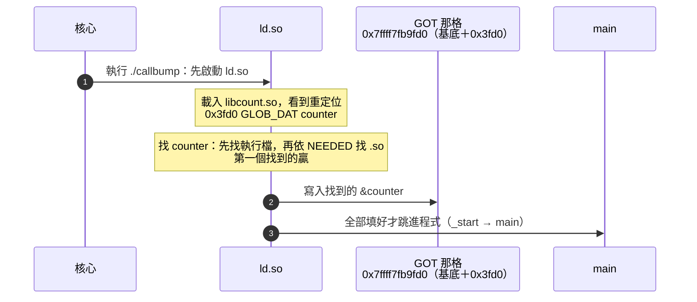

（gdb 關掉 ASLR，`libcount.so` 的載入基底是 `0x7ffff7fb6000`。）

**圖七：`bump()` 讀 `counter`，分兩步**

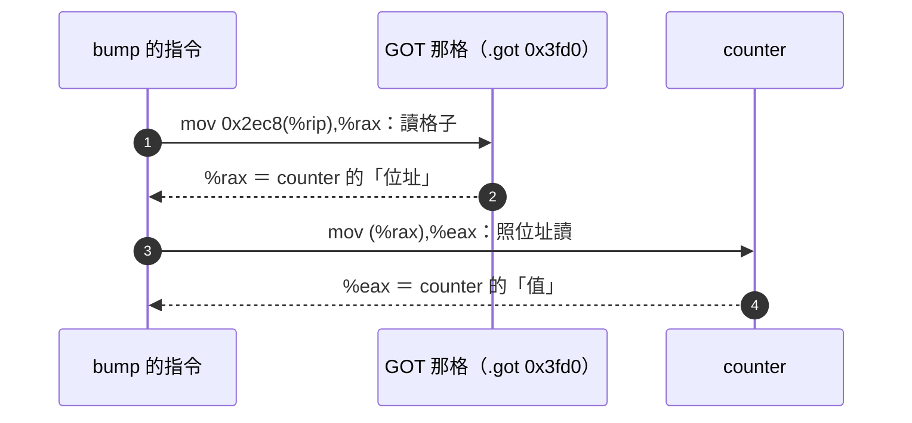

**圖八：同一格，填進去的位址不一樣（符號插入）**

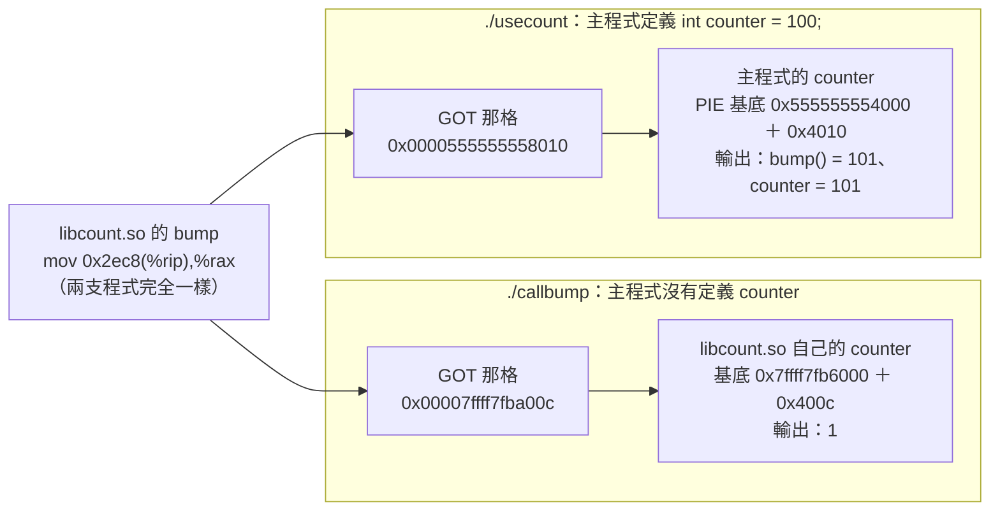

`libcount.so` 的程式碼一個 byte 都沒變，兩次都是 `mov 0x2ec8(%rip),%rax`，差別只在 **`ld.so` 往那一格填了誰的位址**。這就是要經過 GOT 的原因：直接用固定距離讀的話，`bump` 永遠只會讀到自己那份 `counter`。

函式與變數對照（圖一～圖四 vs 圖五～圖八）：

| | 函式 `say`（PLT＋`.got.plt`） | 變數 `counter`（`.got`） |
|---|---|---|
| 檔案裡那格裝什麼 | 指回 `.plt` 的「去查」程式碼 | 0 |
| 誰、什麼時候填 | `ld.so`，**第一次呼叫時** | `ld.so`，**載入時**（`main` 之前） |
| 重定位類型 | `R_X86_64_JUMP_SLOT` | `R_X86_64_GLOB_DAT` |
| 使用時 | `call` 跳板 → 跳板讀格子 → 跳過去 | 讀格子拿到位址 → 照位址讀值 |
| 會被符號插入嗎 | 會（`say() in main`） | 會（`counter = 101`） |

### 6. 兩支程式都用 `libcount.so`，記憶體裡是同一份嗎？

> 2026-10-26 課後提問：「這是之每個程式,如果他們都有用libcount.so,那libcount.so在記憶體都一樣嗎?比方說執行檔a 跟 執行檔b 都用用?」
>
> 正文出處：[第四節〈為什麼不能直接用固定距離：`counter` 最後不一定是這一份〉](#為什麼不能直接用固定距離counter-最後不一定是這一份)裡〈那為什麼不讓 `ld.so` 載入時直接改 `.text` 裡的距離就好？〉那段（「同一份 `.text` 給所有用它的行程共用」）

**只有程式碼是同一份；GOT 和 `counter` 每個行程各一份；連共用的程式碼，兩個行程看到的虛擬位址也不一樣。**

實驗：兩支不同的程式 `a`、`b` 同時跑，都連 `libcount.so`（`count.c` 就是[第四節〈為什麼一定要 `-fPIC`：先看不加會怎樣〉](#為什麼一定要--fpic先看不加會怎樣)那一份，[檔案](../small-project/s1-07-libraries/examples/pic/count.c)）。`a` 呼叫 `bump()` 1 次、`b` 呼叫 3 次，印完停 5 秒，趁這時候看兩個行程的 `/proc/<pid>/smaps`。

`a.c`（檔案：[`a.c`](../small-project/s1-07-libraries/examples/share/a.c)）完整原始碼：

```c
#include <stdio.h>
#include <unistd.h>

int bump(void);

int main(void)
{
    int r = bump();                           /* a 只呼叫 1 次 */
    printf("a: pid=%d  &bump=%p  bump() 回傳 %d\n", getpid(), (void *)bump, r);
    fflush(stdout);
    sleep(5);                                 /* 停 5 秒，讓我們看 /proc/<pid>/ */
    return 0;
}
```

`b.c`（檔案：[`b.c`](../small-project/s1-07-libraries/examples/share/b.c)）完整原始碼：

```c
#include <stdio.h>
#include <unistd.h>

int bump(void);

int main(void)
{
    int r = 0;
    for (int i = 0; i < 3; i++)               /* b 呼叫 3 次 */
        r = bump();
    printf("b: pid=%d  &bump=%p  bump() 回傳 %d\n", getpid(), (void *)bump, r);
    fflush(stdout);
    sleep(5);
    return 0;
}
```

> 課後討論：[第九節第 14 章〈`fflush(stdout)` 是什麼：`printf` 先寫進緩衝區〉](#14-fflushstdout-是什麼printf-先寫進緩衝區)（`a.c`、`b.c` 裡的 `fflush(stdout);` 在做什麼）

建檔與執行（`sync` 先把剛寫好的 `.so` 寫回磁碟，否則頁快取裡的頁還是「髒的」，`smaps` 會顯示成 `Shared_Dirty`，不好讀）：

```sh
cd small-project/s1-07-libraries/examples/share
gcc -Wall -fPIC -c ../pic/count.c -o count.pic.o && gcc -shared count.pic.o -o libcount.so
gcc -Wall a.c -L. -lcount -Wl,-rpath,'$ORIGIN' -o a
gcc -Wall b.c -L. -lcount -Wl,-rpath,'$ORIGIN' -o b
sync
./a & ./b & sleep 1          # 兩支同時在背景跑，等 1 秒讓它們印完、進入 sleep
for p in $(pgrep -x a) $(pgrep -x b); do
    echo "== $(cat /proc/$p/comm)"
    # 只印 libcount.so 的每一段：位址、權限、檔案位移，以及四個共用／私有的計數
    awk '/libcount.so/{show=1; printf "%s %s %s  ", $1, $2, $3; next} /^[0-9a-f]+-/{show=0}
         show && /^(Shared_Clean|Shared_Dirty|Private_Clean|Private_Dirty):/{printf "%s%s ", $1, $2}
         show && /^Private_Dirty/{print ""}' /proc/$p/smaps
done
wait
```

本機輸出（ASLR 開著，每次位址不同）：

```text
a: pid=26624  &bump=0x76191ad1d0f9  bump() 回傳 1
b: pid=26625  &bump=0x757e0a65f0f9  bump() 回傳 3
== a
76191ad1c000-76191ad1d000 r--p 00000000  Shared_Clean:4 Shared_Dirty:0 Private_Clean:0 Private_Dirty:0
76191ad1d000-76191ad1e000 r-xp 00001000  Shared_Clean:4 Shared_Dirty:0 Private_Clean:0 Private_Dirty:0
76191ad1e000-76191ad1f000 r--p 00002000  Shared_Clean:0 Shared_Dirty:0 Private_Clean:0 Private_Dirty:0
76191ad1f000-76191ad20000 r--p 00002000  Shared_Clean:0 Shared_Dirty:0 Private_Clean:0 Private_Dirty:4
76191ad20000-76191ad21000 rw-p 00003000  Shared_Clean:0 Shared_Dirty:0 Private_Clean:0 Private_Dirty:4
== b
757e0a65e000-757e0a65f000 r--p 00000000  Shared_Clean:4 Shared_Dirty:0 Private_Clean:0 Private_Dirty:0
757e0a65f000-757e0a660000 r-xp 00001000  Shared_Clean:4 Shared_Dirty:0 Private_Clean:0 Private_Dirty:0
757e0a660000-757e0a661000 r--p 00002000  Shared_Clean:0 Shared_Dirty:0 Private_Clean:0 Private_Dirty:0
757e0a661000-757e0a662000 r--p 00002000  Shared_Clean:0 Shared_Dirty:0 Private_Clean:0 Private_Dirty:4
757e0a662000-757e0a663000 rw-p 00003000  Shared_Clean:0 Shared_Dirty:0 Private_Clean:0 Private_Dirty:4
```

`smaps` 的四個計數，單位是 kB（一頁 4 kB）：`Shared` 是這一頁**還有別的行程也映射著**，`Private` 是只有這個行程在用；`Clean` 是內容跟檔案一樣、沒被改過，`Dirty` 是被寫過。`libcount.so` 的五段對到哪些區段，可以用 `readelf -lW libcount.so` 的 `Section to Segment mapping` 對照：

| 段（權限） | 裡面是什麼 | `a` | `b` | 意思 |
|---|---|---|---|---|
| `r--p` 位移 0 | 檔頭、`.dynsym` 等 | `Shared_Clean:4` | `Shared_Clean:4` | 共用、沒被改過 |
| `r-xp` | **`.text`（`bump`）** | `Shared_Clean:4` | `Shared_Clean:4` | **兩個行程共用同一個實體頁** |
| `r--p` 位移 `0x2000` 第一段 | `.eh_frame` | 0 | 0 | 沒用到，還沒讀進記憶體 |
| `r--p` 位移 `0x2000` 第二段 | **`.got`**（RELRO） | `Private_Dirty:4` | `Private_Dirty:4` | **各自一份**：`ld.so` 載入時寫了 GOT |
| `rw-p` | **`.data`／`.bss`（`counter`）** | `Private_Dirty:4` | `Private_Dirty:4` | **各自一份**：`a` 的是 1、`b` 的是 3 |

逐列讀：

1. **`.text` 是 `Shared_Clean`**：兩個行程用的是同一個實體頁，而且沒人寫過它。
2. **`&bump` 不一樣**（`0x76191ad1d0f9` vs `0x757e0a65f0f9`）：載入基底各自隨機（ASLR），所以虛擬位址不同；但尾巴都是 `…0f9`，就是檔案裡的 `0x10f9`。不同的虛擬位址，對到同一個實體頁。
3. **GOT 那頁是 `Private_Dirty`**：核心映射 `.so` 用的是**私有映射**（`p`），一開始每頁都跟別人共用；某個行程一寫，核心才替它複製一份，叫**寫入時複製（copy-on-write，COW）**。`ld.so` 載入時要把 `&counter` 填進 GOT，一寫就複製，所以每個行程的 GOT 都是自己的。它顯示 `r--p`、跟 `.eh_frame` 的位移一樣是 `0x2000`，是因為這個載入段從 `0x3e60` 開始、跟前一段擠在同一個檔案頁；填完之後 `ld.so` 把這一頁改回唯讀，叫 **RELRO**（Relocation Read-Only，重定位後唯讀），防止之後被竄改。
4. **`counter` 那頁也是 `Private_Dirty`**：`bump()` 寫了 `counter`，同樣被複製，所以 `a` 的 `counter` 是 1、`b` 的是 3，互不影響。

> 課後討論：[第九節第 16 章〈`.got` 算一頁嗎：區段、載入段與頁，寫入時複製一次複製一頁〉](#16-got-算一頁嗎區段載入段與頁寫入時複製一次複製一頁)

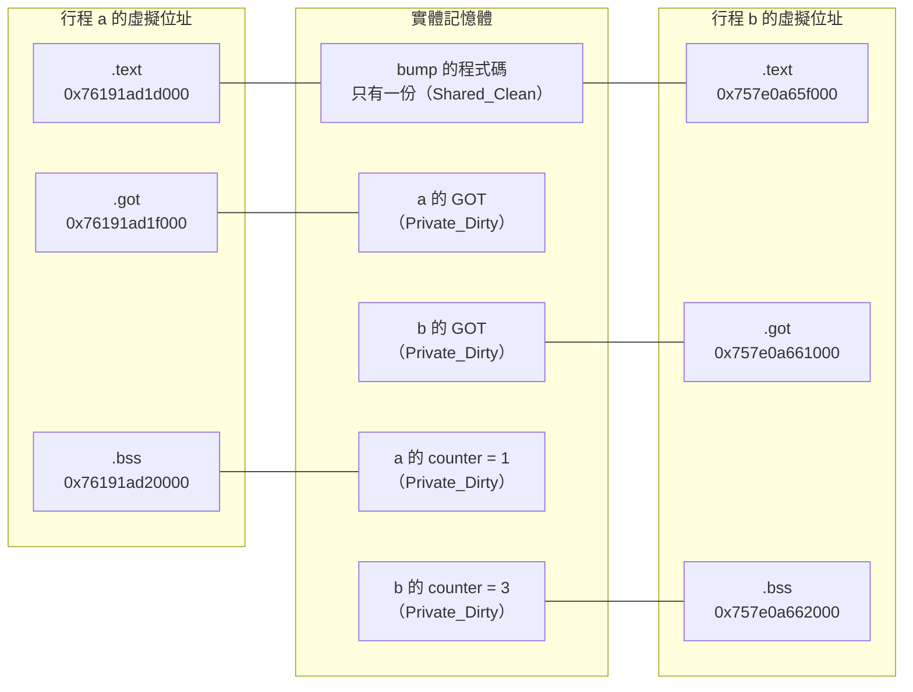

這張圖要看的是：**兩邊的 `.text` 都連到中間同一格，`.got` 和 `.bss` 各連到自己的一格**。這也回答了正文那段為什麼要 GOT：共用 `.text` 的前提是沒人改它，只要有一個行程往 `.text` 寫自己的位址，COW 就會替它複製一份，那一頁就不再共用；PIC 把每個行程不同的東西（位址）集中在 GOT，只讓 GOT 那一頁被複製，`.text` 就一直是一份。

函式那邊（PLT 跳板共用、`.got.plt` 各一份）、格子裡記的是誰的位址、虛擬位址怎麼變成實體位址，接著看[第 7 章](#7-函式那邊plt-跳板共用gotplt-每個行程各一份)～[第 10 章](#10-整理四個容易搞錯的地方)。

### 7. 函式那邊：PLT 跳板共用、`.got.plt` 每個行程各一份

> 2026-10-26 課後提問：
>
> - 「那如果函式 也就是plt怎麼理解?」（接在第 6 章之後）
> - 「p,q兩個執行檔,共用了同一個庫,相同的say,他們跳過去的say也是相同的記憶體位址嗎?」
> - 「p,q兩個行程在各自的got.plt 記錄的say的位址會一樣嗎?」
>
> 正文出處：同[第 6 章](#6-兩支程式都用-libcountso記憶體裡是同一份嗎)；函式怎麼經過 PLT 見[第 4 章](#4-plt-存函式位址got-存變數位址嗎plt-是跳板以及延遲綁定)

第 1～6 章講的是**一支程式**怎麼透過 GOT／PLT 接上 `.so`，以及變數在記憶體裡的樣子；這一章到第 10 章接著問：**好幾支程式同時用同一個 `.so` 時，函式那邊哪些是同一份**。

實驗：兩支程式 `q`、`r` 同時跑，都連第四節的 `libgreet.so`（`greet()` 呼叫 `say()`，`greet.c` 的完整原始碼在[第 4 章](#4-plt-存函式位址got-存變數位址嗎plt-是跳板以及延遲綁定)，[檔案](../small-project/s1-07-libraries/examples/pic/greet.c)），兩支都**沒有**自己的 `say`，所以接到的都是函式庫的 `say`。程式自己把 `.got.plt` 裡 `say` 那一格讀出來，在呼叫 `greet()` 前後各印一次，然後停 5 秒讓我們看 `/proc/<pid>/smaps`。

那一格在哪裡：`readelf -r libgreet.so` 說 `say` 的 `JUMP_SLOT` 在 `0x4008`（[第 4 章](#4-plt-存函式位址got-存變數位址嗎plt-是跳板以及延遲綁定)實測過），所以執行時在「`libgreet.so` 的載入基底 ＋ `0x4008`」。載入基底用 `dladdr` 查：給它函式庫裡任何一個函式的位址（這裡用 `greet`），它回報這個位址屬於哪個檔案、那個檔案載入在哪裡（`dli_fbase`）。

`slot.h`（檔案：[`slot.h`](../small-project/s1-07-libraries/examples/share/slot.h)）完整原始碼：

```c
#define _GNU_SOURCE
#include <dlfcn.h>

void greet(void);

/* 回傳 libgreet.so 裡 .got.plt 中 say 那一格的位址：載入基底 + 0x4008（readelf -r 查到的） */
static void **say_slot(void)
{
    Dl_info info;
    dladdr((void *)greet, &info);          /* dli_fbase = libgreet.so 的載入基底 */
    return (void **)((char *)info.dli_fbase + 0x4008);
}
```

`q.c`（檔案：[`q.c`](../small-project/s1-07-libraries/examples/share/q.c)）完整原始碼：

```c
#include "slot.h"        /* 要放第一行：裡面的 _GNU_SOURCE 必須在任何 #include 之前 */
#include <stdio.h>
#include <unistd.h>

int main(void)                                   /* q 沒有定義 say */
{
    printf("q: 格子在 %p，呼叫前裝 %p\n", (void *)say_slot(), *say_slot());
    greet();
    printf("q: 呼叫後裝 %p\n", *say_slot());
    fflush(stdout);
    sleep(5);
    return 0;
}
```

`r.c`（檔案：[`r.c`](../small-project/s1-07-libraries/examples/share/r.c)）跟 `q.c` 只差印出的名字：

```c
#include "slot.h"        /* 要放第一行：裡面的 _GNU_SOURCE 必須在任何 #include 之前 */
#include <stdio.h>
#include <unistd.h>

int main(void)                                   /* r 也沒有定義 say */
{
    printf("r: 格子在 %p，呼叫前裝 %p\n", (void *)say_slot(), *say_slot());
    greet();
    printf("r: 呼叫後裝 %p\n", *say_slot());
    fflush(stdout);
    sleep(5);
    return 0;
}
```

建檔與執行（`sync` 的理由同[第 6 章](#6-兩支程式都用-libcountso記憶體裡是同一份嗎)：讓頁快取裡的頁先變乾淨）：

```sh
cd small-project/s1-07-libraries/examples/share
gcc -Wall -fPIC -c ../pic/greet.c -o greet.pic.o && gcc -shared greet.pic.o -o libgreet.so
gcc -Wall q.c -L. -lgreet -Wl,-rpath,'$ORIGIN' -o q
gcc -Wall r.c -L. -lgreet -Wl,-rpath,'$ORIGIN' -o r
sync
./q & sleep 0.3; ./r & sleep 1       # 兩支都在背景跑，各自停在 sleep(5)
for x in q r; do
    pid=$(pgrep -x $x); echo "== $x"
    awk '/libgreet.so/{show=1; printf "%s %s %s  ", $1, $2, $3; next} /^[0-9a-f]+-/{show=0}
         show && /^(Rss|Pss|Shared_Clean|Private_Clean|Private_Dirty):/{printf "%s%s ", $1, $2}
         show && /^Private_Dirty/{print ""}' /proc/$pid/smaps
done
wait
```

本機輸出（ASLR 開著）：

```text
q: 格子在 0x7187194bc008，呼叫前裝 0x7187194b9040
say() in libgreet.so
q: 呼叫後裝 0x7187194b9139
r: 格子在 0x7125ada24008，呼叫前裝 0x7125ada21040
say() in libgreet.so
r: 呼叫後裝 0x7125ada21139
== q
7187194b8000-7187194b9000 r--p 00000000  Rss:4 Pss:2 Shared_Clean:4 Private_Clean:0 Private_Dirty:0
7187194b9000-7187194ba000 r-xp 00001000  Rss:4 Pss:2 Shared_Clean:4 Private_Clean:0 Private_Dirty:0
7187194ba000-7187194bb000 r--p 00002000  Rss:4 Pss:2 Shared_Clean:4 Private_Clean:0 Private_Dirty:0
7187194bb000-7187194bc000 r--p 00002000  Rss:4 Pss:4 Shared_Clean:0 Private_Clean:0 Private_Dirty:4
7187194bc000-7187194bd000 rw-p 00003000  Rss:4 Pss:4 Shared_Clean:0 Private_Clean:0 Private_Dirty:4
== r
7125ada20000-7125ada21000 r--p 00000000  Rss:4 Pss:2 Shared_Clean:4 Private_Clean:0 Private_Dirty:0
7125ada21000-7125ada22000 r-xp 00001000  Rss:4 Pss:2 Shared_Clean:4 Private_Clean:0 Private_Dirty:0
7125ada22000-7125ada23000 r--p 00002000  Rss:4 Pss:2 Shared_Clean:4 Private_Clean:0 Private_Dirty:0
7125ada23000-7125ada24000 r--p 00002000  Rss:4 Pss:4 Shared_Clean:0 Private_Clean:0 Private_Dirty:4
7125ada24000-7125ada25000 rw-p 00003000  Rss:4 Pss:4 Shared_Clean:0 Private_Clean:0 Private_Dirty:4
```

對照組：只讓 `q` 一個在跑，同一段 `r-xp` 變成：

```text
730156525000-730156526000 r-xp 00001000  Rss:4 Pss:4 Shared_Clean:0 Private_Clean:4 Private_Dirty:0
```

`Rss`（Resident Set Size）是這一段實際佔了多少實體記憶體；`Pss`（Proportional Set Size，按比例分攤的大小）是把共用的頁平均分給共用它的行程——兩個行程共用一頁，各算 2 kB。`Shared_*`／`Private_*` 與 `Clean`／`Dirty` 的意思同[第 6 章](#6-兩支程式都用-libcountso記憶體裡是同一份嗎)那張表。

| 段（權限） | 裡面是什麼（`readelf -lW libgreet.so` 的 `Section to Segment mapping`） | `q`、`r` 同時跑 | 只有 `q` | 意思 |
|---|---|---|---|---|
| `r-xp` | **`.plt`（`0x1020`）、`.plt.sec`（`say@plt`，`0x1070`）、`.text`（`greet`、`say`）** | `Pss:2`、`Shared_Clean:4` | `Pss:4`、`Private_Clean:4` | **跳板和程式碼是同一個實體頁** |
| `r--p` 位移 `0x2000` 第二段 | `.got` 等（RELRO） | `Private_Dirty:4` | — | 各自一份 |
| `rw-p` | **`.got.plt` 的 `say` 那格（`0x4008`）**、`.data`、`.bss` | `Private_Dirty:4` | — | **各自一份** |

逐點讀：

1. **跳板能共用**：`say@plt` 只有一條 `jmp *0x2f8e(%rip)`，用的是「跟自己的距離」，載入到哪個基底都不用改；沒人寫它，所以一直是同一個實體頁。`Pss` 從只有 `q` 時的 4 變成兩個一起跑時的 2，就是這一頁被兩個行程分攤的證據。
2. **格子在檔案裡是 `0x1040`**（`objdump -s -j .got.plt libgreet.so` 實測 `4008` 那 8 byte 是 `40100000 00000000`）：`.plt` 裡「去叫 `ld.so` 查」那段程式碼的位置，但只是檔案位址。
3. **第一次寫：載入時**。`ld.so` 把它改成「基底 ＋ `0x1040`」：`q` 的 `0x7187194b9040`、`r` 的 `0x7125ada21040`。一寫就觸發寫入時複製，所以還沒呼叫函式，這一頁就已經是各自一份。
4. **第二次寫：第一次呼叫時**（延遲綁定）。`ld.so` 查到 `say`，把「基底 ＋ `0x1139`」寫回格子：`q` 是 `0x7187194b9139`、`r` 是 `0x7125ada21139`——**兩個行程的格子裡數字不一樣**，但[第 9 章](#9-虛擬位址怎麼變成實體位址核心準備頁表cpu-的-mmu-翻譯)會看到，它們最後跑的是同一份程式碼。

這也說明延遲綁定為什麼「改格子」而不是「改跳板」：跳板是大家共用的程式碼，一改就要複製、共用就沒了；格子本來就是每個行程各一份，改了不影響別人。

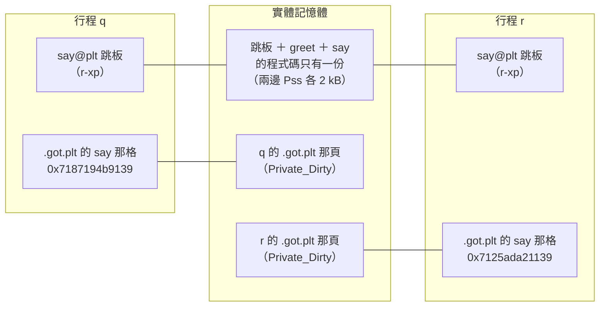

這張圖要看的是：**兩邊的跳板連到中間同一格，`.got.plt` 各連到自己的一格**，跟[第 6 章](#6-兩支程式都用-libcountso記憶體裡是同一份嗎)變數那張圖（`.text` 共用、`.got`／`.bss` 各一份）是同一個樣子。

### 8. `ld.so` 填進格子的是什麼：這個行程裡的虛擬位址

> 2026-10-26 課後提問：「所以你的這步其實是說ld.so查到say在這個行程的虛擬位址,然後把他填入到.got.plt?」（指第 7 章第 4 點與第一次呼叫的流程）

[第 7 章](#7-函式那邊plt-跳板共用gotplt-每個行程各一份)的第 4 點：「`ld.so` 查到 `say`」查的是什麼？它手上只有兩樣東西，兩者相加就是要填的值：

```text
格子要填的值 ＝ 找到 say 的那個檔案在這個行程裡的載入基底 ＋ say 在那個檔案裡的位置
```

- **`say` 在檔案裡的位置**：每個 `.so`、執行檔都有一張動態符號表（`.dynsym`），記著符號相對於檔案開頭的位置；`ld.so` 照「先執行檔、再依 `NEEDED` 順序找各個 `.so`」一張一張查（[第四節〈為什麼不能直接用固定距離：`counter` 最後不一定是這一份〉](#為什麼不能直接用固定距離counter-最後不一定是這一份)）。
- **那個檔案的載入基底**：`.so` 是 `ld.so` 自己映射進來的，它當然知道映射在哪裡。

`LD_DEBUG=bindings` 讓 `ld.so` 印出它把 `say` 接到哪個檔案（`LD_DEBUG` 全部選項見第七節），對照 `nm -D` 的位置：

```text
$ nm -D libgreet.so | grep -w say
0000000000001139 T say
$ LD_DEBUG=bindings ./q
     30213:	binding file ./libgreet.so [0] to ./libgreet.so [0]: normal symbol `say'
q: 格子在 0x7fa4bf07b008，呼叫前裝 0x7fa4bf078040
q: 呼叫後裝 0x7fa4bf078139
```

`binding file A to B` 是「A 裡要用的 `say`，接到 B 定義的那一個」：`libgreet.so` 用的 `say` 就在 `libgreet.so` 自己裡面。這次的基底是 `0x7fa4bf078040 − 0x1040 ＝ 0x7fa4bf077000`，填進去的 `0x7fa4bf078139` ＝ `0x7fa4bf077000 ＋ 0x1139`。

把第一次呼叫的流程完整寫一次（[第 4 章](#4-plt-存函式位址got-存變數位址嗎plt-是跳板以及延遲綁定)〈那為什麼函式要多一層跳板？延遲綁定〉的精確版）：

1. `greet` 執行 `call say@plt`，跳到 `.plt.sec` 的跳板。
2. 跳板執行 `jmp *(.got.plt 那格)`：**照格子裡的位址跳**，不判斷格子是不是「空的」。
3. 第一次時格子裝的是載入時填的「基底 ＋ `0x1040`」，所以這一跳就跳進 `.plt` 裡叫 `ld.so` 的程式碼。
4. `ld.so` 算出「基底 ＋ `0x1139`」，寫回格子，再跳到 `say`。
5. 第二次以後，格子裡已經是 `say` 的位址，跳板一跳就到，`ld.so` 不再出現。

`ld.so` 從頭到尾只碰虛擬位址；它不知道、也不需要知道這些位址最後對到哪個實體頁。

> 課後討論：[第九節第 16 章〈`.got` 算一頁嗎：區段、載入段與頁，寫入時複製一次複製一頁〉](#16-got-算一頁嗎區段載入段與頁寫入時複製一次複製一頁)

### 9. 虛擬位址怎麼變成實體位址：核心準備頁表，CPU 的 MMU 翻譯

> 2026-10-26 課後提問：「那這樣說的話我們在gdb看到的是否都是虛擬記憶體位址,並不是真實的?」（另外問：虛擬位址轉成實體位址「這個轉換由kernel或是cpu來做?」）

`q` 跳到 `0x7187194b9139`、`r` 跳到 `0x7125ada21139`，兩個不同的數字最後執行到同一份程式碼，中間的翻譯分兩個角色：

| 誰 | 做什麼 | 什麼時候 |
|---|---|---|
| **核心（kernel）** | 替**每個行程**建立、維護一張頁表（page table）：哪個虛擬頁對到哪個實體頁、權限是什麼（`r-x`、`rw-`）。映射檔案、處理分頁錯誤（page fault）、做寫入時複製，都是核心的事 | 映射時、第一次碰到某頁時、寫入共用頁時 |
| **CPU 的 MMU**（Memory Management Unit，記憶體管理單元） | **每一次**讀寫記憶體、取指令，都照目前行程的頁表把虛擬位址翻成實體位址；翻過的結果暫存在 TLB（Translation Lookaside Buffer，轉譯後援緩衝區）加速 | 每一條存取記憶體或跳躍的指令 |

所以 `jmp` 那一刻是 CPU 自動翻譯，核心不必介入；只有頁表裡查不到（還沒載入的頁）或權限不符（寫到唯讀、要做寫入時複製的頁）時，CPU 觸發分頁錯誤，才交給核心處理。

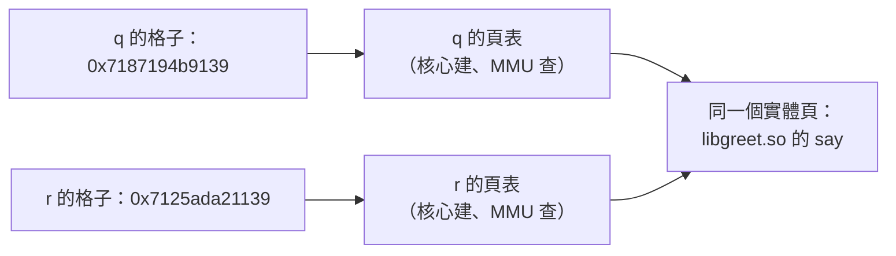

**gdb 看到的全都是虛擬位址**：`$rip`、`p &counter`、`x/gx`、`info proc mappings` 的範圍、`break *0x…`，全是被除錯那個行程的虛擬位址。但與其說它們「不是真實的」，不如說**虛擬位址就是這個行程唯一看得到、也唯一能用的位址**——每條指令用的都是它。兩個證據：

- gdb 預設關掉 ASLR，所以分別用 gdb 跑 `q` 和 `r`，`p say` 都印 `0x7ffff7fb7139 <say>`——數字一樣，但那是兩個行程各自的位址空間、各自的頁表，只是基底剛好相同：

  ```text
  $ gdb -q -batch -ex 'break greet' -ex run -ex 'p say' ./q
  $1 = {<text variable, no debug info>} 0x7ffff7fb7139 <say>
  $ gdb -q -batch -ex 'break greet' -ex run -ex 'p say' ./r
  $1 = {<text variable, no debug info>} 0x7ffff7fb7139 <say>
  ```

- 一般程式拿不到實體位址。`/proc/self/pagemap` 每個虛擬頁有一筆 8 byte 的紀錄，第 63 位元是「這頁在不在記憶體」，低 55 位元是實體頁框號（PFN，Page Frame Number）；但沒有 `CAP_SYS_ADMIN` 權限時，核心把 PFN 遮成 0（Linux 4.0 起，因為實體位址可以被拿來發動 Rowhammer 這類攻擊）。`pfn.c`（檔案：[`pfn.c`](../small-project/s1-07-libraries/examples/share/pfn.c)）完整原始碼：

  ```c
  #include <fcntl.h>
  #include <stdint.h>
  #include <stdio.h>
  #include <unistd.h>

  int main(void)
  {
      static char buf[4096];
      buf[0] = 'x';                                    /* 寫一下，確保這頁真的配了實體頁 */
      uintptr_t va = (uintptr_t)buf;
      uint64_t e;
      int fd = open("/proc/self/pagemap", O_RDONLY);   /* 每個虛擬頁一筆 8 byte 的紀錄 */
      pread(fd, &e, sizeof e, (va / 4096) * 8);
      printf("虛擬位址 %#lx：present=%lu  PFN=%lu\n",
             (unsigned long)va, (unsigned long)(e >> 63), (unsigned long)(e & ((1ULL << 55) - 1)));
      close(fd);
      return 0;
  }
  ```

  ```text
  $ gcc -Wall pfn.c -o pfn && ./pfn
  虛擬位址 0x6535b6d71040：present=1  PFN=0
  ```

  `present=1` 看得到，`PFN` 卻是 0。（`sudo ./pfn` 會印出真的頁框號——需要 root，未實測。）

### 10. 整理：四個容易搞錯的地方

> 2026-10-26 課後提問（使用者整理自己的理解，請 Claude 檢查）：「我解釋一下你看對不對,在so 裏有 全域變數counter, 也有 函式bump 這個so存在某個實體記憶體位址,不管是 p 還是 q都共用他……是這個意思吧」

討論過程中出現過的四個說法，對照實驗修正：

| 說法 | 實際上 | 證據 |
|---|---|---|
| 整個 `.so` 在實體記憶體裡只有一份，大家共用 | 只有**沒被寫過的頁**共用（程式碼、跳板、唯讀資料）；`.got`、`.got.plt`、`.data`／`.bss` 被寫過，各自一份 | `smaps`：`r-xp` 是 `Shared_Clean`，`rw-p` 是 `Private_Dirty`；`a` 的 `counter` 是 1、`b` 的是 3（[第 6 章](#6-兩支程式都用-libcountso記憶體裡是同一份嗎)） |
| `ld.so` 執行時替 `counter` 找一個位置放 | 位置是**檔案版面**決定的（`counter` 在 `libcount.so` 的 `0x400c`）；`ld.so` 只決定整個檔案映射到哪個基底，再把「基底 ＋ `0x400c`」填進 `.got` | `nm -D libcount.so` 的 `000000000000400c B counter`；gdb 的 `&counter` ＝ 基底 ＋ `0x400c`（[第 1 章](#1-0x2ec8-和-0x3fd0-各是什麼mov-0x2ec8riprax-的兩個數字)） |
| 第一次呼叫時 `.got.plt` 那格是空的 | 載入時就填了「基底 ＋ `0x1040`」，指向 `.plt` 裡叫 `ld.so` 的程式碼；跳板只是照格子跳 | 呼叫前印出的 `0x7187194b9040` |
| `ld.so` 把 `say` 的實體位址寫進格子 | 寫的是**這個行程的虛擬位址**；每個行程基底不同，數字就不同；翻成實體位址是 MMU 照頁表做的 | `q`、`r` 的格子 `0x…b9139` vs `0x…21139`；`pagemap` 的 PFN 是 0 |

**一句話結論：多個行程共用的是「沒被寫過的頁」——程式碼和 PLT 跳板；每個行程各一份的是被寫過的頁——`.got`、`.got.plt` 和全域變數。位址表裡記的全是「這個行程自己的虛擬位址」，翻成實體位址是 CPU 照核心準備的頁表做的，程式（包括 `ld.so`、gdb）看不到實體位址。`.h` 只在編譯時給宣告、型別和巨集，跟「接上 `.so`」無關。**

### 11. 做 `.so` 需要 `.h` 嗎？`#include` 管編譯、`-l` 管連結

> 2026-10-26 課後提問：
>
> - 「greet.c, count.c這個會被main引用的,爲什麼都不加.h了? 做so不需要h嗎?」
> - 「那爲什麼我在用libc.so.6 要用stdio.h?」
>
> 正文出處：[第四節〈為什麼一定要 `-fPIC`：先看不加會怎樣〉](#為什麼一定要--fpic先看不加會怎樣)的 `count.c`

正文的 `count.c`、[第 4 章](#4-plt-存函式位址got-存變數位址嗎plt-是跳板以及延遲綁定)的 `greet.c` 都沒有 `.h`，呼叫端直接在自己的檔案裡寫宣告（`int bump(void);`、`void greet(void);`）。這是為了讓範例短一點——**做 `.so`、連結、執行時接線都用不到 `.h`**，`.h` 只在**編譯呼叫端**時派上用場。第 1 課〈[第 2 題：刪掉 `#include` 為什麼只是警告，程式還能跑？](./hello.c怎麼變成能跑的程式-編譯的四個階段.md#第-2-題刪掉-include-為什麼只是警告程式還能跑部分教過關鍵一句沒明講)〉和第 6 課〈[`#include` 只是貼上](./多檔案的C程式-標頭檔、static與extern、連結錯誤與make.md#include-只是貼上)〉教過：`#include` 就是把檔案內容貼進來，所以「自己寫宣告」和「`#include` 一個寫了同樣宣告的 `.h`」，編譯器看到的東西一模一樣。

| 階段 | 用到什麼 | 用不用 `.h` |
|---|---|---|
| `gcc -fPIC -c count.c` | `count.c` 本身 | 不用（它是**定義**的那一邊） |
| `gcc -shared … -o libcount.so` | `.o` | 不用 |
| 編譯呼叫端 | 函式的**宣告**、用到的型別和巨集 | 宣告寫在哪都可以，`.h` 是最好的寫法 |
| 連結、`ld.so` 執行時接線 | 符號的**名字**（`.dynsym`） | 不用：只認名字（第 6 課〈[符號表](./多檔案的C程式-標頭檔、static與extern、連結錯誤與make.md#四符號表o-之間靠名字接起來)〉） |

那為什麼用 `libc.so.6` 還要 `#include <stdio.h>`？四個實驗（檔案都在 [`examples/headers/`](../small-project/s1-07-libraries/examples/headers/)）：

**實驗一：只呼叫 `printf`，自己寫宣告就夠了。** `mydecl.c`（檔案：[`mydecl.c`](../small-project/s1-07-libraries/examples/headers/mydecl.c)）：

```c
int printf(const char *fmt, ...);     /* 自己寫宣告，不 #include <stdio.h> */

int main(void)
{
    printf("hi %d\n", 42);
    return 0;
}
```

```text
$ gcc -Wall mydecl.c -o mydecl && ./mydecl
hi 42                                     ← 沒有任何警告
$ readelf -d mydecl | grep NEEDED
 0x0000000000000001 (NEEDED)             Shared library: [libc.so.6]
```

連宣告都不寫（`noinc.c`，檔案：[`noinc.c`](../small-project/s1-07-libraries/examples/headers/noinc.c)），gcc 13 只給警告、程式照樣跑，但這是在賭編譯器猜對（第 6 課的隱式宣告）：

```c
int main(void)
{
    printf("hi %d\n", 42);
    return 0;
}
```

```text
$ gcc -Wall noinc.c -o noinc && ./noinc
noinc.c:3:5: warning: implicit declaration of function ‘printf’ [-Wimplicit-function-declaration]
noinc.c:1:1: note: include ‘<stdio.h>’ or provide a declaration of ‘printf’
noinc.c:3:5: warning: incompatible implicit declaration of built-in function ‘printf’ [-Wbuiltin-declaration-mismatch]
hi 42
```

**實驗二：用到型別和巨集，就很難自己寫了。** `needfile.c`（檔案：[`needfile.c`](../small-project/s1-07-libraries/examples/headers/needfile.c)）：

```c
int main(void)
{
    FILE *f = fopen("/etc/hostname", "r");
    if (f == NULL)
        return 1;
    fclose(f);
    printf("EOF = %d\n", EOF);
    return 0;
}
```

```text
$ gcc -Wall needfile.c -o needfile
needfile.c:3:5: error: unknown type name ‘FILE’
needfile.c:1:1: note: ‘FILE’ is defined in header ‘<stdio.h>’; did you forget to ‘#include <stdio.h>’?
needfile.c:4:14: error: ‘NULL’ undeclared (first use in this function)
…
```

| `stdio.h` 提供的東西 | 例子 | 為什麼不好自己寫 |
|---|---|---|
| 函式宣告 | `printf`、`fopen`、`fclose` | 可以自己寫，但要一字不差；寫錯了連結器和 `ld.so` 都抓不到（第 6 課 `square(100000)` 那種錯） |
| **型別** | `FILE` | 它是 glibc 內部的結構，各版本、各平台可能不同 |
| **巨集** | `EOF`、`NULL`、`BUFSIZ`、`stdout` | 數值由 glibc 決定；巨集在前處理時就換掉了，`.so` 裡根本沒有這些東西 |

**實驗三：`#include` 了，不代表會連結。** `sq.c`（檔案：[`sq.c`](../small-project/s1-07-libraries/examples/headers/sq.c)）：

```c
#include <math.h>
#include <stdio.h>

int main(int argc, char **argv)
{
    (void)argv;
    printf("%f\n", sqrt((double)argc + 1.0));
    return 0;
}
```

```text
$ gcc -Wall sq.c -o sq
/usr/bin/ld: /tmp/ccy284ne.o: in function `main':
sq.c:(.text+0x33): undefined reference to `sqrt'      ← 有 #include <math.h>，連結照樣失敗
collect2: error: ld returned 1 exit status
$ gcc -Wall sq.c -o sq -lm && ./sq
1.414214
```

`#include <math.h>` 只讓**編譯器**知道 `sqrt` 的型別；`-lm` 才讓**連結器**去找 `libm.so`。`libc.so.6` 不用寫 `-lc`，是因為 gcc 自己會加——`gcc -v mydecl.c -o mydecl` 印出它塞給連結器的命令列，裡面有 ` -lc `，跟有沒有 `#include <stdio.h>` 無關。

**實驗四：真實的函式庫怎麼分 `.h` 和 `.so`。** 本機的 zlib：

```text
$ dpkg -S /usr/lib/x86_64-linux-gnu/libz.so.1
zlib1g:amd64: /usr/lib/x86_64-linux-gnu/libz.so.1      ← 執行時用的套件：只有 .so.1
$ dpkg -L zlib1g-dev | grep -E '\.h$|\.so$|\.a$'
/usr/include/zconf.h                                    ← 開發用的套件：.h
/usr/include/zlib.h
/usr/lib/x86_64-linux-gnu/libz.a                        ←               .a
/usr/lib/x86_64-linux-gnu/libz.so                       ←               給 -lz 用的連結名（第六節的 SONAME 那三個名字）
```

只是要**執行**用到 zlib 的程式，裝 `zlib1g` 就好；要**編譯**呼叫 zlib 的程式，才要裝 `zlib1g-dev`，拿到 `zlib.h`（`#include <zlib.h>`）和 `libz.so`（`-lz`）。

| | 誰處理 | 什麼時候 | 你要做什麼 |
|---|---|---|---|
| 宣告、型別、巨集 | 前處理器、編譯器 | 編譯時 | `#include`（找不到就是 `fatal error: xxx.h: No such file or directory`，用 `-I` 指路徑） |
| 找到 `.so`、寫下 `NEEDED` | `ld` | 連結時 | `-l`（libc 自動加；找不到符號就是 `undefined reference`，用 `-L` 指路徑） |
| 載入 `.so`、接上函式與變數 | `ld.so` | 執行時 | 不用做（找不到 `.so` 見第五節） |

正式的函式庫一定要附 `.h`，而且照第 6 課〈[定義的那個 `.c` 為什麼也要 `#include` 自己的標頭檔](./多檔案的C程式-標頭檔、static與extern、連結錯誤與make.md#定義的那個-c-為什麼也要-include-自己的標頭檔)〉：定義的 `.c` 和呼叫端都引入同一份 `.h`，宣告寫錯才會在編譯時被抓到——`.so` 的符號表沒有型別，連結器和 `ld.so` 幫不了你。本課第一節的 `examples/calc/` 就是照這個做法寫的（`calc.h`）。

### 12. `.so` 之間為什麼順序幾乎不重要、(a) 為什麼還是失敗（作業 2-3）

> 2026-10-27 作業 2-3 批改補教（新觀念）：題目問「為什麼 `.so` 版的 (b) 不必像 `.a` 那樣把 `-lconv` 寫兩次？(a) 為什麼還是失敗？」，使用者的猜測：
>
> - 「a 一開始找了 libround，main 沒有用到 round，接下來他去找 libconv，找到了加到記憶體，又要回去找 libround，但他不在記憶體，所以就沒了」
> - 「b 一開始就找了 libconv，存到了記憶體，再找 round，然後再從記憶體去找 libconv，我們不用重寫兩次」
>
> 正文出處：[第四節〈`.so` 在 Ubuntu 上也有順序問題〉](#so-在-ubuntu-上也有順序問題)；`.a` 的對照在[第二節〈順序：`ld` 由左往右只掃一次〉](#順序ld-由左往右只掃一次)

**一句話：`.a` 是「當下缺什麼才拉哪個 `.o`」，`.so` 是「整份符號一次進來」，所以 `.so` 不必寫兩次；`.so` 之間剩下的順序問題只來自 `--as-needed`——讀到它的當下沒人需要它，就不寫進 `NEEDED`。**

#### 實驗用的檔案

跟作業第 2 題同一組：`libconv` 放 `c_to_f`、`f_to_c`、`temp_clamp`，`libround` 放 `temp_round`，而 `temp_round` 又呼叫 `libconv` 的 `temp_clamp`——兩個函式庫互相需要。檔案在 [`examples/order/`](../small-project/s1-07-libraries/examples/order/)。

`temp.h`（檔案：[`temp.h`](../small-project/s1-07-libraries/examples/order/temp.h)）：

```c
#ifndef TEMP_H
#define TEMP_H

int c_to_f(int c);
int f_to_c(int f);
int temp_round(int x10);
int temp_clamp(int x10);

#endif
```

`ctof.c`（檔案：[`ctof.c`](../small-project/s1-07-libraries/examples/order/ctof.c)）：

```c
#include "temp.h"

int c_to_f(int c)
{
    return temp_round(c * 18 + 320);
}
```

`ftoc.c`（檔案：[`ftoc.c`](../small-project/s1-07-libraries/examples/order/ftoc.c)）：

```c
#include "temp.h"

int f_to_c(int f)
{
    return temp_round((f - 32) * 100 / 18);
}
```

`limit.c`（檔案：[`limit.c`](../small-project/s1-07-libraries/examples/order/limit.c)）：

```c
#include "temp.h"

int temp_clamp(int x10)
{
    return x10 < -2732 ? -2732 : x10;
}
```

`round.c`（檔案：[`round.c`](../small-project/s1-07-libraries/examples/order/round.c)）：

```c
#include "temp.h"

int temp_round(int x10)
{
    x10 = temp_clamp(x10);
    return (x10 + 5) / 10;
}
```

`main.c`（檔案：[`main.c`](../small-project/s1-07-libraries/examples/order/main.c)）：

```c
#include <stdio.h>
#include "temp.h"

int main(void)
{
    printf("f_to_c(100) = %d\n", f_to_c(100));
    return 0;
}
```

做成兩個 `.so`（注意做 `libconv.so` 時**沒有**寫 `-lround`，所以它不知道 `temp_round` 要去哪裡找）：

```text
$ mkdir -p so
$ gcc -Wall -fPIC -shared ctof.c ftoc.c limit.c -o so/libconv.so
$ gcc -Wall -fPIC -shared round.c -o so/libround.so
$ nm -D so/libconv.so | grep temp_
000000000000117b T temp_clamp
                 U temp_round          ← libconv.so 需要 temp_round
$ nm -D so/libround.so | grep temp_
                 U temp_clamp          ← libround.so 需要 temp_clamp
0000000000001119 T temp_round
$ readelf -d so/libconv.so | grep NEEDED
                                       ← 沒有輸出：libconv.so 沒記任何依賴（libc 也沒用到）
```

#### (b) `-lconv -lround`：為什麼不必寫兩次

```text
$ gcc -Wall main.c -Lso -lconv -lround -Wl,-rpath,'$ORIGIN/so' -o app_b
$ ./app_b
f_to_c(100) = 38
$ readelf -d app_b | grep -E 'NEEDED|RUNPATH'
 0x0000000000000001 (NEEDED)             Shared library: [libconv.so]
 0x0000000000000001 (NEEDED)             Shared library: [libround.so]
 0x0000000000000001 (NEEDED)             Shared library: [libc.so.6]
 0x000000000000001d (RUNPATH)            Library runpath: [$ORIGIN/so]
```

同樣的順序換成 `.a` 會失敗（作業 2-1 (b)：`round.o` 帶來的 `temp_clamp` 找不到），`.so` 卻成功。差別在 `ld` 讀到兩種檔案時做的事：

| | 讀到 `libconv.a` 時 | 讀到 `libconv.so` 時 |
|---|---|---|
| 拿進來什麼 | 只拉**當下清單上缺的**符號所在的成員：清單只有 `f_to_c`，所以只拉 `ftoc.o`，`limit.o` 留在 `.a` 裡 | 沒有「成員」可以挑，`.so` 是一個連結好的整體：`nm -D` 看到的所有 `T`（`c_to_f`、`f_to_c`、`temp_clamp`）**一次全部**記進 `ld` 的符號表 |
| 之後才出現的需求 | `round.o` 後來需要 `temp_clamp`，但 `libconv.a` 已經掃過、不回頭 → `undefined reference` | `libround.so` 後來需要 `temp_clamp`，`ld` 在符號表裡一查，`libconv.so` 早就提供了 → 沒問題 |

使用者猜的「`libconv` 存到記憶體，之後再從那裡找」方向是對的，只是那個「記住」發生在**連結時** `ld` 的符號表裡，不是程式的記憶體——這時程式根本還沒跑。

真正**執行**時，接上符號的是 `ld.so`，它也是在所有載入的 `.so` 裡找，不管 `NEEDED` 的先後（`LD_DEBUG=bindings` 的輸出很長，這裡只留跟本例有關的三列，行首的行程編號拿掉、路徑縮短）：

```text
$ LD_DEBUG=bindings ./app_b 2>&1 | grep -E "f_to_c|temp_"
binding file ./app_b [0] to so/libconv.so [0]: normal symbol `f_to_c'
binding file so/libconv.so [0] to so/libround.so [0]: normal symbol `temp_round'
binding file so/libround.so [0] to so/libconv.so [0]: normal symbol `temp_clamp'    ← libround.so 回頭用 libconv.so 的函式
```

最後一列就是 `.a` 做不到的事：`libround.so` 排在 `libconv.so` 後面，照樣用到 `libconv.so` 的 `temp_clamp`。

#### (a) `-lround -lconv`：為什麼還是失敗

```text
$ gcc -Wall main.c -Lso -lround -lconv -Wl,-rpath,'$ORIGIN/so' -o app_a
/usr/bin/ld: so/libconv.so: undefined reference to `temp_round'
collect2: error: ld returned 1 exit status
```

`.so` 都是整份進來，照理 `libround.so` 的 `temp_round` 也被記下了，為什麼還說找不到？逐步看：

1. 讀 `main.c` 的 `.o`：清單上缺 `f_to_c`（和 `printf`）。
2. 讀到 `libround.so`：它只提供 `temp_round`，**現在沒有人缺** `temp_round`。Ubuntu 的 gcc 預設傳 `--as-needed`（[第四節〈`.so` 在 Ubuntu 上也有順序問題〉](#so-在-ubuntu-上也有順序問題)），所以 `libround.so` **不寫進 `NEEDED`**，被丟掉了。
3. 讀到 `libconv.so`：提供了 `f_to_c`，寫進 `NEEDED`；但它自己有 `U temp_round`。
4. 命令列結束，`ld` 檢查：留下來的 `.so`（`libconv.so`）裡未定義的 `temp_round`，有沒有哪個留下來的檔案提供？`libround.so` 已經被丟了 → 報錯。注意訊息的開頭是 `so/libconv.so:`，表示「是 `libconv.so` 需要它」，跟 `.a` 時的 `./libconv.a(ftoc.o): in function ...` 不一樣。

用兩個選項各拿掉一個條件，證明是這兩件事造成的：

```text
$ gcc -Wall main.c -Lso -Wl,--no-as-needed -lround -lconv -Wl,-rpath,'$ORIGIN/so' -o app_a2
$ ./app_a2
f_to_c(100) = 38
$ readelf -d app_a2 | grep NEEDED
 0x0000000000000001 (NEEDED)             Shared library: [libround.so]     ← 沒被丟掉
 0x0000000000000001 (NEEDED)             Shared library: [libconv.so]
 0x0000000000000001 (NEEDED)             Shared library: [libc.so.6]
```

關掉 `--as-needed`，`libround.so` 就留下來了，(a) 的順序也能成功——所以**跟 `.so` 之間的先後無關**，只跟「讀到它的當下有沒有人需要它」有關。

```text
$ gcc -Wall main.c -Lso -lround -lconv -Wl,--allow-shlib-undefined -Wl,-rpath,'$ORIGIN/so' -o app_a3
$ readelf -d app_a3 | grep NEEDED
 0x0000000000000001 (NEEDED)             Shared library: [libconv.so]      ← libround.so 還是被丟掉
 0x0000000000000001 (NEEDED)             Shared library: [libc.so.6]
$ ./app_a3
./app_a3: symbol lookup error: ./so/libconv.so: undefined symbol: temp_round
```

`--allow-shlib-undefined` 叫 `ld` 不要檢查「`.so` 裡找不到定義的符號」，連結就過了；但 `libround.so` 沒進 `NEEDED`，執行時 `ld.so` 不會載入它，呼叫到 `temp_round` 時才在執行期爆掉（訊息是 `ld.so` 印的）。`man ld` 寫明：做**執行檔**時預設會檢查（`--no-allow-shlib-undefined`），做 `.so` 時預設不檢查——所以第 4 步那道檢查，就是在擋這種「連結過了、跑起來才壞」。

#### 整理：`.a` 和 `.so` 的順序規則

| | `.a` | `.so`（Ubuntu，預設 `--as-needed`） |
|---|---|---|
| 讀進來的單位 | 成員（`.o`），當下缺什麼才拉什麼 | 整份 |
| 被依賴的要寫在後面嗎 | 要：寫在前面時，當時還不缺，就一個成員都不拉 | 要：寫在前面時，當時沒人需要，就不寫進 `NEEDED` |
| 互相依賴（A 需要 B，B 又需要 A 的**別的**東西） | 寫兩次 `-lA -lB -lA`，或用 `--start-group` | 照「被依賴的在後」排一次就好：A 整份已經在符號表裡 |
| 錯誤訊息的開頭 | `./libA.a(成員.o): in function ...` | `libA.so: undefined reference to ...` |

正式的做法是讓每個 `.so` 自己記住依賴：做 `libconv.so` 時加 `-Lso -lround`，`libconv.so` 的 `NEEDED` 就有 `libround.so`，主程式只寫 `-lconv` 也找得到（依賴的依賴在執行時怎麼找，見[第五節〈`ld.so` 去了哪些地方找〉](#ldso-去了哪些地方找)與作業第 4 題）。作業故意不加，才看得到上面這些現象。


### 13. 連結時 `ld` 為什麼要找「依賴的依賴」：`-rpath-link` 與 `-rpath`（作業 4-3）

> 2026-10-28 作業 4-3 批改補教（「`ld` 為什麼要在連結時檢查」是新觀念）：題目把連結 `hw4` 的指令拿掉 `-Wl,-rpath-link,lib`，問「`hw4_main.c` 根本沒呼叫 `temp_round`，為什麼 `ld` 在連結時就要去找 `libround.so`？」使用者的猜測：
>
> - 「我猜 `ld` 不是幫 `hw4_main.c` 找，而是幫 `libtemp.so` 找……也會去看 `libtemp.so` 的依賴 `libround.so`」
>
> 正文出處：[第五節〈`RPATH` 和 `RUNPATH` 差在哪〉](#rpath-和-runpath-差在哪跟-ld_library_path-誰優先)最後一段「`RUNPATH` 只管直接依賴」；`-rpath-link` 在[第七節〈`ld`：本課透過 `-Wl,` 用到的選項〉](#ld本課透過--wl-用到的選項)的表

**一句話：做執行檔時，`ld` 要確認每個 `.so` 自己缺的符號（`libtemp.so` 的 `U temp_round`）都有人提供，所以要把 `.so` 的 `NEEDED` 也找出來看；它找這些間接依賴時不看 `-L`，而是看 `-rpath-link`、`-rpath`、`LD_LIBRARY_PATH`、那個 `.so` 自己的 `RUNPATH` 等。`-rpath-link` 只在連結時用、不寫進執行檔；`-rpath` 寫進執行檔給 `ld.so` 用，連結時也會順便參考。**

#### 實驗用的檔案

跟作業第 4 題同一組，檔案在 [`examples/rpathlink/`](../small-project/s1-07-libraries/examples/rpathlink/)：`libround.so` 放 `temp_round`，`libtemp.so` 放 `c_to_f`、`f_to_c`，它們呼叫 `temp_round`。

`temp.h`（檔案：[`temp.h`](../small-project/s1-07-libraries/examples/rpathlink/temp.h)）：

```c
#ifndef TEMP_H
#define TEMP_H

int c_to_f(int c);
int f_to_c(int f);
int temp_round(int x10);

#endif
```

`round.c`（檔案：[`round.c`](../small-project/s1-07-libraries/examples/rpathlink/round.c)）：

```c
#include "temp.h"

int temp_round(int x10)
{
    return (x10 + 5) / 10;
}
```

`ctof.c`（檔案：[`ctof.c`](../small-project/s1-07-libraries/examples/rpathlink/ctof.c)）：

```c
#include "temp.h"

int c_to_f(int c)
{
    return temp_round(c * 18 + 320);
}
```

`ftoc.c`（檔案：[`ftoc.c`](../small-project/s1-07-libraries/examples/rpathlink/ftoc.c)）：

```c
#include "temp.h"

int f_to_c(int f)
{
    return temp_round((f - 32) * 100 / 18);
}
```

`main.c`（檔案：[`main.c`](../small-project/s1-07-libraries/examples/rpathlink/main.c)）：

```c
#include <stdio.h>
#include "temp.h"

int main(void)
{
    printf("c_to_f(37) = %d\n", c_to_f(37));
    return 0;
}
```

先做兩個 `.so`（`libtemp.so` 自己記住依賴 `libround.so`，但**沒有** `RUNPATH`）：

```text
$ mkdir -p lib
$ gcc -Wall -fPIC -shared round.c -o lib/libround.so
$ gcc -Wall -fPIC -shared ctof.c ftoc.c -Llib -lround -o lib/libtemp.so
$ nm -D lib/libtemp.so | grep temp_round
                 U temp_round                    ← libtemp.so 自己缺 temp_round
$ readelf -d lib/libtemp.so | grep NEEDED
 0x0000000000000001 (NEEDED)             Shared library: [libround.so]
```

#### `ld` 在檢查什麼

```text
$ gcc -Wall main.c -Llib -ltemp -o app
/usr/bin/ld: warning: libround.so, needed by lib/libtemp.so, not found (try using -rpath or -rpath-link)
/usr/bin/ld: lib/libtemp.so: undefined reference to `temp_round'
collect2: error: ld returned 1 exit status
```

兩行訊息分開讀：

1. **`libround.so, needed by lib/libtemp.so, not found`**：`ld` 讀了 `libtemp.so` 的 `NEEDED`，想把 `libround.so` 也找來看，找不到。注意 `-Llib` 明明寫了，`libround.so` 也在 `lib/`——**找間接依賴時不看 `-L`**（`man ld` 的 `-rpath-link` 一節列了搜尋順序，`-L` 只在 SunOS 才算）。
2. **`lib/libtemp.so: undefined reference to 'temp_round'`**：開頭是 `lib/libtemp.so:`，表示缺的是 **`libtemp.so`** 的符號，不是 `main.c` 的。做執行檔時 `ld` 預設 `--no-allow-shlib-undefined`：每個留下來的 `.so` 裡未定義的符號都要有人提供（跟[第 12 章](#12-so-之間為什麼順序幾乎不重要a-為什麼還是失敗作業-2-3)〈(a) 為什麼還是失敗〉第 4 步是同一個檢查），`libround.so` 找不到，這個檢查就過不了。

所以使用者猜的方向對：`ld` 是**替 `libtemp.so`** 找。為什麼要在連結時就查？因為這是執行檔的最後一關——現在不查，`libtemp.so` 的洞要到執行時（甚至呼叫到那個函式時）才爆。第 12 章的 `app_a3` 就是關掉檢查（`--allow-shlib-undefined`）、執行時才出錯的例子。

這個檢查可以關掉，關掉後連結成功；本例 `libtemp.so` 的 `NEEDED` 有寫 `libround.so`，執行時 `ld.so` 會照常載入，所以也能跑：

```text
$ gcc -Wall main.c -Llib -ltemp -Wl,--allow-shlib-undefined -o app4 && echo 連結成功
連結成功
$ LD_LIBRARY_PATH=lib ./app4
c_to_f(37) = 99
```

但正常不要這樣做——它會連「真的沒有人提供」的情況一起放過。

#### 告訴 `ld` 去哪裡找：幾種方法實測

| 指令 | 連結 | 寫進 `app` 的 | 說明 |
|---|---|---|---|
| `-Wl,-rpath-link,lib` | 成功 | 什麼都沒寫 | 只給連結時的 `ld` 用 |
| `-Wl,-rpath,lib` | 成功 | `RUNPATH [lib]` | `-rpath` 在連結時也被拿來找間接依賴（`man ld` 搜尋順序第 2 步） |
| `-Wl,-rpath,'$ORIGIN/lib'` | **失敗**（同上面的兩行錯誤） | — | 本機實測連結時沒用上 `$ORIGIN/lib`；原因我沒查證，所以第 4 題才另外加 `-rpath-link` |
| `LD_LIBRARY_PATH=lib gcc …` | 成功 | 什麼都沒寫 | `ld` 也會參考這個環境變數（第 5 步） |
| `libtemp.so` 自己帶 `RUNPATH [$ORIGIN]` | 成功 | — | `ld` 會看那個 `.so` 自己的 `RUNPATH`（第 6 步），`$ORIGIN` 換成 `libtemp.so` 所在的資料夾 |

```text
$ gcc -Wall main.c -Llib -ltemp -Wl,-rpath-link,lib -o app && echo 連結成功
連結成功
$ readelf -d app | grep -E 'NEEDED|RUNPATH|RPATH'
 0x0000000000000001 (NEEDED)             Shared library: [libtemp.so]
 0x0000000000000001 (NEEDED)             Shared library: [libc.so.6]
$ ./app
./app: error while loading shared libraries: libtemp.so: cannot open shared object file: No such file or directory
$ gcc -Wall main.c -Llib -ltemp -Wl,-rpath,lib -o app2 && echo 連結成功
連結成功
$ readelf -d app2 | grep -E 'RUNPATH|RPATH'
 0x000000000000001d (RUNPATH)            Library runpath: [lib]
$ gcc -Wall -fPIC -shared ctof.c ftoc.c -Llib -lround -Wl,-rpath,'$ORIGIN' -o lib/libtemp.so
$ gcc -Wall main.c -Llib -ltemp -Wl,-rpath,'$ORIGIN/lib' -o app6 && echo 連結成功
連結成功
$ ./app6
c_to_f(37) = 99
```

`app` 只用 `-rpath-link`：連結過了，但執行檔裡沒有任何路徑，執行時連 `libtemp.so` 都找不到——**`-rpath-link` 完全不影響執行時**。`app2` 的 `RUNPATH [lib]` 是相對路徑，會照**目前工作目錄**解讀，換個資料夾執行就失效，所以實務上用 `$ORIGIN`。最後一組說明：讓函式庫自己帶 `RUNPATH`（作業 4-2 (a)）不只修好執行時，連結時也不必再加 `-rpath-link`。

#### 整理：`-rpath-link` 與 `-rpath`

| | `-rpath-link 目錄` | `-rpath 目錄` |
|---|---|---|
| 誰用 | 只有連結時的 `ld` | 執行時的 `ld.so`（連結時 `ld` 也會參考） |
| 寫進輸出檔嗎 | 不寫 | 寫成 `RUNPATH`（加 `--disable-new-dtags` 是 `RPATH`） |
| 用來找什麼 | `.so` 的 `NEEDED`（間接依賴） | 執行時：這個檔案的 `NEEDED`（`RPATH` 則是整棵樹）；連結時：同左 |
| 常見寫法 | `-Wl,-rpath-link,lib` | `-Wl,-rpath,'$ORIGIN/lib'` |


### 14. `fflush(stdout)` 是什麼：`printf` 先寫進緩衝區

> 2026-10-29 課後提問（做自我測驗第 9 題時）：「可以幫我註解一下fflush這是什麼東西嗎?」
>
> 正文出處：本課正文沒有用到 `fflush`；它第一次出現在[第 6 章](#6-兩支程式都用-libcountso記憶體裡是同一份嗎)的 `a.c`、`b.c`（`printf` 之後、`sleep(5)` 之前那一行），之後第 7 章與自我測驗第 9、10 題的程式也照抄。

**一句話：`printf` 不會直接把字寫出去，而是先存進程式自己記憶體裡的緩衝區（buffer），累積一批才用一次 `write` 系統呼叫寫出去；`fflush(stdout)` 是「現在就把緩衝區裡的東西寫出去」。它跟本課的函式庫主題無關，本課的程式加它，只是為了讓結果在 `sleep` 之前就出現。**

#### 為什麼要先存起來

把字真正寫到終端機或檔案的是系統呼叫 `write`（要進 kernel，比一般函式呼叫慢得多）。如果每個 `printf` 都 `write` 一次，印很多小字串時就很浪費，所以 C 標準函式庫（glibc）的 stdio 在每個 `FILE`（`stdout` 的型別是 `FILE *`）裡放一塊緩衝區，先寫進去，等時機到了再一次寫出。名字的由來：`f` 是 file（作用在一個 `FILE`），`flush` 是「沖掉、清空」。

「時機」看 `stdout` 接到哪裡：

| `stdout` 接到 | 緩衝方式 | 什麼時候真的 `write` 出去 |
|---|---|---|
| 終端機 | 行緩衝（line buffered） | 遇到 `\n`、緩衝區滿、程式正常結束、呼叫 `fflush` |
| 檔案或管線（`> out.txt`、`\| cat`） | 全緩衝（fully buffered） | 緩衝區滿、程式正常結束、呼叫 `fflush`——**遇到 `\n` 不會寫** |

- 「程式正常結束」指 `main` `return` 或呼叫 `exit()`：`exit()` 會先把所有 `FILE` 的緩衝區寫出去再結束行程。
- 行程被訊號（signal）砍掉（例如 `kill`、segfault）不會經過 `exit()`，**緩衝區裡還沒寫出去的字就直接消失**。
- `stderr` 預設不緩衝（unbuffered），每次都馬上寫，所以錯誤訊息通常寫到 `stderr`。

`fflush` 本身：宣告在 `stdio.h`（`extern int fflush (FILE *__stream);`），成功回傳 0、失敗回傳 `EOF`；參數給 `NULL` 時（`fflush(NULL)`）會清空所有輸出用的 `FILE`。

#### 實驗：有沒有 `fflush`，`write` 發生在 `sleep` 之前還是之後

兩支程式只差一行。`nf.c`（檔案：[`nf.c`](../small-project/s1-07-libraries/examples/fflush/nf.c)）完整原始碼：

```c
#include <stdio.h>
#include <unistd.h>
int main(void)
{
    printf("hello\n");
    /* 沒有 fflush */
    sleep(3);
    return 0;
}
```

`wf.c`（檔案：[`wf.c`](../small-project/s1-07-libraries/examples/fflush/wf.c)）完整原始碼：

```c
#include <stdio.h>
#include <unistd.h>
int main(void)
{
    printf("hello\n");
    fflush(stdout);
    sleep(3);
    return 0;
}
```

**實驗一：輸出導向檔案，在程式還在 `sleep` 時偷看檔案。** `kill` 那一組在 `sleep` 時把 `nf` 砍掉：

```sh
cd small-project/s1-07-libraries/examples/fflush
gcc nf.c -o nf && gcc wf.c -o wf
for p in nf wf; do
    ./$p > out.$p & sleep 1
    echo "$p 第1秒 out 的內容: [$(cat out.$p)]"
    wait
    echo "$p 結束後: [$(cat out.$p)]"
done
./nf > out.kill & pid=$!; sleep 1; kill $pid; wait; echo "nf 被 kill 後: [$(cat out.kill)]"
```

```
nf 第1秒 out 的內容: []
nf 結束後: [hello]
wf 第1秒 out 的內容: [hello]
wf 結束後: [hello]
nf 被 kill 後: []
```

- `nf` 第 1 秒時檔案是空的：`hello\n` 還在 `nf` 自己的緩衝區裡（導向檔案是全緩衝，`\n` 不會觸發寫出），等 `main` `return` 時才寫出去。
- `wf` 第 1 秒就看得到 `hello`：`fflush` 在 `sleep` 之前就把它寫出去了。
- `nf` 在 `sleep` 時被 `kill`：行程沒走到 `exit()`，緩衝區連同 `hello` 一起消失，檔案是空的。[第 3 課第四節](./陣列、字串與指標運算-C不檢查邊界與用gdb找segfault.md#四字串以-0-結尾的-char-陣列)〈補充一個 I/O 的陷阱〉講的「當掉的程式什麼都看不到」就是這個原因。

**實驗二：用 `strace` 看 `write` 和 `sleep` 的先後。** `strace -e trace=write,clock_nanosleep,exit_group` 只列出這三個系統呼叫（`sleep()` 在 glibc 裡是用 `clock_nanosleep` 做的）；這裡只用到 `strace` 的 `-e trace=`（只追蹤指定的系統呼叫）一個選項，完整選項見 `man strace`（`strace -h` 列出全部選項的摘要）。終端機那一組用 `script -qc "<指令>" /dev/null` 讓程式的 `stdout` 接到一個假終端機（pseudo-terminal）：`-q` 是不印開始／結束訊息，`-c` 是要執行的指令，`/dev/null` 是把 `script` 本來要寫的紀錄檔丟掉（`script` 的完整選項見 `man script`）。

```sh
strace -e trace=write,clock_nanosleep,exit_group ./nf > out.s 2>&1; cat out.s     # 導向檔案，nf
strace -e trace=write,clock_nanosleep,exit_group ./wf > out.s2 2>&1; cat out.s2   # 導向檔案，wf
script -qc "strace -e trace=write,clock_nanosleep,exit_group ./nf" /dev/null        # 終端機，nf
```

```
--- 導向檔案 nf
clock_nanosleep(CLOCK_REALTIME, 0, {tv_sec=3, tv_nsec=0}, 0x7ffd7ef80020) = 0
write(1, "hello\n", 6hello
)                  = 6
exit_group(0)                           = ?
--- 導向檔案 wf
write(1, "hello\n", 6hello
)                  = 6
clock_nanosleep(CLOCK_REALTIME, 0, {tv_sec=3, tv_nsec=0}, 0x7ffe3be96b60) = 0
exit_group(0)                           = ?
--- 終端機 nf
write(1, "hello\n", 6hello
)                  = 6
clock_nanosleep(CLOCK_REALTIME, 0, {tv_sec=3, tv_nsec=0}, 0x7ffcc108bf50) = 0
exit_group(0)                           = ?
```

（`write` 那一列被拆成兩行，是因為 `strace` 的紀錄和程式寫出的 `hello\n` 進了同一個檔案，交錯在一起。）

- 導向檔案的 `nf`：先 `clock_nanosleep` 睡 3 秒，**醒來、`main` 結束時才 `write`**——這就是緩衝區在 `exit()` 時被寫出去。
- 導向檔案的 `wf`：`write` 在睡之前，是 `fflush` 觸發的。
- 終端機的 `nf`：沒有 `fflush`，`write` 照樣在睡之前——行緩衝遇到 `\n` 就寫。

#### 回到本課的程式

第 6 章的 `a.c`、`b.c` 和自我測驗第 9 題的 `x.c`、`y.c` 都是「`printf` 之後 `sleep(5)`」：實驗要讓兩個行程同時活著，再趁它們睡覺時去看 `/proc/<pid>/smaps`，所以結果一定要在 `sleep` 之前印出來。直接在終端機跑時，`printf` 字串結尾的 `\n` 就會觸發寫出，`fflush` 其實可有可無；它是保險——輸出被導向檔案或管線時（例如 `(./x & ./y & wait) | cat`），結果照樣會在 `sleep` 之前出現，不會等 5 秒、程式結束才一起冒出來。stdio 緩衝在第 ⑤ 站（I/O）會正式講。

### 15. `ld` 還沒讀到 `main.o`，怎麼知道誰需要什麼：未定義符號清單與 `--as-needed`

> 2026-10-29 課後提問（批改自我測驗 2-3 之後）：
>
> - 「看「目前還沒找到定義的符號」,你這句我不理解,這個時候都還沒有到main.o他要怎麼看還沒找到定義的符號?」
> - 「那就是說--no-as-needed的話,ld也不管現在手頭上的清單有沒有trim,他就直接把trim加入清單嗎?」
>
> 正文出處：[第二節〈順序：`ld` 由左往右只掃一次〉](#順序ld-由左往右只掃一次)的三個步驟（「先遇到 `libcalc.a`：這時清單裡……」）、[第四節〈`.so` 在 Ubuntu 上也有順序問題〉](#so-在-ubuntu-上也有順序問題)；自我測驗第 2 題的 2-3

**一句話：`ld` 不往後看——讀到一個函式庫時，只拿「到這一刻為止」的未定義符號清單來決定要不要它。`.a` 只拉此刻需要的成員，其餘不記；`.so` 在 `--as-needed`（Ubuntu 預設）下此刻沒人需要就丟掉，在 `--no-as-needed` 下一律留下、記住它提供的定義，等後面的檔案來用。清單裡放的永遠是「還沒找到定義的符號」，函式庫提供的是定義，不會被「加進清單」。**

#### 實驗用的檔案

用自我測驗第 1、2 題的 `libtxt`，另外加一支什麼都不呼叫的 `none.c`。檔案都在 [`examples/asneeded/`](../small-project/s1-07-libraries/examples/asneeded/)。

`case.c`（檔案：[`case.c`](../small-project/s1-07-libraries/examples/asneeded/case.c)）：

```c
/* case.c */
void to_upper_str(char *s) { for (; *s; s++) if (*s >= 'a' && *s <= 'z') *s -= 32; }
void to_lower_str(char *s) { for (; *s; s++) if (*s >= 'A' && *s <= 'Z') *s += 32; }
```

`space.c`（檔案：[`space.c`](../small-project/s1-07-libraries/examples/asneeded/space.c)）：

```c
/* space.c */
int is_space(char c) { return c == ' ' || c == '\t' || c == '\n'; }
```

`trim.c`（檔案：[`trim.c`](../small-project/s1-07-libraries/examples/asneeded/trim.c)）：

```c
/* trim.c */
int is_space(char c);

char *trim(char *s)
{
    while (is_space(*s))
        s++;
    return s;
}
```

`main.c`（檔案：[`main.c`](../small-project/s1-07-libraries/examples/asneeded/main.c)）：

```c
/* main.c */
#include <stdio.h>

char *trim(char *s);

int main(void)
{
    char buf[] = "   hello";
    printf("[%s]\n", trim(buf));
    return 0;
}
```

`none.c`（檔案：[`none.c`](../small-project/s1-07-libraries/examples/asneeded/none.c)）：

```c
int main(void)
{
    return 0;            /* 完全不呼叫 libtxt 的函式 */
}
```

做 `.so`：

```sh
cd small-project/s1-07-libraries/examples/asneeded
gcc -Wall -fPIC -shared case.c space.c trim.c -o libtxt.so
```

#### 清單是怎麼長出來的

`ld` 從頭到尾維持一張「還沒找到定義的符號」清單（第 6 課的 `UND`），每讀一個輸入檔就照兩條規則更新：

1. 這個檔案**定義**了清單上的某個符號 → 從清單劃掉；
2. 這個檔案**用到**、但目前還沒有人定義的符號 → 加進清單。

讀到函式庫（`.a`、`.so`）時，它只拿**此刻的清單**比對：這個函式庫能不能解決清單上的某個符號？之後**不會回頭**再看。所以問題「還沒讀到 `main.o`，怎麼知道誰需要 `trim`」的答案就是：**它不知道**，也不去猜，就用當下不完整的清單做決定。這正是順序會出事的原因。

而且讀到 `-ltxt` 時清單**不是空的**。用 `gcc -v` 看 gcc 交給 `ld`（`collect2`）的完整命令列，把每個參數拆成一行，只留相關的：

```text
$ gcc -v -Wall -L. -ltxt main.c -o app_bad 2>&1 | grep collect2 | tr ' ' '\n' \
      | grep -nE 'crt[^/]*\.o$|^-ltxt$|/tmp/cc.*\.o$|^-lc$|as-needed'
17:--as-needed
27:/usr/lib/gcc/x86_64-linux-gnu/13/../../../x86_64-linux-gnu/Scrt1.o
28:/usr/lib/gcc/x86_64-linux-gnu/13/../../../x86_64-linux-gnu/crti.o
29:/usr/lib/gcc/x86_64-linux-gnu/13/crtbeginS.o
39:-ltxt
40:/tmp/cccq3MAT.o                ← main.c 編出來的暫存 .o
43:--as-needed
46:-lc
49:--as-needed
52:/usr/lib/gcc/x86_64-linux-gnu/13/crtendS.o
53:/usr/lib/gcc/x86_64-linux-gnu/13/../../../x86_64-linux-gnu/crtn.o
```

（行號是拆開後的第幾個參數。第 17 行的 `--as-needed` 在所有輸入檔之前，所以整條命令列都在它的作用下；`-lc` 附近另外幾個是 gcc 處理 `libgcc` 時切換狀態用的。）

`-ltxt` 前面還有 gcc 自己塞的三個啟動檔。`Scrt1.o` 裡是程式真正的進入點 `_start`，它要呼叫你的 `main`。`nm -u`（只列未定義的符號）看它們帶進清單的符號：

```text
$ nm -u $(gcc -print-file-name=Scrt1.o)
                 U _GLOBAL_OFFSET_TABLE_
                 U __libc_start_main
                 U main
$ nm -u $(gcc -print-file-name=crti.o) $(gcc -print-file-name=crtbeginS.o)
…/crti.o:
                 U _GLOBAL_OFFSET_TABLE_
                 w __gmon_start__
…/crtbeginS.o:
                 w __cxa_finalize
                 U _GLOBAL_OFFSET_TABLE_
                 w _ITM_deregisterTMCloneTable
                 w _ITM_registerTMCloneTable
                 U __TMC_END__
```

（`U` 是未定義；`w` 是弱符號，找不到定義也不算錯。`-print-file-name=` 讓 gcc 印出它會用的那個檔案的完整路徑，見第七節的 gcc 表。）

所以讀到 `-ltxt` 那一刻，清單裡是 `main`、`__libc_start_main`、`__TMC_END__` 這些，**沒有 `trim`**。逐步看（預設 `--as-needed`）：

| 步驟 | 讀到 | 清單的變化 | 結果 |
|---|---|---|---|
| 1 | `Scrt1.o`、`crti.o`、`crtbeginS.o` | 加進 `main`、`__libc_start_main` 等 | 一般 `.o`，整個放進輸出檔 |
| 2 | `-ltxt` → `libtxt.so` | 不變 | `libtxt.so` 提供的 `trim` 等，清單上一個都沒有 → **丟掉** |
| 3 | `main.c` 的 `.o` | 劃掉 `main`；加進 `trim`、`printf` | — |
| 4 | `-lc` → `libc.so.6` | 劃掉 `printf`、`__libc_start_main` | 有人需要 → 留下、記進 `NEEDED` |
| 5 | 命令列結束 | `trim` 還在 | `undefined reference to 'trim'` |

```text
$ gcc -Wall -L. -ltxt main.c -o app_bad
/usr/bin/ld: /tmp/ccbG2eFO.o: in function `main':
main.c:(.text+0x35): undefined reference to `trim'
collect2: error: ld returned 1 exit status
```

正文第二節的 `libcalc.a` 例子也一樣：「這時清單裡沒有 `calc_add`」，不是嚴格意義的空清單。

#### `--as-needed` 與 `--no-as-needed`：讀到 `.so` 那一刻的差別

把 `-Wl,--no-as-needed` 放在 `-ltxt` 前面，順序完全不變，卻成功了：

```text
$ gcc -Wall -L. -Wl,--no-as-needed -ltxt main.c -o app_no
$ LD_LIBRARY_PATH=. ./app_no
[hello]
$ readelf -d app_no | grep NEEDED
 0x0000000000000001 (NEEDED)             Shared library: [libtxt.so]
 0x0000000000000001 (NEEDED)             Shared library: [libc.so.6]
```

（`LD_LIBRARY_PATH=.` 是第五節的方法一，讓執行時找得到 `libtxt.so`。）

`--no-as-needed` 並不是「把 `trim` 加進清單」——清單只放還沒找到定義的符號，`libtxt.so` 提供的是**定義**。它做的是：讀到 `libtxt.so` 時**不看清單**，一律把它留下（記進 `NEEDED`），並記住它的動態符號表裡有哪些定義：

```text
$ nm -D --defined-only libtxt.so
00000000000011ad T is_space
0000000000001163 T to_lower_str
0000000000001119 T to_upper_str
00000000000011da T trim
```

接著讀到 `main.o`，它要 `trim`：`ld` 發現手上已經記著 `libtxt.so` 有這個定義，當場就解決了，`trim` 不會留在清單上。

`.so` 本來就有「先記住、後面再用」的能力，順序問題完全是 `--as-needed` 那一刻的「丟掉」造成的：

| | 讀到 `-ltxt`（`libtxt.so`）那一刻 | 後面的 `main.o` 要 `trim` |
|---|---|---|
| `--as-needed`（Ubuntu 預設） | 看此刻的清單：沒人需要它的符號 → 丟掉，不記進 `NEEDED` | 沒人提供 → `undefined reference` |
| `--no-as-needed` | 不看清單：一律留下、記進 `NEEDED`，記住它的定義 | 用記住的定義解決 → 成功 |

**那為什麼 Ubuntu 預設要 `--as-needed`？** `--no-as-needed` 的代價是「用不到也留下」。拿完全不呼叫 `libtxt` 的 `none.c` 各連一次：

```text
$ gcc -Wall none.c -L. -Wl,--no-as-needed -ltxt -o none_no
$ readelf -d none_no | grep NEEDED
 0x0000000000000001 (NEEDED)             Shared library: [libtxt.so]      ← 沒用到也記進需求單
 0x0000000000000001 (NEEDED)             Shared library: [libc.so.6]
$ gcc -Wall none.c -L. -ltxt -o none_as
$ readelf -d none_as | grep NEEDED
 0x0000000000000001 (NEEDED)             Shared library: [libc.so.6]      ← 沒人需要就丟掉
```

多一個用不到的 `NEEDED`，執行時 `ld.so` 就得多找、多載入一個 `.so`；找不到時（例如換到沒裝這個函式庫的機器），程式會整個跑不起來，即使它根本沒用到。建置系統常常把一長串 `-l` 套到每個程式上，`--as-needed` 讓沒用到的自動消失；代價就是 `-l` 一定要寫在用到它的檔案後面。

#### 對照：`.a` 加 `--no-as-needed` 沒有用

`--as-needed` 只管 `.so`。把 `libtxt.so` 換成同樣三個 `.o` 做成的 `libtxt.a`：

```text
$ gcc -Wall -c case.c space.c trim.c && ar rcs libtxt.a case.o space.o trim.o && rm libtxt.so
$ gcc -Wall -L. -Wl,--no-as-needed -ltxt main.c -o app_a
/usr/bin/ld: /tmp/ccWceYGf.o: in function `main':
main.c:(.text+0x35): undefined reference to `trim'
collect2: error: ld returned 1 exit status
```

（`rm libtxt.so` 是因為 `-ltxt` 會先找 `.so`，第三節。）`.a` 沒有「先記住、後面再用」這回事：讀到它時只拉此刻清單需要的成員，沒拉的就略過、不記，之後也不回頭。所以 `.a` 的順序問題不管加什麼都存在，只能把 `-l` 寫在後面，或用 `--start-group … --end-group` 讓群組反覆掃（正文第二節）。

#### 整理

| | 讀到函式庫那一刻看什麼 | 沒被選中的部分 | 寫在前面會怎樣 |
|---|---|---|---|
| `.a` | 此刻的清單 | 略過、不記 | 失敗（加 `--no-as-needed` 也一樣） |
| `.so`＋`--as-needed`（Ubuntu 預設） | 此刻的清單 | 整個 `.so` 丟掉 | 失敗 |
| `.so`＋`--no-as-needed` | 不看清單 | 沒有，一律留下、記住定義 | 成功，但用不到也會記進 `NEEDED` |

本章用到的 `nm` 選項是 `-u`（`--undefined-only`，只列未定義的）與 `--defined-only`（`-U`，只列有定義的），是 `nm --help` 36 個選項裡的 2 個，完整見 `man nm`；`ld` 的 `--as-needed`／`--no-as-needed` 在第七節的 `ld` 表裡。

### 16. `.got` 算一頁嗎：區段、載入段與頁，寫入時複製一次複製一頁

> 2026-10-30 課後提問（自我測驗 9-1 的自我練習時，連著問了三則）：
>
> - 「但是.got算一頁嗎? 我記得.got不是也是在load裏面嗎?load纔是一頁吧?」
> - 「got存的是虛擬位址還是實體位址?」
> - 「但是,x,y 兩個在各自got 存的 hits的也應該是虛擬位址,在尚未讀寫hits之前,這兩個hits的虛擬位址在各自的got是否相同」
>
> 正文出處：[第 6 章](#6-兩支程式都用-libcountso記憶體裡是同一份嗎)逐列讀的第 3 點（「GOT 那頁是 `Private_Dirty`」「跟前一段擠在同一個檔案頁」）、[第 8 章〈`ld.so` 填進格子的是什麼：這個行程裡的虛擬位址〉](#8-ldso-填進格子的是什麼這個行程裡的虛擬位址)；自我測驗第 9 題的 9-1

**一句話：`.got` 是區段（幾十 byte），`LOAD` 是載入段（可以跨好幾頁），寫入時複製的單位是「頁」（4 kB）——某一頁被寫，就只複製那一整頁。GOT 裡裝的是這個行程自己的虛擬位址，`ld.so` 在 `main` 之前就寫好了，所以 GOT 那頁一開始就各自一份；寫入時複製只改頁表、讓同一個虛擬位址改對到新的實體頁，虛擬位址本身不變，「讀」則不會觸發複製。**

#### 實驗用的檔案

第一、二小節用自我測驗第 9 題的 `libhits.so`、`x`、`y`（檔案：[`hits.c`](../small-project/s1-07-libraries/examples/share/hits.c)、[`x.c`](../small-project/s1-07-libraries/examples/share/x.c)、[`y.c`](../small-project/s1-07-libraries/examples/share/y.c)）：

```c
/* hits.c */
int hits = 0;

int hit(void)
{
    hits = hits + 1;
    return hits;
}
```
```c
/* x.c（y.c 一樣，只是迴圈跑 5 次、印 "y:"） */
#include <stdio.h>
#include <unistd.h>

int hit(void);

int main(void)
{
    int r = 0;
    for (int i = 0; i < 2; i++)               /* x 呼叫 2 次 */
        r = hit();
    printf("x: &hit=%p  hit() 回傳 %d\n", (void *)hit, r);
    fflush(stdout);
    sleep(5);
    return 0;
}
```

```sh
gcc -Wall -fPIC -c hits.c -o hits.pic.o && gcc -shared hits.pic.o -o libhits.so
gcc -Wall x.c -L. -lhits -Wl,-rpath,'$ORIGIN' -o x
gcc -Wall y.c -L. -lhits -Wl,-rpath,'$ORIGIN' -o y
```

第三小節另外做一個 `libbox.so`，放在 [`examples/cowpage/`](../small-project/s1-07-libraries/examples/cowpage/)。

#### 一、三種單位：區段、載入段、頁

| 單位 | 誰在用 | 大小 | `libhits.so` 的例子 |
|---|---|---|---|
| 區段（section） | 連結器 `ld` 分類用（`readelf -S`） | 看內容，幾 byte 到幾 MB | `.got` 只有 `0x28` ＝ 40 byte |
| 載入段（segment，`LOAD`） | `ld.so` 照它 `mmap`，一個 `LOAD` 一種權限（`readelf -l`） | 看裡面裝了哪些區段，可以跨好幾頁 | 可寫的 `LOAD`：`0x3e60`～`0x4010` |
| 頁（page） | 核心與 MMU 管記憶體的單位：頁表一格管一頁、權限一次設一頁 | 固定 4 kB（`0x1000`） | `0x3000`～`0x3fff`、`0x4000`～`0x4fff` |

由小到大：好幾個區段打包成一個載入段（[ELF 那課第四節〈名字的關鍵：兩種視角〉](./ELF是什麼-可執行與可連結格式的兩種視角.md#四名字的關鍵兩種視角)），一個載入段再被切成一頁一頁映射進記憶體。`readelf -lW libhits.so` 與 `readelf -SW libhits.so` 的實際輸出（只留相關的列）：

```text
$ readelf -lW libhits.so
  Type           Offset   VirtAddr           PhysAddr           FileSiz  MemSiz   Flg Align
  LOAD           0x002e60 0x0000000000003e60 0x0000000000003e60 0x0001a8 0x0001b0 RW  0x1000
  GNU_RELRO      0x002e60 0x0000000000003e60 0x0000000000003e60 0x0001a0 0x0001a0 R   0x1
   03     .init_array .fini_array .dynamic .got .got.plt .data .bss
   10     .init_array .fini_array .dynamic .got .got.plt
$ readelf -SW libhits.so
  [17] .got              PROGBITS        0000000000003fc0 002fc0 000028 08  WA  0   0  8
  [18] .got.plt          PROGBITS        0000000000003fe8 002fe8 000018 08  WA  0   0  8
  [19] .data             PROGBITS        0000000000004000 003000 000008 00  WA  0   0  8
  [20] .bss              NOBITS          0000000000004008 003008 000008 00  WA  0   0  4
```

可寫的 `LOAD` 從 `0x3e60` 開始、`MemSiz` 是 `0x1b0`，結束在 `0x4010`，**跨過 `0x4000` 這條頁的邊界，所以佔兩頁**：

```text
圖一：libhits.so 可寫的 LOAD 怎麼落在頁上（位址是檔案裡的位置，執行時再加基底）

               一個 LOAD（RW）：0x3e60 ～ 0x4010
        ┌──────────────── 頁 0x3000 ────────────────┐┌────────── 頁 0x4000 ──────────┐
        │ (空) │.init_array│.fini_array│.dynamic│.got│.got.plt││.data│.bss(hits)│  (空)  │
        └───────────────────────────────────────────┘└───────────────────────────────┘
          0x3000  0x3e60                       0x3fc0 0x3fe8 0x4000  0x4008      0x4010
          ▲ 整頁都在 GNU_RELRO 範圍（0x3e60～0x4000）       ▲ 一直是可寫
          ① ld.so 載入時寫 GOT → 這頁被複製                  ② hit() 寫 hits → 這頁被複製
          ③ 填完用 mprotect 改成唯讀
```

執行時這一個 `LOAD` 在 `/proc/<pid>/maps` 也確實變成**兩列**（本機跑 `./x` 時，`libhits.so` 的最後兩列）：

```text
75db55a70000-75db55a71000 r--p 00002000 ...  libhits.so   ← 頁 0x3000：.got 那頁（RELRO 後唯讀）
75db55a71000-75db55a72000 rw-p 00003000 ...  libhits.so   ← 頁 0x4000：.data／.bss
```

這張圖要看三件事：

1. **`.got` 不是一頁，是一頁裡的 40 byte**。`ld.so` 只往 `.got` 寫了幾個 8 byte 的位址，核心就把 `.got` 所在的**整個 `0x3000` 頁**複製一份；同一頁的 `.dynamic`、`.got.plt` 也跟著成了各自一份。所以「`.got` 各自一份」精確的說法是「`.got` 所在的那頁各自一份」。
2. **`LOAD` 也不是一頁**。同一個 `LOAD` 的兩頁可以一頁被複製、一頁沒有：某個行程要是從來沒呼叫 `hit()`，`0x4000` 那頁就沒人寫，照樣跟別的行程共用。判斷共不共用，看的是**那一頁**有沒有被寫，不是看整個 `LOAD`。
3. **`ld` 故意讓 RELRO 範圍剛好結束在頁的邊界**：`0x3e60 ＋ 0x1a0 ＝ 0x4000`。這個 `LOAD` 不從 `0x3000` 開始、而是從 `0x3e60` 開始，就是為了把它往後推、讓 `.got.plt` 的結尾對齊 `0x4000`。原因是權限一次只能設一整頁（`mprotect` 以頁為單位），GOT 那頁要改成唯讀，又不能連 `.data`／`.bss` 一起鎖住，兩邊只好分在不同頁。這也是第 6 章 `smaps` 裡 GOT 那頁顯示 `r--p`、而且跟 `.eh_frame` 一樣是位移 `0x2000` 的原因：檔案裡 `0x2e60` 起的內容跟 `.eh_frame` 擠在同一個檔案頁。

#### 二、GOT 裡裝的是虛擬位址，讀寫 `hits` 之前兩邊一樣嗎？

GOT 裡裝的是**這個行程自己的虛擬位址**（第 8 章）。程式拿到的每個位址都是虛擬位址——指標、`%rip`、GOT 那格的值都一樣；CPU 每次用它存取記憶體，都由 MMU 照這個行程的頁表翻成實體位址（第 9 章）。要是 GOT 裝的是實體位址，MMU 會把它再翻一次，讀到錯的地方；何況寫 GOT 的 `ld.so` 本身是普通程式，根本拿不到實體位址（第 9 章的 `pfn.c`）。

那麼兩個行程 GOT 裡 `hits` 那格的數字一樣嗎？讓程式停在 `main`——這時 `hit()` 一次都還沒被呼叫，`hits` 沒被讀寫過——用 gdb 直接讀 `libhits.so` 的 GOT 那格。那格在檔案裡是 `0x3fc8`（`readelf -rW libhits.so` 的 `0000000000003fc8 ... R_X86_64_GLOB_DAT ... hits + 0`），`hits` 在檔案裡是 `0x400c`（`nm -D libhits.so` 的 `000000000000400c B hits`），所以「那格的位址 ＝ `&hits` − `0x400c` ＋ `0x3fc8`」：

```sh
# 開著 ASLR（gdb 預設會關掉，要用 set disable-randomization off 打開）
for p in x y; do
  gdb -q -batch -ex 'set disable-randomization off' -ex 'break main' -ex run \
      -ex 'info sharedlibrary libhits' \
      -ex 'p/x *(long*)((char*)&hits - 0x400c + 0x3fc8)' ./$p
done
# 關掉 ASLR
for p in x y; do
  setarch -R gdb -q -batch -ex 'break main' -ex run \
      -ex 'p/x *(long*)((char*)&hits - 0x400c + 0x3fc8)' ./$p
done
```

`info sharedlibrary` 印的是 `.text` 的起訖（`From`／`To`），`.text` 在檔案裡從 `0x1040` 開始，所以基底 ＝ `From` − `0x1040`。實際輸出（只留需要的列，旁邊的計算是我加的）：

```text
開著 ASLR：
x：From 0x000079dcd674c040 → 基底 0x79dcd674b000；GOT 那格 = 0x79dcd674f00c  (= 基底 + 0x400c)
y：From 0x0000705d93462040 → 基底 0x705d93461000；GOT 那格 = 0x705d9346500c  (= 基底 + 0x400c)

setarch -R（關掉 ASLR）：
x：GOT 那格 = 0x7ffff7fba00c
y：GOT 那格 = 0x7ffff7fba00c
```

逐列讀：

1. **開著 ASLR，兩邊不同**：數字都是「這個行程裡 `libhits.so` 的基底 ＋ `0x400c`」。基底是核心 `mmap` 這個 `.so` 時選的，每個行程都不一樣，所以填進去的數字不一樣。
2. **跟有沒有讀寫過 `hits` 無關**：這時還在 `main` 開頭，`hits` 從沒被碰過，GOT 那格就已經填好了——`ld.so` 在跳進 `main` 之前處理完所有 `R_X86_64_GLOB_DAT`（變數沒有延遲綁定，第 4 章）。之後讀寫 `hits`、發生寫入時複製，這個數字都不會變（下一小節）。
3. **關掉 ASLR，兩邊數字一樣，但仍然是兩個位址空間**：同一個虛擬位址 `0x7ffff7fba00c`，在 `x` 照 `x` 的頁表翻、在 `y` 照 `y` 的頁表翻。數字一樣不代表同一個實體頁（自我測驗 10-4 的 gdb 情境就是這件事）；而 GOT 那頁不論數字一不一樣，都被 `ld.so` 寫過，照樣各自一份。

所以要分清兩件事：**「GOT 那頁各自一份」是因為 `ld.so` 寫了它；「GOT 裡的數字不同」是因為各行程的基底不同。**

#### 三、實測：讀不會複製，寫才會；複製之後虛擬位址不變

要看「某一頁有沒有被複製」，可以讀 `/proc/self/pagemap`（第 9 章介紹過，每個虛擬頁一筆 8 byte 的紀錄）。沒有 root 時實體頁框號會被遮成 0，但另外兩個位元照樣看得到：

| 位元 | 意思（`man 5 proc` 的 `/proc/pid/pagemap`） |
|---|---|
| 63 | 這頁在不在記憶體（present） |
| 61 | 這頁對到的是**檔案的頁**（page cache，也就是大家共用的那份）；是 0 就是這個行程自己的匿名頁，被複製出來的頁就是這種 |

為了讓「`v` 那一頁」只裝 `v`、不跟 `.bss` 或其他會在載入時被寫的東西擠在一起，`box.c` 把 `v` 對齊到一整頁，後面用 `pad` 填滿。`box.c`（檔案：[`box.c`](../small-project/s1-07-libraries/examples/cowpage/box.c)）完整原始碼：

```c
/* box.c：做成 libbox.so。v 對齊到一整頁，那一頁只有它和 pad，沒有 .bss */
int v __attribute__((aligned(4096))) = 7;
char pad[4096 - sizeof(int)] = {1};

int  peek(void) { return v; }       /* 只讀 v */
void poke(void) { v = v + 1; }      /* 寫 v */
int *where(void) { return &v; }
```

`cow.c`（檔案：[`cow.c`](../small-project/s1-07-libraries/examples/cowpage/cow.c)）在三個時間點印出 `libbox.so` 三頁的狀態：`.text`（`peek` 所在）、`.got`（用 `dl_iterate_phdr` 找到 `libbox.so` 的基底與 `GNU_RELRO` 的位置相加）、`v` 所在的頁。完整原始碼：

```c
/* cow.c：用 /proc/self/pagemap 看 libbox.so 的三頁——.text、.got（RELRO）、v——
   在「讀 v」和「寫 v」之後各是什麼狀態 */
#define _GNU_SOURCE
#include <stdio.h>
#include <stdint.h>
#include <string.h>
#include <fcntl.h>
#include <unistd.h>
#include <link.h>

int  peek(void);
void poke(void);
int *where(void);

static uintptr_t got_page;                            /* libbox.so 的 GNU_RELRO 那頁（.got 在裡面） */

static int find_relro(struct dl_phdr_info *info, size_t size, void *data)
{
    (void)size; (void)data;
    if (!strstr(info->dlpi_name, "libbox.so"))
        return 0;
    for (int i = 0; i < info->dlpi_phnum; i++)
        if (info->dlpi_phdr[i].p_type == PT_GNU_RELRO) /* 基底 ＋ RELRO 在檔案裡的位置 */
            got_page = info->dlpi_addr + info->dlpi_phdr[i].p_vaddr;
    return 1;
}

static void page(const char *name, uintptr_t va)
{
    uint64_t e = 0;
    int fd = open("/proc/self/pagemap", O_RDONLY);    /* 每個虛擬頁一筆 8 byte 的紀錄 */

    pread(fd, &e, sizeof e, (va / 4096) * 8);
    close(fd);
    printf("  %-6s 虛擬頁 %#lx  在記憶體=%d  對到檔案的頁=%d\n", name,
           (unsigned long)(va & ~4095UL),
           (int)(e >> 63 & 1),                       /* 第 63 位元：這頁在不在記憶體 */
           (int)(e >> 61 & 1));                      /* 第 61 位元：對到檔案的頁（page cache）；0 是自己的匿名頁 */
}

static void show(const char *when)
{
    printf("%s\n", when);
    page(".text", (uintptr_t)peek);
    page(".got", got_page);
    page("v", (uintptr_t)where());
}

int main(void)
{
    dl_iterate_phdr(find_relro, NULL);
    show("[剛進 main]");
    printf("peek() = %d\n", peek());
    show("[讀過 v]");
    poke();
    show("[寫過 v]");
    printf("peek() = %d\n", peek());
    return 0;
}
```

`dl_iterate_phdr` 是 glibc 的函式（`man 3 dl_iterate_phdr`），對每個已載入的檔案呼叫一次回呼，給它檔名（`dlpi_name`）、基底（`dlpi_addr`）和程式標頭表（`dlpi_phdr`），也就是 `readelf -l` 看到的那張表。編譯與執行：

```sh
gcc -Wall -fPIC -shared box.c -o libbox.so
gcc -Wall cow.c -L. -lbox -Wl,-rpath,'$ORIGIN' -o cow
./cow
```

本機輸出：

```text
[剛進 main]
  .text  虛擬頁 0x73f97ef00000  在記憶體=1  對到檔案的頁=1
  .got   虛擬頁 0x73f97ef02000  在記憶體=1  對到檔案的頁=0
  v      虛擬頁 0x73f97ef04000  在記憶體=1  對到檔案的頁=1
peek() = 7
[讀過 v]
  .text  虛擬頁 0x73f97ef00000  在記憶體=1  對到檔案的頁=1
  .got   虛擬頁 0x73f97ef02000  在記憶體=1  對到檔案的頁=0
  v      虛擬頁 0x73f97ef04000  在記憶體=1  對到檔案的頁=1
[寫過 v]
  .text  虛擬頁 0x73f97ef00000  在記憶體=1  對到檔案的頁=1
  .got   虛擬頁 0x73f97ef02000  在記憶體=1  對到檔案的頁=0
  v      虛擬頁 0x73f97ef04000  在記憶體=1  對到檔案的頁=0
peek() = 8
```

（三頁的位置可以對回 `readelf`：`.text` 那頁 `0x…00000` 是基底 ＋ `0x1000`，所以基底是 `0x73f97eeff000`；`GNU_RELRO` 從 `0x3e60` 開始，落在基底 ＋ `0x3000` 那頁 `0x…02000`；`nm -D libbox.so` 的 `0000000000005000 D v`，在基底 ＋ `0x5000` ＝ `0x…04000`。）

逐列讀：

1. **`.got` 那頁一進 `main` 就是 0（自己的匿名頁）**：還沒讀寫過 `v`，GOT 已經被複製了——`ld.so` 在 `main` 之前把 `&v` 寫進 GOT（`R_X86_64_GLOB_DAT`），一寫就複製。這就是 9-1 要寫的「`.got` 被 `ld.so` 載入時寫」。
2. **`v` 那頁讀過之後還是 1（還是檔案的頁）**：`peek()` 只讀 `v`，**讀不會觸發複製**，這個行程看的仍是大家共用的那份。`peek()` 讀 `v` 時還要先讀 GOT 那格拿到 `&v`，那也只是讀，GOT 那頁之所以是 0，跟這次讀無關。（「剛進 `main`」時 `v` 那頁就已經在記憶體，是核心處理附近的分頁錯誤時順便把鄰近的檔案頁一起映射進來，跟寫入時複製無關。）
3. **`v` 那頁寫過之後變成 0，但虛擬頁還是 `0x73f97ef04000`**：`poke()` 一寫，核心替這個行程複製一頁、改頁表，讓**同一個虛擬位址**改對到新的實體頁。虛擬位址沒變，所以 GOT 那格（裝的是 `&v`）也不必改；`peek()` 之後讀到的 8 是新那頁的內容。
4. **`.text` 從頭到尾都是 1**：沒有人寫程式碼，它一直對到檔案的頁，也就是所有行程共用的那份。

寫入時複製一步一步發生的事（對應第 3 點；`v` 那頁是私有映射、權限 `rw-p`，但核心一開始在頁表裡把它設成唯讀，就是為了攔下第一次寫）：

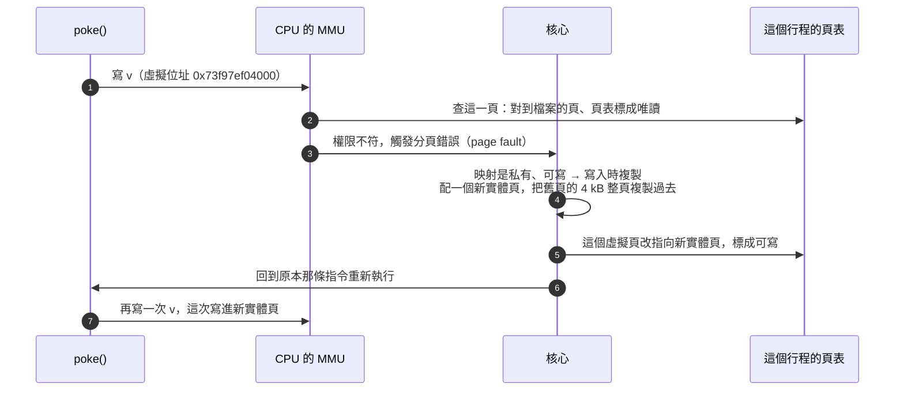

這張圖要看的是：**複製的是一整頁、改的是頁表、虛擬位址從頭到尾沒變**。別的行程的頁表沒動，仍然指著檔案那份，所以看不到這次的寫入。

#### 整理

| 問題 | 答案 | 證據 |
|---|---|---|
| `.got` 算一頁嗎？`LOAD` 才是一頁嗎？ | 都不是：`.got` 是區段（40 byte），`LOAD` 可以跨好幾頁；複製的單位是頁（4 kB） | `libhits.so` 可寫的 `LOAD` 是 `0x3e60`～`0x4010`、在 `maps` 是兩列 |
| GOT 裡是虛擬還是實體位址？ | 這個行程自己的虛擬位址 | gdb 讀到「基底 ＋ `0x400c`」 |
| 讀寫 `hits` 之前，兩邊 GOT 的數字一樣嗎？ | 開 ASLR 不同（基底不同）；關 ASLR 相同，但還是兩個位址空間；都跟有沒有讀寫過無關 | `0x…f00c` vs `0x…500c`；`setarch -R` 兩邊都是 `0x7ffff7fba00c` |
| 讀會觸發複製嗎？ | 不會，只有寫會 | `peek()` 之後 `v` 那頁還是檔案的頁 |
| 複製之後虛擬位址會變嗎？ | 不會，只改頁表 | `poke()` 前後 `v` 都在 `0x73f97ef04000` |

本章用到的新東西：`/proc/self/pagemap` 的第 61、63 位元（其餘位元見 `man 5 proc`）、glibc 的 `dl_iterate_phdr`（`man 3 dl_iterate_phdr`）、`setarch -R`（`--addr-no-randomize`，關掉這次執行的 ASLR，是 `setarch --help` 裡的一個選項，完整見 `man setarch`）、gdb 的 `set disable-randomization off` 與 `info sharedlibrary`（gdb 的分類與查法見 [`gdb完整命令參考.md`](./gdb完整命令參考.md)）。

---

## 自我測驗

> 參考答案寫在每題下面，第一次作答批改完才會補上。作答時先遮住答案、自己想過再對照。作答寫在 [`s1-07-libraries/quiz.md`](../small-project/s1-07-libraries/quiz.md)。

1. 一個靜態函式庫 `libtxt.a` 由三個成員組成，`main.c` 只呼叫 `trim`。最後的執行檔裡會有哪些函式（`to_upper_str`、`to_lower_str`、`trim`、`is_space`）？為什麼？如果把連結指令改成直接寫三個 `.o`（`gcc main.c case.o trim.o space.o`），結果有什麼不同、為什麼？
   ```c
   /* case.c */
   void to_upper_str(char *s) { for (; *s; s++) if (*s >= 'a' && *s <= 'z') *s -= 32; }
   void to_lower_str(char *s) { for (; *s; s++) if (*s >= 'A' && *s <= 'Z') *s += 32; }
   ```
   ```c
   /* space.c */
   int is_space(char c) { return c == ' ' || c == '\t' || c == '\n'; }
   ```
   ```c
   /* trim.c */
   int is_space(char c);

   char *trim(char *s)
   {
       while (is_space(*s))
           s++;
       return s;
   }
   ```
   ```c
   /* main.c */
   #include <stdio.h>

   char *trim(char *s);

   int main(void)
   {
       char buf[] = "   hello";
       printf("[%s]\n", trim(buf));
       return 0;
   }
   ```
   建立與連結：`gcc -Wall -c case.c space.c trim.c && ar rcs libtxt.a case.o space.o trim.o && gcc -Wall main.c -L. -ltxt -o app`
   > **參考答案**（核心關鍵＋詳細說明）
   >
   > **1-1**【[第二節](../html/c/靜態與動態函式庫-ar與.a、-fPIC與.so、執行時怎麼找到.so.html#連結只拉需要的成員)〈連結：只拉需要的成員〉】核心關鍵：
   >
   > 1. 執行檔裡只有 `trim` 和 `is_space`。
   > 2. `ld` 從 `.a` 只拉能解決「目前還沒定義的符號」的成員：`main` 要 `trim` → 拉 `trim.o`；`trim.o` 要 `is_space` → 再拉 `space.o`；`case.o` 沒人要，整個不拉。
   >
   > 詳細說明：拉的單位是**整個 `.o`**：如果有人用到 `to_upper_str`，同在 `case.o` 的 `to_lower_str` 也會跟著進來（筆記的 `both.c`）。成員在封存檔裡的順序不影響：本機實測 `ar t libtxt.a` 是 `case.o space.o trim.o`，`space.o` 排在 `trim.o` 前面，照樣拉得到——`ld` 在**同一個** `.a` 裡會反覆看成員，直到沒有新的符號被解決；「只掃一次、不回頭」是對命令列上前後不同的輸入檔而言（第 2 題）。驗證：`nm app | grep -E 'trim|is_space|to_'` 只列出 `trim`、`is_space`。
   >
   > **1-2**【[第二節](../html/c/靜態與動態函式庫-ar與.a、-fPIC與.so、執行時怎麼找到.so.html#連結只拉需要的成員)〈連結：只拉需要的成員〉】核心關鍵：
   >
   > 1. 執行檔多了 `to_upper_str`、`to_lower_str`（執行結果一樣，檔案變大）。
   > 2. 命令列上直接寫的 `.o` 一律整個放進輸出檔，不管有沒有人用；只有封存檔裡的成員才是「有人需要才拉」。
   >
   > 詳細說明：本機實測：`nm app2` 四個函式都在；`app` 16136 byte、`app2` 16240 byte。
2. 承上題的檔案，`gcc -Wall -L. -ltxt main.c -o app` 會失敗，錯誤訊息是 `undefined reference to 'trim'`。用 `ld` 處理輸入檔的方式解釋為什麼。這個錯誤跟 `cannot find -ltxt` 差在哪（各是什麼東西找不到）？在 Ubuntu 上把 `libtxt.a` 換成 `libtxt.so`、命令一樣寫成 `-L. -ltxt main.c`，也會失敗，原因是什麼？
   > **參考答案**（核心關鍵＋詳細說明）
   >
   > **2-1**【[第二節](../html/c/靜態與動態函式庫-ar與.a、-fPIC與.so、執行時怎麼找到.so.html#順序ld-由左往右只掃一次)〈順序：`ld` 由左往右只掃一次〉】核心關鍵：
   >
   > 1. `ld` 照命令列順序處理輸入檔，手上維持一張「還沒找到定義的符號」清單。
   > 2. 遇到 `libtxt.a` 時 `main` 的 `.o` 還沒讀，清單裡沒有 `trim`（只有啟動檔帶進來的 `main` 等，第九節第 15 章），一個成員都不拉就略過。
   > 3. 讀到 `main` 才多了 `trim`，命令列結束時還在清單上，`ld` 不會回頭重掃 `libtxt.a` → `undefined reference`。
   >
   > 詳細說明：規則：函式庫寫在用到它的檔案後面（`main.c -L. -ltxt`）。函式庫之間互相需要時，寫兩次或用 `-Wl,--start-group … -Wl,--end-group`。
   >
   > **2-2**【[第三節](../html/c/靜態與動態函式庫-ar與.a、-fPIC與.so、執行時怎麼找到.so.html#三-l-與--l連結時去哪裡找找什麼名字)、[第二節](../html/c/靜態與動態函式庫-ar與.a、-fPIC與.so、執行時怎麼找到.so.html#順序ld-由左往右只掃一次)〈順序：`ld` 由左往右只掃一次〉】核心關鍵：
   >
   > 1. `cannot find -ltxt`：連結時在搜尋目錄裡找不到 `libtxt.so`／`libtxt.a` **這個檔案**（例如沒給 `-L.`、名字拼錯）。
   > 2. `undefined reference to 'trim'`：檔案找到了，但 `trim` 這個**符號**到最後都沒有被解決（這題是因為順序，一個成員都沒拉）。
   >
   > 詳細說明：兩者都是連結時 `ld` 的錯。對照第五節的 `cannot open shared object file`：那是**執行時** `ld.so` 找不到 `.so` 檔，第 4 題會用到。
   >
   > **2-3**【[第四節](../html/c/靜態與動態函式庫-ar與.a、-fPIC與.so、執行時怎麼找到.so.html#so-在-ubuntu-上也有順序問題)〈`.so` 在 Ubuntu 上也有順序問題〉】核心關鍵：
   >
   > 1. Ubuntu 的 gcc 預設傳 `--as-needed` 給 `ld`：`.so` 只有在**目前有人需要它的符號**時才寫進 `NEEDED`、才拿來解決符號。
   > 2. 遇到 `-ltxt` 時 `main` 還沒讀、沒人需要 `trim`，`libtxt.so` 就被丟掉 → 之後 `main` 的 `trim` 沒人提供 → `undefined reference`。
   >
   > 詳細說明：本機實測：`gcc -Wall -fPIC -shared case.c space.c trim.c -o libtxt.so && gcc -Wall -L. -ltxt main.c -o app3` 得到 `undefined reference to 'trim'`；把 `-Wl,--no-as-needed` 放在 `-ltxt` 前面（`gcc -Wall -L. -Wl,--no-as-needed -ltxt main.c -o app4`）就成功，`readelf -d app4` 有 `NEEDED libtxt.so`。`gcc -v` 印出的 `collect2` 那一行看得到 `--as-needed`。所以 `.a` 和 `.so` 一律把 `-l` 寫在後面。你寫的「`.a` 把要用的 `.o` 合併進執行檔、`.so` 只寫進動態區段給執行時用」是對的，只是不是這題的原因。
3. 下面的 `stats.c` 不加 `-fPIC` 編成 `stats.o`，再用 `gcc -shared stats.o -o libstats.so`。會成功嗎？錯誤訊息會提到哪個變數？為什麼另一個變數不會有問題？為什麼 `.so` 存取全域變數一定要經過 GOT，而不能像執行檔那樣用 `%rip` 加固定距離直接讀（講出兩個理由）？
   ```c
   /* stats.c */
   int hits = 0;
   static int misses = 0;

   void hit(void)  { hits = hits + 1; }
   void miss(void) { misses = misses + 1; }
   ```
   編譯：`gcc -Wall -c stats.c -o stats.o && gcc -shared stats.o -o libstats.so`
   > **參考答案**（核心關鍵＋詳細說明）
   >
   > **3-1**【[第四節](../html/c/靜態與動態函式庫-ar與.a、-fPIC與.so、執行時怎麼找到.so.html#為什麼一定要--fpic先看不加會怎樣)〈為什麼一定要 `-fPIC`：先看不加會怎樣〉】核心關鍵：
   >
   > 1. 不會成功。
   > 2. 錯誤提到 `hits`：`relocation R_X86_64_PC32 against symbol 'hits' can not be used when making a shared object; recompile with -fPIC`。
   >
   > 詳細說明：本機實測輸出：`warning: relocation against 'hits' in read-only section '.text'`、`relocation R_X86_64_PC32 against symbol 'hits' can not be used when making a shared object; recompile with -fPIC`、`final link failed: bad value`。沒加 `-fPIC`（Ubuntu 預設 `-fPIE`）時，編譯器假設 `hits` 就在附近、用 `R_X86_64_PC32` 直接讀；做 `.so` 時 `ld` 不接受對全域符號用這種重定位。
   >
   > **3-2**【[第四節](../html/c/靜態與動態函式庫-ar與.a、-fPIC與.so、執行時怎麼找到.so.html#為什麼不能直接用固定距離counter-最後不一定是這一份)〈為什麼不能直接用固定距離：`counter` 最後不一定是這一份〉】核心關鍵：
   >
   > 1. `misses` 是 `static`（`LOCAL`），別的檔案不可能用到它、也不可能用同名定義插入。
   > 2. 所以它一定是這個 `.so` 自己那一份，跟程式碼在同一個 `.so` 裡、距離固定，`%rip` 加固定距離就讀得到，不需要 GOT。
   >
   > 詳細說明：筆記的 `count_static.c`（`static int counter`）不加 `-fPIC` 也做得成 `.so`，是同一個道理。
   >
   > **3-3**【[第四節](../html/c/靜態與動態函式庫-ar與.a、-fPIC與.so、執行時怎麼找到.so.html#為什麼不能直接用固定距離counter-最後不一定是這一份)〈為什麼不能直接用固定距離：`counter` 最後不一定是這一份〉】核心關鍵：
   >
   > 1. 符號插入：`.so` 的全域變數最後被使用的可能不是它自己那份（執行檔或先載入的 `.so` 有同名定義，`ld.so` 先找執行檔），做 `.so` 時不知道它在哪 → 只能等載入時由 `ld.so` 把真正位址填進 GOT。
   > 2. 不能讓 `ld.so` 載入時直接改 `.text` 裡的距離：`.text` 是唯讀的，而且每個行程寫進自己的位址就得各複製一份，同一份 `.text` 實體頁給所有行程共用的好處就沒了；所以把要因行程而異的位址集中在可寫的 GOT。
   >
   > 詳細說明：正文〈為什麼不能直接用固定距離〉的 `usecount` 實驗：主程式自己定義 `counter = 100`，`libcount.so` 的 `bump()` 加的是主程式那份，印出 `counter = 101`。第二個理由在同一節〈那為什麼不讓 `ld.so` 載入時直接改 `.text` 裡的距離就好？〉那段，第 9 題會再考到。
4. 情境題：你在 `/home/me/proj/` 下做了 `lib/libfoo.so` 和用它的 `app`，連結指令是 `gcc main.c -Llib -lfoo -o app`。連結成功，`./app` 卻印出 `error while loading shared libraries: libfoo.so: cannot open shared object file`。(1) 這個訊息是誰印的？為什麼連結時找得到、執行時找不到？(2) 你想讓 `app` 和 `lib/` 一起打包給同事，同事解壓到任何地方都能直接執行，連結指令要怎麼改？為什麼要用單引號？(3) 同事想臨時用 `LD_LIBRARY_PATH` 換成他自己編的 `libfoo.so` 來除錯，在你的做法（`RUNPATH`）下換得掉嗎？如果是 `RPATH` 呢？為什麼？
   > **參考答案**（核心關鍵＋詳細說明）
   >
   > **4-1**【[第五節](../html/c/靜態與動態函式庫-ar與.a、-fPIC與.so、執行時怎麼找到.so.html#ldso-去了哪些地方找)〈`ld.so` 去了哪些地方找〉】核心關鍵：
   >
   > 1. 是動態連結器 `ld.so`（執行檔的 interpreter）在執行時印的。
   > 2. `-Llib` 只告訴**連結時**的 `ld` 去哪找，不會寫進執行檔；執行檔的 `NEEDED` 只記名字 `libfoo.so`。
   > 3. 執行時 `ld.so` 只找 `RPATH`、`LD_LIBRARY_PATH`、`RUNPATH`、`/etc/ld.so.cache`、預設目錄，`lib/`（和當前目錄）都不在裡面。
   >
   > 詳細說明：`LD_DEBUG=libs ./app` 會印出它試過的每個路徑，最後放棄。
   >
   > **4-2**【[第五節](../html/c/靜態與動態函式庫-ar與.a、-fPIC與.so、執行時怎麼找到.so.html#方法二-wl-rpath把路徑寫進執行檔)〈方法二：`-Wl,-rpath`——把路徑寫進執行檔〉】核心關鍵：
   >
   > 1. `gcc main.c -Llib -lfoo -Wl,-rpath,'$ORIGIN/lib' -o app`：把 `$ORIGIN/lib` 寫進執行檔的 `RUNPATH`，`ld.so` 執行時把 `$ORIGIN` 換成執行檔所在的目錄。
   > 2. `$ORIGIN` 不是 shell 變數，要**原封不動**寫進執行檔給 `ld.so` 換；不用單引號（包括用雙引號）時 shell 會先把 `$ORIGIN` 換成空字串，寫進去的就變成 `/lib`。
   >
   > 詳細說明：單引號裡 shell 什麼都不展開；一定要用雙引號時寫成 `"\$ORIGIN/lib"`。用 `readelf -d app | grep RUNPATH` 檢查實際寫進去的是什麼。只要 `app` 和 `lib/` 的相對位置不變，解壓到哪裡都找得到。
   >
   > **4-3**【[第五節](../html/c/靜態與動態函式庫-ar與.a、-fPIC與.so、執行時怎麼找到.so.html#rpath-和-runpath-差在哪跟-ld_library_path-誰優先)〈`RPATH` 和 `RUNPATH` 差在哪：跟 `LD_LIBRARY_PATH` 誰優先〉、[第五節](../html/c/靜態與動態函式庫-ar與.a、-fPIC與.so、執行時怎麼找到.so.html#ldso-去了哪些地方找)〈`ld.so` 去了哪些地方找〉】核心關鍵：
   >
   > 1. `RUNPATH` 換得掉：`ld.so` 的搜尋順序裡 `LD_LIBRARY_PATH`（第 2 步）排在 `RUNPATH`（第 3 步）前面，先找到同事自己的版本。
   > 2. `RPATH` 換不掉：`RPATH`（第 1 步，只在沒有 `RUNPATH` 時用）排在 `LD_LIBRARY_PATH` 前面，先找到原本 `lib/` 裡的版本。
   >
   > 詳細說明：筆記的 `v1`／`v2` 實驗：`LD_LIBRARY_PATH=v2 ./app_runpath` 印 1005（用了 v2），`./app_rpath` 印 5（還是 v1）。`RUNPATH` 是故意排在後面的：讓使用者能臨時換版本來除錯；所以 `ld` 預設寫 `RUNPATH`，加 `--disable-new-dtags` 才寫舊式的 `RPATH`，`man ld.so` 也標明 `DT_RPATH` 不建議使用。`LD_DEBUG=libs` 每段 `search path=` 後面的括號會寫來源（`(LD_LIBRARY_PATH)`、`(RPATH from file …)`）。
5. 你維護 `libcalc`，SONAME 是 `libcalc.so.1`。系統上有 `libcalc.so -> libcalc.so.1`、`libcalc.so.1 -> libcalc.so.1.0.0` 兩個符號連結。(1) 一支程式動態連結了 `libcalc`，它的 `NEEDED` 寫的是哪個名字？為什麼刪掉 `libcalc.so` 它照樣能跑，刪掉 `libcalc.so.1` 就不行？(2) 你修了一個 bug（介面不變），做成 `libcalc.so.1.0.1`。已經動態連結的程式要怎樣才能用到修正？另一支用 `libcalc.a` 靜態連結的程式呢？(3) 下一版要把 `calc_add` 改成三個參數（不相容），SONAME 該怎麼辦？為什麼這樣舊程式不會壞？
   > **參考答案**（核心關鍵＋詳細說明）
   >
   > **5-1**【[第六節](../html/c/靜態與動態函式庫-ar與.a、-fPIC與.so、執行時怎麼找到.so.html#sonameneeded-記的是哪個名字)〈SONAME：`NEEDED` 記的是哪個名字〉】核心關鍵：
   >
   > 1. `NEEDED` 寫的是 SONAME `libcalc.so.1`：`ld` 照 `-lcalc` 打開 `libcalc.so`，但記下的是那個檔案裡寫的 SONAME，不是檔名。
   > 2. `libcalc.so`（連結名稱）只在連結時給 `-lcalc` 用；執行時 `ld.so` 找的是 `libcalc.so.1`，所以刪掉它就找不到。
   >
   > 詳細說明：這就是開發套件（`zlib1g-dev`，有 `libz.so`）和執行套件（`zlib1g`，只有 `libz.so.1`）分開的原因：只裝執行套件，程式能跑，但不能 `-lz` 連結。
   >
   > **5-2**【[第六節](../html/c/靜態與動態函式庫-ar與.a、-fPIC與.so、執行時怎麼找到.so.html#sonameneeded-記的是哪個名字)〈SONAME：`NEEDED` 記的是哪個名字〉、[第六節](../html/c/靜態與動態函式庫-ar與.a、-fPIC與.so、執行時怎麼找到.so.html#換掉-so程式不用重新連結)〈換掉 `.so`：程式不用重新連結〉】核心關鍵：
   >
   > 1. 動態：SONAME 不變（`libcalc.so.1`），把 `libcalc.so.1` 改指向 `libcalc.so.1.0.1`；程式不必重新連結，重新執行就用到修正。
   > 2. 靜態：`libcalc.a` 的 `.o` 已經複製進執行檔，換函式庫影響不到它，要用新的 `libcalc.a` 重新連結。
   >
   > 詳細說明：`ldconfig` 會照各 `.so` 的 SONAME 自動建立 SONAME 符號連結。已經在跑的行程要重開才會載入新檔。
   >
   > **5-3**【[第六節](../html/c/靜態與動態函式庫-ar與.a、-fPIC與.so、執行時怎麼找到.so.html#sonameneeded-記的是哪個名字)〈SONAME：`NEEDED` 記的是哪個名字〉】核心關鍵：
   >
   > 1. 新版 SONAME 改成 `libcalc.so.2`（`-Wl,-soname,libcalc.so.2`，真實檔例如 `libcalc.so.2.0.0`，`libcalc.so.2` 指向它，`libcalc.so` 改指向新版給新程式連結）。
   > 2. 舊程式的 `NEEDED` 寫的是 `libcalc.so.1`，執行時照樣找到舊檔（舊檔留著、兩版並存），不會拿到參數不相容的新版；重新連結的新程式才記下 `libcalc.so.2`。
   >
   > 詳細說明：反過來，如果不相容卻沒換 SONAME，舊程式會載入新版、用兩個參數呼叫三個參數的 `calc_add`，第三個參數是暫存器裡的垃圾值。
6. 看下面 `libtally.so` 的反組譯（`total = total + x;` 那一段）回答：(1) `111a` 那一行的 `0x2eaf` 是從哪裡到哪裡的距離？用這段的數字算出右邊註解的 `3fd0`。`112b` 那一行的 `D` 是 `0x2e9e`，跟 `0x2eaf` 不一樣，為什麼算出來還是 `3fd0`？(2) 註解 `<total-0x48>` 是說 `total` 放在 `0x3fd0` 嗎？`0x3fd0` 是什麼、`total` 本身在哪？(3) 執行完 `111a` 那一行，`%rax` 裡裝的是什麼？`1121` 讀到的又是什麼？為什麼用 `objdump -s -j .got libtally.so` 看，`0x3fd0` 那格在檔案裡是 0？
   ```c
   /* tally.c */
   int seen = 0;
   long total = 0;

   void add_sample(long x)
   {
       seen = seen + 1;
       total = total + x;
   }
   ```
   編譯與觀察：`gcc -Wall -fPIC -c tally.c -o tally.pic.o && gcc -shared tally.pic.o -o libtally.so`，再 `objdump -d --no-show-raw-insn libtally.so` 與 `readelf -r libtally.so`，`total = total + x;` 那一段是：
   ```asm
       111a:	mov    0x2eaf(%rip),%rax        # 3fd0 <total-0x48>   ← 從 %rip 加 0x2eaf 的地方讀 8 byte 放進 %rax
       1121:	mov    (%rax),%rdx                                  ← 照 %rax 裡的位址讀 8 byte 放進 %rdx
       1124:	mov    -0x8(%rbp),%rax                              ← 從堆疊取出參數 x 放進 %rax
       1128:	add    %rax,%rdx                                    ← %rdx = %rdx + x
       112b:	mov    0x2e9e(%rip),%rax        # 3fd0 <total-0x48>   ← 同第一行，D 不同
       1132:	mov    %rdx,(%rax)                                  ← 把 %rdx 寫到 %rax 裡的位址
   ```
   ```text
   000000003fd0  000700000006 R_X86_64_GLOB_DAT 0000000000004018 total + 0
   000000003fd8  000600000006 R_X86_64_GLOB_DAT 0000000000004010 seen + 0
   ```
   （檔案：[`tally.c`](../small-project/s1-07-libraries/examples/pic/tally.c)）
   > **參考答案**（核心關鍵＋詳細說明）
   >
   > **6-1**【[第九節第 1 章](../html/c/靜態與動態函式庫-ar與.a、-fPIC與.so、執行時怎麼找到.so.html#1-0x2ec8-和-0x3fd0-各是什麼mov-0x2ec8riprax-的兩個數字)〈`0x2ec8` 和 `0x3fd0` 各是什麼：`mov 0x2ec8(%rip),%rax` 的兩個數字〉】核心關鍵：
   >
   > 1. 從**下一條指令**（`0x1121`）到 GOT 裡 `total` 那一格的距離。
   > 2. `0x1121 ＋ 0x2eaf ＝ 0x3fd0`。
   >
   > 詳細說明：公式是第 4 課的 `D(%rip)`：位址 ＝ 下一條指令的位址 ＋ D。
   >
   > **6-2**【[第九節第 1 章](../html/c/靜態與動態函式庫-ar與.a、-fPIC與.so、執行時怎麼找到.so.html#1-0x2ec8-和-0x3fd0-各是什麼mov-0x2ec8riprax-的兩個數字)〈`0x2ec8` 和 `0x3fd0` 各是什麼：`mov 0x2ec8(%rip),%rax` 的兩個數字〉】核心關鍵：
   >
   > 1. 兩行都是去 `0x3fd0` 那一格，但 `%rip` 是各自的下一條指令：`112b` 的下一條是 `0x1132`。
   > 2. 起點不同，到同一格的距離自然不同：`0x1132 ＋ 0x2e9e ＝ 0x3fd0`。
   >
   > 詳細說明：同一個函式裡每次拿 `total` 的位址，`D` 都不一樣、算出來都是同一格，這正好證明 `0x3fd0` 是位址、`D` 是距離。
   >
   > **6-3**【[第九節第 1 章](../html/c/靜態與動態函式庫-ar與.a、-fPIC與.so、執行時怎麼找到.so.html#1-0x2ec8-和-0x3fd0-各是什麼mov-0x2ec8riprax-的兩個數字)〈`0x2ec8` 和 `0x3fd0` 各是什麼：`mov 0x2ec8(%rip),%rax` 的兩個數字〉】核心關鍵：
   >
   > 1. 不是：`<total-0x48>` 只是位置標籤，意思是「`total` 往前 `0x48`」：`0x4018 − 0x48 ＝ 0x3fd0`。GOT 的格子沒有自己的符號名，`objdump` 只好找附近的符號來標。
   > 2. `0x3fd0` 是 `.got` 裡的一格，裡面裝的是 `total` 的位址（`readelf -r` 那行 `R_X86_64_GLOB_DAT … total`）。
   > 3. `total` 本身在 `.bss` 的 `0x4018`（`readelf -r` 的 `Sym. Value`）。
   >
   > 詳細說明：標籤跟「這格裝什麼」沒關係，只是剛好這個 `.so` 很小、最近的符號就是 `total`。真正說明那格裝什麼的是 `readelf -r`：第一欄 `3fd0` 是要被填的格子，`GLOB_DAT` 是「填一個符號的位址」，`total` 是填誰。
   >
   > **6-4**【[第九節第 1 章](../html/c/靜態與動態函式庫-ar與.a、-fPIC與.so、執行時怎麼找到.so.html#1-0x2ec8-和-0x3fd0-各是什麼mov-0x2ec8riprax-的兩個數字)〈`0x2ec8` 和 `0x3fd0` 各是什麼：`mov 0x2ec8(%rip),%rax` 的兩個數字〉】核心關鍵：
   >
   > 1. `111a` 去 `0x3fd0` 那格讀 8 byte，所以 `%rax` 裝的是格子的**內容**——`total` 的位址（載入時 `ld.so` 填的）。
   > 2. `1121` 的 `mov (%rax),%rdx` 照這個位址再讀 8 byte，讀到的是 **`total` 的值**。
   >
   > 詳細說明：兩條指令＝兩次讀記憶體：先讀 GOT 拿到位址，再照位址讀變數。對照第 4 課〈[`lea`：只算位址，不碰記憶體](../html/c/x86-64組合語言入門-暫存器、mov與lea、cmp與條件跳躍.html#lea只算位址不碰記憶體)〉：如果寫成 `lea 0x2eaf(%rip),%rax`，`%rax` 才會是 `0x3fd0`（加上載入基底）這個格子的位址。筆記第 1 章用 gdb 實測：`libcount.so` 的 GOT 那格（`0x7ffff7fb6000 + 0x3fd0`）裡裝的是 `0x7ffff7fba00c`，正是 `&counter`。
   >
   > **6-5**【[第九節第 1 章](../html/c/靜態與動態函式庫-ar與.a、-fPIC與.so、執行時怎麼找到.so.html#1-0x2ec8-和-0x3fd0-各是什麼mov-0x2ec8riprax-的兩個數字)〈`0x2ec8` 和 `0x3fd0` 各是什麼：`mov 0x2ec8(%rip),%rax` 的兩個數字〉】核心關鍵：
   >
   > 1. 檔案裡那格還沒填：要等**載入時** `ld.so` 照 `R_X86_64_GLOB_DAT total` 把 `total` 的真正位址寫進去。
   > 2. 做 `.so` 時填不了：載入基底每次不同，而且最後用的 `total` 可能是別人那份（符號插入）。
   >
   > 詳細說明：你貼的 `.got` 全是 0 就是證據；用 gdb 停在函式裡看同一格，就會看到填好的位址。
7. `libconf.so` 和主程式 `app.c` 都定義了 `verbose`。(1) `gcc -Wall app.c -L. -lconf -Wl,-rpath,'$ORIGIN' -o app` 會不會出現 `multiple definition`？為什麼？改成 `gcc -Wall app.c conf.pic.o -o app2` 呢？差別在 `ld` 怎麼處理 `.so` 和 `.o`。(2) 能連結成功的那一個，`./app` 會印出 `get_verbose() = ` 多少？用執行時 `ld.so` 怎麼找符號解釋。(3) 把 `conf.c` 第一行改成 `static int verbose = 0;`，重做 `libconf.so`，不重新連結就執行 `./app`，印出多少？為什麼跟 (2) 不同？
   ```c
   /* conf.c */
   int verbose = 0;

   int get_verbose(void)
   {
       return verbose;
   }
   ```
   ```c
   /* app.c */
   #include <stdio.h>

   int verbose = 3;
   int get_verbose(void);

   int main(void)
   {
       printf("get_verbose() = %d\n", get_verbose());
       return 0;
   }
   ```
   做函式庫：`gcc -Wall -fPIC -c conf.c -o conf.pic.o && gcc -shared conf.pic.o -o libconf.so`（檔案：[`conf.c`](../small-project/s1-07-libraries/examples/pic/conf.c)、[`app.c`](../small-project/s1-07-libraries/examples/pic/app.c)）
   > **參考答案**（核心關鍵＋詳細說明）
   >
   > **7-1**【[第九節第 2 章](../html/c/靜態與動態函式庫-ar與.a、-fPIC與.so、執行時怎麼找到.so.html#2-兩份-counter接-so-為什麼不算重複定義)〈兩份 `counter`：接 `.so` 為什麼不算重複定義〉】核心關鍵：
   >
   > 1. 不會。
   > 2. `ld` 不把 `.so` 的內容複製進輸出檔，只讀它的動態符號表（解決未定義符號）並記進 `NEEDED`；輸出檔裡只有 `app.c` 那份 `verbose`，`multiple definition` 只檢查放進同一個輸出檔的定義。
   >
   > 詳細說明：連結成功後兩份 `verbose` 都還在，各在各的檔案裡，要到執行時才由 `ld.so` 挑一份。
   >
   > **7-2**【[第九節第 2 章](../html/c/靜態與動態函式庫-ar與.a、-fPIC與.so、執行時怎麼找到.so.html#2-兩份-counter接-so-為什麼不算重複定義)〈兩份 `counter`：接 `.so` 為什麼不算重複定義〉】核心關鍵：
   >
   > 1. 會出現 `multiple definition of 'verbose'`。
   > 2. `.o` 的內容會被整個**複製進**輸出檔，`app.c` 和 `conf.pic.o` 的 `verbose` 都進了 `app2`，同一個輸出檔裡兩份定義。
   >
   > 詳細說明：同樣兩份定義，接 `.o` 是連結錯誤、接 `.so` 是執行時的符號插入。
   >
   > **7-3**【[第四節](../html/c/靜態與動態函式庫-ar與.a、-fPIC與.so、執行時怎麼找到.so.html#為什麼不能直接用固定距離counter-最後不一定是這一份)〈為什麼不能直接用固定距離：`counter` 最後不一定是這一份〉、[第九節第 2 章](../html/c/靜態與動態函式庫-ar與.a、-fPIC與.so、執行時怎麼找到.so.html#2-兩份-counter接-so-為什麼不算重複定義)〈兩份 `counter`：接 `.so` 為什麼不算重複定義〉】核心關鍵：
   >
   > 1. 印 `get_verbose() = 3`。
   > 2. `ld.so` 找符號**先找執行檔、再依 `NEEDED` 順序找各個 `.so`**，第一個找到的贏（符號插入）；所以 `libconf.so` 的 GOT 裡 `verbose` 那格填的是執行檔那份的位址，`get_verbose` 經過 GOT 讀到 3。
   >
   > 詳細說明：`LD_DEBUG=bindings ./app` 會看到 `binding file …/libconf.so to ./app: normal symbol 'verbose'`。`libconf.so` 自己那份（初值 0）一直在記憶體裡，只是沒人用。
   >
   > **7-4**【[第四節](../html/c/靜態與動態函式庫-ar與.a、-fPIC與.so、執行時怎麼找到.so.html#為什麼不能直接用固定距離counter-最後不一定是這一份)〈為什麼不能直接用固定距離：`counter` 最後不一定是這一份〉】核心關鍵：
   >
   > 1. 印 `get_verbose() = 0`。
   > 2. `static` 讓 `verbose` 變成 `LOCAL`，別人不可能插入：編譯器直接用 `%rip` 加固定距離讀 `.so` 自己那份，不經過 GOT，`ld.so` 也不會把它接到執行檔的 `verbose`。
   >
   > 詳細說明：執行檔不用重新連結也會變：`get_verbose` 的程式碼在 `.so` 裡，換掉 `.so` 就換了讀法。
8. `liblogger.so` 的 `run()` 呼叫了 `log_msg()` 兩次，主程式 `runner.c` 只呼叫 `run()`。(1) 反組譯裡的 `log_msg@plt` 是一張存位址的表嗎？`log_msg` 的位址存在哪個區段的哪一格？用 `jmp` 那行的數字算出來。(2) 第一次和第二次 `call 1070 <log_msg@plt>`，從 `call` 到進入 `log_msg` 各經過哪些地方？`ld.so` 在哪一次介入、做了什麼？(3) 全域變數為什麼不能用這種「第一次用到才查」的方式，一定要載入時就把 `.got` 那格填好？
   ```c
   /* logger.c */
   #include <stdio.h>

   void log_msg(const char *s)
   {
       printf("[log] %s\n", s);
   }

   void run(void)
   {
       log_msg("start");
       log_msg("stop");
   }
   ```
   ```c
   /* runner.c */
   void run(void);

   int main(void)
   {
       run();
       return 0;
   }
   ```
   編譯：`gcc -Wall -fPIC -c logger.c -o logger.pic.o && gcc -shared logger.pic.o -o liblogger.so && gcc -Wall runner.c -L. -llogger -Wl,-rpath,'$ORIGIN' -o runner`（檔案：[`logger.c`](../small-project/s1-07-libraries/examples/pic/logger.c)、[`runner.c`](../small-project/s1-07-libraries/examples/pic/runner.c)）。觀察到的反組譯與區段（`objdump -d --no-show-raw-insn liblogger.so`、`readelf -SW liblogger.so`、`readelf -r liblogger.so`）：
   ```asm
       1179:	call   1070 <log_msg@plt>        ← 第一次呼叫 log_msg（參數 "start" 已放進 %rdi）
       ...
       1188:	call   1070 <log_msg@plt>        ← 第二次呼叫 log_msg（參數 "stop"）

   0000000000001070 <log_msg@plt>:
       1070:	endbr64                          ← 間接跳躍的保護標記，可以忽略
       1074:	jmp    *0x2f8e(%rip)        # 4008 <log_msg@@Base+0x2ecf>   ← 跳到「%rip 加 0x2f8e 那格裡存的位址」
       107a:	nopw   0x0(%rax,%rax,1)        ← 不做事的填充指令
   ```
   ```text
     [11] .plt              PROGBITS        0000000000001020 001020 000030 10  AX  0   0 16
     [13] .plt.sec          PROGBITS        0000000000001060 001060 000020 10  AX  0   0 16
     [22] .got              PROGBITS        0000000000003fc8 002fc8 000020 08  WA  0   0  8
     [23] .got.plt          PROGBITS        0000000000003fe8 002fe8 000028 08  WA  0   0  8
   000000004008  000700000007 R_X86_64_JUMP_SLO 0000000000001139 log_msg + 0
   ```
   > **參考答案**（核心關鍵＋詳細說明）
   >
   > **8-1**【[第九節第 4 章](../html/c/靜態與動態函式庫-ar與.a、-fPIC與.so、執行時怎麼找到.so.html#4-plt-存函式位址got-存變數位址嗎plt-是跳板以及延遲綁定)〈PLT 存函式位址、GOT 存變數位址嗎？PLT 是跳板，以及延遲綁定〉】核心關鍵：
   >
   > 1. 不是：`log_msg@plt` 是**程式碼**（`.plt.sec` 裡的跳板，權限 `AX`），不存位址。
   > 2. `log_msg` 的位址存在 `.got.plt`（`0x3fe8` 起）的 `0x4008` 那格（`R_X86_64_JUMP_SLOT`）。
   > 3. `jmp *0x2f8e(%rip)` 的下一條是 `0x107a`：`0x107a ＋ 0x2f8e ＝ 0x4008`。
   >
   > 詳細說明：`*` 表示「跳到記憶體裡存的那個位址」。函式和變數的位址都在 GOT 裡，只是函式那些放在 `.got.plt`。
   >
   > **8-2**【[第九節第 4 章](../html/c/靜態與動態函式庫-ar與.a、-fPIC與.so、執行時怎麼找到.so.html#4-plt-存函式位址got-存變數位址嗎plt-是跳板以及延遲綁定)〈PLT 存函式位址、GOT 存變數位址嗎？PLT 是跳板，以及延遲綁定〉、[第九節第 8 章](../html/c/靜態與動態函式庫-ar與.a、-fPIC與.so、執行時怎麼找到.so.html#8-ldso-填進格子的是什麼這個行程裡的虛擬位址)〈`ld.so` 填進格子的是什麼：這個行程裡的虛擬位址〉】核心關鍵：
   >
   > 1. 第一次：`call` → `log_msg@plt` 跳板 → `jmp *(0x4008 那格)`，那格載入時填的是 `.plt` 裡「叫 `ld.so` 去查」的程式碼 → `ld.so` 查出 `log_msg` 的位址、寫回 `0x4008`、跳進 `log_msg`。
   > 2. 第二次：`call` → 跳板 → 照 `0x4008`（已經是 `log_msg` 的位址）直接跳進去，`ld.so` 不再介入。
   >
   > 詳細說明：這叫延遲綁定（lazy binding）：好處是啟動時不必查完所有函式。跳板只是照格子跳，不判斷格子「空不空」。
   >
   > **8-3**【[第九節第 4 章](../html/c/靜態與動態函式庫-ar與.a、-fPIC與.so、執行時怎麼找到.so.html#4-plt-存函式位址got-存變數位址嗎plt-是跳板以及延遲綁定)〈PLT 存函式位址、GOT 存變數位址嗎？PLT 是跳板，以及延遲綁定〉】核心關鍵：
   >
   > 1. 延遲綁定靠跳板：呼叫函式時一定先經過 PLT 這段程式碼，第一次才有機會轉去叫 `ld.so` 查。
   > 2. 讀變數就是一條 `mov`（從 GOT 拿位址、再照位址讀），中間沒有程式碼可以攔下來「先去查」，所以 `.got` 裡變數那格一定要在載入時就填好。
   >
   > 詳細說明：如果 `.got` 那格沒填，`mov (%rax),…` 會直接拿檔案裡的 0 當位址去讀，當場 segfault。
9. （2026-10-26 提問延伸）兩支程式 `x`、`y` 都連 `libhits.so`，同時在跑（各自停在 `sleep(5)`）。(1) `x` 印出的 `&hit` 和 `y` 印出的不一樣，這代表記憶體裡有兩份 `hit` 的程式碼嗎？`libhits.so` 的哪些部分兩個行程共用同一份實體記憶體、哪些是各自一份？(2) `y` 印出的 `hit()` 回傳值是多少？為什麼不是 `x`、`y` 加起來的 7？(3) 假設沒有 GOT，改成讓 `ld.so` 載入時把位址直接寫進 `.text`，用「寫入時複製」說明 `.text` 還能不能共用、為什麼。
   ```c
   /* hits.c */
   int hits = 0;

   int hit(void)
   {
       hits = hits + 1;
       return hits;
   }
   ```
   ```c
   /* x.c */
   #include <stdio.h>
   #include <unistd.h>

   int hit(void);

   int main(void)
   {
       int r = 0;
       for (int i = 0; i < 2; i++)               /* x 呼叫 2 次 */
           r = hit();
       printf("x: &hit=%p  hit() 回傳 %d\n", (void *)hit, r);
       fflush(stdout);
       sleep(5);
       return 0;
   }
   ```
   ```c
   /* y.c */
   #include <stdio.h>
   #include <unistd.h>

   int hit(void);

   int main(void)
   {
       int r = 0;
       for (int i = 0; i < 5; i++)               /* y 呼叫 5 次 */
           r = hit();
       printf("y: &hit=%p  hit() 回傳 %d\n", (void *)hit, r);
       fflush(stdout);
       sleep(5);
       return 0;
   }
   ```
   編譯：`gcc -Wall -fPIC -c hits.c -o hits.pic.o && gcc -shared hits.pic.o -o libhits.so && gcc -Wall x.c -L. -lhits -Wl,-rpath,'$ORIGIN' -o x && gcc -Wall y.c -L. -lhits -Wl,-rpath,'$ORIGIN' -o y`，執行：`./x & ./y & wait`（檔案：[`hits.c`](../small-project/s1-07-libraries/examples/share/hits.c)、[`x.c`](../small-project/s1-07-libraries/examples/share/x.c)、[`y.c`](../small-project/s1-07-libraries/examples/share/y.c)）。
   > **參考答案**（核心關鍵＋詳細說明）
   >
   > **9-1**【[第九節第 6 章](../html/c/靜態與動態函式庫-ar與.a、-fPIC與.so、執行時怎麼找到.so.html#6-兩支程式都用-libcountso記憶體裡是同一份嗎)〈兩支程式都用 `libcount.so`，記憶體裡是同一份嗎？〉】核心關鍵：
   >
   > 1. 不是兩份程式碼：`&hit` 不同是因為兩個行程把 `libhits.so` 載入在不同的基底（ASLR），虛擬位址不同，但對到同一個實體頁（尾巴都是檔案裡的 `0x10f9`）。
   > 2. 共用同一份實體記憶體的是沒被寫過的頁：`.text`（`r-xp`，`smaps` 是 `Shared_Clean`）、唯讀資料。
   > 3. 各自一份的是被寫過的頁：`.got`（`ld.so` 載入時寫）和 `.data`／`.bss`（`hits` 被寫）——私有映射一寫就寫入時複製（`Private_Dirty`）。
   >
   > 詳細說明：本機實測：`x: &hit=0x7ace937850f9  hit() 回傳 2`、`y: &hit=0x713b714f10f9  hit() 回傳 5`。`x`、`y` 是兩個獨立的行程，各有自己的位址空間；`libhits.so` 映射進來時是私有映射（`smaps` 權限欄的 `p`），沒人寫的頁大家共用，誰寫了核心就替誰複製一份。
   >
   > **9-2**【[第九節第 6 章](../html/c/靜態與動態函式庫-ar與.a、-fPIC與.so、執行時怎麼找到.so.html#6-兩支程式都用-libcountso記憶體裡是同一份嗎)〈兩支程式都用 `libcount.so`，記憶體裡是同一份嗎？〉】核心關鍵：
   >
   > 1. 印 5。
   > 2. `hits` 那一頁（`libhits.so` 的 `.bss`）每個行程各一份：`hit()` 一寫就觸發寫入時複製，`x` 改的是 `x` 的那頁、`y` 改的是 `y` 的那頁，所以 `x` 算到 2、`y` 算到 5，不會加成 7。
   >
   > 詳細說明：共用的只有沒被寫過的頁。要讓兩個行程真的共用一個計數器，得用共享記憶體（例如 `mmap` 的 `MAP_SHARED`）這類明確的機制，函式庫本身做不到。
   >
   > **9-3**【[第九節第 6 章](../html/c/靜態與動態函式庫-ar與.a、-fPIC與.so、執行時怎麼找到.so.html#6-兩支程式都用-libcountso記憶體裡是同一份嗎)〈兩支程式都用 `libcount.so`，記憶體裡是同一份嗎？〉、[第四節](../html/c/靜態與動態函式庫-ar與.a、-fPIC與.so、執行時怎麼找到.so.html#為什麼不能直接用固定距離counter-最後不一定是這一份)〈為什麼不能直接用固定距離：`counter` 最後不一定是這一份〉】核心關鍵：
   >
   > 1. `ld.so` 載入時要把**這個行程自己的位址**寫進 `.text` 那一頁。
   > 2. `.so` 是私有映射，一寫就觸發寫入時複製：核心替這個行程複製一份那頁 → 每個行程各一份，`.text` 不再共用（何況 `.text` 是唯讀的，還得先改權限）。
   >
   > 詳細說明：PIC 的設計正是為了避免這件事：程式碼完全不改、大家共用；要因行程而異的位址集中在可寫的 GOT，只讓 GOT 那一頁被複製。
10. （2026-10-26 提問延伸）兩支程式 `m`、`n` 都連 `libshape.so`（兩支都沒有自己的 `area`），同時在跑。`libshape.so` 的 `calc()` 透過 `area@plt` 呼叫 `area()`。(1) 兩個行程第一次呼叫 `calc` 之後，各自 `.got.plt` 裡 `area` 那格裝的數字一樣嗎？那個數字是誰、用哪兩樣東西算出來的？(2) 兩個行程執行的 `area` 程式碼是同一份實體記憶體嗎？`/proc/<pid>/smaps` 裡哪個欄位、出現什麼數值可以證明？(3) 跳到那格裡的位址時，虛擬位址由誰翻成實體位址？翻譯用的表又是誰準備的？(4) 同學分別用 gdb 跑 `m` 和 `n`，`p area` 兩邊都印 `0x7ffff7fb7119`，他說「看吧，兩個行程的 `area` 在同一個位址」。這個推論哪裡有問題？
   ```c
   /* shape.c */
   long area(long w, long h)
   {
       return w * h;
   }

   long calc(long w, long h)
   {
       return area(w, h) + 1;
   }
   ```
   ```c
   /* m.c */
   #include <stdio.h>
   #include <unistd.h>

   long calc(long w, long h);

   int main(void)
   {
       printf("m: calc(3, 4) = %ld\n", calc(3, 4));
       fflush(stdout);
       sleep(5);
       return 0;
   }
   ```
   ```c
   /* n.c */
   #include <stdio.h>
   #include <unistd.h>

   long calc(long w, long h);

   int main(void)
   {
       printf("n: calc(5, 6) = %ld\n", calc(5, 6));
       fflush(stdout);
       sleep(5);
       return 0;
   }
   ```
   編譯與執行：`gcc -Wall -fPIC -c shape.c -o shape.pic.o && gcc -shared shape.pic.o -o libshape.so && gcc -Wall m.c -L. -lshape -Wl,-rpath,'$ORIGIN' -o m && gcc -Wall n.c -L. -lshape -Wl,-rpath,'$ORIGIN' -o n && ./m & ./n & wait`（檔案：[`shape.c`](../small-project/s1-07-libraries/examples/share/shape.c)、[`m.c`](../small-project/s1-07-libraries/examples/share/m.c)、[`n.c`](../small-project/s1-07-libraries/examples/share/n.c)）。`libshape.so` 的反組譯與重定位（`objdump -d --no-show-raw-insn libshape.so`、`readelf -r libshape.so`）：
   ```asm
       1156:	call   1050 <area@plt>                  ← calc 裡呼叫 area
   0000000000001050 <area@plt>:
       1050:	endbr64                             ← 間接跳躍的保護標記，可以忽略
       1054:	jmp    *0x2fa6(%rip)        # 4000 <area+0x2ee7>   ← 照 0x4000 那格裡存的位址跳
   ```
   ```text
   000000004000  000600000007 R_X86_64_JUMP_SLO 0000000000001119 area + 0
   ```
    > **參考答案**（核心關鍵＋詳細說明）
    >
    > **10-1**【[第九節第 7 章](../html/c/靜態與動態函式庫-ar與.a、-fPIC與.so、執行時怎麼找到.so.html#7-函式那邊plt-跳板共用gotplt-每個行程各一份)〈函式那邊：PLT 跳板共用、`.got.plt` 每個行程各一份〉、[第九節第 8 章](../html/c/靜態與動態函式庫-ar與.a、-fPIC與.so、執行時怎麼找到.so.html#8-ldso-填進格子的是什麼這個行程裡的虛擬位址)〈`ld.so` 填進格子的是什麼：這個行程裡的虛擬位址〉】核心關鍵：
    >
    > 1. 不一樣。
    > 2. 那格裝的是**這個行程裡的虛擬位址**：`libshape.so` 在這個行程的載入基底 ＋ `area` 在檔案裡的位置 `0x1119`（`.dynsym`，也就是 `R_X86_64_JUMP_SLOT` 那行的 `0x1119`）。
    > 3. 兩個行程的載入基底不同（ASLR），所以數字不同。
    >
    > 詳細說明：`0x1119` 確實在做 `.so` 時就定了，但它只是「檔案內的位置」，還要加上基底；基底要到 `ld.so` 把檔案映射進來時才知道，每個行程不同。那格一共被寫兩次：載入時寫「基底 ＋ `0x1030`」，第一次呼叫時改成「基底 ＋ `0x1119`」。筆記第 7 章的 `q`、`r` 實測兩個行程的格子分別是 `0x7187194b9139`、`0x7125ada21139`。
    >
    > **10-2**【[第九節第 7 章](../html/c/靜態與動態函式庫-ar與.a、-fPIC與.so、執行時怎麼找到.so.html#7-函式那邊plt-跳板共用gotplt-每個行程各一份)〈函式那邊：PLT 跳板共用、`.got.plt` 每個行程各一份〉、[第九節第 6 章](../html/c/靜態與動態函式庫-ar與.a、-fPIC與.so、執行時怎麼找到.so.html#6-兩支程式都用-libcountso記憶體裡是同一份嗎)〈兩支程式都用 `libcount.so`，記憶體裡是同一份嗎？〉】核心關鍵：
    >
    > 1. 是同一份實體記憶體。
    > 2. `/proc/<pid>/smaps` 裡 `libshape.so` 的 `r-xp`（程式碼）那段，兩個行程都是 `Shared_Clean:4`（共用、沒被寫過），`Pss:2`（4 kB 由兩個行程分攤）。
    >
    > 詳細說明：本機實測（`./m & ./n` 同時跑，用筆記第 6 章的 `awk` 印 `smaps`）：兩個行程的 `r-xp 00001000` 都是 `Pss:2 Shared_Clean:4 Private_Clean:0 Private_Dirty:0`；而 `.got` 那段和 `rw-p` 那段是 `Pss:4 … Private_Dirty:4`，各自一份。`Shared` ＝ 還有別的行程映射著這頁、`Private` ＝ 只有自己；`Clean` ＝ 沒被寫過；`Pss` 把共用的頁平均分給共用它的行程，只有一個行程在跑時同一段會是 `Pss:4`、`Private_Clean:4`。
    >
    > **10-3**【[第九節第 9 章](../html/c/靜態與動態函式庫-ar與.a、-fPIC與.so、執行時怎麼找到.so.html#9-虛擬位址怎麼變成實體位址核心準備頁表cpu-的-mmu-翻譯)〈虛擬位址怎麼變成實體位址：核心準備頁表，CPU 的 MMU 翻譯〉】核心關鍵：
    >
    > 1. 翻譯由 **CPU 的 MMU** 做：每一次讀寫記憶體、取指令、跳躍，都照目前行程的頁表把虛擬位址翻成實體位址（翻過的結果暫存在 TLB）。
    > 2. 頁表由**核心**替每個行程建立、維護（哪個虛擬頁對到哪個實體頁、權限）。
    >
    > 詳細說明：核心只在 MMU 翻不下去時介入：頁表裡查不到（頁還沒載入）或權限不符（寫到要做寫入時複製的頁），CPU 觸發分頁錯誤（page fault），交給核心處理。`ld.so`、gdb 都只碰虛擬位址。
    >
    > **10-4**【[第九節第 9 章](../html/c/靜態與動態函式庫-ar與.a、-fPIC與.so、執行時怎麼找到.so.html#9-虛擬位址怎麼變成實體位址核心準備頁表cpu-的-mmu-翻譯)〈虛擬位址怎麼變成實體位址：核心準備頁表，CPU 的 MMU 翻譯〉】核心關鍵：
    >
    > 1. gdb 預設關掉 ASLR，所以兩次的載入基底一樣，印出同一個數字只是巧合。
    > 2. 兩個行程各有自己的位址空間和頁表，虛擬位址只在自己的行程裡有意義；數字一樣不代表是同一個東西或同一個實體頁（反過來，數字不同也可能是同一個實體頁，像 9-1）。
    >
    > 詳細說明：要證明兩個行程用的是同一份實體記憶體，看 `smaps` 的 `Shared_Clean`、`Pss`（10-2）。一般程式拿不到實體位址：`/proc/self/pagemap` 沒有 `CAP_SYS_ADMIN` 時 PFN 會被遮成 0（筆記第 9 章 `pfn.c`）。
11. （2026-10-26 提問延伸）`libcfg.so` 定義了 `int level = 3;` 與 `get_level()`，主程式 `setlevel.c` 只寫了 `extern int level;`。(1) 執行後兩行各印多少？(2) `nm setlevel` 會不會看到 `level`？在哪一種區段？為什麼原始碼只有 `extern` 卻會有？(3) 第一行印出的值是怎麼放進那裡的？`get_level()` 讀的是哪一份 `level`？用重定位的類型和 `ld.so` 找符號的順序說明。(4) 之後把 `cfg.c` 改成 `long level = 3;` 重做 `libcfg.so`，`setlevel` 不重新連結就執行，會發生什麼事、為什麼？
   ```c
   /* cfg.c */
   int level = 3;

   int get_level(void)
   {
       return level;
   }
   ```
   ```c
   /* setlevel.c */
   #include <stdio.h>

   extern int level;
   int get_level(void);

   int main(void)
   {
       printf("一開始 level = %d\n", level);
       level = 7;
       printf("get_level() = %d\n", get_level());
       return 0;
   }
   ```
   編譯：`gcc -Wall -fPIC -c cfg.c -o cfg.pic.o && gcc -shared cfg.pic.o -o libcfg.so && gcc -Wall setlevel.c -L. -lcfg -Wl,-rpath,'$ORIGIN' -o setlevel`（檔案：[`cfg.c`](../small-project/s1-07-libraries/examples/pic/cfg.c)、[`setlevel.c`](../small-project/s1-07-libraries/examples/pic/setlevel.c)）。主程式是 Ubuntu 預設的 `-fPIE`。
    > **參考答案**（核心關鍵＋詳細說明）
    >
    > **11-1**【[第九節第 3 章](../html/c/靜態與動態函式庫-ar與.a、-fPIC與.so、執行時怎麼找到.so.html#3-主程式只寫-extern-int-counter變數放進執行檔複製重定位)〈主程式只寫 `extern int counter;`：變數放進執行檔（複製重定位）〉】核心關鍵：
    >
    > 1. 第一行 `一開始 level = 3`，第二行 `get_level() = 7`。
    >
    > 詳細說明：主程式和 `get_level()` 用的是同一份 `level`（11-3），所以主程式改成 7，`get_level()` 讀到 7。
    >
    > **11-2**【[第九節第 3 章](../html/c/靜態與動態函式庫-ar與.a、-fPIC與.so、執行時怎麼找到.so.html#3-主程式只寫-extern-int-counter變數放進執行檔複製重定位)〈主程式只寫 `extern int counter;`：變數放進執行檔（複製重定位）〉】核心關鍵：
    >
    > 1. 會看到，類型 `B`，在執行檔的 `.bss`。
    > 2. 主程式是 `-fPIE`：編譯器假設全域變數都在執行檔自己裡面，用 `%rip` 加固定距離直接讀，不經 GOT。
    > 3. 但 `level` 定義在 `.so`，距離不可能固定；`ld` 只好在執行檔的 `.bss` 替它留一個同樣大小的位置，並寫一個 `R_X86_64_COPY` 重定位（複製重定位）。
    >
    > 詳細說明：本機實測：`nm setlevel` → `0000000000004010 B level`；`readelf -SW setlevel` 的 `.bss` 從 `0x4010` 開始；`readelf -r setlevel` → `000000004010 … R_X86_64_COPY … level + 0`。
    >
    > **11-3**【[第九節第 3 章](../html/c/靜態與動態函式庫-ar與.a、-fPIC與.so、執行時怎麼找到.so.html#3-主程式只寫-extern-int-counter變數放進執行檔複製重定位)〈主程式只寫 `extern int counter;`：變數放進執行檔（複製重定位）〉】核心關鍵：
    >
    > 1. 第一行的 3：載入時 `ld.so` 處理執行檔的 `R_X86_64_COPY`，去 `libcfg.so` 找到 `level`，把初值 3 複製進執行檔 `.bss` 的 `level`；`main` 直接讀它。
    > 2. `get_level()` 經過 `libcfg.so` 的 GOT 讀 `level`，那格是 `R_X86_64_GLOB_DAT level`；`ld.so` 照「先找執行檔、再找 `.so`」找到**執行檔那份**，把執行檔的 `&level` 填進去。
    > 3. 所以兩邊用的都是執行檔那份；`main` 改成 7，`get_level()` 讀到 7。`libcfg.so` 自己那份 `level` 只在載入時被讀一次初值。
    >
    > 詳細說明：本機實測 `LD_DEBUG=bindings ./setlevel` 的兩行就是這兩件事：`binding file ./setlevel to …/libcfg.so: normal symbol 'level'`（處理 `COPY`：去 `.so` 拿初值）、`binding file …/libcfg.so to ./setlevel: normal symbol 'level'`（處理 `GLOB_DAT`：`.so` 的 GOT 接到執行檔）。
    >
    > **11-4**【[第九節第 3 章](../html/c/靜態與動態函式庫-ar與.a、-fPIC與.so、執行時怎麼找到.so.html#3-主程式只寫-extern-int-counter變數放進執行檔複製重定位)〈主程式只寫 `extern int counter;`：變數放進執行檔（複製重定位）〉】核心關鍵：
    >
    > 1. 執行時 `ld.so` 印警告 `Symbol 'level' has different size in shared object, consider re-linking`，程式照樣跑。
    > 2. 原因：執行檔 `.bss` 留給 `level` 的大小（4 byte）是**連結時**照當時的 `.so` 決定的；現在 `.so` 裡的 `level` 是 8 byte，大小對不上，要重新連結。
    >
    > 詳細說明：本機實測（`cfg.c` 改成 `long level = 3;` 重做 `libcfg.so`，`setlevel` 不動）：先印那行警告，接著照樣印 `一開始 level = 3`、`get_level() = 7`。印對是運氣：`get_level()` 經過 GOT 到執行檔那格讀 8 byte，多讀的 4 byte 是執行檔 `.bss` 裡 `level` 後面的空間，剛好是 0；值一大、或後面放了別的變數，就會讀寫到別人。這是函式庫通常**不直接給外面用全域變數、而是提供函式**（`get_level()`）的原因之一：函式走 PLT，執行檔不必知道它的大小。
12. （2026-10-26 提問延伸）`libtemp.so` 的宣告放在 `include/temp.h`（裡面還定義了巨集 `FREEZING_C`），做好的 `libtemp.so` 放在 `lib/`。(1) `gcc -Wall main.c -Llib -ltemp -o app` 會失敗在哪個階段（前處理、編譯、連結、執行）？錯誤大概長怎樣、要補什麼？(2) `gcc -Wall -Iinclude main.c -Llib -o app` 呢？(3) 同事說「`FREEZING_C` 的值存在 `libtemp.so` 裡，執行時才讀進來」，對嗎？為什麼？(4) 編好的 `app`（連結時加了 `-Wl,-rpath,'$ORIGIN/lib'`）要拿給別人執行，`include/temp.h` 要一起給嗎？`lib/libtemp.so` 呢？
   ```c
   /* include/temp.h */
   #ifndef TEMP_H
   #define TEMP_H

   #define FREEZING_C 0.0

   double c_to_f(double c);

   #endif
   ```
   ```c
   /* temp.c */
   #include "temp.h"

   double c_to_f(double c)
   {
       return c * 9.0 / 5.0 + 32.0;
   }
   ```
   ```c
   /* main.c */
   #include <stdio.h>
   #include "temp.h"

   int main(void)
   {
       printf("%.1f\n", c_to_f(FREEZING_C));
       return 0;
   }
   ```
   做 `.so`：`gcc -Wall -fPIC -Iinclude -c temp.c -o temp.pic.o && gcc -shared temp.pic.o -o lib/libtemp.so`（檔案：[`include/temp.h`](../small-project/s1-07-libraries/examples/headers/temp/include/temp.h)、[`temp.c`](../small-project/s1-07-libraries/examples/headers/temp/temp.c)、[`main.c`](../small-project/s1-07-libraries/examples/headers/temp/main.c)）。
    > **參考答案**（核心關鍵＋詳細說明）
    >
    > **12-1**【[第九節第 11 章](../html/c/靜態與動態函式庫-ar與.a、-fPIC與.so、執行時怎麼找到.so.html#11-做-so-需要-h-嗎include-管編譯-l-管連結)〈做 `.so` 需要 `.h` 嗎？`#include` 管編譯、`-l` 管連結〉】核心關鍵：
    >
    > 1. 失敗在**前處理**：`fatal error: temp.h: No such file or directory`。
    > 2. `#include "temp.h"` 先找 `main.c` 所在的目錄、再找 `-I` 指定的目錄；`temp.h` 在 `include/`，要補 `-Iinclude`。
    >
    > 詳細說明：本機實測輸出：`main.c:2:10: fatal error: temp.h: No such file or directory`、`compilation terminated.`。四個階段的錯誤長相不同：前處理是 `fatal error: xxx.h`、連結是 `undefined reference`／`cannot find -l`、執行是 `error while loading shared libraries`。
    >
    > **12-2**【[第九節第 11 章](../html/c/靜態與動態函式庫-ar與.a、-fPIC與.so、執行時怎麼找到.so.html#11-做-so-需要-h-嗎include-管編譯-l-管連結)〈做 `.so` 需要 `.h` 嗎？`#include` 管編譯、`-l` 管連結〉】核心關鍵：
    >
    > 1. 失敗在**連結**：`undefined reference to 'c_to_f'`。
    > 2. `.h` 只讓編譯器知道 `c_to_f` 的型別；要 `-ltemp`（寫在 `main.c` 後面）`ld` 才會去 `-Llib` 找 `libtemp.so`、解決 `c_to_f`。
    >
    > 詳細說明：本機實測輸出：`main.c:(.text+0x15): undefined reference to 'c_to_f'`。對照筆記第 11 章的 `sq.c`：有 `#include <math.h>`、沒 `-lm`，一樣是 `undefined reference to 'sqrt'`。
    >
    > **12-3**【[第九節第 11 章](../html/c/靜態與動態函式庫-ar與.a、-fPIC與.so、執行時怎麼找到.so.html#11-做-so-需要-h-嗎include-管編譯-l-管連結)〈做 `.so` 需要 `.h` 嗎？`#include` 管編譯、`-l` 管連結〉】核心關鍵：
    >
    > 1. 不對。
    > 2. `FREEZING_C` 是巨集，前處理時就被換成 `0.0`，寫進 `main.c` 編出來的程式碼；`libtemp.so` 裡根本沒有這個東西。
    >
    > 詳細說明：本機實測：`gcc -E -Iinclude main.c` 的最後幾行是 `printf("%.1f\n", c_to_f(0.0));`。所以改了 `temp.h` 的 `FREEZING_C`，只換 `.so` 沒用，要重新編譯 `main.c`。
    >
    > **12-4**【[第九節第 11 章](../html/c/靜態與動態函式庫-ar與.a、-fPIC與.so、執行時怎麼找到.so.html#11-做-so-需要-h-嗎include-管編譯-l-管連結)〈做 `.so` 需要 `.h` 嗎？`#include` 管編譯、`-l` 管連結〉】核心關鍵：
    >
    > 1. `include/temp.h` 不用給：它只在編譯呼叫端時用，內容已經編進 `app`。
    > 2. `lib/libtemp.so` 要給：`c_to_f` 的程式碼在裡面，執行時 `ld.so` 照 `NEEDED` 和 `RUNPATH $ORIGIN/lib` 載入它，所以要放在 `app` 旁邊的 `lib/`。
    >
    > 詳細說明：這就是 `zlib1g`（執行用，只有 `.so.1`）和 `zlib1g-dev`（開發用，`.h`、`.a`、`.so`）分成兩個套件的原因。
13. （2026-10-29 提問延伸）`libtxt.so` 由下面的 `case.c`、`space.c`、`trim.c` 做成；`main.c` 只呼叫 `trim`，`none.c` 什麼都不呼叫。(1) `gcc -v` 顯示 gcc 交給 `ld` 的順序是 `Scrt1.o crti.o crtbeginS.o … -ltxt <main.c 的 .o> … -lc …`。讀到 `-ltxt` 那一刻，「還沒找到定義的符號」清單是空的嗎？裡面有 `trim` 嗎？為什麼？(2) 預設下 `gcc -Wall -L. -ltxt main.c -o app_bad` 失敗；把 `-Wl,--no-as-needed` 放在 `-ltxt` 前面（`gcc -Wall -L. -Wl,--no-as-needed -ltxt main.c -o app_no`）就成功。讀到 `libtxt.so` 時兩種模式各做了什麼？`main.o` 要的 `trim` 最後是怎麼被解決的——是 `libtxt.so` 把 `trim` 加進了清單嗎？(3) `none.c` 用 `gcc -Wall none.c -L. -Wl,--no-as-needed -ltxt -o none_no` 和 `gcc -Wall none.c -L. -ltxt -o none_as` 各連結一次，`readelf -d` 的 `NEEDED` 會差在哪？Ubuntu 為什麼預設開 `--as-needed`？(4) 把 `libtxt.so` 換成同樣三個 `.o` 做成的 `libtxt.a`（並刪掉 `libtxt.so`），`gcc -Wall -L. -Wl,--no-as-needed -ltxt main.c -o app_a` 會成功嗎？為什麼？
    ```c
    /* case.c */
    void to_upper_str(char *s) { for (; *s; s++) if (*s >= 'a' && *s <= 'z') *s -= 32; }
    void to_lower_str(char *s) { for (; *s; s++) if (*s >= 'A' && *s <= 'Z') *s += 32; }
    ```
    ```c
    /* space.c */
    int is_space(char c) { return c == ' ' || c == '\t' || c == '\n'; }
    ```
    ```c
    /* trim.c */
    int is_space(char c);

    char *trim(char *s)
    {
        while (is_space(*s))
            s++;
        return s;
    }
    ```
    ```c
    /* main.c */
    #include <stdio.h>

    char *trim(char *s);

    int main(void)
    {
        char buf[] = "   hello";
        printf("[%s]\n", trim(buf));
        return 0;
    }
    ```
    ```c
    /* none.c */
    int main(void)
    {
        return 0;            /* 完全不呼叫 libtxt 的函式 */
    }
    ```
    做 `.so`：`gcc -Wall -fPIC -shared case.c space.c trim.c -o libtxt.so`；做 `.a`：`gcc -Wall -c case.c space.c trim.c && ar rcs libtxt.a case.o space.o trim.o && rm libtxt.so`（檔案都在 [`examples/asneeded/`](../small-project/s1-07-libraries/examples/asneeded/)）。啟動檔 `Scrt1.o` 未定義的符號可以用 `nm -u $(gcc -print-file-name=Scrt1.o)` 看。
