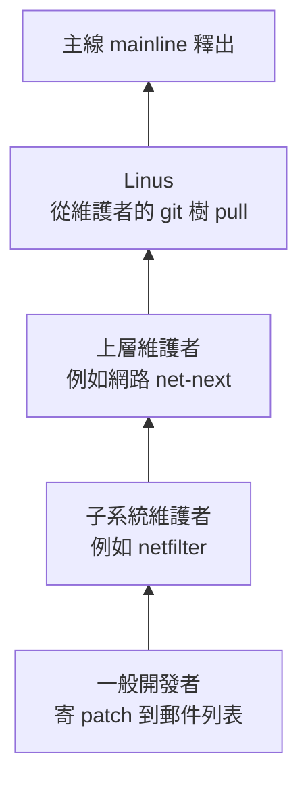

# Linus 是怎樣的工程師？—— 務實、講究品味、先想資料結構、絕不破壞使用者空間

> 日期：2026-10-28
> 情境：使用者問「Linus 是怎麼樣的工程師？」。他的長期目標是成為 kernel 維護者，所以這篇除了講人，也講 Linus 的工程觀怎麼變成今天 kernel 社群的規矩。
> 適用範圍：生平與引言依公開紀錄整理（郵件列表 LKML（Linux Kernel Mailing List，Linux 核心郵件列表）、TED 訪談、自傳 *Just for Fun*）；第四節的 C 範例在本機 Ubuntu 24.04、gcc 13.3 實測。

**一句話結論：Linus 是「務實的工程師」而不是「有遠見的設計者」——他看重能跑的程式碼、好的資料結構、消掉特例的「品味」，和「不准弄壞使用者的程式」這條鐵律；今天他幾乎不寫 kernel 程式，而是站在信任網路頂端的「合併者」。**

---

## 目錄

- [一、先講結論：五個特點](#一先講結論五個特點)
- [二、生平時間線](#二生平時間線)
- [三、務實：「我是工程師，不是夢想家」](#三務實我是工程師不是夢想家)
- [四、品味：消掉特例的程式碼（實測）](#四品味消掉特例的程式碼實測)
- [五、資料結構優先：Git 是怎麼來的](#五資料結構優先git-是怎麼來的)
- [六、鐵律：不准破壞使用者空間](#六鐵律不准破壞使用者空間)
- [七、他現在的工作：不寫程式的合併者](#七他現在的工作不寫程式的合併者)
- [八、爭議面：言辭粗暴與 2018 年的轉變](#八爭議面言辭粗暴與-2018-年的轉變)
- [九、對想當 kernel 維護者的你有什麼意義](#九對想當-kernel-維護者的你有什麼意義)
- [自我測驗](#自我測驗)

---

## 一、先講結論：五個特點

| 特點 | 一句話 | 出處（第幾節） |
|---|---|---|
| 務實（pragmatic） | 能解決真實問題、能跑的程式碼，比理論上漂亮的設計重要 | 第三節 |
| 講究品味（good taste） | 好程式碼會把「特例」消掉，讓一般情況就涵蓋邊界 | 第四節 |
| 資料結構優先 | 資料結構設計對了，程式碼自然簡單 | 第五節 |
| 不破壞使用者空間（don't break userspace） | kernel 改版不能讓原本能跑的使用者程式壞掉，這是最高原則 | 第六節 |
| 信任網路的整合者 | 現在主要工作是審查、合併子系統維護者送來的程式碼，而不是自己寫 | 第七節 |

另外一個不能略過的面向：他長年以措辭粗暴著稱，2018 年公開道歉並調整行為（第八節）。

---

## 二、生平時間線

| 年份 | 事件 |
|---|---|
| 1969 | 生於芬蘭赫爾辛基，屬於講瑞典語的少數族群 |
| 1991-08-25 | 赫爾辛基大學學生時期，在新聞群組 `comp.os.minix` 發文：「我在做一個（自由的）作業系統（只是興趣，不會像 GNU 那樣大而專業）」 |
| 1991-09 | 釋出 Linux 0.01 |
| 1992 | 從 0.12 起改用 GPL（GNU General Public License，GNU 通用公共授權條款）；與 Andrew Tanenbaum 的「微核心 vs 單體核心」論戰（第三節） |
| 1994 | Linux 1.0 |
| 1997～2003 | 搬到美國，在處理器公司 Transmeta 工作，kernel 是業餘時間維護 |
| 2003 起 | 加入 OSDL（Open Source Development Labs，開放原始碼開發實驗室），2007 年併入 Linux Foundation，從此全職維護 kernel |
| 2005 | BitKeeper 收回免費授權，他花大約兩週寫出 Git 的雛形，同年 7 月把 Git 交給 Junio Hamano 維護（第五節） |
| 2012 | 獲千禧年科技獎（Millennium Technology Prize） |
| 2018 | 公開為自己的言行道歉、暫離一段時間，kernel 採用行為準則（Code of Conduct）（第八節） |
| 2022 | Linux 6.1 合入初步的 Rust 支援——他對 C++ 一向排斥，對 Rust 則採「先讓它進來、用實際結果說話」的態度 |

版本號本身也透露他的務實：主版本號沒有技術意義，次版本號變得太大（他說「手指腳趾數不完」）就進一位。你這台機器的 kernel 已經是 `7.0.0-38-generic`，從 6 跳到 7 並不代表有什麼重大斷代。

他和 GNU 的關係（GNU 有工具缺核心、Linux 補上核心）見 [GNU是什麼-Linux核心與GNU工具的分工.md 第三節](./GNU是什麼-Linux核心與GNU工具的分工.md#三gnu-缺的那一塊核心以及gnulinux之爭)。

---

## 三、務實：「我是工程師，不是夢想家」

**微核心論戰（1992）。** 作業系統教授 Andrew Tanenbaum（MINIX 的作者）在 `comp.os.minix` 發文〈LINUX is obsolete〉，說單體核心（monolithic kernel，驅動、檔案系統、網路都在核心裡面跑）是 1970 年代的設計，微核心（microkernel，核心只留最少功能，其他放在使用者空間的行程）才是未來。Linus 的回應重點是：理論上微核心比較乾淨，但**單體核心現在就能跑、跑得快，而且在 386 上做得出來**。三十多年後 Linux 仍是單體核心（加上可載入模組），並統治了伺服器與手機。

**2016 年 TED 訪談的自我描述**（大意）：「我不是夢想家。有很多人望著天空、看著星星說『我想去那裡』，我很欣賞他們；但我是看著地面的人，我想先把眼前那個坑補好，免得自己掉進去。」

**「Talk is cheap. Show me the code.」**（2000 年 LKML，「空談很便宜，拿程式碼來」）。在 kernel 社群，提議的分量取決於你有沒有附上能跑、能審查的 patch，而不是你論述多漂亮。

務實的另一面是**不跟隨教條**：

- 授權：kernel 維持 GPL-2.0，他拒絕跟著自由軟體基金會改成 GPLv3（認為 v3 對硬體的限制管太多）。
- 語言：kernel 主體一直是 C；他拒絕 C++（認為它的抽象會藏住成本），但接受 Rust 進入 kernel，理由是它能在驅動程式減少記憶體錯誤，而且先以實驗性質進來。

---

## 四、品味：消掉特例的程式碼（實測）

2016 年 TED 訪談時，Linus 拿「從單向鏈結串列（singly linked list）刪除一個節點」當例子解釋什麼是**品味（good taste）**：大部分人寫的版本，刪「第一個節點」要用 `if` 特別處理；有品味的版本換個角度看問題，特例就**自然消失**了。

下面是兩個版本的完整程式（為了實測，我加了 `main` 和印出函式）。先說明用到的 C 語法：

- `struct node` 是「結構」：把一個 `int` 和一個指向下一個節點的指標包在一起；`p->next` 是「`p` 指向的那個結構裡的 `next` 欄位」，等於 `(*p).next`。
- `struct node **` 是「指向指標的指標」：它存的是**某個 `struct node *` 變數的位址**（指標本身就是位址，見 [C資料第二節](../c/C的資料在記憶體裡長怎樣-位元組、指標、位元組順序與有號無號.md#二指標就是位址)）。

`taste.c` 完整原始碼：

```c
#include <stdio.h>

struct node {
    int value;
    struct node *next;
};

/* 版本一：「沒品味」——頭節點要特別處理 */
void remove_v1(struct node **head, struct node *entry)
{
    struct node *prev = NULL;
    struct node *walk = *head;

    while (walk != entry) {
        prev = walk;
        walk = walk->next;
    }
    if (prev == NULL)              /* 要刪的是第一個節點 */
        *head = entry->next;
    else
        prev->next = entry->next;
}

/* 版本二：「有品味」——用指向指標的指標，沒有特例 */
void remove_v2(struct node **head, struct node *entry)
{
    struct node **indirect = head;

    while (*indirect != entry)
        indirect = &(*indirect)->next;
    *indirect = entry->next;
}

static void print(const char *tag, struct node *head)
{
    printf("%-22s", tag);
    for (struct node *p = head; p != NULL; p = p->next)
        printf(" %d", p->value);
    printf("\n");
}

int main(void)
{
    struct node c = {3, NULL}, b = {2, &c}, a = {1, &b};
    struct node *head = &a;

    print("start:", head);
    remove_v1(&head, &a);          /* 刪頭 */
    print("v1 remove head(1):", head);
    remove_v1(&head, &c);          /* 刪尾 */
    print("v1 remove tail(3):", head);

    struct node z = {30, NULL}, y = {20, &z}, x = {10, &y};
    head = &x;
    print("start:", head);
    remove_v2(&head, &x);          /* 刪頭 */
    print("v2 remove head(10):", head);
    remove_v2(&head, &z);          /* 刪尾 */
    print("v2 remove tail(30):", head);
    return 0;
}
```

編譯與執行：

```bash
gcc -Wall -Wextra -O0 -o taste taste.c
./taste
```

實際輸出：

```text
start:                 1 2 3
v1 remove head(1):     2 3
v1 remove tail(3):     2
start:                 10 20 30
v2 remove head(10):    20 30
v2 remove tail(30):    20
```

兩個版本結果一樣，刪頭、刪尾都對。差別在**怎麼看「要改的東西」**：

- 版本一的想法是「找到**前一個節點**，改它的 `next`」。可是第一個節點沒有前一個節點，要改的是 `head` 這個變數，所以需要 `if (prev == NULL)` 特例。
- 版本二的想法是「找到**指向目標的那個指標**，把它改掉」。指向第一個節點的指標是 `head`，指向其他節點的指標是前一個節點的 `next`——它們**都是 `struct node *` 型別的變數**，所以用一個 `struct node **indirect` 就能統一指著「那個指標在哪」，特例消失。

```text
刪 10（頭）時：               刪 30（尾）時：
indirect ─▶ head ─▶ [10|●]─▶[20|●]─▶[30|NULL]      indirect ─▶ 20 的 next 欄位 ─▶ [30|NULL]
            把 head 改成 20                                     把這格改成 NULL
→ 兩種情況都是同一行：*indirect = entry->next;
```

這張圖要看的是：`indirect` 永遠指著「某個存放節點位址的格子」，不管那格叫 `head` 還是某節點的 `next`，寫法都一樣。

**品味的意義不在省一個 `if`**：特例越多，越容易在邊界出 bug（刪頭時忘了更新 `head` 是經典錯誤），審查的人也要多想一種情況。kernel 的通用鏈結串列 `include/linux/list.h`（`struct list_head`）做成**環狀雙向串列加一個哨兵頭節點**，同樣是為了讓插入、刪除不用處理「空串列」「第一個」「最後一個」這些特例。

---

## 五、資料結構優先：Git 是怎麼來的

他在 2006 年的 Git 郵件列表寫過一句常被引用的話：

> 「爛程式設計師擔心程式碼；好程式設計師擔心資料結構和它們之間的關係。」（*Bad programmers worry about the code. Good programmers worry about data structures and their relationships.*）

Git 就是這句話的實例。2005 年 kernel 用的商業版本控制 BitKeeper 收回免費授權，Linus 沒有去找「功能最多」的替代品，而是先決定**資料怎麼存**：

- 每個檔案內容存成 **blob**、每個目錄存成 **tree**（列出底下的 blob 與 tree）、每次提交存成 **commit**（指向一個 tree 和父 commit）。
- 每個物件用**內容的雜湊值**當名字（內容定址，content-addressable）：內容一樣，名字就一樣；內容被竄改，名字就對不上。

資料結構定好之後，「分支只是指向某個 commit 的名字」「比對兩個版本只要比 tree 的雜湊」這些功能幾乎是自然長出來的，所以他能在兩週左右做出能管理 kernel 自己的雛形，之後就交給 Junio Hamano 維護到今天。這也是第一節講的務實：他做 Git 是因為**手上的工作需要它**，做完能用就交出去，自己回去管 kernel。

---

## 六、鐵律：不准破壞使用者空間

kernel 社群最常被引用的一封 Linus 信是 2012 年的「**WE DO NOT BREAK USERSPACE!**」（我們不破壞使用者空間）。當時一位子系統維護者的修改讓某個使用者程式壞了，他還說是使用者程式的錯，Linus 用大寫回信說：**kernel 修改造成使用者程式壞掉，就是 kernel 的 bug，不管那個程式寫得多爛。**

原則的內容：

- **系統呼叫（system call）的行為、`/proc`／`/sys` 裡的格式這類「使用者看得到的介面」**，一旦釋出、有人在用，就不能改到讓舊程式壞掉。所謂「回歸（regression）」：以前能跑、升級 kernel 後不能跑，一律優先修。
- 判斷標準是**實際有沒有人壞掉**，不是文件怎麼寫：就算舊行為本來是錯的，只要有人依賴它，就要保留（或找到不會弄壞任何人的改法）。
- 只限於 kernel 對使用者空間的介面。kernel **內部**的函式介面（驅動程式呼叫的 API）可以隨時改，改的人負責把所有呼叫者一起改好——所以 kernel 沒有穩定的內部 API，驅動最好合進主線。

為什麼這條這麼重要：使用者升級 kernel 是為了修 bug、拿新功能；如果升級會弄壞程式，大家就不敢升級，安全修補也送不出去。這跟你在第 7 課學到的「換掉 `.so` 不用重新連結、靠 SONAME 管理不相容的版本」是同一個精神——**對外承諾的介面要穩**（見 [靜態與動態函式庫第六節](../c/靜態與動態函式庫-ar與.a、-fPIC與.so、執行時怎麼找到.so.md#六換掉-so-不用重新連結以及-soname)）。glibc 用 SONAME 換版號來「宣告不相容」，kernel 則乾脆承諾系統呼叫**永遠不會不相容**，連換版號的機會都不給自己。

---

## 七、他現在的工作：不寫程式的合併者

很多人以為 Linus 每天在寫 kernel，其實他自己說過，他現在大部分時間在**讀信、讀程式碼、合併**，很少寫新程式。運作方式：



- **信任鏈（chain of trust）**：Linus 不可能審查每年數萬個 patch，他只直接信任約一百多位上層維護者，從他們的 git 樹拉（pull）程式碼；那些維護者再信任他們底下的人。你要進到這張網，就是讓某位維護者信任你的判斷（見 [學習路線第七節](../learning/Linux與系統程式的系統化學習路線.md#七目標是-kernel-維護者第二段主線)）。
- **固定節奏**：新版本釋出後是兩週的**合併視窗（merge window）**，只在這段時間收新功能；之後每週日左右發一個 `-rc`（release candidate，候選版本），只收修正，通常到 `-rc7` 或 `-rc8` 就正式釋出。整個週期約九到十週，非常規律。
- **穩定版不歸他管**：已釋出版本的修正分支由 Greg Kroah-Hartman 等人維護，Linus 只管主線往前走。

所以「Linus 是怎樣的工程師」到了今天，答案有一半是「怎樣的**維護者**」：他的工作是說「不」、問「為什麼這樣改」、要求修改說明（commit message）講清楚動機，並在維護者之間出現衝突時做最後決定。

---

## 八、爭議面：言辭粗暴與 2018 年的轉變

不能只講好的一面。Linus 長年在 LKML 用很重的字眼罵人（包括罵具名的開發者），支持者說那是「對程式碼直率」，但也確實讓很多人（尤其新人）不敢參與。

2018 年 9 月，他公開寫信承認自己的行為傷人、「不專業」，暫停維護工作一段時間去調整，kernel 同時採用了行為準則（Code of Conduct）。之後他的信仍然直接、仍然會強烈反對爛 patch，但明顯把火力集中在**程式碼與決策**，而不是人身。

給你的實務建議：要學的是他**技術判斷的標準**（第三～六節），不是他過去的語氣。今天在 kernel 社群用那種語氣，只會讓你的 patch 更難被接受。

---

## 九、對想當 kernel 維護者的你有什麼意義

把上面的特點翻成你審查或寫 patch 時會被問的問題：

| Linus 的原則 | 落到 patch 上會被問 |
|---|---|
| 務實 | 這修的是真實存在的問題嗎？有重現方法、有測試結果嗎？ |
| 品味 | 能不能換個寫法，讓特例不存在，而不是多加一個 `if`？ |
| 資料結構優先 | 這個改動的資料結構對嗎？還是在程式碼裡繞路補洞？ |
| 不破壞使用者空間 | 這會改變任何系統呼叫、`/proc`、`/sys` 的對外行為嗎？會讓舊程式壞掉嗎？ |
| 信任 | commit message 有沒有說清楚「為什麼」？維護者讀完敢不敢信你？ |

**心法：kernel 社群的規矩大多是 Linus 的工程觀變成的制度——學懂這些「為什麼」，比記住他講過哪些名言有用。**

---

## 自我測驗

> 參考答案寫在每題下面（第一次作答批改完才會補上），作答時先遮住答案。

1. Linus 說自己是「工程師，不是夢想家」。用 1992 年微核心論戰說明這種務實態度：Tanenbaum 的論點是什麼，Linus 為什麼不接受？

2. 下面兩個函式都從單向鏈結串列刪除節點 `entry`：

   ```c
   #include <stdio.h>

   struct node {
       int value;
       struct node *next;
   };

   void remove_v1(struct node **head, struct node *entry)
   {
       struct node *prev = NULL;
       struct node *walk = *head;

       while (walk != entry) {
           prev = walk;
           walk = walk->next;
       }
       if (prev == NULL)
           *head = entry->next;
       else
           prev->next = entry->next;
   }

   void remove_v2(struct node **head, struct node *entry)
   {
       struct node **indirect = head;

       while (*indirect != entry)
           indirect = &(*indirect)->next;
       *indirect = entry->next;
   }

   int main(void)
   {
       struct node c = {3, NULL}, b = {2, &c}, a = {1, &b};
       struct node *head = &a;

       remove_v2(&head, &a);
       for (struct node *p = head; p != NULL; p = p->next)
           printf("%d ", p->value);
       printf("\n");
       return 0;
   }
   ```

   編譯：`gcc -Wall -o taste taste.c && ./taste`

   （1）為什麼 `remove_v1` 需要 `if (prev == NULL)`，`remove_v2` 卻不需要？`indirect` 指著的是什麼？
   （2）Linus 認為這種差別為什麼重要（不只是少一行）？

3. 情境題：你送了一個 patch 給某個子系統，把 `/proc` 裡某個檔案的一個欄位格式從「十進位」改成「十六進位」，理由是十六進位比較合理、而且文件上本來就寫十六進位。結果有人回報某個監控腳本升級 kernel 後解析失敗。依照 Linus 的原則，這是誰的錯？應該怎麼處理？同樣的事如果發生在「驅動程式呼叫的 kernel 內部函式」上，答案有什麼不同？

4. Linus 說「好程式設計師擔心資料結構」。用 Git 的設計說明這句話：Git 最核心的資料結構是什麼？為什麼定好這個之後，他能在大約兩週內做出能用的雛形？

5. 今天 Linus 的日常工作主要是什麼？一個 patch 從一般開發者寄出到進入主線，大致經過哪些人？這對「怎麼成為維護者」有什麼啟示？
