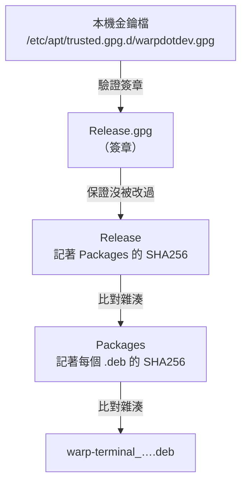
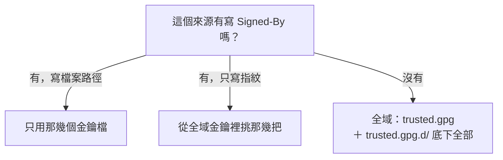
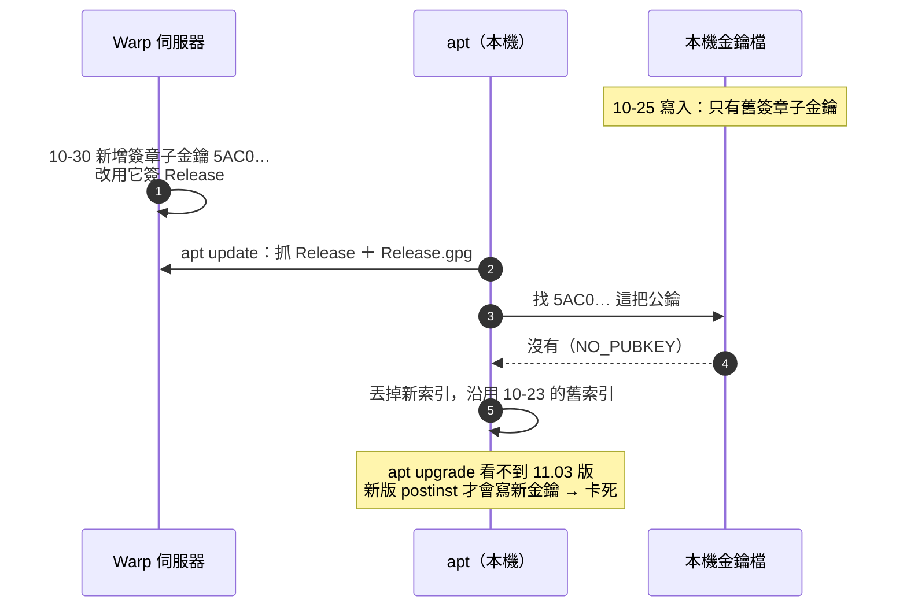

# apt update 出現 NO_PUBKEY —— 套件庫換了簽章子金鑰，本機的金鑰檔沒跟上

> 日期：2026-11-05
> 症狀：`sudo apt update` 對 Warp 的套件庫印出三行 `W:`：`GPG error: … NO_PUBKEY 5AC01A19A09FA9A6`、`Failed to fetch …/Release.gpg`、`Some index files failed to download`。
> 對應檔案：`/etc/apt/sources.list.d/warpdotdev.list`、`/etc/apt/trusted.gpg.d/warpdotdev.gpg`（兩者都由 `warp-terminal` 套件的 `postinst` 自動寫入，系統檔、不在 repo 裡）
> 適用範圍：Debian／Ubuntu；實測環境 Ubuntu 24.04、apt 2.8.3、gpg 2.4

**一句話結論：apt 不是「信任某個網站」，而是「信任某把金鑰簽過的 `Release` 檔」——`Release` 裡有 `Packages` 的雜湊、`Packages` 裡有每個 `.deb` 的雜湊，整條鏈的起點就是那個簽章。`NO_PUBKEY <ID>` 的意思是：簽章是 `<ID>` 這把金鑰簽的，但 apt 能用的金鑰檔裡沒有它。這次是 Warp 換了簽章子金鑰（subkey），本機金鑰檔還是舊版；修法是重新下載官方公鑰、確認主金鑰指紋沒變，再覆蓋本機那個檔案。**

---

## 目錄

- [一、逐行讀懂這三行警告](#一逐行讀懂這三行警告)
- [二、apt 的設定都放在哪裡](#二apt-的設定都放在哪裡)
- [三、來源檔的兩種格式：`.list` 與 `.sources`](#三來源檔的兩種格式list-與-sources)
- [四、信任鏈：簽章 → `Release` → `Packages` → `.deb`](#四信任鏈簽章--release--packages--deb)
- [五、金鑰放哪裡、`signed-by` 怎麼選金鑰](#五金鑰放哪裡signed-by-怎麼選金鑰)
- [六、這次的根因：Warp 換了簽章子金鑰](#六這次的根因warp-換了簽章子金鑰)
- [七、修法](#七修法)
- [八、簽章相關錯誤訊息對照](#八簽章相關錯誤訊息對照)
- [九、課後討論](#九課後討論)
- [自我測驗](#自我測驗)

---

## 一、逐行讀懂這三行警告

```text
W: An error occurred during the signature verification. The repository is not updated and the previous index files will be used. GPG error: https://releases.warp.dev/linux/deb stable Release: The following signatures couldn't be verified because the public key is not available: NO_PUBKEY 5AC01A19A09FA9A6
W: Failed to fetch https://releases.warp.dev/linux/deb/dists/stable/Release.gpg  The following signatures couldn't be verified because the public key is not available: NO_PUBKEY 5AC01A19A09FA9A6
W: Some index files failed to download. They have been ignored, or old ones used instead.
```

| 片段 | 意思 |
|------|------|
| `W:` | 警告（Warning），不是 `E:` 錯誤：`apt update` 照樣跑完、其他套件庫照樣更新，只有這個來源被跳過 |
| `https://releases.warp.dev/linux/deb stable` | 出問題的是哪一個來源：URI＝`…/linux/deb`、套件組（suite）＝`stable`，對應到來源檔裡的一行（見[第三節](#三來源檔的兩種格式list-與-sources)） |
| `Release` / `Release.gpg` | 這個套件庫的「目錄檔」和它的簽章檔（見[第四節](#四信任鏈簽章--release--packages--deb)） |
| `NO_PUBKEY 5AC01A19A09FA9A6` | 簽章裡寫著「我是被 key ID `5AC01A19A09FA9A6` 簽的」，可是 apt 拿來驗這個來源的金鑰檔裡**找不到這把公鑰** |
| `The repository is not updated and the previous index files will be used` | 驗不過就**不採用**新下載的索引，繼續用上次成功的舊索引 |

最後一點是這個錯誤最容易被忽略的後果：**它不會讓 apt 壞掉，只會讓這個軟體默默停在舊版。** 本機實測：

```bash
# 本機現在用的 Warp 索引是什麼時候抓的、裡面的版本是多少
ls -l --time-style=+%F\ %T /var/lib/apt/lists/releases.warp.dev_linux_deb_dists_stable_*
grep ^Version /var/lib/apt/lists/releases.warp.dev_linux_deb_dists_stable_main_binary-amd64_Packages
```

```text
-rw-r--r-- 1 root root 2598 2026-10-23 08:40:09 /var/lib/apt/lists/releases.warp.dev_linux_deb_dists_stable_main_binary-amd64_Packages
-rw-r--r-- 1 root root 4008 2026-10-23 17:15:23 /var/lib/apt/lists/releases.warp.dev_linux_deb_dists_stable_Release
-rw-r--r-- 1 root root  833 2026-10-23 17:15:23 /var/lib/apt/lists/releases.warp.dev_linux_deb_dists_stable_Release.gpg
Version: 0.2026.10.21.08.25.stable.02
Version: 0.2026.10.21.08.25.stable.02
```

- 本機索引停在 10-23 抓的版本，裡面最新的 `warp-terminal` 是 `0.2026.10.21…`（兩行 `Version` 是 `oz-stable` 和 `warp-terminal` 兩個套件）。
- 同一天直接抓伺服器上的 `Packages`（[第四節](#四信任鏈簽章--release--packages--deb)的實驗）看到的是 `0.2026.11.03…`：伺服器早就有新版，但 `apt upgrade` 永遠看不到。

---

## 二、apt 的設定都放在哪裡

apt 所有路徑都是設定值，可以用 `apt-config dump` 印出來（這裡只挑 `Dir` 相關的）：

```bash
apt-config dump | grep -E '^Dir::Etc|^Dir::State|^Dir "'
```

```text
Dir "/";
Dir::State "var/lib/apt";
Dir::State::lists "lists/";
Dir::State::cdroms "cdroms.list";
Dir::State::extended_states "extended_states";
Dir::State::status "/var/lib/dpkg/status";
Dir::Etc "etc/apt";
Dir::Etc::sourcelist "sources.list";
Dir::Etc::sourceparts "sources.list.d";
Dir::Etc::main "apt.conf";
Dir::Etc::netrc "auth.conf";
Dir::Etc::netrcparts "auth.conf.d";
Dir::Etc::parts "apt.conf.d";
Dir::Etc::preferences "preferences";
Dir::Etc::preferencesparts "preferences.d";
Dir::Etc::trusted "trusted.gpg";
Dir::Etc::trustedparts "trusted.gpg.d";
```

- 相對路徑一層層接起來：`Dir` + `Dir::Etc` + `Dir::Etc::sourceparts` ＝ `/etc/apt/sources.list.d/`。
- `Dir::State::status` 是絕對路徑 `/var/lib/dpkg/status`——apt 判斷「裝了什麼」直接讀 dpkg 的資料庫（見 [dpkg完整使用指南.md 第八節](./dpkg完整使用指南.md#八dpkg-的資料庫varlibdpkg)）。

整理成一張地圖（「這次相關」標出跟 NO_PUBKEY 有關的）：

| 路徑 | 放什麼 | 這次相關 |
|------|--------|---------|
| `/etc/apt/sources.list` | 舊式的主來源檔；Ubuntu 24.04 起改用下一列，這個檔只剩註解 | |
| `/etc/apt/sources.list.d/*.list`、`*.sources` | **來源**：要去哪些套件庫抓索引，一個檔可以有好幾個來源；第三方軟體各自放一個檔 | ✅ |
| `/etc/apt/trusted.gpg`、`/etc/apt/trusted.gpg.d/*.gpg`／`*.asc` | **全域信任的金鑰**：沒寫 `signed-by` 的來源，用這裡全部的金鑰驗 | ✅ |
| `/etc/apt/keyrings/`、`/usr/share/keyrings/` | **給 `signed-by` 指定用的金鑰**，放這裡不會被全域信任（見[第五節](#五金鑰放哪裡signed-by-怎麼選金鑰)） | ✅ |
| `/etc/apt/apt.conf`、`/etc/apt/apt.conf.d/` | apt 本身的行為設定（代理、自動更新、`Acquire::*`） | |
| `/etc/apt/preferences`、`preferences.d/` | **釘選（pinning）**：同一個套件有好幾個來源、好幾個版本時選哪個 | |
| `/etc/apt/auth.conf`、`auth.conf.d/` | 需要帳號密碼的私有套件庫的登入資訊 | |
| `/var/lib/apt/lists/` | `apt update` 下載下來、**驗證通過**的索引（`Release`、`Packages`…），檔名是 URL 把 `/` 換成 `_` | ✅ |
| `/var/cache/apt/archives/` | `apt install` 下載的 `.deb` | |

**所以 `apt update` 做的事就是：讀來源檔 → 去每個套件庫抓 `Release` 與它的簽章 → 用金鑰驗 → 通過才把新索引放進 `/var/lib/apt/lists/`。** `apt install`／`upgrade` 完全只看 `lists/` 裡的索引，不會上網查有沒有新版。

---

## 三、來源檔的兩種格式：`.list` 與 `.sources`

本機兩種格式並存（實際檔案內容）：

```bash
cat /etc/apt/sources.list.d/warpdotdev.list
cat /etc/apt/sources.list.d/vscode.sources
```

```text
### THIS FILE IS AUTOMATICALLY CONFIGURED ###
# You may comment out this entry, but other modifications to the file may be lost.

deb [arch=amd64 signed-by=/etc/apt/trusted.gpg.d/warpdotdev.gpg] https://releases.warp.dev/linux/deb stable main
### THIS FILE IS AUTOMATICALLY CONFIGURED ###
# You may comment out this entry, but any other modifications may be lost.
Types: deb
URIs: https://packages.microsoft.com/repos/code
Suites: stable
Components: main
Architectures: amd64
Signed-By: /usr/share/keyrings/microsoft.gpg
```

兩個檔表達的是同一種東西，只是寫法不同。副檔名決定 apt 用哪種格式解析：`.list` 是**單行格式（one-line style）**，`.sources` 是 **deb822 格式**（RFC 822 那種「欄位: 值」的段落，apt 1.1 起支援，官方打算逐步取代單行格式；Ubuntu 24.04 自己的 `ubuntu.sources` 已經是這種）。

### 3-1. 單行格式的文法

```text
deb [ 選項1=值1 選項2=值2 ] URI 套件組 [元件1] [元件2] ...
```

逐個位置（以 Warp 那行為例）：

| 位置 | Warp 那行的值 | 是什麼 | 可省略？ |
|------|---------------|--------|---------|
| 1. 類型 | `deb` | 固定關鍵字：`deb`＝抓編好的二進位套件索引；`deb-src`＝抓原始碼索引（`apt source` 用） | 不可 |
| 2. 選項 | `[arch=amd64 signed-by=…]` | 方括號包住、空白分隔的 `名稱=值`；多個值用逗號（`arch=amd64,i386`） | 可，整組省略＝全部用預設值 |
| 3. URI | `https://releases.warp.dev/linux/deb` | 套件庫的**根目錄**；apt 會在後面接 `dists/<套件組>/…` | 不可 |
| 4. 套件組（suite） | `stable` | 發行版代號或通道名（`noble`、`noble-updates`、`stable`），由套件庫自己定義 | 不可 |
| 5. 元件（component） | `main` | 套件庫裡的分區（Ubuntu 有 `main restricted universe multiverse`），可列好幾個 | 套件組以 `/` 結尾（「扁平套件庫」，直接指一個目錄）時**必須**省略；否則至少一個 |

URI＋套件組＋元件決定 apt 實際去抓的網址：

```text
<URI>/dists/<套件組>/Release                     ← 目錄檔
<URI>/dists/<套件組>/Release.gpg                 ← 它的簽章（或合併成 InRelease）
<URI>/dists/<套件組>/<元件>/binary-<架構>/Packages  ← 套件清單
```

這就是錯誤訊息裡 `https://releases.warp.dev/linux/deb/dists/stable/Release.gpg` 的由來。

### 3-2. deb822 格式的欄位

一個來源是一個**段落（stanza）**，段落之間空一行；一個段落可以一次寫好幾個類型、URI、套件組（值之間用**空白**分隔，不是逗號）。`ubuntu.sources` 的第一段等於單行格式的三行（`noble`、`noble-updates`、`noble-backports` 各一行）。

| 欄位 | 對應單行格式的位置 | 說明 |
|------|-------------------|------|
| `Types:` | 1. 類型 | `deb`、`deb-src`，可兩個都寫 |
| `URIs:` | 3. URI | 可多個 |
| `Suites:` | 4. 套件組 | 可多個 |
| `Components:` | 5. 元件 | 套件組以 `/` 結尾時省略 |
| `Enabled:` | （單行格式沒有，只能在行首加 `#` 註解掉） | `no` 停用這一段，不必刪掉 |
| 其餘選項 | 2. 選項 | 見下表，名稱首字大寫（`Signed-By`），單行格式則是小寫（`signed-by`） |

### 3-3. 全部的選項

以本機 `man 5 sources.list`（apt 2.8.3）的〈THE DEB AND DEB-SRC TYPES: OPTIONS〉一節為準，**共 17 個，全部列出**。括號裡是單行格式的寫法。手冊註明：**不認得的選項會被默默忽略**——拼錯不會報錯，只會沒效果。

**影響「抓什麼」的選項**（每個來源可以各自不同）：

| 選項 | 做什麼 | 預設 |
|------|--------|------|
| `Architectures`（`arch`） | 只抓這些架構的索引 | `APT::Architectures`（本機 amd64，加過 `dpkg --add-architecture i386` 的再加 i386） |
| `Languages`（`lang`） | 抓哪些語言的套件描述翻譯 | `Acquire::Languages` |
| `Targets`（`target`） | 抓哪些種類的索引（`Packages`、`Contents`、`Translation`…） | `Acquire::IndexTargets` 的設定 |
| `PDiffs`（`pdiffs`） | 是否只下載索引的差異檔（patch）來更新，而不是整份重抓 | `yes`（套件庫有提供才有用） |
| `By-Hash`（`by-hash`） | 用「檔案雜湊值」組成的網址抓索引，避免鏡像站更新到一半造成雜湊不符；`yes`／`no`／`force` | `yes` |

**影響「信不信任」的選項**（同一個 URI＋套件組的所有條目必須設得一樣，否則 apt 報錯）：

| 選項 | 做什麼 | 預設 |
|------|--------|------|
| `Signed-By`（`signed-by`） | **只用指定的金鑰檔／指紋驗這個來源**（見[第五節](#五金鑰放哪裡signed-by-怎麼選金鑰)） | 沒寫＝`trusted.gpg` 與 `trusted.gpg.d/` 裡全部金鑰 |
| `Trusted`（`trusted`） | `yes`＝**驗不過也當成可信**；`no`＝驗過也當成不可信 | 由 apt 依驗證結果決定 |
| `Allow-Insecure`（`allow-insecure`） | 允許套件庫完全沒有簽章 | `no` |
| `Allow-Weak`（`allow-weak`） | 允許用已淘汰的弱演算法（例如 SHA-1）簽章 | `no` |
| `Allow-Downgrade-To-Insecure`（`allow-downgrade-to-insecure`） | 允許原本有簽章的套件庫變成沒簽章 | `no` |
| `Check-Valid-Until`（`check-valid-until`） | 檢查 `Release` 的 `Valid-Until` 有沒有過期，防止「重播攻擊」（replay attack：攻擊者一直餵你舊的、有漏洞的索引） | `yes` |
| `Valid-Until-Min`／`Valid-Until-Max`（`valid-until-min`／`valid-until-max`） | 把有效期限調長或調短（秒）；算兩個選項 | 不設定 |
| `Check-Date`（`check-date`） | 是否相信本機時鐘、做時間相關檢查（例如 `Release` 不能來自未來）；關掉也會一併關掉 `Check-Valid-Until` | `yes` |
| `Date-Max-Future`（`date-max-future`） | `Release` 的日期最多可以比本機時鐘超前幾秒 | 10 秒 |
| `InRelease-Path`（`inrelease-path`） | 指定 `InRelease` 的路徑，設了就不再退回去抓 `Release`＋`Release.gpg` | 不設定 |
| `Snapshot`（`snapshot`） | 從快照服務選某個過去時間點的套件庫（`enable` 或時間戳 `20220102T030405Z`） | 不設定 |

**`trusted=yes` 與三個 `allow-*` 是拿掉安全檢查，不是修法。** 網路上常見「NO_PUBKEY 就加 `[trusted=yes]`」——那等於「這個來源送來什麼都裝」，連中間人竄改過的套件也照裝。

### 3-4. 查文法的方法

- `man 5 sources.list`：兩種格式與上面全部選項。
- `man 8 apt-secure`：簽章驗證的流程。
- `apt-config dump`：目前所有設定值（包括預設的 `Acquire::*`）。
- `apt-get indextargets`：列出 `lists/` 裡每個索引對應哪個來源。

---

## 四、信任鏈：簽章 → `Release` → `Packages` → `.deb`

**為什麼只要驗一個簽章就夠？** 因為套件庫的檔案是一層雜湊包一層雜湊。實驗：直接用 `curl` 抓 Warp 套件庫的檔案，自己走一遍 apt 的驗證（不需要 root，在任何空目錄跑）：

```bash
mkdir -p ~/tmp/apt-chain && cd ~/tmp/apt-chain
BASE=https://releases.warp.dev/linux/deb/dists/stable
curl -sS -o Release     $BASE/Release        # 目錄檔
curl -sS -o Release.gpg $BASE/Release.gpg    # 目錄檔的分離式簽章
curl -sS -o Packages    $BASE/main/binary-amd64/Packages
curl -sS -o /dev/null -w 'InRelease: %{http_code}\n' $BASE/InRelease   # 有沒有合併版
```

```text
InRelease: 404
```

- Warp 沒提供 `InRelease`（簽章跟內容合在一起的版本），所以 apt 退回去抓 `Release`＋`Release.gpg`——這就是錯誤訊息裡出現 `Release.gpg` 的原因。Ubuntu 官方套件庫用的是 `InRelease`（本機 `lists/` 裡 Chrome 的也是 `…_InRelease`）。

**第一層：`Release` 裡記著 `Packages` 的雜湊。**

```bash
grep -A30 '^SHA256' Release | grep 'binary-amd64/Packages$'   # Release 說 Packages 的 SHA256 應該是多少
sha256sum Packages                                               # 實際抓到的 Packages 的 SHA256
```

```text
 5132143a9bc8fc4f8acd734a1cad0c6fdb1ba3efd4198a5c05d897e5751b95b1             2598 main/binary-amd64/Packages
5132143a9bc8fc4f8acd734a1cad0c6fdb1ba3efd4198a5c05d897e5751b95b1  Packages
```

- 第 1 行是 `Release` 宣稱的值（雜湊、大小 2598 byte、路徑），第 2 行是實際算出來的，兩者相同。不同的話 apt 會報 `Hash Sum mismatch`。

**第二層：`Packages` 裡記著每個 `.deb` 的雜湊。**

```bash
grep -E '^(Package|Version|Filename|SHA256):' Packages
```

```text
Package: oz-stable
Version: 0.2026.11.03.17.08.stable.00
Filename: ../../stable/v0.2026.11.03.17.08.stable_00/oz-stable_0.2026.11.03.17.08.stable.00_amd64.deb
SHA256: cb9bd61087d578601e66e93320b3f36ea2fb3f5444ff9f8f20163ee15971b758
Package: warp-terminal
Version: 0.2026.11.03.17.08.stable.00
Filename: ../../stable/v0.2026.11.03.17.08.stable_00/warp-terminal_0.2026.11.03.17.08.stable.00_amd64.deb
SHA256: 9676a7f35acd9ca2032adb60ff96181d2431ff759c78847b4ce8d50fe767299d
```

- `apt install` 下載 `.deb` 之後會比對這個 `SHA256`。
- 這也證實伺服器上已經是 `11.03` 版，而本機索引停在 `10.21`（[第一節](#一逐行讀懂這三行警告)）。

**第三層（鏈的起點）：`Release` 本身由簽章保證。** 雜湊只能證明「檔案跟目錄寫的一樣」，攻擊者如果能同時換掉 `Release` 和 `Packages`，雜湊照樣對得上；只有簽章是攻擊者做不出來的（他沒有私鑰）。



圖一：apt 的信任鏈。只有最上面那一步用到公鑰；這次斷的就是那一步，下面整條都不採用。

**HTTPS 為什麼不夠？** HTTPS 只保證「你在跟 `releases.warp.dev` 這台主機講話、傳輸中沒被改」；簽章保證的是「內容是持有私鑰的人發布的」。鏡像站、代理、CDN 被入侵時，HTTPS 照樣是綠的，簽章才擋得住。所以 apt 用 `http://` 的 Ubuntu 官方套件庫也是安全的（本機 `ubuntu.sources` 就是 `http://archive.ubuntu.com`）。

---

## 五、金鑰放哪裡、`signed-by` 怎麼選金鑰

驗某個來源時，apt 用哪些金鑰：



圖二：apt 選金鑰的規則（`man 5 sources.list` 的 `Signed-By` 一項）。

四個放金鑰的位置，差在**會不會被全域信任**：

| 位置 | 誰管 | 會被全域信任？ | 本機例子 |
|------|------|---------------|---------|
| `/etc/apt/trusted.gpg` | 舊的 `apt-key add` 寫進去的單一大檔 | ✅ | 本機沒有這個檔 |
| `/etc/apt/trusted.gpg.d/` | 套件或管理者 | ✅ | `ubuntu-keyring-2018-archive.gpg`、`warpdotdev.gpg` |
| `/usr/share/keyrings/` | 套件（`man` 建議：由套件管理的金鑰） | ❌，只給 `signed-by` 指定 | `google-chrome.gpg`、`microsoft.gpg`、`steam.gpg` |
| `/etc/apt/keyrings/` | 管理者自己（apt 2.4 起提供，`man` 建議：手動加的金鑰） | ❌，只給 `signed-by` 指定 | `docker.asc`、`openvpn.asc` |

**為什麼要分？** 放在 `trusted.gpg.d/` 的金鑰可以替**任何一個**沒寫 `signed-by` 的來源背書——如果 Warp 的私鑰外洩，攻擊者就能偽造一個「Ubuntu 套件庫」的 `Release`，你的系統照樣接受。放在 `keyrings/` 再用 `signed-by` 綁定，那把金鑰就只能替 Warp 的套件庫背書。Warp 的 `postinst` 把金鑰放在 `trusted.gpg.d/`、又在來源行寫 `signed-by`，綁定那一半有做到，但它仍然被全域信任——這不算正確，只是常見。

**檔案格式**：副檔名必須跟內容一致——`.gpg` 是二進位格式（`gpg --dearmor` 或 `gpg --export` 產生），`.asc` 是 ASCII 文字格式（`-----BEGIN PGP PUBLIC KEY BLOCK-----` 開頭，apt 1.4 起支援）。把 `.asc` 的內容存成 `.gpg` 檔名，apt 會讀不懂、當成沒有這把金鑰。實測（`warp.asc`、`Release`、`Release.gpg` 是[第六節](#六這次的根因warp-換了簽章子金鑰)下載的檔案）：

```bash
cp warp.asc armored.gpg                            # 文字格式的內容，卻用 .gpg 檔名
gpgv --keyring ./armored.gpg Release.gpg Release   # 用它驗簽章
```

```text
gpgv: Signature made Thu 05 Nov 2026 05:14:37 PM CST
gpgv:                using RSA key D272B58E4BF4EA3E7CB958A55AC01A19A09FA9A6
gpgv: [don't know]: invalid packet (ctb=2d)
gpgv: keydb_search failed: Invalid packet
gpgv: [don't know]: invalid packet (ctb=2d)
gpgv: keydb_search failed: Invalid packet
gpgv: Can't check signature: No public key
```

- `ctb=2d`：`0x2d` 是 ASCII 的 `-`，也就是 `-----BEGIN PGP…` 的第一個字元；`gpgv` 預期二進位封包，讀到文字就放棄。
- 最後一行還是 `No public key`——金鑰明明在檔案裡，結果跟「沒有金鑰」一模一樣。可是 `gpg --show-keys armored.gpg` 會自動辨認格式、正常列出金鑰，所以光用 `--show-keys` 檢查會被騙。

**`apt-key` 已經淘汰**（`man apt-key` 的標題就是「Deprecated APT key management utility」）：它的 `apt-key add` 把金鑰寫進全域的 `trusted.gpg`，正是上面說的問題。網路上舊教學的 `curl … | sudo apt-key add -` 要換成「存成檔案＋`signed-by`」。

---

## 六、這次的根因：Warp 換了簽章子金鑰

**先看簽章是誰簽的。** 用 `gpg --list-packets` 解析 `Release.gpg`（只讀封包內容，不驗證）：

```bash
gpg --list-packets Release.gpg | head -8
```

```text
# off=0 ctb=89 tag=2 hlen=3 plen=563
:signature packet: algo 1, keyid 5AC01A19A09FA9A6
	version 4, created 1793870077, md5len 0, sigclass 0x00
	digest algo 10, begin of digest e1 6f
	hashed subpkt 33 len 21 (issuer fpr v4 D272B58E4BF4EA3E7CB958A55AC01A19A09FA9A6)
	hashed subpkt 2 len 4 (sig created 2026-11-05)
	subpkt 16 len 8 (issuer key ID 5AC01A19A09FA9A6)
	data: [4095 bits]
```

- `keyid 5AC01A19A09FA9A6` 就是錯誤訊息裡的 ID；它是完整指紋（fingerprint）`D272B58E…5AC01A19A09FA9A6` 的**最後 16 個十六進位字**。
- `algo 1` 是 RSA，`digest algo 10` 是 SHA-512。

**再看本機金鑰檔裡有什麼。**

```bash
gpg --show-keys --with-subkey-fingerprints /etc/apt/trusted.gpg.d/warpdotdev.gpg
```

```text
pub   rsa4096 2024-02-11 [SC]
      0913165C78D5B7A41B42AC657FF7AB39D60F803F
uid                      Warp Linux Maintainers (Package Signing Authority) <linux-maintainers@warp.dev>
sub   rsa4096 2024-02-11 [E] [expires: 2027-12-12]
      C9A54635BABE2011B6FDB64A5EB4B35CA4E0F5F2
sub   rsa4096 2024-02-11 [S] [expires: 2027-12-12]
      19A1E427461B1795F73F629631F4254AFE49E02E
```

- 一份「金鑰」其實是一組：`pub` 是**主金鑰（primary key）**，底下掛著好幾把 `sub` **子金鑰（subkey）**，每把有用途標記：`[S]` 簽章（Sign）、`[E]` 加密（Encrypt）、`[C]` 認證其他金鑰（Certify）。
- 本機能用來簽章的只有 `…31F4254AFE49E02E`，**沒有 `5AC01A19A09FA9A6`**——這就是 NO_PUBKEY。

**最後看官方現在公布的公鑰。**

```bash
curl -sS -o warp.asc https://releases.warp.dev/linux/keys/warp.asc
gpg --show-keys --with-subkey-fingerprints warp.asc
```

```text
pub   rsa4096 2024-02-11 [SC]
      0913165C78D5B7A41B42AC657FF7AB39D60F803F
uid                      Warp Linux Maintainers (Package Signing Authority) <linux-maintainers@warp.dev>
sub   rsa4096 2024-02-11 [E] [expires: 2027-12-12]
      C9A54635BABE2011B6FDB64A5EB4B35CA4E0F5F2
sub   rsa4096 2024-02-11 [S] [revoked: 2026-11-03]
      19A1E427461B1795F73F629631F4254AFE49E02E
sub   rsa4096 2026-10-30 [S] [expires: 2028-10-29]
      D272B58E4BF4EA3E7CB958A55AC01A19A09FA9A6
```

- 主金鑰指紋 `0913165C…D60F803F` **跟本機的一模一樣**：是同一份金鑰，不是換了一個發行者。
- 舊的簽章子金鑰 `…31F4254AFE49E02E` 在 2026-11-03 被**撤銷（revoked）**；10-30 新增了一把 `…5AC01A19A09FA9A6`。
- 本機金鑰檔的修改時間是 10-25（`ls -l /etc/apt/trusted.gpg.d/`），早於新子金鑰出現的時間，所以裡面沒有它。

**用 `gpgv` 實際驗一次**（apt 底下就是呼叫 `gpgv` 驗簽章）：

```bash
gpgv --keyring /etc/apt/trusted.gpg.d/warpdotdev.gpg Release.gpg Release   # 用本機的舊金鑰檔
gpg --dearmor < warp.asc > new.gpg                                         # 官方 .asc 轉成二進位
gpgv --keyring ./new.gpg Release.gpg Release                               # 用官方的新金鑰檔
```

```text
gpgv: Signature made Thu 05 Nov 2026 05:14:37 PM CST
gpgv:                using RSA key D272B58E4BF4EA3E7CB958A55AC01A19A09FA9A6
gpgv: Can't check signature: No public key
gpgv: Signature made Thu 05 Nov 2026 05:14:37 PM CST
gpgv:                using RSA key D272B58E4BF4EA3E7CB958A55AC01A19A09FA9A6
gpgv: Good signature from "Warp Linux Maintainers (Package Signing Authority) <linux-maintainers@warp.dev>"
```

- 前三行是舊金鑰檔：`No public key`，跟 apt 的 NO_PUBKEY 是同一件事。
- 後三行是新金鑰檔：`Good signature`。根因確認。

**為什麼套件自己不會修好？** 這把金鑰是 `warp-terminal` 的 `postinst` 寫的（`/var/lib/dpkg/info/warp-terminal.postinst` 第 18～22 行：把內嵌的公鑰用 `base64 -d` 寫到 `trusted.gpg.d/warpdotdev.gpg`），也就是**裝了新版的 Warp 才會拿到新金鑰**。但要裝新版，apt 得先看到新的索引；要看到新索引，得先有新金鑰——雞生蛋問題，只能手動補一次金鑰。



圖三：從換金鑰到卡住的時序。第 5 步之後每次 `apt update` 都會重演一次。

---

## 七、修法

> 以下指令需要 `sudo`，Claude 只在本機做到「驗證新金鑰能驗過簽章」（第六節的 `gpgv`），覆蓋系統檔與之後的 `apt update` **未實測**。

```bash
# 1. 下載官方公鑰到暫存目錄
curl -fsSL -o /tmp/warp.asc https://releases.warp.dev/linux/keys/warp.asc

# 2. 先看指紋：主金鑰要跟本機現有的那份相同（0913165C78D5B7A41B42AC657FF7AB39D60F803F），
#    而且要有 [S] 的 …5AC01A19A09FA9A6
gpg --show-keys --with-subkey-fingerprints /tmp/warp.asc

# 3. 轉成二進位，覆蓋 signed-by 指到的那個檔（路徑要跟來源檔裡的一樣，副檔名 .gpg 配二進位）
gpg --dearmor < /tmp/warp.asc | sudo tee /etc/apt/trusted.gpg.d/warpdotdev.gpg > /dev/null

# 4. 重新抓索引，應該不再有 W:，接著就能升級到新版
sudo apt update
apt list --upgradable 2>/dev/null | grep warp
sudo apt install --only-upgrade warp-terminal
```

**第 2 步為什麼重要：** 「從同一個網站下載公鑰」本身不能證明公鑰是真的——網站被入侵的話，攻擊者會連公鑰一起換。這次能放心，是因為**主金鑰沒變**：新的子金鑰是用你早就信任的那把主金鑰簽進來的（子金鑰綁定簽章），等於舊的信任延續過來。如果下載到的主金鑰指紋跟本機的不一樣，就要停下來，到官方公告或其他管道確認，不能直接覆蓋。

**不要做的事：**

- 在來源行加 `[trusted=yes]`：拿掉的是整個簽章檢查（[第三節](#三來源檔的兩種格式list-與-sources)的 `Trusted`）。
- `sudo apt-key adv --recv-keys 5AC01A19A09FA9A6`：舊教學的寫法，`apt-key` 已淘汰，而且會把金鑰加進**全域**的 `trusted.gpg`（[第五節](#五金鑰放哪裡signed-by-怎麼選金鑰)）。
- 把 `.asc` 直接存成 `.gpg` 檔名：格式不對，apt 讀不懂，照樣 NO_PUBKEY。

**以後這個軟體不想再用了**：`sudo apt purge warp-terminal`。它的 `postrm`（`/var/lib/dpkg/info/warp-terminal.postrm` 第 26、34、35 行）會刪掉 `warpdotdev.gpg`、`warpdotdev.list`、`warpdotdev.sources`。別的第三方軟體不一定這麼做，移除後要自己檢查：只刪來源檔、不刪金鑰的話，放在 `trusted.gpg.d/` 的那把金鑰仍然被全域信任。

> 課後討論：[第九節第 1 章〈停用或移除第三方套件庫的正確做法〉](#1-停用或移除第三方套件庫的正確做法)

---

## 八、簽章相關錯誤訊息對照

錯誤訊息裡的大寫代號是 `gpgv` 的狀態碼，apt 原樣轉印。只有 `NO_PUBKEY` 是本機實測，其他是依 `gpgv` 狀態碼的意義整理、**未實測**：

| 訊息 | 代表 | 該查什麼 |
|------|------|---------|
| `NO_PUBKEY <ID>` | 簽章的金鑰不在可用的金鑰檔裡 | `signed-by` 指的檔案在不在、裡面有沒有那把子金鑰、副檔名與格式對不對（本篇） |
| `EXPKEYSIG <ID>` | 金鑰有，但已過期 | 重新下載公鑰（通常發行者延長了期限） |
| `REVKEYSIG <ID>` | 金鑰有，但被撤銷了 | 發行者換金鑰了；照本篇的方式更新，並確認主金鑰指紋 |
| `BADSIG <ID>` | 金鑰有，但簽章跟內容對不上：檔案被改過或傳輸壞掉 | 代理／鏡像有沒有快取到半新半舊的檔案；不要硬繞過 |
| `is not signed` | 套件庫沒提供簽章 | 確認 URI 對不對；不要隨手加 `allow-insecure` |
| `Release file … is expired` | `Valid-Until` 過了 | 鏡像站停止更新，或本機時鐘錯了（`timedatectl`） |
| `Hash Sum mismatch` | 簽章對了，但 `Packages` 的雜湊跟 `Release` 寫的不同（[第四節](#四信任鏈簽章--release--packages--deb)第一層） | 鏡像同步到一半；稍後重試 |

**排查順序（適用所有簽章錯誤）：** 從訊息找出是哪個 URI → `grep -rl <網域> /etc/apt/sources.list.d/` 找到來源檔 → 看 `signed-by` 指到哪個金鑰檔 → `gpg --show-keys` 看那個檔有什麼 → 抓 `Release.gpg` 用 `gpg --list-packets` 看是誰簽的 → 用 `gpgv --keyring` 對驗。

---

## 九、課後討論

正文讀完之後的提問與延伸，一個主題一章：

- [第 1 章](#1-停用或移除第三方套件庫的正確做法)：停用或移除第三方套件庫的正確做法

### 1. 停用或移除第三方套件庫的正確做法

> - 2026-11-05 提問：「我可以直接刪除warp的warpdotdev.list嗎?」
> - 2026-11-05 提問：「我要怎麼刪除warp」
> - 2026-11-05 提問：「我找不到warpdotdev.sources」
>
> 正文出處：[第七節〈修法〉](#七修法)最後一段〈以後這個軟體不想再用了〉。正文只寫了「`purge` 會刪掉來源檔與金鑰」，沒寫到只想停用來源、`remove` 跟 `purge` 的差別，以及兩種來源檔為什麼只會有一個。

#### 先搞清楚：這兩個檔案不屬於套件

`warpdotdev.list` 和 `warpdotdev.gpg` 不在 `.deb` 裡，是 `warp-terminal` 安裝時由 `postinst` **自己寫出來的**，所以 dpkg 的資料庫查不到它們屬於誰：

```bash
dpkg -S /etc/apt/sources.list.d/warpdotdev.list /etc/apt/trusted.gpg.d/warpdotdev.gpg
```

```text
dpkg-query: no path found matching pattern /etc/apt/sources.list.d/warpdotdev.list
dpkg-query: no path found matching pattern /etc/apt/trusted.gpg.d/warpdotdev.gpg
```

- `dpkg -S` 查的是資料庫裡登記的檔案清單（[dpkg完整使用指南.md 第四節](./dpkg完整使用指南.md#四查詢五個最常用的問題)），`postinst` 事後產生的檔案不在清單裡。
- 後果有兩個：dpkg 移除套件時**不會自動刪它們**，只能靠套件自己的 `postrm` 刪；`postinst` 下次執行時**可能把它們寫回來**。下面三個問題都是從這裡來的。

`postinst`、`postrm` 是 dpkg 的維護腳本（[dpkg完整使用指南.md 第六節〈維護腳本與觸發器：安裝過程中真正在跑什麼〉](./dpkg完整使用指南.md#六維護腳本與觸發器安裝過程中真正在跑什麼)）。

#### 問題一：可以直接刪 `warpdotdev.list` 嗎？

可以，系統不會壞：

- **Warp 本身照常能用**：來源檔只決定 apt 去哪裡找更新，跟已經裝好的程式無關。
- `apt update` 不再報 `NO_PUBKEY`，因為 apt 不會再去找這個套件庫。
- 代價：Warp 從此不會經由 apt 更新。

但是有兩個坑。

**坑一：金鑰還留著。** `warpdotdev.gpg` 放在 `trusted.gpg.d/`，會被全域信任（[第五節](#五金鑰放哪裡signed-by-怎麼選金鑰)）。不用這個套件庫了，金鑰要一起刪。

**坑二：重裝或升級 Warp 時，`postinst` 會把檔案寫回來。** `postinst` 的寫法（`/var/lib/dpkg/info/warp-terminal.postinst`）：

- 第 18～22 行：**每次都**用 `base64 -d` 把內嵌的公鑰寫進 `warpdotdev.gpg`，無條件覆蓋。
- 第 109～128 行：`warpdotdev.list` 和 `warpdotdev.sources` **兩個都不存在**時，才新建一個 `warpdotdev.sources`；任一個存在就不動。

```bash
if [ ! -f "$APT_SOURCE_LIST_LEGACY" ] && [ ! -f "$APT_SOURCE_LIST_DEB822" ]; then
	# 兩種格式都沒有，才寫一份新的 warpdotdev.sources
	...
fi
```

所以刪檔只撐到下次重裝。想永久停用，用檔頭寫的「You may comment out this entry」：**留著檔案，把那一行註解掉**。檔案還在，`postinst` 就不會補一份新的：

```bash
sudo sed -i 's/^deb /# deb /' /etc/apt/sources.list.d/warpdotdev.list
```

- `sed -i` 直接改檔；`s/^deb /# deb /` 把行首的 `deb ` 換成 `# deb `，變成註解。
- 如果是 deb822 格式的 `.sources`，就改成在段落裡加一行 `Enabled: no`（[第三節〈deb822 格式的欄位〉](#3-2-deb822-格式的欄位)）。
- 金鑰每次都會被重寫，重裝之後還是要再刪一次。

#### 問題二：怎麼把 Warp 整個移除？要用 `purge`，不能用 `remove`

```bash
sudo apt purge warp-terminal
sudo apt update     # 確認不再有 NO_PUBKEY，並清掉 /var/lib/apt/lists/ 裡 Warp 的舊索引
```

原因在 `postrm`（`/var/lib/dpkg/info/warp-terminal.postrm`）：

```bash
action="$1"

rm -f /usr/bin/warp-terminal
...
if [ "$action" != "purge" ]; then
  exit 0
fi
# 以下才刪 warpdotdev.gpg、warpdotdev.list、warpdotdev.sources
```

- dpkg 執行 `postrm` 時，第一個參數是 `remove` 或 `purge`。`apt purge` 會讓 `postrm` 跑兩次（先 `remove`、再 `purge`），實測見 [dpkg完整使用指南.md 第十二節第 1 章](./dpkg完整使用指南.md#1-維護腳本收到的第一個參數purge-時-postrm-會跑兩次)。
- 所以 `apt remove` 只刪程式，來源檔和金鑰都留著，`apt update` 會繼續報 `NO_PUBKEY`。這跟 `remove` 的語意一致：`remove` 留下設定，之後重裝還能用。

刪完確認：

```bash
dpkg -l warp-terminal                                                 # 應該查不到，或至少不是 ii／rc
ls /etc/apt/sources.list.d/ /etc/apt/trusted.gpg.d/ | grep -i warp     # 應該沒輸出
```

**家目錄的資料 apt 不管。** `purge` 只清套件裝進系統的東西，每個使用者自己的資料不會動。本機的情況：

| 目錄 | 大小 | 內容 |
|------|------|------|
| `~/.config/warp-terminal` | 80K | 設定：`keybindings.yaml`、`user_preferences.json` |
| `~/.local/state/warp-terminal` | 84M | 執行狀態，佔掉大部分空間 |
| `~/.cache/warp-terminal` | 72K | 快取 |

這三個目錄照 XDG 慣例分成設定、狀態、快取。不打算再用就手動 `rm -rf`；想保留快捷鍵與偏好設定，留著 `~/.config/warp-terminal`。

#### 問題三：為什麼找不到 `warpdotdev.sources`？

因為本來就只會有其中一個。從問題一的 `postinst` 邏輯看：舊版 Warp 新建來源檔時寫 `.list`，新版改寫 `.sources`，而且只要任一個已經存在就不再新建。本機是舊版時裝的，所以只有 `.list`，之後每次升級 `postinst` 看到 `.list` 已經在，就沒動它。

`postrm` 不知道當初寫的是哪一種，所以兩個都刪：

```bash
rm -f "${APT_SOURCE_LIST_DIR}warpdotdev.list"
rm -f "${APT_SOURCE_LIST_DIR}warpdotdev.sources"
```

`rm -f` 的 `-f`（force）讓「檔案不存在」不報錯、結束狀態仍是 0。所以不存在的那個也不會讓 `postrm` 失敗。正文第七節寫的「會刪掉 `warpdotdev.list`、`warpdotdev.sources`」意思是**哪個存在就刪哪個**。

#### 整理：三種打算、三種做法

| 你的打算 | 做法 | 為什麼 |
|------|------|------|
| 還要用 Warp，也要自動更新 | 不要刪，照[第七節](#七修法)更新金鑰 | 問題出在金鑰舊了，不是來源檔 |
| 還要用，但不讓 apt 管它的更新 | 註解掉來源那一行，刪掉 `warpdotdev.gpg` | 刪檔的話，重裝時 `postinst` 會再補一份新的來源檔 |
| 不用 Warp 了 | `apt purge`，再視需要刪家目錄的三個目錄 | `remove` 不會刪來源檔與金鑰 |

**心法：第三方軟體在 `/etc/apt/` 留下的檔案是 `postinst` 產生的，不屬於套件。刪之前先讀它的 `postinst`／`postrm`，才知道哪些會被寫回來、哪些要用 `purge` 才清得掉。**

---

## 自我測驗

> 參考答案寫在每題下面（第一次作答批改完才補上），作答時先遮住答案。

1. `apt update` 印出 `NO_PUBKEY` 之後，`apt upgrade` 照樣可以正常執行、不會報錯。這代表那個套件庫的軟體還是會正常更新嗎？為什麼？
2. 套件庫的 `Release`、`Packages`、`.deb` 三者之間是什麼關係？為什麼 apt 只要驗**一個**簽章，就能相信整個套件庫的每個 `.deb`？既然已經用 HTTPS 下載，為什麼還需要簽章？
3. 把第三方的公鑰放在 `/etc/apt/trusted.gpg.d/`，跟放在 `/etc/apt/keyrings/` 再在來源行寫 `signed-by=`，差在哪裡？為什麼後者比較安全？
4. 情境題：你在另一台機器上加了某軟體的套件庫，來源行是
   ```text
   deb [signed-by=/etc/apt/keyrings/foo.gpg] https://pkg.example.com/apt stable main
   ```
   金鑰是用 `curl -fsSL https://pkg.example.com/key.asc | sudo tee /etc/apt/keyrings/foo.gpg` 存的。`apt update` 一樣報 `NO_PUBKEY`，而且 `gpg --show-keys` 看到 `/etc/apt/keyrings/foo.gpg` 裡**確實有**那把子金鑰。可能錯在哪？為什麼？怎麼改？
5. 這次 Warp 的修法是「從 Warp 官網重新下載公鑰、覆蓋本機金鑰檔」。既然公鑰是從同一個網站下載的，憑什麼相信它沒被攻擊者換掉？在什麼情況下你應該停下來、不能直接覆蓋？
6. 情境題：你還要用 Warp，但不想再讓 apt 幫它更新，於是 `sudo rm /etc/apt/sources.list.d/warpdotdev.list`。幾週後你從官網下載新版的 `.deb`，用 `sudo apt install ./warp-terminal_….deb` 裝上去。之後 `/etc/apt/sources.list.d/` 會變成什麼樣子？為什麼？如果一開始想要「永久停用」這個來源，應該怎麼做？為什麼那樣做有效？
