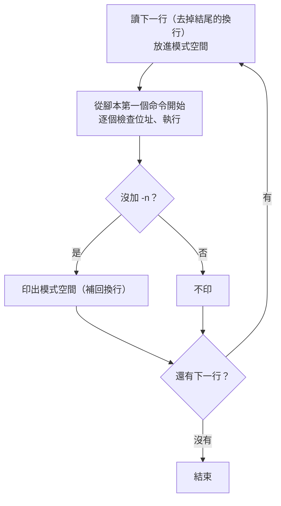

# sed 怎麼用？—— 一次讀一行、跑一遍腳本、印出來；插入指定行用 `i`／`a`

> 日期：2026-10-28
> 情境：課程筆記裡常順手用 `sed -n '/<bump>:/,/ret/p'`、`sed -i 's/64/128/' config.h`，但從沒解釋過 `sed`；使用者問「有沒有筆記教 `sed`」「`sed` 可以插入指定行嗎」。
> 適用範圍：GNU sed 4.9（Ubuntu 24.04 實測）。macOS／BSD 的 `sed` 在 `-i` 與單行 `i text` 的寫法上不同，見第七節。

**一句話結論：`sed` 把輸入一行一行讀進「模式空間（pattern space）」，對每一行從頭跑一遍腳本，跑完自動印出；所以 `3i 文字` 是「輪到第 3 行時先印出文字」、`3a 文字` 是「第 3 行印完再印文字」，加 `-i` 就把結果寫回檔案。**

---

## 目錄

- [一、先回答：插入指定行](#一先回答插入指定行)
- [二、sed 怎麼運作：一行一個循環](#二sed-怎麼運作一行一個循環)
- [三、文法骨架](#三文法骨架)
- [四、位址：選哪幾行（全部 11 種寫法）](#四位址選哪幾行全部-11-種寫法)
- [五、命令：全部 34 個](#五命令全部-34-個)
- [六、`s` 命令：取代](#六s-命令取代)
- [七、插入的細節與陷阱](#七插入的細節與陷阱)
- [八、選項：全部 15 個](#八選項全部-15-個)
- [九、錯誤訊息與結束狀態](#九錯誤訊息與結束狀態)
- [十、文法可以問工具](#十文法可以問工具)
- [自我測驗](#自我測驗)

---

## 一、先回答：插入指定行

可以。插入用 `i`（insert，插在這一行**前面**）、`a`（append，接在這一行**後面**），取代整行用 `c`（change）。

實驗用的檔案（下面所有例子都用它，除非另外說明）：

```sh
printf 'apple\nbanana\ncherry\ndate\nelder\n' > fruits.txt
printf 'X1\nX2\n' > ins.txt
```

| 想做什麼 | 指令 | 結果（實測） |
|---|---|---|
| 第 3 行**前面**插一行 | `sed '3i NEW' fruits.txt` | `apple` `banana` **`NEW`** `cherry` `date` `elder` |
| 第 3 行**後面**插一行 | `sed '3a NEW' fruits.txt` | `apple` `banana` `cherry` **`NEW`** `date` `elder` |
| 第 3 行整行換掉 | `sed '3c REPLACED' fruits.txt` | `apple` `banana` **`REPLACED`** `date` `elder` |
| 檔案開頭加一行 | `sed '1i # header' fruits.txt` | **`# header`** `apple` … |
| 檔案結尾加一行 | `sed '$a # footer' fruits.txt` | … `elder` **`# footer`** |
| 最後一行前面插 | `sed '$i NEW' fruits.txt` | … `date` **`NEW`** `elder` |
| 符合某字串的行前面插 | `sed '/cherry/i >>> before cherry' fruits.txt` | `apple` `banana` **`>>> before cherry`** `cherry` … |
| 一次插好幾行 | `sed '2i line A\nline B' fruits.txt` | `apple` **`line A`** **`line B`** `banana` … |
| 插入另一個檔案的內容 | `sed '2r ins.txt' fruits.txt` | `apple` `banana` **`X1`** **`X2`** `cherry` … |
| 直接改檔案 | `sed -i '3i NEW' fruits.txt` | 不印出，`fruits.txt` 被改成上面第一列的內容 |
| 改檔案並留備份 | `sed -i.bak '3i NEW' fruits.txt` | 多一個 `fruits.txt.bak`，是改之前的內容 |

沒加 `-i` 時 `sed` **不會改檔案**，只把結果印到標準輸出——先不加 `-i` 看結果對不對，再加 `-i` 寫回去，是最安全的用法。

縮排、只插第一個符合的、空檔案插不進去等細節在[第七節](#七插入的細節與陷阱)。

## 二、sed 怎麼運作：一行一個循環

`sed` 是串流編輯器（stream editor）：它不像 `vim` 把整個檔案載入再讓你編輯，而是**一行一行流過去**。每一行都走一次同樣的循環（cycle）：



圖要看的重點：**腳本對每一行都從頭跑一次**，跑完那一行「自動印出」。由這個模型可以推出幾個常讓人意外的結果：

- `sed '2p' fruits.txt` 會把 `banana` 印**兩次**：`p` 印一次，循環結束又自動印一次。只想印第 2 行要加 `-n` 關掉自動印出：`sed -n '2p'`。
- `sed '2,4d'` 刪掉第 2～4 行：`d` 清空模式空間並**直接開始下一個循環**，跳過自動印出。
- `i` 的文字在執行到 `i` 時立刻印出，`a` 的文字排在「循環結束、自動印出之後」才印，所以一個在前、一個在後。這些文字**不放進模式空間**，後面的 `s` 改不到它（[第七節](#七插入的細節與陷阱)有實測）。

除了模式空間，還有一個**保留空間（hold space）**：跨行暫存用的第二個緩衝區，一開始是空的，循環之間不會被清掉。`h`／`H`／`g`／`G`／`x` 在兩者之間搬資料（[第五節](#五命令全部-34-個)）。例如把整個檔案倒過來印：

```text
$ sed -n '1!G;h;$p' fruits.txt
elder
date
cherry
banana
apple
```

逐步看：每一行（第 1 行除外，`1!`）先 `G` 把保留空間接到模式空間後面，再 `h` 把結果存回保留空間；所以保留空間一路累積成「目前這行＋之前所有行（倒序）」；最後一行（`$`）才 `p` 印出。

## 三、文法骨架

```text
sed [選項]... '腳本' [輸入檔]...
sed [選項]... -e '腳本' [-e '腳本']... [輸入檔]...
sed [選項]... -f 腳本檔 [輸入檔]...
```

- **腳本**：沒有 `-e`／`-f` 時，第一個非選項參數就是腳本（`sed --help` 最後一段：`If no -e, --expression, -f, or --file option is given, then the first non-option argument is taken as the sed script`）。有了 `-e`／`-f`，所有非選項參數都是檔案。
- **輸入檔**：可以給好幾個，**預設接成一條長串流**（行號跨檔累加，見[第八節](#八選項全部-15-個) `-s`）；不給就讀標準輸入，所以能接在管線（pipe）後面：`objdump -d x | sed -n '/<f>:/,/ret/p'`。
- 腳本要用**單引號**包起來，否則 shell 會先處理裡面的 `$`、`!`、`\`（例如 `$a` 會被 shell 當成變數 `$a` 展開成空字串）。

腳本由一個或多個命令組成，每個命令的形式：

```text
[位址[,位址]][!]命令[參數]
 └─ 選哪幾行 ─┘ │  └─ 對它們做什麼
               └─ 反過來：選「不符合」的行
```

| 位置 | 可省略嗎 | 說明 |
|---|---|---|
| 位址 | 可以 | 省略 ＝ **每一行**都執行。一個位址選一行（或符合的行），兩個位址用 `,` 隔開選一個範圍。 |
| `!` | 可以 | 加了就是「不在這個位址的行才執行」：`sed -n '/an/!p'` 印出不含 `an` 的行。 |
| 命令 | 不可以 | 一個字母（`s`、`d`、`p`、`i`…）或 `=`、`#`、`{`、`}`、`:`。全部見第五節。 |
| 參數 | 看命令 | `s/re/取代/旗標`、`i 文字`、`r 檔名`、`q 結束碼`…… |

好幾個命令的串法：

| 寫法 | 例子 |
|---|---|
| 用 `;` 隔開 | `sed -n 'h;n;G;p'` |
| 多個 `-e` | `sed -e '2i A' -e '4a B'` |
| 換行 | 腳本裡直接換行，或寫進 `-f` 的腳本檔 |
| `{}` 把好幾個命令套用到同一個位址 | `sed -n '2{p;p}'` → `banana` 印兩次 |

例外：`a`、`i`、`c` 的文字、`r`／`w` 的檔名會**吃到這一行結尾**，後面不能再用 `;` 接命令（`;` 會被當成文字或檔名的一部分），只能換行或另開一個 `-e`。

## 四、位址：選哪幾行（全部 11 種寫法）

`man sed` 的 Addresses 一節＋`info sed` 第 4 章，GNU sed 4.9 共這些：

| # | 寫法 | 選到 | 實測（`sed -n '<位址>p' fruits.txt`） |
|---|---|---|---|
| 1 | `N`（數字） | 第 N 行 | `2p` → `banana` |
| 2 | `$` | 最後一行 | `$=` → `5`（`=` 印行號，所以這是數行數） |
| 3 | `/regex/` | 內容符合正規表示式（regular expression）的行 | `/an/p` → `banana` |
| 4 | `\%regex%` | 同上，`%` 可換成任何字元；regex 裡有 `/` 時用，免得一直跳脫 | `\%/usr%p` |
| 5 | `/regex/I` | 不分大小寫比對（GNU） | |
| 6 | `/regex/M` | 多行模式：`^`／`$` 也對模式空間中間的換行生效（GNU，配 `N` 用） | |
| 7 | `first~step` | 從第 first 行起每 step 行一次（GNU） | `1~2p` → `apple` `cherry` `elder`（奇數行） |
| 8 | `位址1,位址2` | 從符合位址 1 的行，到符合位址 2 的行（含頭尾） | `/b/,/d/p` → `banana` `cherry` `date` |
| 9 | `位址1,+N` | 位址 1 那行加後面 N 行（GNU） | `2,+1p` → `banana` `cherry` |
| 10 | `位址1,~N` | 位址 1 那行到下一個「行號是 N 的倍數」的行（GNU） | `2,~4p` → `banana` `cherry` `date` |
| 11 | `0,/regex/` | 跟 `1,/regex/` 一樣，但第 1 行就符合時範圍在第 1 行結束（GNU，位址 2 只能是 regex） | 見下面 |

再加上第三節的 `!`，可以接在任何一種後面反過來選。

範圍的三個規則（`man sed`：`Three things to note about address ranges`）：

1. **位址 1 那一行一定被選**，即使位址 2 是更前面的行號：`sed -n '3,1p'` 只印 `cherry`。
2. 位址 2 是 regex 時，**不會拿位址 1 那一行去比**，從下一行才開始找結束。
3. 範圍結束後如果又遇到符合位址 1 的行，會**再開一個範圍**。

規則 2 正好是第 11 種 `0,/regex/` 存在的理由：

```text
$ printf 'x\ny\nx\n' | sed '1,/x/s/^/>/'
>x
>y
>x
$ printf 'x\ny\nx\n' | sed '0,/x/s/^/>/'
>x
y
x
```

`1,/x/`：第 1 行 `x` 是起點，規則 2 讓它不跟結束條件比，往下找到第 3 行的 `x` 才結束，三行全選。`0,/x/`：從「第 0 行」就進入範圍，第 1 行拿去跟 `/x/` 比，符合，範圍就在第 1 行結束——這是「**只對第一個符合的行**做事」的標準寫法（[第七節](#七插入的細節與陷阱)用它只插一次）。

## 五、命令：全部 34 個

以 `info sed` 第 3.2 節〈sed commands summary〉為準，依用途分組。「位址」欄：0 ＝ 不能加位址、1 ＝ 最多一個、2 ＝ 可以是範圍。GNU 4.9 實際上讓 `a`／`i`／`c`／`=`／`r` 等也接受範圍（`sed '2,3i X'` 在第 2、3 行前各插一次），表裡照 `man sed` 的標準寫。

**輸出與刪除**

| 命令 | 位址 | 做什麼 | 實測 |
|---|---|---|---|
| `p` | 2 | 印出模式空間 | `sed -n 2p` → `banana` |
| `P` | 2 | 只印模式空間到第一個換行（配 `N` 用） | |
| `d` | 2 | 刪掉模式空間，**直接開始下一循環**（不自動印出） | `sed 2,4d` → `apple` `elder` |
| `D` | 2 | 模式空間沒有換行時同 `d`；有的話只刪到第一個換行，用剩下的內容重跑循環、不讀新行 | `sed '$!N;P;D'` 是經典的「兩行視窗」寫法 |
| `=` | 1 | 印出目前行號 | `sed -n '/cherry/='` → `3` |
| `l` ／ `l 寬度` | 2 | 用看得到的形式印出（`\t`、結尾 `$`），可指定折行寬度 | `printf 'a\tb\n' \| sed -n l` → `a\tb$` |

**插入文字**

| 命令 | 位址 | 做什麼 |
|---|---|---|
| `i 文字` ／ `i\`＋換行＋文字 | 1 | 在這一行**之前**印出文字 |
| `a 文字` ／ `a\`＋換行＋文字 | 1 | 在這一行**之後**（循環結束時）印出文字 |
| `c 文字` ／ `c\`＋換行＋文字 | 2 | 刪掉這一行（範圍的話是整段），印出文字代替 |
| `r 檔名` | 1 | 循環結束時印出整個檔案的內容（檔案不存在就安靜地什麼都不做，實測不報錯） |
| `R 檔名` | 1 | 每執行一次，從那個檔案讀**下一行**印出（GNU） |

**取代與轉換**

| 命令 | 位址 | 做什麼 | 實測 |
|---|---|---|---|
| `s/regex/取代/旗標` | 2 | 取代；詳見第六節 | `echo 'aaa bbb aaa' \| sed 's/aaa/X/'` → `X bbb aaa` |
| `y/來源字元/目的字元/` | 2 | 逐字元對應轉換（像 `tr`），兩邊長度要一樣 | `echo hello \| sed 'y/abc…z/ABC…Z/'` → `HELLO` |
| `z` | 2 | 清空模式空間（GNU，跟 `d` 不同：不結束循環） | `printf 'a\nb\n' \| sed 'z;s/^$/(empty)/'` → 兩行 `(empty)` |

**讀下一行**

| 命令 | 位址 | 做什麼 |
|---|---|---|
| `n` | 2 | （沒 `-n` 時先印出目前的模式空間）讀下一行**取代**模式空間 |
| `N` | 2 | 讀下一行**接在**模式空間後面，中間放一個換行 |

`sed 'N;s/\n/ + /' fruits.txt` → `apple + banana`、`cherry + date`、`elder`：每兩行併成一行。

**保留空間**

| 命令 | 位址 | 做什麼 |
|---|---|---|
| `h` | 2 | 模式空間**複製到**保留空間（覆蓋） |
| `H` | 2 | 模式空間**接到**保留空間後面（中間加換行） |
| `g` | 2 | 保留空間**複製到**模式空間（覆蓋） |
| `G` | 2 | 保留空間**接到**模式空間後面（中間加換行） |
| `x` | 2 | 兩個空間**交換** |

`sed -n 'h;n;G;p' fruits.txt` → `banana` `apple` `date` `cherry`：存一行、讀下一行、把存的接在後面，兩兩對調。

**流程控制**

| 命令 | 位址 | 做什麼 |
|---|---|---|
| `: 標籤` | 0 | 定義跳躍目標 |
| `b [標籤]` | 2 | 無條件跳到標籤；省略標籤 ＝ 跳到腳本結尾（結束這個循環） |
| `t [標籤]` | 2 | 這一行讀進來後（或上次 `t`／`T` 之後）**有** `s` 成功取代過才跳 |
| `T [標籤]` | 2 | **沒有** `s` 成功過才跳（GNU） |
| `{ 命令;… }` | 2 | 把好幾個命令綁在同一個位址 |
| `}` | 0 | 區塊結尾 |
| `q [結束碼]` | 1 | （沒 `-n` 時先印出目前這行）結束，不再讀；可指定結束碼（GNU） |
| `Q [結束碼]` | 1 | 直接結束、**不印**目前這行（GNU） |

```text
$ echo 'one two' | sed ':a;s/o/0/;ta'          # 每次只換一個，換成功就跳回 a 再換
0ne tw0
$ echo 'one two' | sed 's/o/0/;T;s/$/ (changed)/'   # 沒換成功就跳到結尾
0ne two (changed)
$ sed 3q fruits.txt          # 印到第 3 行就停（像 head -3）
apple
banana
cherry
$ sed 3Q fruits.txt          # 第 3 行不印
apple
banana
$ sed '/cherry/q 5' fruits.txt; echo exit=$?
apple
banana
cherry
exit=5
```

**檔案與外部命令**

| 命令 | 位址 | 做什麼 |
|---|---|---|
| `w 檔名` | 2 | 把模式空間寫進檔案（檔案在 `sed` 開始時就被清空建立） |
| `W 檔名` | 2 | 只寫模式空間的第一行（GNU） |
| `e` | 2 | 把模式空間當成 shell 命令執行，用輸出**取代**模式空間（GNU） |
| `e 命令` | 2 | 執行指定的命令，輸出印在目前這行前面（GNU） |
| `F` | 1 | 印出目前輸入檔的檔名（GNU；標準輸入印 `-`） |

```text
$ sed -n '/an/w out.txt' fruits.txt; cat out.txt
banana
$ echo 'x' | sed 'e echo from-e'
from-e
x
$ sed -n 'F;=' ins.txt
ins.txt
1
ins.txt
2
```

**其他**

| 命令 | 位址 | 做什麼 |
|---|---|---|
| `#註解` | 0 | 註解到行尾。特例：腳本檔的**前兩個字元**是 `#n` 時，等於加了 `-n`（實測 `printf '#n\n2p\n' > n.sed; sed -f n.sed fruits.txt` 只印 `banana`） |
| `v [版本]` | 0 | 什麼都不做；只是宣告「這個腳本需要 GNU sed（至少這個版本）」，版本不夠就報錯（GNU；實測 `sed 'v 9.0'` → `expected newer version of sed`） |

數一下：輸出與刪除 6、插入 5、取代 3、讀行 2、保留空間 5、流程 8、檔案 4（`e` 兩種形式算一個）、其他 2，共 35 列；`info sed` 3.2 節把 `{ … }` 算成一個，上表把 `{`、`}` 分開列，所以命令是 **34** 個。

## 六、`s` 命令：取代

```text
s/regex/取代/旗標
│└─分隔符：s 後面的第一個字元就是分隔符，不一定要 /
```

**分隔符**：路徑裡一堆 `/` 時換一個比較好讀：`echo '/usr/lib' | sed 's#/usr#/opt#'` → `/opt/lib`。

**取代字串裡的特殊寫法**：

| 寫法 | 意思 | 實測 |
|---|---|---|
| `&` | 整個符合的部分 | `echo abc \| sed 's/b/[&]/'` → `a[b]c` |
| `\1`～`\9` | 第 N 個括號群組 | `echo key=value \| sed 's/\(.*\)=\(.*\)/\2=\1/'` → `value=key` |
| `\n` | 換行 | `echo 'a b' \| sed 's/ /\n/'` → 兩行 `a`、`b` |
| `\L` ／ `\U` | 之後全部轉小寫／大寫，直到 `\E` 或 `\U`／`\L`（GNU） | `echo 'ABC def' \| sed -E 's/(\w+) (\w+)/\L\1\E \U\2/'` → `abc DEF` |
| `\l` ／ `\u` | 只把下一個字元轉小寫／大寫（GNU） | `echo 'hello world' \| sed 's/\w\+/\u&/g'` → `Hello World` |
| `\E` | 結束 `\L`／`\U` | |
| `\&`、`\/` | 字面上的 `&`、`/` | |

**旗標（全部 7 種，`info sed` 3.3 節）**：

| 旗標 | 做什麼 | 實測 |
|---|---|---|
| （不加） | 只換每行**第一個** | `s/aaa/X/` → `X bbb aaa` |
| `g` | 換掉每行**全部** | `s/aaa/X/g` → `X bbb X` |
| 數字 N | 只換第 N 個；跟 `g` 一起用（`2g`）是第 N 個以後全換 | `s/aaa/X/2` → `aaa bbb X` |
| `p` | 有換成功就印出（配 `-n` 只看改到的行） | `sed -n 's/x/y/p'` |
| `w 檔名` | 有換成功就把結果寫進檔案 | `sed 's/a/A/w changed.txt' fruits.txt` → `changed.txt` 是 `Apple` `bAnana` `dAte` |
| `e` | 換完把模式空間當命令執行，輸出取代它（GNU） | `echo 'echo hi' \| sed 's/.*/&/e'` → `hi` |
| `I` 或 `i` | 不分大小寫（GNU） | `echo Hello \| sed 's/hello/X/I'` → `X` |
| `M` 或 `m` | 多行模式，`^`／`$` 對中間的換行也生效（GNU） | `printf 'foo\nbar\n' \| sed 'N;s/^bar/X/M'` → `foo` `X` |

（`I`／`i`、`M`／`m` 是同一個旗標的兩種寫法，所以是 7 種。）

**正規表示式：BRE 與 ERE**

`sed` 預設用 BRE（Basic Regular Expression，基本正規表示式），`-E` 改成 ERE（Extended Regular Expression，延伸正規表示式）。差別在 `+ ? ( ) { } |` 這幾個符號：BRE 裡它們是**普通字元**，要加反斜線才有特殊意義（`\+ \? \( \) \{ \} \|` 是 GNU 的擴充）；ERE 剛好相反。

```text
$ echo 'x' | sed -E 's/(x)+/y/'
y
$ echo 'x' | sed 's/(x)+/y/'        # BRE：找字面上的 "(x)+"，找不到，不換
x
$ echo 'aaa' | sed 's/a\{2\}/X/'    # BRE 的次數
Xa
$ echo 'aaa' | sed -E 's/a{2}/X/'   # ERE 的次數
Xa
$ echo 'cat dog' | sed 's/cat\|dog/pet/g'
pet pet
$ echo 'a1b22' | sed 's/[[:digit:]]\+/<&>/g'
a<1>b<22>
```

這裡只列了最常用的部分。正規表示式的完整語法（字元類別 `[[:alpha:]]` 全表、`\w` `\s` `\b` `\<` `\>` 等 GNU 擴充、跳脫序列、多位元組字元）見 `info sed` 第 5 章〈Regular Expressions: selecting text〉。

## 七、插入的細節與陷阱

**1. 單行寫法會吃掉開頭的空白，要保留縮排用 `i\`**

```text
$ sed '2i    indented' fruits.txt     # 前面的空白被吃掉
apple
indented
banana
...
$ sed '2i\    indented' fruits.txt    # 加反斜線，空白保留
apple
    indented
banana
...
```

**2. 單行寫法是 GNU 擴充；POSIX 的寫法是 `i\` 換行再寫文字**

```text
$ sed --posix '2i NEW' fruits.txt
sed: -e expression #1, char 4: expected \ after `a', `c' or `i'
```

POSIX 寫法（各家 `sed` 都吃）：

```sh
sed '2i\
line A\
line B' fruits.txt
```

除了最後一行，每行文字結尾都要 `\`，表示「文字還沒完」。macOS 的 BSD `sed` 只認這種寫法，而且 `-i` 一定要給備份副檔名（不要備份寫 `-i ''`），跟 GNU 不同（本機未實測 BSD）。

**3. 插入的文字不在模式空間，後面的命令改不到**

```text
$ sed -e '2a foo' -e 's/foo/X/' fruits.txt | head -4
apple
banana
foo
cherry
```

`a` 只是把 `foo` 排進「待印出」的佇列，`s` 處理的是模式空間裡的 `banana`，碰不到 `foo`。

**4. regex 位址會在每個符合的行都插；只插第一個用 `0,/regex/`**

```text
$ printf 'a=1\nb=2\na=3\n' | sed '/^a=/a INSERTED'
a=1
INSERTED
b=2
a=3
INSERTED
$ printf 'a=1\nb=2\na=3\n' | sed '0,/^a=/{/^a=/a INSERTED
}'
a=1
INSERTED
b=2
a=3
```

`0,/^a=/` 選出「開頭到第一個 `a=`」這個範圍（第四節第 11 種），`{}` 裡再用 `/^a=/` 從範圍中挑出那一行。`a` 的文字吃到行尾，所以 `}` 要換行寫。

**5. 空檔案插不進去；超過最後一行的行號也沒反應**

```text
$ : > empty.txt; sed -i '1i first' empty.txt; cat empty.txt
                          # 什麼都沒有
$ sed '7i X' fruits.txt | wc -l
5
```

`sed` 的命令是「輪到某一行時」才執行；空檔案沒有任何一行，`1i` 永遠輪不到；檔案只有 5 行，第 7 行也輪不到。要給空檔案加內容就不是 `sed` 的工作了，直接 `echo first > empty.txt`。

**6. 好幾個檔案時，行號預設跨檔累加；`-i` 會自動改成每個檔案分開算**

```text
$ sed '1i ==' fruits.txt ins.txt       # 只在整串的第 1 行前面插
==
apple
...
elder
X1
X2
$ sed -s '1i ==' fruits.txt ins.txt    # -s：每個檔案各自從第 1 行算
==
apple
...
elder
==
X1
X2
```

`-i` 隱含 `-s`：`printf 'a\n' > a1; printf 'b\n' > b1; sed -i '1i X' a1 b1` 之後兩個檔案開頭都有 `X`。

**7. `-i` 其實是「寫新檔、再換名字」：inode 會變，符號連結會被換成一般檔案**

```text
$ cp fruits.txt t.txt; stat -c %i t.txt; sed -i '1i x' t.txt; stat -c %i t.txt
18481492
18481493
```

inode（索引節點，檔案在檔案系統裡的編號）換了：`sed -i` 把結果寫進同一個資料夾的暫存檔，再用 `rename` 蓋掉原檔名，並不是在原檔上就地改。所以：

```text
$ cp fruits.txt t2.txt; ln -sf t2.txt lk; sed -i 's/apple/APPLE/' lk
$ ls -l lk | cut -c1
-                        # lk 原本是符號連結（l），現在變成一般檔案（-）
$ head -1 t2.txt
apple                    # 連結指向的原檔根本沒改
$ head -1 lk
APPLE
```

要改連結指向的檔案，加 `--follow-symlinks`（同樣的實驗，`lk` 還是 `l`、原檔第一行變成 `APPLE`）。另外，其他程式如果還開著舊檔（拿著舊 inode），看到的仍是舊內容；檔案的擁有者與權限 `sed` 會盡量照抄，但要在那個資料夾有寫入權才能建暫存檔。

## 八、選項：全部 15 個

以 `sed --help`（GNU sed 4.9）為準，照它列的順序：

| 選項 | 做什麼 |
|---|---|
| `-n`、`--quiet`、`--silent` | 關掉每個循環結束時的自動印出；只有 `p` 等命令明確印的才出現 |
| `--debug` | 印出解析後的腳本，並逐行顯示每個命令執行前後的模式空間（除錯用，見下面） |
| `-e 腳本`、`--expression=腳本` | 加一段腳本；可以給好幾次，依序串起來 |
| `-f 腳本檔`、`--file=腳本檔` | 從檔案讀腳本（一行一個命令，`a`/`i`/`c` 不用煩惱 `;`） |
| `--follow-symlinks` | `-i` 時跟著符號連結去改真正的檔案（第七節第 7 點） |
| `-i[後綴]`、`--in-place[=後綴]` | 把結果寫回檔案；給了後綴就把原檔留成「原檔名＋後綴」的備份。後綴要**緊貼** `-i`（`-i.bak`），中間有空白會被當成別的參數。隱含 `-s` |
| `-l N`、`--line-length=N` | 設定 `l` 命令的折行寬度（`sed -n -l 10 l` 每 9 個字元加 `\` 折行） |
| `--posix` | 關掉所有 GNU 擴充，用來檢查腳本能不能在別的 `sed` 跑（第七節第 2 點） |
| `-E`、`-r`、`--regexp-extended` | 用 ERE（第六節）；`-E` 是 POSIX 標準寫法，建議用它 |
| `-s`、`--separate` | 把每個輸入檔當成獨立的串流：行號、`$` 各檔分開算（第七節第 6 點） |
| `--sandbox` | 禁用 `e`／`r`／`w` 這些會碰到檔案或執行命令的功能，處理別人給的腳本時用 |
| `-u`、`--unbuffered` | 讀少一點、更常把輸出沖出去（例如接在 `tail -f` 後面要即時看到結果） |
| `-z`、`--null-data` | 用 NUL（`\0`）而不是換行來切「行」，配 `find -print0` 處理含換行的檔名 |
| `--help` | 印出用法 |
| `--version` | 印出版本 |

```text
$ sed --sandbox 'w x.txt' fruits.txt
sed: -e expression #1, char 1: e/r/w commands disabled in sandbox mode
$ printf 'a\0b\0' | sed -z 's/^/>/' | tr '\0' '\n'
>a
>b
$ echo 'abc' | sed --debug 's/b/B/'
SED PROGRAM:
  s/b/B/
INPUT:   'STDIN' line 1
PATTERN: abc
COMMAND: s/b/B/
MATCHED REGEX REGISTERS
  regex[0] = 1-2 'b'
PATTERN: aBc
END-OF-CYCLE:
aBc
```

`--debug` 的輸出正好就是第二節那張圖：`PATTERN` 是模式空間、`COMMAND` 是正在跑的命令、`END-OF-CYCLE` 之後是自動印出的結果。腳本不照預期跑時，先加 `--debug` 看模式空間在哪一步變了。

## 九、錯誤訊息與結束狀態

錯誤訊息都長這樣：`sed: -e expression #第幾段, char 第幾個字元: 原因`，`char` 指到出錯的位置。

| 寫錯的方式 | 錯誤訊息 |
|---|---|
| `sed 'k'`（沒有這個命令） | `unknown command: `k'` |
| `sed 's/a/b'`（少了最後的 `/`） | `unterminated `s' command` |
| `sed 's/a/b/z'`（沒有這個旗標） | `unknown option to `s'` |
| `sed '2i'`（`i` 後面沒文字），或 `--posix` 下用單行 `i 文字` | `expected \ after `a', `c' or `i'` |
| `sed '/x/,'`（範圍少了位址 2） | `unexpected `,'` |
| `sed '2{p'`（沒關 `{`） | `unmatched `{'` |
| `sed '0a NEW'`（`0` 只能用在 `0,/regex/`） | `invalid usage of line address 0` |
| `sed p nofile`（檔案不存在） | `can't read nofile: No such file or directory`，**繼續處理其他檔案** |

結束狀態（`info sed` 2.3 節）：

| 值 | 意思 |
|---|---|
| 0 | 成功 |
| 1 | 命令、語法、正規表示式不對，或 `--posix` 下用了 GNU 擴充（實測 `sed 'k'` → 1） |
| 2 | 有輸入檔打不開（實測 `sed p nofile fruits.txt` → 2，但 `fruits.txt` 照樣處理了） |
| 4 | I/O 錯誤或執行中的嚴重錯誤，立刻中止 |
| 自訂 | `q 結束碼`／`Q 結束碼`（第五節） |

注意：**沒有任何一行符合位址，結束狀態仍是 0**。`sed` 不像 `grep` 會用結束狀態告訴你「有沒有找到」；要判斷有沒有改到，用 `s///w` 寫檔，或 `/regex/q 1` 這類寫法自己設結束碼。

## 十、文法可以問工具

| 查法 | 內容 |
|---|---|
| `sed --help` | 全部 15 個選項（第八節就是照它） |
| `man sed` | 選項＋命令的**簡表**（`COMMAND SYNOPSIS`）＋位址；它自己寫明只是給熟手的提示，完整說明要看 texinfo 文件。注意 `man sed` 的命令表沒列 `e`、`F`、`v`、`z` |
| `info sed` | 完整手冊（本機檔案是 `/usr/share/info/sed.info.gz`）：第 3 章命令（3.2 節是全部命令的摘要）、第 4 章位址、第 5 章正規表示式、第 6 章模式空間與保留空間、第 7 章範例腳本 |
| `sed --debug '腳本'` | 看腳本實際被怎麼解析、每一步模式空間長怎樣 |

---

## 自我測驗

> 參考答案寫在每題下面（第一次作答批改後才補上），作答時先遮住答案。

1. `sed '2p' fruits.txt` 為什麼會把第 2 行印兩次？用 `sed` 處理每一行的流程解釋，並說明 `-n` 改變了流程的哪一步。
2. `sed '3i NEW'`、`sed '3a NEW'`、`sed '3c NEW'` 各把 `NEW` 放在哪裡？下面這個指令為什麼輸出裡還是 `foo`，沒有變成 `X`？

   ```sh
   printf 'apple\nbanana\ncherry\ndate\nelder\n' > fruits.txt
   sed -e '2a foo' -e 's/foo/X/' fruits.txt
   ```

3. 情境題：設定檔 `app.conf` 內容如下，你想只在**第一個** `server=` 那一行後面插入 `timeout=30`。同事寫的 `sed -i '/^server=/a timeout=30' app.conf` 結果插了兩次。為什麼？要怎麼改？

   ```text
   server=10.0.0.1
   port=80
   server=10.0.0.2
   ```

4. 情境題：你對一個符號連結 `config` 執行 `sed -i 's/debug=0/debug=1/' config`，之後發現連結指向的原檔沒有改、`config` 自己變成一般檔案。從 `-i` 的實作方式解釋為什麼，要怎麼避免？
5. 情境題：腳本裡用 `sed -i '1i #!/bin/sh' "$f"` 替檔案加第一行，對大部分檔案都正常，只有一個剛用 `touch` 建出來的檔案沒有被加上。為什麼？
