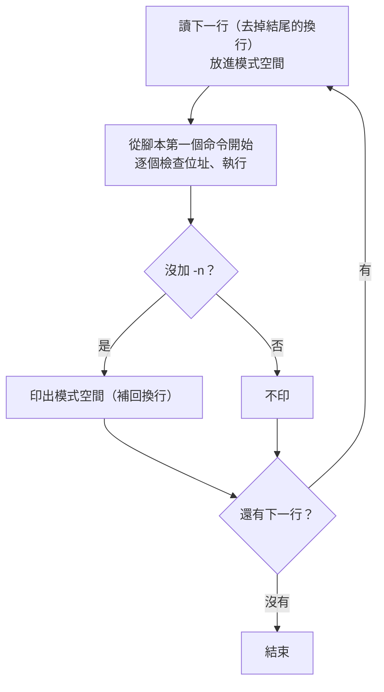

# sed 怎麼用？—— 一次讀一行、跑一遍腳本、印出來；插入指定行用 `i`／`a`

> 日期：2026-10-28（2026-11-04 改版：每個位址、命令、選項都附一個實測例子）
> 情境：課程筆記裡常順手用 `sed -n '/<bump>:/,/ret/p'`、`sed -i 's/64/128/' config.h`，但從沒解釋過 `sed`；使用者問「有沒有筆記教 `sed`」「`sed` 可以插入指定行嗎」。2026-11-04 使用者反映「寫的內容讓人不知道怎麼查與用」，改成每個功能一個例子：粗體寫結論、一個指令與它的輸出、下面緊接說明（`CLAUDE.md` 筆記規範 6-4）。
> 適用範圍：GNU sed 4.9（Ubuntu 24.04 實測）。macOS／BSD 的 `sed` 在 `-i` 與單行 `i text` 的寫法上不同，見第七節。

**一句話結論：`sed` 把輸入一行一行讀進「模式空間（pattern space）」，對每一行從頭跑一遍腳本，跑完自動印出；所以 `3i 文字` 是「輪到第 3 行時先印出文字」、`3a 文字` 是「第 3 行印完再印文字」，加 `-i` 就把結果寫回檔案。**

**怎麼查**：知道要做什麼（印某幾行、刪行、取代、插入、改檔）→ 先看[第零節〈依任務查〉](#零依任務查)；看到別人寫的 `sed` 看不懂 → 照[第三節〈文法骨架〉](#三文法骨架)把它拆成「位址＋命令」，再到第四節（位址）、第五節（命令）、第六節（`s` 的寫法）、第八節（選項）找那一項的例子。

---

## 目錄

- [零、依任務查](#零依任務查)
- [一、先回答：插入指定行](#一先回答插入指定行)
- [二、sed 怎麼運作：一行一個循環](#二sed-怎麼運作一行一個循環)
- [三、文法骨架](#三文法骨架)
- [四、位址：選哪幾行（全部 11 種寫法）](#四位址選哪幾行全部-11-種寫法)
- [五、命令：全部 34 個](#五命令全部-34-個)
- [六、`s` 命令：取代](#六s-命令取代)
- [七、插入的細節與陷阱](#七插入的細節與陷阱)
- [八、選項：全部 15 個](#八選項全部-15-個)
- [九、錯誤訊息與結束狀態](#九錯誤訊息與結束狀態)
- [十、文法可以問工具](#十文法可以問工具)
- [自我測驗](#自我測驗)

---

## 零、依任務查

全篇的例子都用這兩個檔案（每個例子都從這個內容開始，前一個例子的 `-i` 不會影響下一個）：

```sh
printf 'apple\nbanana\ncherry\ndate\nelder\n' > fruits.txt     # 5 行，下面叫它第 1～5 行
printf 'X1\nX2\n' > ins.txt                                    # 插入用的小檔案
```

| 想做什麼 | 寫法 | 例子在 |
|---|---|---|
| 只印第 N 行 | `sed -n 'Np'` | [第四節 1](#1-n數字第-n-行) |
| 印第 M～N 行 | `sed -n 'M,Np'` | [第四節 8](#8-位址1位址2一段範圍) |
| 印符合某字串的行（像 `grep`） | `sed -n '/字串/p'` | [第四節 3](#3-regex符合的行) |
| 印從 A 到 B 的一段（例如反組譯的一個函式） | `sed -n '/A/,/B/p'` | [第四節 8](#8-位址1位址2一段範圍) |
| 印不符合的行（像 `grep -v`） | `sed -n '/字串/!p'` | [第四節〈`!`〉](#反過來選) |
| 數行數 | `sed -n '$='` | [第四節 2](#2-最後一行) |
| 刪掉某幾行 | `sed 'M,Nd'` | [第五節 `d`](#d刪掉這一行直接開始下一個循環) |
| 取代第一個／全部 | `sed 's/舊/新/'`／`sed 's/舊/新/g'` | [第六節〈旗標〉](#旗標全部-7-種) |
| 只印有被取代的行 | `sed -n 's/舊/新/p'` | [第六節 `p` 旗標](#p有取代成功就印出) |
| 在第 N 行前／後插入、整行換掉 | `sed 'Ni 文字'`／`'Na 文字'`／`'Nc 文字'` | [第一節](#一先回答插入指定行) |
| 直接改檔案（留備份） | `sed -i.bak '…' 檔案` | [第一節〈直接改檔案〉](#直接改檔案-i) |
| 印到第 N 行就停（像 `head`） | `sed Nq` | [第五節 `q`](#q-結束碼印出這一行後結束) |
| 每兩行併成一行／整個檔案併成一行 | `sed 'N;s/\n/ /'`／`sed ':a;N;$!ba;s/\n/,/g'` | [第五節 `N`](#n讀下一行接在後面)、[`:`／`b`](#-標籤-與-b-標籤跳躍) |
| 腳本不照預期跑 | `sed --debug '…'` | [第八節 `--debug`](#--debug逐步看模式空間) |

## 一、先回答：插入指定行

可以。插入用 `i`（insert，插在這一行**前面**）、`a`（append，接在這一行**後面**），取代整行用 `c`（change）。沒加 `-i` 時 `sed` **不會改檔案**，只把結果印到標準輸出——先不加 `-i` 看結果對不對，再加 `-i` 寫回去，是最安全的用法。

**第 3 行前面插一行**

```text
$ sed '3i NEW' fruits.txt
apple
banana
NEW
cherry
date
elder
```

- `NEW` 出現在 `cherry`（第 3 行）**前面**：輪到第 3 行時，`i` 先印出文字，循環結束才印 `cherry`。

**第 3 行後面插一行**

```text
$ sed '3a NEW' fruits.txt
apple
banana
cherry
NEW
date
elder
```

- `NEW` 出現在 `cherry` **後面**：`a` 的文字排在「這一行印完之後」才印。

**第 3 行整行換掉**

```text
$ sed '3c REPLACED' fruits.txt
apple
banana
REPLACED
date
elder
```

- `cherry` 不見了，換成 `REPLACED`：`c` 刪掉這一行、印出文字代替。

**檔案開頭加一行**

```text
$ sed '1i # header' fruits.txt
# header
apple
banana
cherry
date
elder
```

- 位址 `1` ＋ `i` ＝ 第一行前面。常用來加 shebang 或註解標頭。

**檔案結尾加一行**

```text
$ sed '$a # footer' fruits.txt
apple
banana
cherry
date
elder
# footer
```

- 位址 `$` 是最後一行，`a` 接在它後面。腳本要用單引號，否則 shell 會把 `$a` 當成變數展開。

**最後一行前面插**

```text
$ sed '$i NEW' fruits.txt
apple
banana
cherry
date
NEW
elder
```

- `$i`：`NEW` 在 `date` 與 `elder` 之間。

**符合某字串的行前面插**

```text
$ sed '/cherry/i >>> before cherry' fruits.txt
apple
banana
>>> before cherry
cherry
date
elder
```

- 位址換成 `/cherry/`：每一個含 `cherry` 的行前面都插（有好幾行符合就插好幾次，只插第一個見[第七節 4](#4-regex-位址會在每個符合的行都插只插第一個用-0regex)）。

**一次插好幾行**

```text
$ sed '2i line A\nline B' fruits.txt
apple
line A
line B
banana
cherry
date
elder
```

- 文字裡的 `\n` 會變成換行（GNU 擴充），所以插了 `line A`、`line B` 兩行。各家 `sed` 都吃的寫法見[第七節 2](#2-單行寫法是-gnu-擴充posix-的寫法是-i-換行再寫文字)。

**插入另一個檔案的內容**

```text
$ sed '2r ins.txt' fruits.txt
apple
banana
X1
X2
cherry
date
elder
```

- `r 檔名`：在第 2 行（`banana`）印完之後，接著印出 `ins.txt` 的全部內容。

#### 直接改檔案：`-i`

```text
$ sed -i '3i NEW' fruits.txt; cat fruits.txt     # 改完再 cat 出來看
apple
banana
NEW
cherry
date
elder
```

- `sed -i` 自己**不印任何東西**，結果直接寫回 `fruits.txt`；`cat` 印出來的是改過的檔案。

**改檔案並留備份**

```text
$ sed -i.bak '3i NEW' fruits.txt; cat fruits.txt.bak     # 看備份檔
apple
banana
cherry
date
elder
```

- `-i.bak`：改之前的內容留在 `fruits.txt.bak`（上面印的就是備份，還沒有 `NEW`）。後綴要**緊貼** `-i`。

縮排、只插第一個符合的、空檔案插不進去等細節在[第七節](#七插入的細節與陷阱)。

## 二、sed 怎麼運作：一行一個循環

`sed` 是串流編輯器（stream editor）：它不像 `vim` 把整個檔案載入再讓你編輯，而是**一行一行流過去**。每一行都走一次同樣的循環（cycle）：



圖要看的重點：**腳本對每一行都從頭跑一次**，跑完那一行「自動印出」。由這個模型可以推出幾個常讓人意外的結果。

**`p` 會讓那一行印兩次**

```text
$ sed '2p' fruits.txt
apple
banana
banana
cherry
date
elder
```

- `banana` 出現兩次：`p` 印一次，循環結束又自動印一次。

**加 `-n` 關掉自動印出，只剩 `p` 印的**

```text
$ sed -n '2p' fruits.txt
banana
```

- 只想印某幾行，就是「`-n` ＋ `p`」。

**`d` 跳過自動印出**

```text
$ sed '2,4d' fruits.txt
apple
elder
```

- 第 2～4 行沒印：`d` 清空模式空間並**直接開始下一個循環**，跳過了「自動印出」那一步。

`i` 的文字在執行到 `i` 時立刻印出，`a` 的文字排在「循環結束、自動印出之後」才印，所以一個在前、一個在後。這些文字**不放進模式空間**，後面的 `s` 改不到它（[第七節 3](#3-插入的文字不在模式空間後面的命令改不到)有實測）。

除了模式空間，還有一個**保留空間（hold space）**：跨行暫存用的第二個緩衝區，一開始是空的，循環之間不會被清掉。`h`／`H`／`g`／`G`／`x` 在兩者之間搬資料（[第五節〈保留空間〉](#保留空間)）。

**把整個檔案倒過來印**

```text
$ sed -n '1!G;h;$p' fruits.txt
elder
date
cherry
banana
apple
```

- 每一行（第 1 行除外，`1!`）先 `G` 把保留空間接到模式空間後面，再 `h` 把結果存回保留空間；保留空間一路累積成「目前這行＋之前所有行（倒序）」；最後一行（`$`）才 `p` 印出。

## 三、文法骨架

```text
sed [選項]... '腳本' [輸入檔]...
sed [選項]... -e '腳本' [-e '腳本']... [輸入檔]...
sed [選項]... -f 腳本檔 [輸入檔]...
```

- **腳本**：沒有 `-e`／`-f` 時，第一個非選項參數就是腳本（`sed --help` 最後一段：`If no -e, --expression, -f, or --file option is given, then the first non-option argument is taken as the sed script`）。有了 `-e`／`-f`，所有非選項參數都是檔案。
- **輸入檔**：可以給好幾個，**預設接成一條長串流**（行號跨檔累加，見[第八節 `-s`](#-s每個檔案分開算)）；不給就讀標準輸入，所以能接在管線（pipe）後面：`objdump -d x | sed -n '/<f>:/,/ret/p'`。
- 腳本要用**單引號**包起來，否則 shell 會先處理裡面的 `$`、`!`、`\`（例如 `$a` 會被 shell 當成變數 `$a` 展開成空字串）。

腳本由一個或多個命令組成，每個命令的形式：

```text
[位址[,位址]][!]命令[參數]
 └─ 選哪幾行 ─┘ │  └─ 對它們做什麼
               └─ 反過來：選「不符合」的行
```

| 位置 | 可省略嗎 | 說明 |
|---|---|---|
| 位址 | 可以 | 省略 ＝ **每一行**都執行。一個位址選一行（或符合的行），兩個位址用 `,` 隔開選一個範圍。全部寫法見第四節。 |
| `!` | 可以 | 加了就是「不在這個位址的行才執行」。 |
| 命令 | 不可以 | 一個字母（`s`、`d`、`p`、`i`…）或 `=`、`#`、`{`、`}`、`:`。全部見第五節。 |
| 參數 | 看命令 | `s/re/取代/旗標`、`i 文字`、`r 檔名`、`q 結束碼`…… |

好幾個命令有四種串法：

**用 `;` 隔開**

```text
$ sed -n '2p;4p' fruits.txt
banana
date
```

- 一個腳本裡兩個命令：第 2 行印一次、第 4 行印一次。

**多個 `-e`**

```text
$ sed -e '2i A' -e '4a B' fruits.txt
apple
A
banana
cherry
date
B
elder
```

- 兩段腳本依序接起來，等於寫在同一個腳本裡的兩行。`a`、`i` 這種文字會吃到行尾的命令，最適合用 `-e` 分開。

**寫進腳本檔，用 `-f` 讀**

```text
$ printf '2p\n4p\n' > two.sed; sed -n -f two.sed fruits.txt     # 腳本檔一行一個命令
banana
date
```

- `two.sed` 的內容是兩行 `2p`、`4p`，效果跟 `'2p;4p'` 一樣。腳本長的時候這樣比較好讀。

**`{}` 把好幾個命令套用到同一個位址**

```text
$ sed -n '2{p;p}' fruits.txt
banana
banana
```

- `{p;p}` 兩個 `p` 都只對第 2 行做，所以 `banana` 印兩次。

**例外：`a`、`i`、`c` 的文字、`r`／`w` 的檔名會吃到這一行結尾**

```text
$ sed '2i A;3d' fruits.txt
apple
A;3d
banana
cherry
date
elder
```

- 想「第 2 行前插 `A`，再刪第 3 行」，結果插進去的文字是 `A;3d`，`cherry` 也沒被刪：`;3d` 被當成文字的一部分。這種情況只能換行或另開一個 `-e`。

## 四、位址：選哪幾行（全部 11 種寫法）

`man sed` 的 Addresses 一節＋`info sed` 第 4 章，GNU sed 4.9 共 11 種，下面依序各一個例子（都配 `-n` 與 `p`，只印被選到的行）。

#### 1. `N`（數字）：第 N 行

```text
$ sed -n '2p' fruits.txt
banana
```

- 行號從 1 開始。

#### 2. `$`：最後一行

```text
$ sed -n '$p' fruits.txt
elder
```

- `$` 是最後一行，不管檔案有幾行。

```text
$ sed -n '$=' fruits.txt     # = 印行號：最後一行的行號就是總行數
5
```

- `=` 印出目前行號；只對最後一行做，就等於數行數（像 `wc -l`，但最後一行沒有換行也算）。

#### 3. `/regex/`：符合的行

```text
$ sed -n '/an/p' fruits.txt
banana
```

- 內容符合正規表示式（regular expression）`an` 的行才印。這就是 `grep an fruits.txt` 的 `sed` 寫法。

#### 4. `\%regex%`：換一個分隔符

```text
$ printf '/usr/bin\n/etc/hosts\n/usr/lib\n' | sed -n '\%^/usr%p'     # regex 裡有 /，改用 % 包
/usr/bin
/usr/lib
```

- `\%…%` 跟 `/…/` 一樣是比對，但用 `%` 當分隔符（`%` 可換成任何字元）。regex 本身有很多 `/`（例如路徑）時不必一直寫 `\/`。

#### 5. `/regex/I`：不分大小寫

```text
$ printf 'Apple\nBANANA\ncherry\n' | sed -n '/apple/Ip'
Apple
```

- `I` 讓 `apple` 也比對到 `Apple`（GNU）。`BANANA`、`cherry` 不含 `apple`，不印。

#### 6. `/regex/M`：多行模式

先看不加 `M`：

```text
$ printf 'foo\nbar\n' | sed -n 'N;/^bar/p'     # N 把兩行併進模式空間
```

- `N` 讓模式空間變成 `foo\nbar`。`^` 只比對整個模式空間的開頭（`f`），所以 `/^bar/` 不符合，什麼都沒印。

```text
$ printf 'foo\nbar\n' | sed -n 'N;/^bar/Mp'     # 加 M
foo
bar
```

- 加了 `M`，`^`／`$` 也對模式空間**中間的換行**生效：`\n` 後面的 `bar` 算「行首」，符合了，`p` 把整個模式空間（兩行）印出來。只有用 `N` 把好幾行放進模式空間時才用得到。

#### 7. `first~step`：每隔幾行

```text
$ sed -n '1~2p' fruits.txt
apple
cherry
elder
```

- 從第 1 行起每 2 行一次：第 1、3、5 行（奇數行，GNU）。偶數行寫 `0~2`。

#### 8. `位址1,位址2`：一段範圍

```text
$ sed -n '/b/,/d/p' fruits.txt
banana
cherry
date
```

- 從第一個含 `b` 的行（`banana`）開始，到之後第一個含 `d` 的行（`date`）結束，頭尾都算。數字也可以：`2,4p` 印第 2～4 行。

#### 9. `位址1,+N`：位址 1 再往後 N 行

```text
$ sed -n '2,+1p' fruits.txt
banana
cherry
```

- 第 2 行加後面 1 行（GNU）。

#### 10. `位址1,~N`：到下一個 N 的倍數

```text
$ sed -n '2,~4p' fruits.txt
banana
cherry
date
```

- 從第 2 行到下一個「行號是 4 的倍數」的行，也就是第 4 行（GNU）。

#### 11. `0,/regex/`：第 1 行就符合時，範圍就在第 1 行結束

先看範圍的三個規則（`man sed`：`Three things to note about address ranges`）：

**規則 1：位址 1 那一行一定被選，即使位址 2 是更前面的行號**

```text
$ sed -n '3,1p' fruits.txt
cherry
```

- 範圍「3 到 1」：第 3 行一定選到；位址 2 是比它前面的行號，範圍就只有這一行。

**規則 2：位址 2 是 regex 時，不會拿位址 1 那一行去比，從下一行才開始找結束**（下面 `1,/x/` 的例子）

**規則 3：範圍結束後又遇到位址 1，會再開一個範圍**

```text
$ printf 'start\na\nend\nb\nstart\nc\nend\n' | sed -n '/start/,/end/p'
start
a
end
start
c
end
```

- 兩段 `start`…`end` 都印了，中間的 `b` 不在範圍內。

規則 2 就是 `0,/regex/` 存在的理由：

```text
$ printf 'x\ny\nx\n' | sed '1,/x/s/^/>/'     # 範圍從第 1 行開始
>x
>y
>x
```

- 第 1 行 `x` 是起點，規則 2 讓它不跟結束條件比，往下找到第 3 行的 `x` 才結束，三行全選、全加了 `>`。

```text
$ printf 'x\ny\nx\n' | sed '0,/x/s/^/>/'     # 範圍從「第 0 行」開始
>x
y
x
```

- 從「第 0 行」就進入範圍，第 1 行拿去跟 `/x/` 比，符合，範圍就在第 1 行結束——這是「**只對第一個符合的行**做事」的標準寫法（GNU，位址 2 只能是 regex）。

#### 反過來選：`!`

```text
$ sed -n '/an/!p' fruits.txt
apple
cherry
date
elder
```

- `!` 接在任何一種位址後面，選的就變成「不符合的行」：不含 `an` 的四行。等於 `grep -v an`。

## 五、命令：全部 34 個

以 `info sed` 第 3.2 節〈sed commands summary〉為準，依用途分 8 組。每組先一張速查表（「位址」欄：0 ＝ 不能加位址、1 ＝ 最多一個、2 ＝ 可以是範圍；GNU 4.9 實際上讓 `a`／`i`／`c`／`=`／`r` 等也接受範圍，表裡照 `man sed` 的標準寫），再逐個命令一個例子。

### 輸出與刪除

| 命令 | 位址 | 做什麼 |
|---|---|---|
| `p` | 2 | 印出模式空間 |
| `P` | 2 | 只印模式空間到第一個換行 |
| `d` | 2 | 刪掉模式空間，直接開始下一個循環 |
| `D` | 2 | 刪到第一個換行，用剩下的重跑循環 |
| `=` | 1 | 印出目前行號 |
| `l` ／ `l 寬度` | 2 | 用看得到的形式印出 |

#### `p`：印出模式空間

- 例子在[第二節](#二sed-怎麼運作一行一個循環)：`sed '2p'` 讓 `banana` 印兩次，`sed -n '2p'` 只印 `banana`。第四節每一種位址的例子也都是 `p`。

#### `P`：只印到第一個換行

```text
$ printf 'a\nb\nc\nd\n' | sed -n 'N;P'
a
c
```

- `N` 讓模式空間變成 `a\nb`，`P` 只印第一個換行之前的 `a`；下一輪是 `c\nd`，印 `c`。配 `N` 才有意義，單獨用跟 `p` 一樣。

#### `d`：刪掉這一行，直接開始下一個循環

```text
$ sed '2,4d' fruits.txt
apple
elder
```

- 第 2～4 行被刪。`d` 之後的命令不會執行，也不自動印出。

#### `D`：刪到第一個換行，用剩下的重跑

```text
$ printf 'a\na\nb\nb\nb\nc\n' | sed '$!N;/^\(.*\)\n\1$/!P;D'     # 去掉連續重複的行（像 uniq）
a
b
c
```

- 經典寫法：`$!N` 把下一行接進來（最後一行不接）；`/^\(.*\)\n\1$/!P` 前後兩行**不一樣**才印第一行；`D` 刪掉第一行，用剩下的那行重跑循環（不讀新行）。結果連續重複的 `a a`、`b b b` 各只留一個。

#### `=`：印出行號

```text
$ sed -n '/cherry/=' fruits.txt
3
```

- 印的是行號 `3`，不是內容（加了 `-n`，內容不印）。

#### `l`：用看得到的形式印出

```text
$ printf 'a\tb\n' | sed -n 'l'
a\tb$
```

- tab 印成 `\t`，行尾印 `$`：看得出空白、tab 和行尾。`l 寬度` 或選項 `-l N` 可以指定折行寬度（[第八節 `-l`](#-l-nl-的折行寬度)）。

### 插入文字

| 命令 | 位址 | 做什麼 |
|---|---|---|
| `i 文字` ／ `i\`＋換行＋文字 | 1 | 在這一行**之前**印出文字 |
| `a 文字` ／ `a\`＋換行＋文字 | 1 | 在這一行**之後**（循環結束時）印出文字 |
| `c 文字` ／ `c\`＋換行＋文字 | 2 | 刪掉這一行（範圍的話是整段），印出文字代替 |
| `r 檔名` | 1 | 循環結束時印出整個檔案的內容 |
| `R 檔名` | 1 | 每執行一次，從那個檔案讀**下一行**印出（GNU） |

`i`、`a`、`c`（單行）、`r` 的例子在[第一節](#一先回答插入指定行)，這裡補第一節沒有的。

#### `i` 用在範圍：每一行前面各插一次

```text
$ sed '2,3i X' fruits.txt
apple
X
banana
X
cherry
date
elder
```

- GNU 允許 `i` 接範圍：第 2、3 行前面各插一個 `X`。

#### `c` 用在範圍：整段換成一行

```text
$ sed '2,4c ---' fruits.txt
apple
---
elder
```

- 第 2～4 行**整段**只換成一個 `---`（範圍結束時才印文字）。

#### `r`：檔案不存在也不報錯

```text
$ sed '2r nofile.txt' fruits.txt
apple
banana
cherry
date
elder
```

- `nofile.txt` 不存在，`sed` 安靜地什麼都不插、也不報錯。打錯檔名不會有提示，要自己檢查。

#### `R`：每次讀檔案的下一行

```text
$ sed 'R ins.txt' fruits.txt
apple
X1
banana
X2
cherry
date
elder
```

- 沒有位址 ＝ 每一行都執行：第 1 行後面插 `ins.txt` 的第 1 行 `X1`、第 2 行後面插 `X2`；`ins.txt` 讀完了，之後就不再插。

### 取代與轉換

| 命令 | 位址 | 做什麼 |
|---|---|---|
| `s/regex/取代/旗標` | 2 | 取代；詳見第六節 |
| `y/來源字元/目的字元/` | 2 | 逐字元對應轉換（像 `tr`），兩邊長度要一樣 |
| `z` | 2 | 清空模式空間（GNU） |

#### `s`：取代

```text
$ echo 'aaa bbb aaa' | sed 's/aaa/X/'
X bbb aaa
```

- 只換**第一個** `aaa`。全部換、只換第 N 個等旗標見[第六節](#六s-命令取代)。

#### `y`：逐字元轉換

```text
$ echo hello | sed 'y/abcdefghijklmnopqrstuvwxyz/ABCDEFGHIJKLMNOPQRSTUVWXYZ/'
HELLO
```

- 來源第 N 個字元換成目的第 N 個字元：小寫全換成大寫。跟 `s` 不同，`y` 不認正規表示式，就是一對一的字元表。

#### `z`：清空模式空間

```text
$ printf 'a\nb\n' | sed 'z;s/^$/(empty)/'
(empty)
(empty)
```

- `z` 把每一行清成空字串，但**不結束循環**（跟 `d` 不同），所以後面的 `s/^$/(empty)/` 還會執行，每行都變成 `(empty)`。

### 讀下一行

| 命令 | 位址 | 做什麼 |
|---|---|---|
| `n` | 2 | （沒 `-n` 時先印出目前的模式空間）讀下一行**取代**模式空間 |
| `N` | 2 | 讀下一行**接在**模式空間後面，中間放一個換行 |

#### `n`：讀下一行，取代掉目前這行

```text
$ sed -n 'n;p' fruits.txt
banana
date
```

- 每個循環：讀進第 1 行，`n` 換成第 2 行，`p` 印第 2 行；下一個循環從第 3 行開始……所以只印偶數行。

#### `N`：讀下一行，接在後面

```text
$ sed 'N;s/\n/ + /' fruits.txt
apple + banana
cherry + date
elder
```

- `N` 讓模式空間變成 `apple\nbanana`，`s/\n/ + /` 把中間的換行換掉：每兩行併成一行。`elder` 是最後一行，`N` 讀不到下一行，GNU 照樣印出它。

### 保留空間

| 命令 | 位址 | 做什麼 |
|---|---|---|
| `h` | 2 | 模式空間**複製到**保留空間（覆蓋） |
| `H` | 2 | 模式空間**接到**保留空間後面（中間加換行） |
| `g` | 2 | 保留空間**複製到**模式空間（覆蓋） |
| `G` | 2 | 保留空間**接到**模式空間後面（中間加換行） |
| `x` | 2 | 兩個空間**交換** |

#### `h`：存起來

```text
$ sed -n '/cherry/h;${x;p}' fruits.txt     # 存 cherry，最後拿出來印
cherry
```

- 遇到 `cherry` 就 `h` 存進保留空間；最後一行（`$`）時 `x` 把它換回模式空間、`p` 印出。

#### `H`：接到保留空間後面

```text
$ sed -n 'H;${x;s/\n/,/g;s/^,//;p}' fruits.txt     # 把全部行接成一行，用逗號隔開
apple,banana,cherry,date,elder
```

- 每一行都 `H` 接到保留空間（每次前面加一個換行）；最後一行時 `x` 拿出來，`s/\n/,/g` 把換行換成逗號，`s/^,//` 去掉開頭多的那個。

#### `g`：拿回來蓋掉目前這行

```text
$ sed '1h;3g' fruits.txt
apple
banana
apple
date
elder
```

- 第 1 行 `h` 存了 `apple`；第 3 行 `g` 用保留空間蓋掉模式空間，所以 `cherry` 變成 `apple`。

#### `G`：拿回來接在後面

```text
$ sed G fruits.txt     # 每行後面多一個空行
apple

banana

cherry

date

elder
```

- 保留空間從頭到尾是空的；`G` 在每行後面接「換行＋空字串」，結果每行後面多一個空行（經典的「行距加倍」）。

#### `x`：交換

```text
$ printf 'a\nb\nc\n' | sed 'x'

a
b
```

- 每一行跟保留空間交換：第 1 行印出的是保留空間原本的空字串，第 2 行印出上一行 `a`……所以輸出是「上一行」。

### 流程控制

| 命令 | 位址 | 做什麼 |
|---|---|---|
| `: 標籤` | 0 | 定義跳躍目標 |
| `b [標籤]` | 2 | 無條件跳到標籤；省略標籤 ＝ 跳到腳本結尾（結束這個循環） |
| `t [標籤]` | 2 | 這一行讀進來後（或上次 `t`／`T` 之後）**有** `s` 成功取代過才跳 |
| `T [標籤]` | 2 | **沒有** `s` 成功過才跳（GNU） |
| `{ 命令;… }` | 2 | 把好幾個命令綁在同一個位址 |
| `}` | 0 | 區塊結尾 |
| `q [結束碼]` | 1 | （沒 `-n` 時先印出目前這行）結束，不再讀；可指定結束碼（GNU） |
| `Q [結束碼]` | 1 | 直接結束、**不印**目前這行（GNU） |

#### `: 標籤` 與 `b 標籤`：跳躍

```text
$ sed ':a;N;$!ba;s/\n/,/g' fruits.txt     # 把整個檔案併成一行
apple,banana,cherry,date,elder
```

- `:a` 定義標籤 `a`；`N` 接下一行；`$!ba` 不是最後一行就跳回 `a` 再接；到最後一行才往下，`s/\n/,/g` 把所有換行換成逗號。

#### `b`（不帶標籤）：跳到結尾，跳過後面的命令

```text
$ sed '/an/b;s/$/ !/' fruits.txt
apple !
banana
cherry !
date !
elder !
```

- 含 `an` 的行（`banana`）執行 `b` 直接跳到腳本結尾，後面的 `s/$/ !/` 沒做；其他行都加了 ` !`。

#### `t`：有取代成功才跳

```text
$ echo 'one two' | sed ':a;s/o/0/;ta'     # 一次換一個，換成功就再來一次
0ne tw0
```

- `s/o/0/` 每次只換第一個 `o`；換成功了 `ta` 就跳回 `a` 再換，直到沒有 `o`（這個例子用 `g` 旗標也做得到，`t` 的用處是「換到沒得換為止」的迴圈）。

#### `T`：沒有取代成功才跳

```text
$ printf 'one\nxyz\n' | sed 's/o/0/;T;s/$/ (changed)/'
0ne (changed)
xyz
```

- `one` 有 `o`，換成功，`T` 不跳，加上 ` (changed)`；`xyz` 沒換成功，`T` 跳到結尾，沒加。

#### `{` 與 `}`：好幾個命令綁同一個位址

```text
$ sed -n '2,3{=;p}' fruits.txt
2
banana
3
cherry
```

- 第 2～3 行各執行 `=`（印行號）和 `p`。`}` 本身算一個命令（不能加位址）。

#### `q 結束碼`：印出這一行後結束

```text
$ sed 3q fruits.txt     # 像 head -3
apple
banana
cherry
```

- 印完第 3 行就結束，後面不再讀（大檔案時比 `sed -n 1,3p` 快，因為不用讀到底）。

```text
$ sed '/cherry/q 5' fruits.txt; echo "exit=$?"     # 自訂結束碼
apple
banana
cherry
exit=5
```

- `q 5`：遇到 `cherry` 印出後結束，結束狀態是 5。腳本可以用它判斷「有沒有找到」。

#### `Q`：結束，這一行不印

```text
$ sed 3Q fruits.txt
apple
banana
```

- 跟 `3q` 比，`cherry` 沒印。

### 檔案與外部命令

| 命令 | 位址 | 做什麼 |
|---|---|---|
| `w 檔名` | 2 | 把模式空間寫進檔案（檔案在 `sed` 開始時就被清空建立） |
| `W 檔名` | 2 | 只寫模式空間的第一行（GNU） |
| `e` | 2 | 把模式空間當成 shell 命令執行，用輸出**取代**模式空間（GNU） |
| `e 命令` | 2 | 執行指定的命令，輸出印在目前這行前面（GNU） |
| `F` | 1 | 印出目前輸入檔的檔名（GNU；標準輸入印 `-`） |

#### `w`：寫進檔案

```text
$ sed -n '/an/w out.txt' fruits.txt; cat out.txt     # 再 cat 出來看
banana
```

- 含 `an` 的行寫進 `out.txt`；加了 `-n`，螢幕上沒印東西，`cat` 印的是檔案內容。

#### `W`：只寫第一行

```text
$ printf 'a\nb\nc\nd\n' | sed -n 'N;W first.txt'; cat first.txt
a
c
```

- `N` 讓模式空間是 `a\nb`、`c\nd`；`W` 只寫第一個換行之前的部分，所以 `first.txt` 是 `a`、`c`。

#### `e`：把這一行當命令執行

```text
$ echo 'echo hello from e' | sed 'e'
hello from e
```

- 輸入的那一行 `echo hello from e` 被當成 shell 命令執行，輸出取代了模式空間。處理別人給的資料時很危險（見[第八節 `--sandbox`](#--sandbox禁止讀寫檔案與執行命令)）。

#### `e 命令`：執行指定的命令

```text
$ echo 'x' | sed 'e echo from-e'
from-e
x
```

- 先執行 `echo from-e`，它的輸出印在目前這行（`x`）前面。

#### `F`：印出檔名

```text
$ sed -n 'F;=' ins.txt
ins.txt
1
ins.txt
2
```

- 每一行都先印檔名 `ins.txt`、再印行號。好幾個檔案時用來分辨這一行來自哪個檔。

### 其他

| 命令 | 位址 | 做什麼 |
|---|---|---|
| `#註解` | 0 | 註解到行尾；腳本檔前兩個字元是 `#n` 時等於 `-n` |
| `v [版本]` | 0 | 宣告這個腳本需要 GNU sed（至少這個版本），版本不夠就報錯（GNU） |

#### `#`：註解

```text
$ sed -n '2p # 印第 2 行' fruits.txt
banana
```

- `#` 之後到行尾都是註解，不影響執行。

```text
$ printf '#n\n2p\n' > n.sed; sed -f n.sed fruits.txt     # 腳本檔第一行是 #n
banana
```

- 腳本檔的**前兩個字元**是 `#n` 時，等於加了 `-n`：沒寫 `-n`，也只印了 `banana`。

#### `v`：需要哪個版本

```text
$ sed -n -e 'v 4.2' -e '2p' fruits.txt
banana
```

- 本機是 4.9，比 4.2 新，`v` 什麼都不做，照常執行。

```text
$ sed 'v 9.0' fruits.txt; echo "exit=$?"
sed: -e expression #1, char 5: expected newer version of sed
exit=1
```

- 要求 9.0，本機不夠新，報錯、結束狀態 1。寫給別人用的腳本可以用它提早擋掉舊版 `sed`。

**數一下**：輸出與刪除 6、插入 5、取代 3、讀行 2、保留空間 5、流程 8、檔案 4（`e` 兩種形式算一個）、其他 2，共 35 列；`info sed` 3.2 節把 `{ … }` 算成一個，上表把 `{`、`}` 分開列，所以命令是 **34** 個，每個都有例子。

## 六、`s` 命令：取代

```text
s/regex/取代/旗標
│└─分隔符：s 後面的第一個字元就是分隔符，不一定要 /
```

**換一個分隔符**

```text
$ echo '/usr/lib' | sed 's#/usr#/opt#'     # 路徑裡有 /，改用 # 當分隔符
/opt/lib
```

- 不必把每個 `/` 寫成 `\/`。

### 取代字串裡的特殊寫法

#### `&`：整個符合的部分

```text
$ echo abc | sed 's/b/[&]/'
a[b]c
```

- `&` 代表比對到的 `b`，所以變成 `[b]`。

#### `\1`～`\9`：第 N 個括號群組

```text
$ echo key=value | sed 's/\(.*\)=\(.*\)/\2=\1/'     # 把 = 兩邊對調
value=key
```

- `\(.*\)` 是第 1 個群組（`key`）、第 2 個是 `value`，取代成 `\2=\1`。

#### `\n`：換行

```text
$ echo 'a b' | sed 's/ /\n/'
a
b
```

- 取代字串裡的 `\n` 是換行，一行拆成兩行。

#### `\L`／`\U`：之後全轉小寫／大寫

```text
$ echo 'ABC def' | sed -E 's/(\w+) (\w+)/\L\1\E \U\2/'
abc DEF
```

- `\L` 讓 `\1`（`ABC`）變小寫，`\E` 結束；`\U` 讓 `\2`（`def`）變大寫（GNU）。

#### `\l`／`\u`：只轉下一個字元

```text
$ echo 'hello world' | sed 's/\w\+/\u&/g'     # 每個字首字大寫
Hello World
```

- `\u&`：比對到的每個字，只把第一個字元轉大寫（GNU）。

#### `\E`：結束 `\L`／`\U`

```text
$ echo 'abc def' | sed 's/\(abc\) \(def\)/\U\1\E \2/'
ABC def
```

- `\U` 只作用到 `\E` 為止：`abc` 變大寫，後面的 `def` 不受影響。

#### `\&`、`\/`：字面上的 `&`、`/`

```text
$ echo 'a/b' | sed 's/\//\&/'     # 把 / 換成字面的 &
a&b
```

- regex 裡的 `\/` 是字面的 `/`，取代裡的 `\&` 是字面的 `&`（不是「整個符合的部分」）。

### 旗標（全部 7 種）

`info sed` 3.3 節。`I`／`i`、`M`／`m` 是同一個旗標的兩種寫法，所以是 7 種。

#### （不加）：只換每行第一個

- 例子就是[第五節 `s`](#s取代)：`aaa bbb aaa` → `X bbb aaa`。

#### `g`：全部換

```text
$ echo 'aaa bbb aaa' | sed 's/aaa/X/g'
X bbb X
```

- 每行裡所有符合的都換。

#### 數字 N：只換第 N 個

```text
$ echo 'aaa bbb aaa' | sed 's/aaa/X/2'
aaa bbb X
```

- 只換第 2 個 `aaa`。

```text
$ echo 'a a a a' | sed 's/a/X/2g'     # N 和 g 一起：第 N 個以後全換
a X X X
```

- `2g`：第 1 個 `a` 不動，第 2 個以後全換。

#### `p`：有取代成功就印出

```text
$ sed -n 's/an/AN/p' fruits.txt
bANana
```

- 配 `-n`：只印有被改到的行（`banana` → `bANana`），其他行不印。看「到底改到哪幾行」很好用。

#### `w 檔名`：有取代成功就寫進檔案

```text
$ sed 's/a/A/w changed.txt' fruits.txt > /dev/null; cat changed.txt     # 螢幕輸出丟掉，只看檔案
Apple
bAnana
dAte
```

- 只有第一個 `a` 被換成 `A` 的行（`apple`、`banana`、`date`）寫進 `changed.txt`；`cherry`、`elder` 沒有 `a`，沒寫。

#### `e`：取代完把結果當命令執行

```text
$ echo 'echo hi' | sed 's/.*/&/e'
hi
```

- 模式空間 `echo hi` 被當成 shell 命令執行，輸出 `hi` 取代了它（GNU）。

#### `I`：不分大小寫

```text
$ echo Hello | sed 's/hello/X/I'
X
```

- `hello` 比對到 `Hello`（GNU）。

#### `M`：多行模式

```text
$ printf 'foo\nbar\n' | sed 'N;s/^bar/X/M'
foo
X
```

- `N` 讓模式空間是 `foo\nbar`；`M` 讓 `^` 也比對換行後面，`bar` 被換成 `X`（GNU）。

### 正規表示式：BRE 與 ERE

`sed` 預設用 BRE（Basic Regular Expression，基本正規表示式），`-E` 改成 ERE（Extended Regular Expression，延伸正規表示式）。差別在 `+ ? ( ) { } |` 這幾個符號：BRE 裡它們是**普通字元**，要加反斜線才有特殊意義（`\+ \? \( \) \{ \} \|` 是 GNU 的擴充）；ERE 剛好相反。

**ERE：`( )` 與 `+` 直接有特殊意義**

```text
$ echo 'x' | sed -E 's/(x)+/y/'
y
```

- `(x)+` 是「一個以上的 `x`」，換成 `y`。

**BRE：同一個寫法變成找字面上的字**

```text
$ echo 'x' | sed 's/(x)+/y/'
x
```

- BRE 裡 `(`、`)`、`+` 都是普通字元，要找的是字面上的 `(x)+`，找不到，不換。

**BRE 的次數：`\{ \}`**

```text
$ echo 'aaa' | sed 's/a\{2\}/X/'
Xa
```

- `a\{2\}` ＝ 剛好兩個 `a`，換掉前兩個，剩一個。

**ERE 的次數：`{ }`**

```text
$ echo 'aaa' | sed -E 's/a{2}/X/'
Xa
```

- 同樣的意思，ERE 不用反斜線。

**BRE 的「或」：`\|`**

```text
$ echo 'cat dog' | sed 's/cat\|dog/pet/g'
pet pet
```

- `cat\|dog` 符合 `cat` 或 `dog`（GNU 擴充；ERE 寫 `cat|dog`）。

**字元類別：`[[:digit:]]`**

```text
$ echo 'a1b22' | sed 's/[[:digit:]]\+/<&>/g'
a<1>b<22>
```

- `[[:digit:]]\+` ＝ 一個以上的數字，`&` 把它包上 `<>`。

這裡只列了最常用的部分。正規表示式的完整語法（字元類別 `[[:alpha:]]` 全表、`\w` `\s` `\b` `\<` `\>` 等 GNU 擴充、跳脫序列、多位元組字元）見 `info sed` 第 5 章〈Regular Expressions: selecting text〉。

## 七、插入的細節與陷阱

### 1. 單行寫法會吃掉開頭的空白，要保留縮排用 `i\`

```text
$ sed '2i    indented' fruits.txt     # 前面的空白被吃掉
apple
indented
banana
cherry
date
elder
```

- `i` 後面的空白全被當成分隔，`indented` 沒有縮排。

```text
$ sed '2i\    indented' fruits.txt     # 加反斜線，空白保留
apple
    indented
banana
cherry
date
elder
```

- `i\` 之後的內容原樣保留，縮排還在。

### 2. 單行寫法是 GNU 擴充；POSIX 的寫法是 `i\` 換行再寫文字

```text
$ sed --posix '2i NEW' fruits.txt; echo "exit=$?"
sed: -e expression #1, char 4: expected \ after `a', `c' or `i'
exit=1
```

- `--posix` 關掉 GNU 擴充後，單行的 `2i NEW` 就是語法錯誤。

POSIX 寫法（各家 `sed` 都吃）：

```text
$ sed '2i\
line A\
line B' fruits.txt
apple
line A
line B
banana
cherry
date
elder
```

- 除了最後一行，每行文字結尾都要 `\`，表示「文字還沒完」。macOS 的 BSD `sed` 只認這種寫法，而且 `-i` 一定要給備份副檔名（不要備份寫 `-i ''`），跟 GNU 不同（本機未實測 BSD）。

### 3. 插入的文字不在模式空間，後面的命令改不到

```text
$ sed -e '2a foo' -e 's/foo/X/' fruits.txt
apple
banana
foo
cherry
date
elder
```

- `foo` 沒有變成 `X`：`a` 只是把 `foo` 排進「待印出」的佇列，`s` 處理的是模式空間裡的 `banana`，碰不到 `foo`。

### 4. regex 位址會在每個符合的行都插；只插第一個用 `0,/regex/`

```text
$ printf 'a=1\nb=2\na=3\n' | sed '/^a=/a INSERTED'
a=1
INSERTED
b=2
a=3
INSERTED
```

- 兩個 `a=` 開頭的行後面都插了。

```text
$ printf 'a=1\nb=2\na=3\n' | sed '0,/^a=/{/^a=/a INSERTED
}'
a=1
INSERTED
b=2
a=3
```

- `0,/^a=/` 選出「開頭到第一個 `a=`」這個範圍（[第四節 11](#11-0regex第-1-行就符合時範圍就在第-1-行結束)），`{}` 裡再用 `/^a=/` 從範圍中挑出那一行，所以只插一次。`a` 的文字吃到行尾，所以 `}` 要換行寫。

### 5. 空檔案插不進去；超過最後一行的行號也沒反應

```text
$ : > empty.txt; sed -i '1i first' empty.txt; wc -c empty.txt     # 先建空檔，-i 插第 1 行，再看大小
0 empty.txt
```

- 檔案還是 0 byte：`sed` 的命令是「輪到某一行時」才執行，空檔案沒有任何一行，`1i` 永遠輪不到。要給空檔案加內容就不是 `sed` 的工作，直接 `echo first > empty.txt`。

```text
$ sed '7i X' fruits.txt     # 只有 5 行，第 7 行輪不到
apple
banana
cherry
date
elder
```

- 一樣沒插：第 7 行不存在。

### 6. 好幾個檔案時，行號預設跨檔累加；`-i` 會自動改成每個檔案分開算

```text
$ sed '1i ==' fruits.txt ins.txt     # 兩個檔案接成一條串流
==
apple
banana
cherry
date
elder
X1
X2
```

- 只有整串的第 1 行（`apple`）前面插了 `==`；`ins.txt` 的第一行是整串的第 6 行，沒插。

```text
$ sed -s '1i ==' fruits.txt ins.txt     # -s：每個檔案各自算
==
apple
banana
cherry
date
elder
==
X1
X2
```

- 兩個檔案的第 1 行前面都插了。`-i` 隱含 `-s`，所以 `sed -i '1i X' a b` 會改到兩個檔案的開頭。

### 7. `-i` 其實是「寫新檔、再換名字」：inode 會變，符號連結會被換成一般檔案

```text
$ cp fruits.txt t.txt; stat -c %i t.txt; sed -i '1i x' t.txt; stat -c %i t.txt     # 改之前、改之後各印一次 inode
18483738
18483725
```

- inode（索引節點，檔案在檔案系統裡的編號）換了：`sed -i` 把結果寫進同一個資料夾的暫存檔，再用 `rename` 蓋掉原檔名，並不是在原檔上就地改。

所以對符號連結用 `-i` 會出事。先做實驗（`lk` 是指向 `t2.txt` 的符號連結）：

```text
$ cp fruits.txt t2.txt; ln -sf t2.txt lk; sed -i 's/apple/APPLE/' lk     # 對連結 lk 用 -i
$ ls -l lk | cut -c1                                                       # 第一個字元：l 是連結、- 是一般檔案
-
$ head -1 t2.txt                                                           # 連結原本指向的檔案
apple
$ head -1 lk
APPLE
```

- `lk` 從符號連結（`l`）變成一般檔案（`-`）：`rename` 把新檔蓋在 `lk` 這個名字上。
- 原檔 `t2.txt` 根本沒改，改的內容只在新的 `lk` 裡。

```text
$ cp fruits.txt t3.txt; ln -sf t3.txt lk3; sed -i --follow-symlinks 's/apple/APPLE/' lk3; ls -l lk3 | cut -c1; head -1 t3.txt
l
APPLE
```

- 加 `--follow-symlinks`：`lk3` 還是連結（`l`），改到的是它指向的 `t3.txt`。

另外，其他程式如果還開著舊檔（拿著舊 inode），看到的仍是舊內容；檔案的擁有者與權限 `sed` 會盡量照抄，但要在那個資料夾有寫入權才能建暫存檔。

## 八、選項：全部 15 個

以 `sed --help`（GNU sed 4.9）為準，照它列的順序：

| 選項 | 做什麼 |
|---|---|
| `-n`、`--quiet`、`--silent` | 關掉每個循環結束時的自動印出 |
| `--debug` | 印出解析後的腳本，逐步顯示模式空間 |
| `-e 腳本`、`--expression=腳本` | 加一段腳本；可以給好幾次 |
| `-f 腳本檔`、`--file=腳本檔` | 從檔案讀腳本 |
| `--follow-symlinks` | `-i` 時跟著符號連結去改真正的檔案 |
| `-i[後綴]`、`--in-place[=後綴]` | 把結果寫回檔案，給了後綴就留備份；隱含 `-s` |
| `-l N`、`--line-length=N` | 設定 `l` 命令的折行寬度 |
| `--posix` | 關掉所有 GNU 擴充 |
| `-E`、`-r`、`--regexp-extended` | 用 ERE |
| `-s`、`--separate` | 每個輸入檔當成獨立的串流 |
| `--sandbox` | 禁用 `e`／`r`／`w` |
| `-u`、`--unbuffered` | 讀少一點、更常把輸出沖出去 |
| `-z`、`--null-data` | 用 NUL（`\0`）而不是換行來切「行」 |
| `--help` | 印出用法 |
| `--version` | 印出版本 |

#### `-n`：關掉自動印出

```text
$ sed -n '$=' fruits.txt
5
```

- 沒有 `-n` 的話，每一行都會被自動印出，最後才多一個 `5`。對照 `sed '2p'` 與 `sed -n '2p'` 見[第二節](#二sed-怎麼運作一行一個循環)。

#### `--debug`：逐步看模式空間

```text
$ echo 'abc' | sed --debug 's/b/B/'
SED PROGRAM:
  s/b/B/
INPUT:   'STDIN' line 1
PATTERN: abc
COMMAND: s/b/B/
MATCHED REGEX REGISTERS
  regex[0] = 1-2 'b'
PATTERN: aBc
END-OF-CYCLE:
aBc
```

- `SED PROGRAM` 是解析後的腳本；`PATTERN` 是模式空間、`COMMAND` 是正在跑的命令、`MATCHED REGEX REGISTERS` 是比對到的位置（第 1～2 個字元的 `b`）；`END-OF-CYCLE` 之後是自動印出的結果。這正是第二節那張圖。腳本不照預期跑時，先加 `--debug` 看模式空間在哪一步變了。

#### `-e`：好幾段腳本

```text
$ sed -e 's/a/A/' -e 's/e/E/' fruits.txt
ApplE
bAnana
chErry
dAtE
Elder
```

- 兩段依序執行：先把每行第一個 `a` 換成 `A`，再把第一個 `e` 換成 `E`。

#### `-f`：從檔案讀腳本

```text
$ printf 's/a/A/\n2d\n' > edit.sed; sed -f edit.sed fruits.txt     # 腳本檔兩行：s/a/A/ 與 2d
Apple
cherry
dAte
elder
```

- 第 2 行被刪，其他行的第一個 `a` 換成 `A`。腳本檔裡一行一個命令，`a`／`i`／`c` 不必擔心 `;` 被吃掉。

#### `--follow-symlinks`：跟著連結改

- 例子在[第七節 7](#7--i-其實是寫新檔再換名字inode-會變符號連結會被換成一般檔案)：不加時連結被換成一般檔案，加了才改到原檔。

#### `-i`：寫回檔案

```text
$ sed -i 's/apple/APPLE/' fruits.txt; head -2 fruits.txt     # 改完看前兩行
APPLE
banana
```

- `sed -i` 自己不印，檔案被改了。留備份用 `-i.bak`（[第一節](#直接改檔案-i)）。

#### `-l N`：`l` 的折行寬度

```text
$ echo 'abcdefghijklmnop' | sed -n -l 10 'l'
abcdefghi\
jklmnop$
```

- 每行最多 10 個字元：9 個字元加一個表示「接下一行」的 `\`；最後一段結尾是 `$`。

#### `--posix`：關掉 GNU 擴充

- 例子在[第七節 2](#2-單行寫法是-gnu-擴充posix-的寫法是-i-換行再寫文字)：單行 `i` 在 `--posix` 下是語法錯誤。用它檢查腳本能不能在別的 `sed` 跑。

#### `-E`（`-r`）：用 ERE

- 例子在[第六節〈BRE 與 ERE〉](#正規表示式bre-與-ere)。`-E` 是 POSIX 標準寫法，建議用它。

#### `-s`：每個檔案分開算

```text
$ sed -n '$p' fruits.txt ins.txt     # 不加 -s：$ 是整串的最後一行
X2
```

- 兩個檔案接成一條串流，`$` 只有一個：`ins.txt` 的 `X2`。

```text
$ sed -s -n '$p' fruits.txt ins.txt     # 加 -s
elder
X2
```

- 每個檔案各有自己的最後一行：`elder`、`X2`。

#### `--sandbox`：禁止讀寫檔案與執行命令

```text
$ sed --sandbox 'w x.txt' fruits.txt; echo "exit=$?"
sed: -e expression #1, char 1: e/r/w commands disabled in sandbox mode
exit=1
```

- `w`、`r`、`e` 都被擋，結束狀態 1。處理別人給的腳本時加它，避免腳本偷偷寫檔或執行命令。

#### `-u`：不緩衝

```text
$ printf 'a\nb\n' | sed -u 's/^/>/'
>a
>b
```

- 輸出內容跟不加一樣；差別在**什麼時候**印出：`-u` 每處理完一行就立刻送出。接在 `tail -f` 這種慢慢產生資料的命令後面、又要接到管線時，不加 `-u` 可能要等緩衝區滿了才看到（這個時間差在一次跑完的例子裡看不出來）。

#### `-z`：用 NUL 切行

```text
$ printf 'a\0b\0' | sed -z 's/^/>/' | tr '\0' '\n'
>a
>b
```

- 輸入是 `a\0b\0`，`-z` 把 `\0` 當成「行」的結尾，每段前面加 `>`；最後用 `tr` 把 `\0` 換成換行方便看。配 `find -print0` 處理含空白、換行的檔名。

#### `--help`、`--version`

```text
$ sed --help | head -3
Usage: sed [OPTION]... {script-only-if-no-other-script} [input-file]...

  -n, --quiet, --silent
```

```text
$ sed --version | head -1
sed (GNU sed) 4.9
```

- `--help` 列出全部選項（本節就是照它），`--version` 印版本（本篇是 4.9）。

## 九、錯誤訊息與結束狀態

錯誤訊息都長這樣：`sed: -e expression #第幾段, char 第幾個字元: 原因`，`char` 指到出錯的位置。每種寫錯方式各一個例子：

**沒有這個命令**

```text
$ sed 'k' fruits.txt; echo "exit=$?"
sed: -e expression #1, char 1: unknown command: `k'
exit=1
```

**`s` 少了最後的 `/`**

```text
$ sed 's/a/b' fruits.txt; echo "exit=$?"
sed: -e expression #1, char 5: unterminated `s' command
exit=1
```

**沒有這個旗標**

```text
$ sed 's/a/b/z' fruits.txt; echo "exit=$?"
sed: -e expression #1, char 7: unknown option to `s'
exit=1
```

**`i` 後面沒文字**（`--posix` 下用單行 `i 文字` 也是這個訊息，見第七節 2）

```text
$ sed '2i' fruits.txt; echo "exit=$?"
sed: -e expression #1, char 2: expected \ after `a', `c' or `i'
exit=1
```

**範圍少了位址 2**

```text
$ sed '/x/,' fruits.txt; echo "exit=$?"
sed: -e expression #1, char 4: unexpected `,'
exit=1
```

**`{` 沒有關**

```text
$ sed '2{p' fruits.txt; echo "exit=$?"
sed: -e expression #1, char 0: unmatched `{'
exit=1
```

**位址 `0` 只能用在 `0,/regex/`**

```text
$ sed '0a NEW' fruits.txt; echo "exit=$?"
sed: -e expression #1, char 2: invalid usage of line address 0
exit=1
```

- 以上 7 種都是腳本寫錯，`sed` 一行都不處理，結束狀態 1。

**輸入檔打不開**

```text
$ sed -n '1p' nofile fruits.txt; echo "exit=$?"
sed: can't read nofile: No such file or directory
apple
exit=2
```

- `nofile` 打不開，報錯但**繼續處理** `fruits.txt`（印了 `apple`），最後結束狀態 2。

結束狀態（`info sed` 2.3 節）：

| 值 | 意思 |
|---|---|
| 0 | 成功 |
| 1 | 命令、語法、正規表示式不對，或 `--posix` 下用了 GNU 擴充 |
| 2 | 有輸入檔打不開（其他檔案照樣處理） |
| 4 | I/O 錯誤或執行中的嚴重錯誤，立刻中止 |
| 自訂 | `q 結束碼`／`Q 結束碼`（[第五節 `q`](#q-結束碼印出這一行後結束)） |

注意：**沒有任何一行符合位址，結束狀態仍是 0**。`sed` 不像 `grep` 會用結束狀態告訴你「有沒有找到」；要判斷有沒有改到，用 `s///w` 寫檔，或 `/regex/q 1` 這類寫法自己設結束碼。

## 十、文法可以問工具

| 查法 | 內容 |
|---|---|
| `sed --help` | 全部 15 個選項（第八節就是照它） |
| `man sed` | 選項＋命令的**簡表**（`COMMAND SYNOPSIS`）＋位址；它自己寫明只是給熟手的提示，完整說明要看 texinfo 文件。注意 `man sed` 的命令表沒列 `e`、`F`、`v`、`z` |
| `info sed` | 完整手冊（本機檔案是 `/usr/share/info/sed.info.gz`）：第 3 章命令（3.2 節是全部命令的摘要）、第 4 章位址、第 5 章正規表示式、第 6 章模式空間與保留空間、第 7 章範例腳本 |
| `sed --debug '腳本'` | 看腳本實際被怎麼解析、每一步模式空間長怎樣 |

---

## 自我測驗

> 參考答案寫在每題下面（第一次作答批改後才補上），作答時先遮住答案。

1. `sed '2p' fruits.txt` 為什麼會把第 2 行印兩次？用 `sed` 處理每一行的流程解釋，並說明 `-n` 改變了流程的哪一步。
2. `sed '3i NEW'`、`sed '3a NEW'`、`sed '3c NEW'` 各把 `NEW` 放在哪裡？下面這個指令為什麼輸出裡還是 `foo`，沒有變成 `X`？

   ```sh
   printf 'apple\nbanana\ncherry\ndate\nelder\n' > fruits.txt
   sed -e '2a foo' -e 's/foo/X/' fruits.txt
   ```

3. 情境題：設定檔 `app.conf` 內容如下，你想只在**第一個** `server=` 那一行後面插入 `timeout=30`。同事寫的 `sed -i '/^server=/a timeout=30' app.conf` 結果插了兩次。為什麼？要怎麼改？

   ```text
   server=10.0.0.1
   port=80
   server=10.0.0.2
   ```

4. 情境題：你對一個符號連結 `config` 執行 `sed -i 's/debug=0/debug=1/' config`，之後發現連結指向的原檔沒有改、`config` 自己變成一般檔案。從 `-i` 的實作方式解釋為什麼，要怎麼避免？
5. 情境題：腳本裡用 `sed -i '1i #!/bin/sh' "$f"` 替檔案加第一行，對大部分檔案都正常，只有一個剛用 `touch` 建出來的檔案沒有被加上。為什麼？
