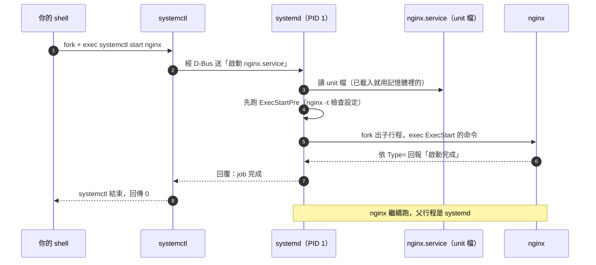
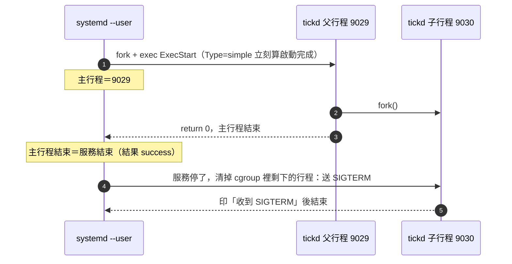

# 怎麼讓自己的程式也能用 `systemctl start` 啟動？—— 寫一個 systemd service unit

> 日期：2026-11-05
> 情境：想知道 `systemctl start nginx` 背後是怎麼運作的，以及怎麼讓自己寫的程式也能用同樣的方式啟動、停止、開機自動啟動
> 對應檔案：實驗用的 `tickd.c` 與 `tickd.service` 只放在 Claude 的暫存目錄（scratchpad），不進 git，完整內容都寫在本篇裡；
> nginx 的 unit 是系統套件提供的 `/usr/lib/systemd/system/nginx.service`（本機實際檔案，只讀不改）
> 適用範圍：實測 Ubuntu 24.04、systemd 255（255.4-1ubuntu8.18）、gcc 13.3
> 未實測：把 unit 檔裝進 `/etc/systemd/system/` 或 `~/.config/systemd/user/`、`enable`、`daemon-reload`。
> 裝 system unit 需要 root（本機 `sudo` 要密碼），寫進 user unit 目錄則被 Claude Code 的權限檢查擋下（會留下常駐設定）。
> 所以執行的部分改用 `systemd-run --user` 建立**暫時性 unit**（transient unit，停掉就消失，不寫檔），
> unit 檔的格式則用 `systemd-analyze verify` 檢查。兩者走的是同一套 systemd 機制，差別見[第五節](#五實驗二跑起來看懂-systemctl-status)。
> 相關：[journalctl看服務日誌.md](./journalctl看服務日誌.md)（服務的輸出去哪裡）、
> [從dpkg反推套件的啟動命令.md](./從dpkg反推套件的啟動命令.md)（從套件找 `ExecStart=`）、
> [Claude-Code能像systemd-service一樣常駐嗎.md](../claude-code/Claude-Code能像systemd-service一樣常駐嗎.md)（user unit 加 timer 的實例）

**一句話結論：`systemctl` 自己不會啟動任何程式，它只是把「啟動 nginx」這個請求送給 PID 1 的 systemd。真正去 `fork`＋`exec` 程式的是 systemd，照的是一份 unit 檔（`nginx.service`）。所以要讓自己的程式也能 `systemctl start`，你要做的是寫一份 `<名字>.service` 放進 systemd 會找的目錄，寫清楚三件事：要跑什麼（`ExecStart=`）、怎麼判斷啟動完成（`Type=`）、開機時掛在哪個 target 底下（`[Install]` 的 `WantedBy=`）。程式最好就待在前景、不要自己 fork 到背景；它印到 `stdout` 的東西會進 journal，但要記得 `stdout` 這時是全緩衝的。**

---

## 目錄

- [一、`systemctl start nginx` 背後發生什麼事](#一systemctl-start-nginx-背後發生什麼事)
- [二、unit 檔：放在哪、長什麼樣](#二unit-檔放在哪長什麼樣)
- [三、練習用的程式：`tickd.c`](#三練習用的程式tickdc)
- [四、實驗一：寫好先用 `systemd-analyze verify` 檢查](#四實驗一寫好先用-systemd-analyze-verify-檢查)
- [五、實驗二：跑起來，看懂 `systemctl status`](#五實驗二跑起來看懂-systemctl-status)
- [六、實驗三：journal 裡一直看不到輸出——`stdout` 的緩衝](#六實驗三journal-裡一直看不到輸出stdout-的緩衝)
- [七、`Type=`：systemd 怎麼知道「啟動完成」、誰是主行程](#七typesystemd-怎麼知道啟動完成誰是主行程)
- [八、停止與自動重啟：`SIGTERM` 與 `Restart=`](#八停止與自動重啟sigterm-與-restart)
- [九、`enable`：開機自動啟動其實是建一個符號連結](#九enable開機自動啟動其實是建一個符號連結)
- [十、完整步驟：把 `tickd` 裝成系統服務](#十完整步驟把-tickd-裝成系統服務)
- [十一、本篇用到的命令與設定，完整清單在哪](#十一本篇用到的命令與設定完整清單在哪)

---

## 一、`systemctl start nginx` 背後發生什麼事

先看 nginx 在本機實際的樣子：

```bash
ps -o pid,ppid,user,cmd -C nginx | head -4   # nginx 的行程，PPID 是誰
ps -o pid,cmd -p 1                           # PID 1 是什麼
```

```text
    PID    PPID USER     CMD
   2951       1 root     nginx: master process /usr/sbin/nginx -g daemon on; master_process on;
   2952    2951 www-data nginx: worker process
   2953    2951 www-data nginx: worker process
    PID CMD
      1 /sbin/init splash
```

- nginx 的主行程（master）`2951` 的父行程（PPID）是 **1**。`/sbin/init` 在 Ubuntu 上就是 systemd（`readlink -f /sbin/init` 印出 `/usr/lib/systemd/systemd`），
  開機後 kernel 第一個執行的使用者空間程式，PID 固定是 1。
- 也就是說，nginx 不是你的 shell 生出來的，是 **systemd 生出來的**。你打的 `systemctl start nginx` 早就結束了，nginx 還在跑。

那 `systemctl` 做了什麼？用 `strace` 看它開了哪些連線（`strace` 在[第 8 課第六節](../c/寫自己的wc與cat-命令列參數、讀到EOF與errno錯誤處理.md#用-strace-看-fopengetcprintf-底下是哪些系統呼叫)用過）：

```bash
strace -e trace=connect,sendmsg -s 0 systemctl is-active nginx   # 只看 connect 與 sendmsg 兩種系統呼叫
```

```text
connect(3, {sa_family=AF_UNIX, sun_path="/run/dbus/system_bus_socket"}, 30) = 0
sendmsg(3, {msg_name=NULL, msg_namelen=0, msg_iov=[...], msg_iovlen=3, msg_controllen=0, msg_flags=0}, MSG_DONTWAIT|MSG_NOSIGNAL) = 48
sendmsg(3, {msg_name=NULL, msg_namelen=0, msg_iov=[...], msg_iovlen=1, msg_controllen=0, msg_flags=0}, MSG_DONTWAIT|MSG_NOSIGNAL) = 128
sendmsg(3, {msg_name=NULL, msg_namelen=0, msg_iov=[...], msg_iovlen=2, msg_controllen=0, msg_flags=0}, MSG_DONTWAIT|MSG_NOSIGNAL) = 228
sendmsg(3, {msg_name=NULL, msg_namelen=0, msg_iov=[...], msg_iovlen=2, msg_controllen=0, msg_flags=0}, MSG_DONTWAIT|MSG_NOSIGNAL) = 226
active
+++ exited with 0 +++
```

- 第 1 行：`systemctl` 連上一個 Unix domain socket `/run/dbus/system_bus_socket`——這是 **D-Bus**（Desktop Bus，Linux 上行程之間傳訊息的匯流排）的系統匯流排。
  （socket 是什麼見 [socket是什麼](./socket是什麼-從核心看連線的端點.md)；這裡只要知道「它是一條通到別的行程的管道」。）
- 接下來幾個 `sendmsg` 就是在送訊息：「請問 `nginx.service` 的狀態？」。systemd 回答之後，`systemctl` 印出 `active`。
- 整個過程裡 `systemctl` **沒有** `fork`、`execve` 任何 nginx 的東西。`start` 也一樣，只是送的訊息換成「請啟動 `nginx.service`」。
- 本機是用一般使用者跑的；用 root 跑時 `systemctl` 會優先直接連 systemd 自己的 socket `/run/systemd/private`（未實測）。
  `--user` 版本的實測見[第五節](#五實驗二跑起來看懂-systemctl-status)。

整個流程畫成圖：



**圖一要看的重點**：真正啟動程式的是第 5 步的 systemd，不是 `systemctl`。systemd 怎麼啟動這支程式，全部寫在第 3 步讀的那份 unit 檔裡。
所以「讓自己的程式能 `systemctl start`」＝「寫一份 unit 檔」。

---

## 二、unit 檔：放在哪、長什麼樣

### unit 是什麼

systemd 管理的每一樣東西都叫一個 **unit**，用副檔名區分種類：`.service`（一支常駐或一次性的程式）、`.socket`、`.timer`、`.target`（一組 unit 的集合，像「開機到多使用者模式」）、`.mount` 等等。
`systemctl start nginx` 省略副檔名時，預設當成 `nginx.service`。

### systemd 去哪些目錄找 unit 檔

```bash
systemd-analyze unit-paths          # system 層（PID 1）找 unit 檔的目錄，依優先順序
```

```text
/etc/systemd/system.control
/run/systemd/system.control
/run/systemd/transient
/run/systemd/generator.early
/etc/systemd/system
/etc/systemd/system.attached
/run/systemd/system
/run/systemd/system.attached
/run/systemd/generator
/usr/local/lib/systemd/system
/usr/lib/systemd/system
/run/systemd/generator.late
```

- 越上面優先權越高：同名的檔案，上面的會蓋掉下面的。
- 要記的只有三個：

| 目錄 | 誰放的 | 用途 |
|---|---|---|
| `/usr/lib/systemd/system/` | 套件（`apt install nginx` 裝進來的 `nginx.service` 就在這） | **不要改**，套件升級會覆蓋 |
| `/etc/systemd/system/` | 系統管理者（你） | **自己寫的 system service 放這裡**；也可以放同名檔蓋掉套件的版本 |
| `/run/systemd/transient/` | `systemd-run` | 暫時性 unit，重開機就沒了（[第五節](#五實驗二跑起來看懂-systemctl-status)的實驗就是放在 user 層對應的目錄） |

使用者層（`systemctl --user`，由每個登入使用者自己的 `systemd --user` 管理，不需要 root）的目錄：

```bash
systemd-analyze --user unit-paths | grep -E "home|/etc|/usr/lib"   # 只挑出主要的幾個
```

```text
/home/set/.config/systemd/user.control
/home/set/.config/systemd/user
/etc/xdg/systemd/user
/etc/systemd/user
/home/set/.local/share/systemd/user
/usr/lib/systemd/user
```

- 自己的 user service 放 `~/.config/systemd/user/`。

### unit 檔的格式：三個節

先看 nginx 的（本機實際檔案，開頭的註解省略）：

```ini
[Unit]
Description=A high performance web server and a reverse proxy server
Documentation=man:nginx(8)
After=network-online.target remote-fs.target nss-lookup.target
Wants=network-online.target
ConditionFileIsExecutable=/usr/sbin/nginx

[Service]
Type=forking
PIDFile=/run/nginx.pid
ExecStartPre=/usr/sbin/nginx -t -q -g 'daemon on; master_process on;'
ExecStart=/usr/sbin/nginx -g 'daemon on; master_process on;'
ExecReload=/usr/sbin/nginx -g 'daemon on; master_process on;' -s reload
ExecStop=-/sbin/start-stop-daemon --quiet --stop --retry QUIT/5 --pidfile /run/nginx.pid
TimeoutStopSec=5
KillMode=mixed

[Install]
WantedBy=multi-user.target
```

格式是 INI 風格：`[節名]` 底下一行一個 `鍵=值`。三個節各管一件事：

| 節 | 管什麼 | 什麼時候被讀 |
|---|---|---|
| `[Unit]` | 跟種類無關的通用資訊：說明、文件、**跟別的 unit 的先後與依賴** | 每次載入 |
| `[Service]` | 只有 `.service` 才有：**怎麼啟動、怎麼停、怎麼判斷啟動完成、掛了要不要重啟** | 每次 start／stop／reload |
| `[Install]` | **`enable` 的時候要把自己掛到哪裡** | 只有 `enable`／`disable` 時才讀 |

nginx 這份逐行講：

| 設定 | 意思 |
|---|---|
| `Description=` | `systemctl status` 第一行顯示的說明 |
| `Documentation=` | `systemctl help nginx` 會打開的文件 |
| `After=network-online.target ...` | **順序**：如果這些 unit 也要啟動，等它們啟動完才啟動我。`After=` 只管順序，不會把它們拉起來 |
| `Wants=network-online.target` | **依賴**：啟動我的時候順便把 `network-online.target` 也拉起來；它失敗了我照樣啟動（換成 `Requires=` 就是它失敗我也不啟動） |
| `ConditionFileIsExecutable=` | 條件不成立（`/usr/sbin/nginx` 不存在或不能執行）就**安靜地跳過**，不算失敗 |
| `Type=forking` | nginx 會自己 fork 到背景，詳見[第七節](#七typesystemd-怎麼知道啟動完成誰是主行程) |
| `PIDFile=/run/nginx.pid` | fork 之後真正的主行程 PID 寫在這個檔案裡 |
| `ExecStartPre=` | 啟動前先跑：`nginx -t` 檢查設定檔，失敗就不啟動 |
| `ExecStart=` | **真正要跑的命令**，這是唯一必要的一行 |
| `ExecReload=` | `systemctl reload nginx` 時跑的命令（不停服務、重讀設定） |
| `ExecStop=-/sbin/...` | `systemctl stop` 時跑的命令；路徑前面的 `-` 表示「這個命令失敗也不算錯」 |
| `TimeoutStopSec=5` | stop 之後最多等 5 秒，還沒結束就送 `SIGKILL` |
| `KillMode=mixed` | 先只送 `SIGTERM` 給主行程，最後的 `SIGKILL` 送給整組行程 |
| `WantedBy=multi-user.target` | `enable` 時把自己掛到 `multi-user.target` 底下＝開機進入多使用者模式時啟動，詳見[第九節](#九enable開機自動啟動其實是建一個符號連結) |

自己的程式只需要其中一小部分。最小、能 `enable` 的 service 長這樣（本篇的 `tickd.service`）：

```ini
[Unit]
Description=tickd：每 2 秒印一行的練習服務

[Service]
Type=simple
ExecStart=/usr/local/bin/tickd

[Install]
WantedBy=multi-user.target
```

（[第四節](#四實驗一寫好先用-systemd-analyze-verify-檢查)檢查時，`ExecStart=` 寫的是暫存目錄裡實際編好的執行檔路徑、`WantedBy=` 寫 user 層的 `default.target`，其餘一樣。）

---

## 三、練習用的程式：`tickd.c`

一支什麼都不做、每 2 秒印一行的常駐程式。加了兩個選項，用來在後面的實驗製造「會自己 fork 到背景」和「會失敗退出」兩種情況。

```c
/* tickd.c：每 2 秒印一行的小常駐程式，用來練習寫 systemd service
 *   ./tickd        前景執行（給 Type=simple 用）
 *   ./tickd -d     fork 後父行程結束，自己變成背景（模仿 nginx 的 daemon on，給 Type=forking 用）
 *   ./tickd -x N   跑 N 圈後用結束狀態 1 離開（測 Restart=on-failure）
 */
#include <signal.h>
#include <stdio.h>
#include <stdlib.h>
#include <string.h>
#include <unistd.h>

static volatile sig_atomic_t stop = 0;

static void on_term(int sig)
{
    (void)sig;
    stop = 1;                           /* 只設旗標，真正的收尾在迴圈外做 */
}

int main(int argc, char *argv[])
{
    int daemonize = 0, fail_after = -1;

    for (int i = 1; i < argc; i++) {
        if (strcmp(argv[i], "-d") == 0)
            daemonize = 1;
        else if (strcmp(argv[i], "-x") == 0 && i + 1 < argc)
            fail_after = atoi(argv[++i]);
    }

    if (daemonize) {
        pid_t pid = fork();
        if (pid < 0) {
            perror("fork");
            return 1;
        }
        if (pid > 0) {                  /* 父行程：寫下子行程的 PID 就離開 */
            FILE *f = fopen(getenv("TICKD_PIDFILE") ? getenv("TICKD_PIDFILE") : "/dev/null", "w");
            if (f) {
                fprintf(f, "%d\n", pid);
                fclose(f);
            }
            return 0;
        }
    }

    if (getenv("TICKD_LINEBUF"))        /* 有設這個環境變數才改成行緩衝 */
        setvbuf(stdout, NULL, _IOLBF, 0);

    signal(SIGTERM, on_term);

    printf("tickd 啟動，PID %d，父行程 %d\n", getpid(), getppid());
    for (int n = 1; !stop; n++) {
        printf("tick %d\n", n);
        if (n == fail_after) {
            fprintf(stderr, "tickd：跑了 %d 圈，故意用結束狀態 1 離開\n", n);
            return 1;
        }
        sleep(2);
    }
    printf("tickd 收到 SIGTERM，正常結束\n");
    return 0;
}
```

```bash
gcc -Wall -Wextra -O2 tickd.c -o tickd
```

這支程式用到三個還沒在課程裡正式教的東西（第 ② 站「行程」才會教），這裡先講到夠用：

- **`fork()`**：把目前的行程**複製一份**。之後有兩個行程從同一行繼續跑；在父行程裡 `fork()` 回傳子行程的 PID（大於 0），在子行程裡回傳 0。
  `-d` 的寫法是「父行程寫下子行程的 PID 就 `return 0` 結束，子行程留下來繼續跑」——傳統 daemon（背景常駐程式）把自己丟到背景的做法，nginx 的 `daemon on` 就是這樣。
- **訊號（signal）與 `SIGTERM`**：kernel 送給行程的通知。`SIGTERM` 的意思是「請你結束」，程式可以用 `signal(SIGTERM, on_term)` 註冊一個函式來接住它、做完收尾再走；
  沒註冊的話預設動作就是直接結束。`SIGKILL`（`kill -9`）則接不住，行程立刻被 kernel 殺掉。`systemctl stop` 預設送的是 `SIGTERM`。
- **`setvbuf(stdout, NULL, _IOLBF, 0)`**：把 `stdout` 改成行緩衝，[第六節](#六實驗三journal-裡一直看不到輸出stdout-的緩衝)會看到為什麼需要它。

先在終端機直接跑 5 秒（`timeout 5` 會在 5 秒後送 `SIGTERM`）：

```bash
timeout 5 ./tickd; echo "exit=$?"
```

```text
tickd 啟動，PID 8802，父行程 8801
tick 1
tick 2
tick 3
tickd 收到 SIGTERM，正常結束
exit=124
```

- 每 2 秒一行，即時出現；5 秒時收到 `SIGTERM`，`on_term` 把 `stop` 設成 1，迴圈結束、印最後一行。
- `exit=124` 是 `timeout` 自己的結束狀態（代表「時間到，我把它停掉了」），不是 `tickd` 的。
- 問題是：它佔住了這個終端機，終端機一關它就跟著結束，開機也不會自己跑。交給 systemd 就是要解決這三件事。

---

## 四、實驗一：寫好先用 `systemd-analyze verify` 檢查

還沒寫 unit 檔之前，systemd 根本不認得這個名字：

```bash
systemctl --user start tickd; echo "exit=$?"
```

```text
Failed to start tickd.service: Unit tickd.service not found.
exit=5
```

- 自動補上了 `.service`；在 user 層的所有目錄都找不到 `tickd.service`，結束狀態 5（`systemctl` 的「unit 不存在」）。

寫好 unit 檔之後，先用 `systemd-analyze verify` 檢查格式，它只讀檔、不會安裝也不會啟動。`$S` 代表暫存目錄的路徑（很長，下面都用 `$S` 代替）：

```bash
cat > tickd.service <<EOF
[Unit]
Description=tickd：每 2 秒印一行的練習服務

[Service]
Type=simple
ExecStart=$S/tickd

[Install]
WantedBy=default.target
EOF
systemd-analyze --user verify ./tickd.service; echo "verify exit=$?"
```

```text
verify exit=0
```

- 沒有任何訊息、結束狀態 0＝格式沒問題，`ExecStart=` 指到的檔案存在而且能執行。

接著故意寫錯三種，看錯誤訊息怎麼對應：

**① 鍵名拼錯：`ExecStrat=`**

```bash
sed 's/ExecStart=/ExecStrat=/' tickd.service > bad1.service   # 把 ExecStart 拼錯
systemd-analyze --user verify ./bad1.service; echo "exit=$?"
```

```text
$S/bad1.service:6: Unknown key name 'ExecStrat' in section 'Service', ignoring.
bad1.service: Service has no ExecStart=, ExecStop=, or SuccessAction=. Refusing.
Unit bad1.service has a bad unit file setting.
exit=1
```

- 第 1 行：第 6 行的鍵不認得，**只是忽略**、不算錯。所以拼錯一個不重要的鍵（例如 `Descripton=`），unit 照樣能跑，只是那行沒作用——要靠 `verify` 才看得出來。
- 第 2 行：忽略之後就等於沒有 `ExecStart=`，這才是致命的：service 一定要有東西可以跑。

**② `ExecStart=` 沒寫絕對路徑：`ExecStart=tickd`**

```bash
sed 's/ExecStart=.*/ExecStart=tickd/' tickd.service > bad2.service
systemd-analyze --user verify ./bad2.service; echo "exit=$?"
```

```text
bad2.service: Command tickd is not executable: No such file or directory
exit=1
```

- systemd **不看你 shell 的 `PATH`**。不是絕對路徑時，它只在編譯時就決定好的幾個固定目錄找（`/usr/local/sbin`、`/usr/local/bin`、`/usr/sbin`、`/usr/bin` 這類，見 `man systemd.service` 的 `COMMAND LINES` 一節），
  `tickd` 不在那裡面，所以找不到。**一律寫絕對路徑**最保險（同樣的坑見 [Claude Code 那篇〈坑 3：PATH 與環境〉](../claude-code/Claude-Code能像systemd-service一樣常駐嗎.md#坑-3path-與環境systemd-的環境是乾淨的)）。
- 另外，`ExecStart=` **不是交給 shell 執行的**：`|`、`>`、`&&`、`*` 都沒有 shell 的意思。真的需要 shell 語法就寫 `ExecStart=/bin/sh -c '...'`。

**③ 整行沒寫**

```bash
sed '/ExecStart/d' tickd.service > bad3.service
systemd-analyze --user verify ./bad3.service; echo "exit=$?"
```

```text
bad3.service: Service has no ExecStart=, ExecStop=, or SuccessAction=. Refusing.
Unit bad3.service has a bad unit file setting.
exit=1
```

- 跟 ① 的第 2、3 行一樣——① 拼錯其實就等於這種情況。

---

## 五、實驗二：跑起來，看懂 `systemctl status`

### 這裡用 `systemd-run`，跟寫 unit 檔差在哪

照理說下一步是把 `tickd.service` 放進 `~/.config/systemd/user/` 再 `systemctl --user start tickd`。本篇的環境寫不進那個目錄（見開頭的「未實測」），
所以改用 `systemd-run`：它**把 unit 檔的設定改成命令列參數傳給 systemd**，由 systemd 在 `/run/user/1000/systemd/transient/` 建一個暫時性 unit 並啟動它。
啟動、停止、狀態、journal、重啟全部跟一般 unit 一模一樣，只是停掉之後 unit 就消失、不能 `enable`。兩種寫法的對照：

| unit 檔裡的一行 | `systemd-run` 的參數 |
|---|---|
| 檔名 `tickd.service` | `--unit=tickd` |
| `Description=...` | `-p Description=...` |
| `ExecStart=/路徑/tickd -d` | 最後面直接寫命令：`/路徑/tickd -d` |
| `Environment=TICKD_LINEBUF=1` | `-E TICKD_LINEBUF=1` |
| `Type=forking`、`Restart=on-failure` 等其他 `[Service]` 設定 | `-p Type=forking`、`-p Restart=on-failure`（`-p` 就是「設一個屬性」） |
| `[Install]` 節 | 沒有對應（暫時性 unit 不能 `enable`） |

`systemd-run` 全部 40 個選項見 `systemd-run --help`／`man systemd-run`，本篇只用了 `--user`、`--unit`、`-p`、`-E` 這 4 個。

### 啟動，然後看狀態

```bash
systemd-run --user --unit=tickd -p Description="tickd 練習" $S/tickd   # 相當於 systemctl --user start tickd
sleep 7
systemctl --user status tickd --no-pager
```

```text
Running as unit: tickd.service; invocation ID: 7c4bd6c5a8ff4fc5834a16ea357a9663
● tickd.service - tickd 練習
     Loaded: loaded (/run/user/1000/systemd/transient/tickd.service; transient)
  Transient: yes
     Active: active (running) since Thu 2026-11-05 09:49:05 CST; 7s ago
   Main PID: 8927 (tickd)
      Tasks: 1 (limit: 16187)
     Memory: 380.0K (peak: 768.0K)
        CPU: 3ms
     CGroup: /user.slice/user-1000.slice/user@1000.service/app.slice/tickd.service
             └─8927 $S/tickd

Nov 05 09:49:05 set-Vector-17-HX-A14VFG systemd[2029]: Started tickd.service - tickd 練習.
```

逐行讀：

| 行 | 意思 |
|---|---|
| `● tickd.service - tickd 練習` | unit 名稱與 `Description=`；前面的圓點是狀態燈（綠＝執行中、紅 `×`＝失敗、白＝沒在跑） |
| `Loaded: loaded (<路徑>; transient)` | unit 檔從哪裡讀的。一般 unit 這裡會寫 `(/etc/systemd/system/tickd.service; enabled; preset: enabled)`：分號後面是有沒有 `enable` |
| `Active: active (running) since ...` | 目前狀態。`active (running)`＝主行程活著；其他常見的是 `inactive (dead)`、`failed`、`activating (start)` |
| `Main PID: 8927 (tickd)` | systemd 認定的**主行程**。主行程結束＝服務結束，所以「誰是主行程」很重要（[第七節](#七typesystemd-怎麼知道啟動完成誰是主行程)） |
| `Tasks`／`Memory`／`CPU` | 這個服務**所有行程加起來**用了多少 |
| `CGroup: .../tickd.service` | 這個服務專屬的 **cgroup**（control group，kernel 用來把一群行程分組、統計與限制資源的機制）。服務生出來的所有子孫行程都在這組裡，所以 systemd 停服務時一個都不會漏 |
| 最後幾行 | 這個服務在 journal 裡最新的幾筆紀錄（等於 `journalctl -u tickd -n 10`） |

`systemd[2029]` 是誰？

```bash
ps -o pid,ppid,cmd -p 2029
```

```text
    PID    PPID CMD
   2029       1 /usr/lib/systemd/systemd --user
```

- 是我這個使用者的 `systemd --user`，它本身是 PID 1 生出來的。user 層的服務都是它的子行程（[第六節](#六實驗三journal-裡一直看不到輸出stdout-的緩衝)的輸出會看到 `tickd` 的父行程是 2029）。
- `systemctl --user` 怎麼連到它：

```bash
strace -e trace=connect systemctl --user is-active nonexist   # 看 --user 版本連去哪裡
```

```text
connect(3, {sa_family=AF_UNIX, sun_path="/run/user/1000/systemd/private"}, 33) = -1 ECONNREFUSED (Connection refused)
connect(3, {sa_family=AF_UNIX, sun_path="/run/user/1000/bus"}, 21) = 0
inactive
+++ exited with 4 +++
```

- 先試 `systemd --user` 自己的 socket（這次被拒絕），再改走這個使用者的 D-Bus（`/run/user/1000/bus`）成功。跟[第一節](#一systemctl-start-nginx-背後發生什麼事)一樣，`systemctl` 只是個傳話的。
- 結束狀態 4：`is-active` 問的 unit 不存在。

---

## 六、實驗三：journal 裡一直看不到輸出——`stdout` 的緩衝

上面 `status` 跑了 7 秒，照理應該已經印了「啟動」加上好幾行 `tick`，可是 journal 裡只有 systemd 自己那行 `Started`。接著看 journal、再停掉服務、再看一次：

```bash
journalctl --user -u tickd --no-pager -o cat   # -o cat：只印訊息本身
systemctl --user stop tickd
journalctl --user -u tickd --no-pager -o short
```

```text
Started tickd.service - tickd 練習.
Nov 05 09:49:05 set-Vector-17-HX-A14VFG systemd[2029]: Started tickd.service - tickd 練習.
Nov 05 09:49:12 set-Vector-17-HX-A14VFG tickd[8927]: tickd 啟動，PID 8927，父行程 2029
Nov 05 09:49:12 set-Vector-17-HX-A14VFG tickd[8927]: tick 1
Nov 05 09:49:12 set-Vector-17-HX-A14VFG tickd[8927]: tick 2
Nov 05 09:49:12 set-Vector-17-HX-A14VFG tickd[8927]: tick 3
Nov 05 09:49:12 set-Vector-17-HX-A14VFG tickd[8927]: tick 4
Nov 05 09:49:12 set-Vector-17-HX-A14VFG tickd[8927]: tickd 收到 SIGTERM，正常結束
Nov 05 09:49:12 set-Vector-17-HX-A14VFG systemd[2029]: Stopping tickd.service - tickd 練習...
Nov 05 09:49:12 set-Vector-17-HX-A14VFG systemd[2029]: Stopped tickd.service - tickd 練習.
```

- 第 1 行（第一個 `journalctl`）：跑了 7 秒，`tickd` 一行都還沒進 journal。
- 停掉之後：`tick 1`～`tick 4` 一次全部出現，**時間戳全是 09:49:12**——停止的那一刻，而不是每 2 秒一行的實際時間。

原因是[第 8 課第五節〈輸出順序為什麼會變〉](../c/寫自己的wc與cat-命令列參數、讀到EOF與errno錯誤處理.md#輸出順序為什麼會變stdout-有緩衝stderr-沒有)講過的緩衝：
stdio 看 `stdout` 接到什麼來決定緩衝方式，接到終端機是行緩衝，**接到別的東西就是全緩衝**，存滿緩衝區（通常 4096 byte）或程式結束時才真的 `write`。
服務的 `stdout` 接到哪裡？看它的 fd 表（fd 是什麼見 [fd是什麼](./fd是什麼-行程的檔案描述符表.md)）：

```bash
systemd-run --user --unit=tickd -p Description="tickd 練習" -E TICKD_LINEBUF=1 $S/tickd   # 這次打開行緩衝
sleep 5
P=$(systemctl --user show tickd -p MainPID --value); echo "MainPID=$P"
ls -l /proc/$P/fd/
journalctl --user -u tickd --no-pager -o short --since "-10s"
systemctl --user stop tickd
```

```text
Running as unit: tickd.service; invocation ID: fcb49e8b2062473389806cd65150c94d
MainPID=8949
total 0
lr-x------ 1 set set 64 Nov  5 09:49 0 -> /dev/null
lrwx------ 1 set set 64 Nov  5 09:49 1 -> socket:[55408]
lrwx------ 1 set set 64 Nov  5 09:49 2 -> socket:[55408]
Nov 05 09:49:20 set-Vector-17-HX-A14VFG systemd[2029]: Started tickd.service - tickd 練習.
Nov 05 09:49:20 set-Vector-17-HX-A14VFG tickd[8949]: tickd 啟動，PID 8949，父行程 2029
Nov 05 09:49:20 set-Vector-17-HX-A14VFG tickd[8949]: tick 1
Nov 05 09:49:22 set-Vector-17-HX-A14VFG tickd[8949]: tick 2
Nov 05 09:49:24 set-Vector-17-HX-A14VFG tickd[8949]: tick 3
```

- fd 0 是 `/dev/null`：服務沒有鍵盤可以讀。fd 1、2 是**同一個 socket**，另一頭是 journald——這就是「服務的輸出被 journald 收走」的實際樣子（[journalctl看服務日誌第一節](./journalctl看服務日誌.md#一為什麼服務沒有自己的-log-檔)）。
- socket 不是終端機，所以 `stdout` 預設全緩衝。這次設了 `TICKD_LINEBUF=1`，程式呼叫 `setvbuf(..., _IOLBF, ...)` 改成行緩衝，每行 `\n` 就寫出去：時間戳變成 20、22、24，每 2 秒一行，即時進 journal。
- `stderr` 不緩衝，所以用 `fprintf(stderr, ...)` 印的錯誤本來就會即時出現（[第八節](#八停止與自動重啟sigterm-與-restart)的 `-x` 實驗就是）。

**更糟的情況：程式沒有接 `SIGTERM`，緩衝區裡的輸出會整個不見。** `tickd` 停止時還印得出那 4 行，是因為它接住 `SIGTERM`、從 `main` 正常 `return`，
`return` 時 stdio 會把緩衝區寫出去（[第 8 課第五節〈結束狀態〉](../c/寫自己的wc與cat-命令列參數、讀到EOF與errno錯誤處理.md#結束狀態return-的值)講過 `exit` 會先寫出緩衝區）。
下面的 `beat.c` 沒有接 `SIGTERM`，而 `SIGTERM` 的預設動作是由 kernel 直接結束行程——`main` 沒有 `return`，stdio 沒有機會寫出緩衝區：

```c
#include <stdio.h>
#include <unistd.h>

int main(void)
{
    for (int n = 1; ; n++) {
        printf("beat %d\n", n);
        sleep(2);
    }
}
```

```bash
gcc -Wall beat.c -o beat
systemd-run --user --unit=beat $S/beat; sleep 7; systemctl --user stop beat; sleep 1   # 跑 7 秒後停掉
journalctl --user -u beat --no-pager -o short --since "-12s"
```

```text
Nov 05 09:58:11 set-Vector-17-HX-A14VFG systemd[2029]: Started beat.service - $S/beat.
Nov 05 09:58:18 set-Vector-17-HX-A14VFG systemd[2029]: Stopping beat.service - $S/beat...
Nov 05 09:58:18 set-Vector-17-HX-A14VFG systemd[2029]: Stopped beat.service - $S/beat.
```

- 跑了 7 秒，照理印了 `beat 1`～`beat 4`，但 journal 裡**一行都沒有**：它們一直待在行程的緩衝區裡，行程被 `SIGTERM` 結束時跟著記憶體一起消失了，從來沒有 `write` 到 socket。

**修法**（擇一）：

1. 程式開頭 `setvbuf(stdout, NULL, _IOLBF, 0);`（本篇的做法），或每次印完 `fflush(stdout);`。
2. 不改程式：用語言或工具的開關，例如 Python 加 `-u` 或設 `PYTHONUNBUFFERED=1`、C 程式外面包 `stdbuf -oL`（只對使用 stdio 預設緩衝的程式有效）。
3. 改用 `syslog(3)` 或 `sd_journal_print(3)` 直接寫 journal，不經過 `stdout`。

---

## 七、`Type=`：systemd 怎麼知道「啟動完成」、誰是主行程

systemd 啟動一支程式後要回答兩個問題：**什麼時候算「啟動完成」**（`systemctl start` 才能返回、`After=` 這個服務的其他服務才能接著啟動），以及**哪個行程是主行程**（它結束就代表服務結束）。
`Type=` 就是在告訴 systemd 怎麼判斷。

### 實驗：會自己 fork 到背景的程式，用 `Type=simple` 會怎樣

`tickd -d` 模仿 nginx 的 `daemon on`：父行程 `fork` 出子行程後立刻 `return 0`。先用預設的 `Type=simple` 跑：

```bash
systemd-run --user --unit=tickd -E TICKD_LINEBUF=1 $S/tickd -d   # 沒寫 -p Type=，預設 simple
sleep 3
systemctl --user status tickd --no-pager
pgrep -a tickd                                                     # 還有沒有任何 tickd 活著
journalctl --user -u tickd --no-pager -o short --since "-5s"
```

```text
Running as unit: tickd.service; invocation ID: 0c14b40d17dd4278934c574e6dad4335
Unit tickd.service could not be found.
Nov 05 09:49:32 set-Vector-17-HX-A14VFG systemd[2029]: Started tickd.service - $S/tickd -d.
Nov 05 09:49:32 set-Vector-17-HX-A14VFG tickd[9030]: tickd 啟動，PID 9030，父行程 9029
Nov 05 09:49:32 set-Vector-17-HX-A14VFG tickd[9030]: tick 1
Nov 05 09:49:32 set-Vector-17-HX-A14VFG tickd[9030]: tickd 收到 SIGTERM，正常結束
```

- 第 2 行：才 3 秒，服務已經**不見了**（暫時性 unit 停掉就被清除；一般 unit 會顯示 `inactive (dead)`）。`pgrep` 什麼都沒印：子行程也死了。
- journal 的第 3 行：子行程 9030 的父行程是 9029（就是 `ExecStart=` 跑的那個父行程），它印了 `tick 1`，接著**同一秒就收到 `SIGTERM`**。

發生了什麼：



**圖二要看的重點**：`Type=simple` 下，systemd 把**它親手 exec 的那個行程**當主行程。父行程一結束，systemd 就認定服務結束了，
接著把同一個 cgroup 裡剩下的行程（也就是好不容易 fork 出來的子行程）全部停掉。在終端機裡 `-d` 是「丟到背景」，在 systemd 底下反而是「自殺」。

### 改成 `Type=forking` 加 `PIDFile=`

`Type=forking` 告訴 systemd：「`ExecStart=` 的程式會 fork，等它的**父行程結束**才算啟動完成，主行程是它留下的子行程」。
子行程是哪一個，最可靠的方式是讓程式把 PID 寫進檔案、用 `PIDFile=` 告訴 systemd（這就是 nginx 的寫法）：

```bash
systemd-run --user --unit=tickd -p Type=forking -p PIDFile=/run/user/1000/tickd.pid \
    -E TICKD_PIDFILE=/run/user/1000/tickd.pid -E TICKD_LINEBUF=1 $S/tickd -d
sleep 4
systemctl --user status tickd --no-pager
echo "pidfile: $(cat /run/user/1000/tickd.pid)"
```

```text
Running as unit: tickd.service; invocation ID: f0ad92b8e42f478cb3056366d7e8598e
● tickd.service - $S/tickd -d
     Loaded: loaded (/run/user/1000/systemd/transient/tickd.service; transient)
  Transient: yes
     Active: active (running) since Thu 2026-11-05 09:51:22 CST; 4s ago
    Process: 9160 ExecStart=$S/tickd -d (code=exited, status=0/SUCCESS)
   Main PID: 9161 (tickd)
      Tasks: 1 (limit: 16187)
     Memory: 736.0K (peak: 768.0K)
        CPU: 4ms
     CGroup: /user.slice/user-1000.slice/user@1000.service/app.slice/tickd.service
             └─9161 $S/tickd -d

Nov 05 09:51:22 set-Vector-17-HX-A14VFG systemd[2029]: Starting tickd.service - $S/tickd -d...
Nov 05 09:51:22 set-Vector-17-HX-A14VFG tickd[9161]: tickd 啟動，PID 9161，父行程 9160
Nov 05 09:51:22 set-Vector-17-HX-A14VFG tickd[9161]: tick 1
Nov 05 09:51:22 set-Vector-17-HX-A14VFG systemd[2029]: Started tickd.service - $S/tickd -d.
Nov 05 09:51:24 set-Vector-17-HX-A14VFG tickd[9161]: tick 2
Nov 05 09:51:26 set-Vector-17-HX-A14VFG tickd[9161]: tick 3
pidfile: 9161
```

- `Process: 9160 ExecStart=... (code=exited, status=0/SUCCESS)`：父行程 9160 結束、回傳 0，這在 `forking` 底下是**正常的**。
- `Main PID: 9161`：跟 PID 檔的內容一樣，systemd 從 `PIDFile=` 讀到真正的主行程。
- journal 先出現 `Starting ...`（啟動中）、父行程結束後才出現 `Started ...`（啟動完成）——`simple` 一 exec 就印 `Started`，沒有 `Starting` 這一步。

`PIDFile=` 指到程式不會寫的地方（下面故意寫成 `nope.pid`，並把等待時間縮成 6 秒）：

```bash
systemd-run --user --unit=tickd -p Type=forking -p PIDFile=/run/user/1000/nope.pid -p TimeoutStartSec=6 \
    -E TICKD_PIDFILE=/run/user/1000/tickd.pid -E TICKD_LINEBUF=1 $S/tickd -d; echo "exit=$?"
journalctl --user -u tickd --no-pager -o short --since "-8s" | grep systemd
```

```text
Job for tickd.service failed because a timeout was exceeded.
See "systemctl --user status tickd.service" and "journalctl --user -xeu tickd.service" for details.
exit=1
Nov 05 09:51:36 set-Vector-17-HX-A14VFG systemd[2029]: Starting tickd.service - $S/tickd -d...
Nov 05 09:51:36 set-Vector-17-HX-A14VFG systemd[2029]: tickd.service: Can't open PID file /run/user/1000/nope.pid (yet?) after start: No such file or directory
Nov 05 09:51:43 set-Vector-17-HX-A14VFG systemd[2029]: tickd.service: start operation timed out. Terminating.
Nov 05 09:51:43 set-Vector-17-HX-A14VFG systemd[2029]: tickd.service: Failed with result 'timeout'.
Nov 05 09:51:43 set-Vector-17-HX-A14VFG systemd[2029]: Failed to start tickd.service - $S/tickd -d.
```

- 父行程結束後 systemd 去讀 PID 檔，讀不到（`(yet?)`：它會繼續等），一直等到 `TimeoutStartSec=` 到期就判定啟動失敗、把行程殺掉。
- 預設的 `TimeoutStartSec=` 是 **90 秒**——`PIDFile=` 寫錯時，你會看到 `systemctl start` 卡住一分半才失敗。

### `Type=` 全部 8 種

依 `man systemd.service`：

| `Type=` | 什麼時候算「啟動完成」 | 主行程 | 適合 |
|---|---|---|---|
| `simple`（有 `ExecStart=`、沒寫 `Type=` 也沒寫 `BusName=` 時的預設） | systemd 一 `fork` 完就算，**連 `exec` 成不成功都不等** | exec 的那個行程 | 待在前景的程式 |
| `exec` | `exec` 成功之後才算（執行檔不存在時 `systemctl start` 會直接報錯，`simple` 不會） | 同上 | 待在前景的程式；**比 `simple` 更建議** |
| `forking` | `ExecStart=` 的行程**結束**之後才算 | 它留下的子行程（看 `PIDFile=`，沒寫就猜） | 傳統會自己 fork 到背景的 daemon（nginx） |
| `oneshot` | `ExecStart=` 的行程**結束**之後才算 | 沒有常駐主行程 | 跑一次就結束的工作（開機時做初始化）；常配 `RemainAfterExit=yes` |
| `dbus` | 程式在 D-Bus 上取得 `BusName=` 指定的名字之後才算 | exec 的那個行程 | D-Bus 服務 |
| `notify` | 程式自己用 `sd_notify(3)` 送出 `READY=1` 之後才算 | exec 的那個行程 | 待在前景、而且想精確回報「我初始化完了」的程式 |
| `notify-reload` | 同 `notify`，另外 `reload` 時由 systemd 送訊號、等程式回報重載完成 | 同上 | 同上，加上支援 reload |
| `idle` | 跟 `simple` 一樣，但等其他啟動中的工作都做完才執行（最多延遲 5 秒） | 同上 | 避免輸出跟開機訊息混在一起的主控台程式 |

**自己寫程式時的建議**：**不要**在程式裡 fork 到背景、也不用寫 PID 檔，待在前景、用 `Type=exec`（或 `simple`）就好；
「丟到背景」「重開」「收輸出」「開機啟動」全部交給 systemd。需要讓依賴你的服務精確地等你初始化完（例如等 socket 開好），才用 `notify`。
nginx 用 `forking` 是因為它的歷史比 systemd 早，本來就設計成自己變成 daemon。

---

## 八、停止與自動重啟：`SIGTERM` 與 `Restart=`

### `systemctl stop` 做了什麼

[第六節](#六實驗三journal-裡一直看不到輸出stdout-的緩衝)的 journal 已經看過：`Stopping ...` → 程式印「收到 SIGTERM，正常結束」→ `Stopped ...`。預設流程是：

1. 有 `ExecStop=` 就先跑它；沒有的話直接下一步。
2. 送 `SIGTERM`（可用 `KillSignal=` 換）給服務的行程（送給誰由 `KillMode=` 決定，預設 `control-group`＝cgroup 裡全部）。
3. 等最多 `TimeoutStopSec=`（預設 90 秒）。
4. 還沒結束就送 `SIGKILL`，強制結束。

所以程式應該**接住 `SIGTERM`、做完收尾（關檔、寫完緩衝、關連線）再結束**，`tickd` 的 `on_term` 就是在做這件事。

### `Restart=on-failure`：被 `kill -9` 殺掉

```bash
systemd-run --user --unit=tickd -p Restart=on-failure -p RestartSec=1 -E TICKD_LINEBUF=1 $S/tickd
sleep 2
P=$(systemctl --user show tickd -p MainPID --value); echo "before: MainPID=$P"
kill -9 $P                                              # 模擬程式當掉
sleep 2
echo "after: $(systemctl --user show tickd -p MainPID -p NRestarts -p ActiveState)"
journalctl --user -u tickd --no-pager -o short --since "-5s"
```

```text
Running as unit: tickd.service; invocation ID: 5d6d46ba38764397a8625410dcebf138
before: MainPID=9191
after: MainPID=9207
NRestarts=1
ActiveState=active
Nov 05 09:51:43 set-Vector-17-HX-A14VFG systemd[2029]: Started tickd.service - $S/tickd.
Nov 05 09:51:43 set-Vector-17-HX-A14VFG tickd[9191]: tickd 啟動，PID 9191，父行程 2029
Nov 05 09:51:43 set-Vector-17-HX-A14VFG tickd[9191]: tick 1
Nov 05 09:51:45 set-Vector-17-HX-A14VFG tickd[9191]: tick 2
Nov 05 09:51:45 set-Vector-17-HX-A14VFG systemd[2029]: tickd.service: Main process exited, code=killed, status=9/KILL
Nov 05 09:51:45 set-Vector-17-HX-A14VFG systemd[2029]: tickd.service: Failed with result 'signal'.
Nov 05 09:51:46 set-Vector-17-HX-A14VFG systemd[2029]: tickd.service: Scheduled restart job, restart counter is at 1.
Nov 05 09:51:46 set-Vector-17-HX-A14VFG systemd[2029]: Started tickd.service - $S/tickd.
Nov 05 09:51:46 set-Vector-17-HX-A14VFG tickd[9207]: tickd 啟動，PID 9207，父行程 2029
Nov 05 09:51:46 set-Vector-17-HX-A14VFG tickd[9207]: tick 1
```

（journal 開頭還有幾行是上一個實驗留下的，這裡省略。）

- `code=killed, status=9/KILL`：主行程被訊號 9（`SIGKILL`）殺掉，systemd 判定為失敗（`result 'signal'`）。
- 等了 `RestartSec=1` 秒（45 → 46），`Scheduled restart job`，重新啟動，新的 PID 是 9207，`NRestarts=1`。

### 一直失敗：重啟次數有上限

`tickd -x 1` 印完第一圈就用結束狀態 1 離開，等於每次一啟動就失敗：

```bash
systemd-run --user --unit=tickd -p Restart=on-failure -p RestartSec=1 -E TICKD_LINEBUF=1 $S/tickd -x 1
sleep 9
systemctl --user show tickd -p NRestarts -p ActiveState -p Result
journalctl --user -u tickd --no-pager -o short --since "-10s" | grep -v "tick 1$" | tail -8
```

```text
Running as unit: tickd.service; invocation ID: c8ba9b0a38724e57b28a664bf53ae177
Result=exit-code
NRestarts=5
ActiveState=failed
Nov 05 09:52:00 set-Vector-17-HX-A14VFG tickd[9236]: tickd 啟動，PID 9236，父行程 2029
Nov 05 09:52:00 set-Vector-17-HX-A14VFG tickd[9236]: tickd：跑了 1 圈，故意用結束狀態 1 離開
Nov 05 09:52:00 set-Vector-17-HX-A14VFG systemd[2029]: tickd.service: Main process exited, code=exited, status=1/FAILURE
Nov 05 09:52:00 set-Vector-17-HX-A14VFG systemd[2029]: tickd.service: Failed with result 'exit-code'.
Nov 05 09:52:01 set-Vector-17-HX-A14VFG systemd[2029]: tickd.service: Scheduled restart job, restart counter is at 5.
Nov 05 09:52:01 set-Vector-17-HX-A14VFG systemd[2029]: tickd.service: Start request repeated too quickly.
Nov 05 09:52:01 set-Vector-17-HX-A14VFG systemd[2029]: tickd.service: Failed with result 'exit-code'.
Nov 05 09:52:01 set-Vector-17-HX-A14VFG systemd[2029]: Failed to start tickd.service - $S/tickd -x 1.
```

- `status=1/FAILURE`：結束狀態不是 0，算失敗，所以重啟。
- 重啟到第 5 次後出現 `Start request repeated too quickly`，systemd **放棄**，狀態變成 `failed`。
  這是 `[Unit]` 的 `StartLimitIntervalSec=`（預設 10 秒）與 `StartLimitBurst=`（預設 5 次）：10 秒內啟動超過 5 次就不再試，避免一支壞掉的程式無限循環吃掉 CPU。
  修好之後要 `systemctl reset-failed tickd` 清掉失敗狀態（或直接再 `start`）。

### `systemctl stop` 不會觸發重啟

```bash
systemd-run --user --unit=tickd -p Restart=on-failure -p RestartSec=1 -E TICKD_LINEBUF=1 $S/tickd
sleep 1; systemctl --user stop tickd; sleep 2
systemctl --user show tickd -p NRestarts -p ActiveState -p Result
```

```text
Running as unit: tickd.service; invocation ID: f9f3f335d3e74a9492c1827dbd0b858a
Result=success
NRestarts=0
ActiveState=inactive
```

- 你親手 stop 的，systemd 不會把它當成「掛掉」，就算設成 `Restart=always` 也不會重啟。
- 另外，`tickd` 接住 `SIGTERM` 後 `return 0`，結果是 `success`。就算程式沒接 `SIGTERM`、被它殺掉，systemd 也把 `SIGHUP`、`SIGINT`、`SIGTERM`、`SIGPIPE` 這四種訊號造成的結束視為「乾淨的結束」。

### `Restart=` 全部 7 個值

依 `man systemd.service` 的對照表：哪一種結束原因會觸發重啟（✓＝會）：

| 結束原因 ＼ `Restart=` | `no` | `always` | `on-success` | `on-failure` | `on-abnormal` | `on-abort` | `on-watchdog` |
|---|---|---|---|---|---|---|---|
| 乾淨結束：結束狀態 0，或被上面四種訊號結束 | | ✓ | ✓ | | | | |
| 結束狀態不是 0（實驗的 `-x 1`） | | ✓ | | ✓ | | | |
| 被其他訊號殺掉（實驗的 `kill -9`） | | ✓ | | ✓ | ✓ | ✓ | |
| 啟動或停止逾時（timeout） | | ✓ | | ✓ | ✓ | | |
| watchdog 逾時（`WatchdogSec=`，程式沒按時回報還活著） | | ✓ | | ✓ | ✓ | | ✓ |

- 預設是 `no`。常駐服務最常用 `on-failure`（cron、很多套件的服務都是）：當掉、回傳錯誤就重啟，正常結束就不管。
- `always` 連正常結束也重啟，適合「理論上永遠不該結束」的程式。

---

## 九、`enable`：開機自動啟動其實是建一個符號連結

`start` 跟 `enable` 是兩件獨立的事：

| | 改變了什麼 | 重開機後 |
|---|---|---|
| `systemctl start X` | **現在**啟動它（執行期狀態） | 不記得，除非有 enable |
| `systemctl enable X` | 依 `[Install]` 節建符號連結（磁碟上的設定），**不會**現在啟動 | 開機時跟著 target 啟動 |
| `systemctl enable --now X` | 兩件一起做 | 會啟動 |

nginx 是 enable 過的，看看實際建了什麼：

```bash
ls -l /etc/systemd/system/multi-user.target.wants/nginx.service
systemctl show nginx -p FragmentPath -p UnitFileState -p WantedBy
systemctl get-default
```

```text
lrwxrwxrwx 1 root root 37 Apr 26  2025 /etc/systemd/system/multi-user.target.wants/nginx.service -> /usr/lib/systemd/system/nginx.service
WantedBy=multi-user.target
FragmentPath=/usr/lib/systemd/system/nginx.service
UnitFileState=enabled
graphical.target
```

- 第 1 行：`/etc/systemd/system/multi-user.target.wants/` 底下有一個指回套件 unit 檔的符號連結。這就是 `enable` 做的**全部事情**。
- `WantedBy=multi-user.target`（`[Install]` 節的那行）決定連結建在 `multi-user.target.wants/` 這個資料夾。
  `X.target.wants/` 資料夾裡的每個連結，等於替 `X.target` 加了一行 `Wants=`：啟動 `X.target` 時把它們一起拉起來。
- 最後一行：開機的預設目標是 `graphical.target`，它又 `Wants`／`Requires` 了 `multi-user.target`，所以開機一路拉到 nginx。
- 所以 `disable` 就是刪掉這個連結；沒有 `[Install]` 節的 unit 無法 `enable`（`systemctl` 會提示它沒有安裝設定）。
- user 層的 `WantedBy=default.target` 意思是「這個使用者的 `systemd --user` 啟動時就啟動」——也就是**登入時**。想在沒登入時也跑（開機就跑），要 `loginctl enable-linger <使用者>`（見 [Claude Code 那篇](../claude-code/Claude-Code能像systemd-service一樣常駐嗎.md#四做法-bsystemd-user-timer最接近-systemctl-enable)）。

### 改了 unit 檔要 `daemon-reload`

systemd 載入 unit 檔後是用**記憶體裡的版本**。改了檔案之後直接 `restart`，用的還是舊設定（`systemctl status` 會提醒 `Warning: The unit file, source configuration file or drop-ins of tickd.service changed on disk. Run 'systemctl daemon-reload' to reload units.`——這行訊息未實測，照 systemd 的訊息格式寫的）。
`systemctl daemon-reload` 叫 systemd 重新讀所有 unit 檔，之後再 `restart` 才會生效。全新的 unit 檔第一次 `start` 時 systemd 會去磁碟找，不 reload 也能啟動，但養成「改完就 reload」的習慣最保險。

---

## 十、完整步驟：把 `tickd` 裝成系統服務

> 本節需要 root，**未實測**（原因見開頭）；每一步對應的機制都已在上面各節用 user 層或暫時性 unit 實測過。

```bash
# 1. 編譯並把執行檔放到固定位置（不要讓服務指向你的家目錄或編譯目錄）
gcc -Wall -Wextra -O2 tickd.c -o tickd
sudo install -m 755 tickd /usr/local/bin/tickd

# 2. 寫 unit 檔到 /etc/systemd/system/
sudo tee /etc/systemd/system/tickd.service > /dev/null <<'EOF'
[Unit]
Description=tickd：每 2 秒印一行的練習服務

[Service]
Type=exec
ExecStart=/usr/local/bin/tickd
Environment=TICKD_LINEBUF=1
Restart=on-failure
RestartSec=2
User=nobody

[Install]
WantedBy=multi-user.target
EOF

# 3. 檢查格式，讓 systemd 重新讀取
sudo systemd-analyze verify /etc/systemd/system/tickd.service
sudo systemctl daemon-reload

# 4. 設成開機啟動並且現在就啟動
sudo systemctl enable --now tickd

# 5. 確認狀態與輸出
systemctl status tickd
journalctl -u tickd -f        # -f：持續跟著看新的紀錄，Ctrl+C 離開

# 收掉：停止、取消開機啟動、刪檔、重新讀取
sudo systemctl disable --now tickd
sudo rm /etc/systemd/system/tickd.service /usr/local/bin/tickd
sudo systemctl daemon-reload
```

- 跟[第二節](#二unit-檔放在哪長什麼樣)的最小版相比多了三行：`Environment=` 解決[第六節](#六實驗三journal-裡一直看不到輸出stdout-的緩衝)的緩衝、`Restart=` 是[第八節](#八停止與自動重啟sigterm-與-restart)、
  `User=nobody` 讓它用一個沒有權限的使用者跑——system service 預設以 **root** 執行，程式不需要 root 就不要給。
- 不需要 root 的版本：unit 檔放 `~/.config/systemd/user/tickd.service`（`WantedBy=default.target`、去掉 `User=`），所有命令改成不加 `sudo` 的 `systemctl --user ...`、`journalctl --user -u tickd`。

---

## 十一、本篇用到的命令與設定，完整清單在哪

### `systemctl` 的全部 74 個命令

依本機 `systemctl --help`（systemd 255）的分組，全部列出。本篇用到的標 ★。

**Unit Commands（操作執行中的 unit，31 個）**

| 命令 | 做什麼 |
|---|---|
| `list-units [樣式]` | 列出目前載入在記憶體裡的 unit |
| `list-automounts` | 列出 automount unit（依路徑排序） |
| `list-paths` | 列出 path unit（監看檔案變化觸發的 unit） |
| `list-sockets` | 列出 socket unit（依位址排序） |
| `list-timers` | 列出 timer unit（依下次觸發時間排序） |
| ★`is-active` | 是否在執行；**用結束狀態回答**（0＝active），給腳本用 |
| `is-failed` | 是否失敗（不給 unit 時：系統是否 degraded） |
| ★`status` | 執行狀態加最近的 journal（[第五節](#五實驗二跑起來看懂-systemctl-status)） |
| ★`show` | 印出屬性的原始值（`-p 屬性` 只印某幾個、`--value` 只印值） |
| `cat` | 印出 unit 檔與所有 drop-in（追加設定檔）的內容 |
| `help` | 打開 unit 的 `Documentation=` |
| `list-dependencies` | 以樹狀列出依賴關係（誰 `Wants`／`Requires` 誰） |
| ★`start` | 啟動 |
| ★`stop` | 停止 |
| `reload` | 叫服務重讀設定、不停止（跑 `ExecReload=`） |
| `restart` | 停止再啟動（沒在跑就直接啟動） |
| `try-restart` | 只有在執行中才重啟 |
| `reload-or-restart` | 支援 reload 就 reload，否則 restart |
| `try-reload-or-restart` | 只有在執行中才做上一個 |
| `isolate` | 啟動某個 target、停掉其他不屬於它的 unit（切換執行模式） |
| `kill` | 送訊號給 unit 的行程（`-s` 選訊號、`--kill-whom=` 選送給誰） |
| `clean` | 清掉 unit 的執行期、快取、狀態、log 等目錄（`--what=`） |
| `freeze` | 凍結 unit 的所有行程（暫停執行） |
| `thaw` | 解除凍結 |
| `set-property` | 執行中修改屬性（例如資源限制），預設永久保存 |
| `bind` | 把主機的路徑 bind-mount 進 unit 的命名空間 |
| `mount-image` | 把映像檔掛進 unit 的命名空間 |
| `service-log-level` | 查／設服務自己的 log 等級（服務要支援） |
| `service-log-target` | 查／設服務自己的 log 目的地 |
| ★`reset-failed` | 清掉 failed 狀態與重啟計數（[第八節](#八停止與自動重啟sigterm-與-restart)） |
| `whoami` | 呼叫者（或指定 PID）屬於哪個 unit |

**Unit File Commands（操作磁碟上的 unit 檔，16 個）**

| 命令 | 做什麼 |
|---|---|
| `list-unit-files` | 列出已安裝的 unit 檔與 enable 狀態 |
| ★`enable` | 依 `[Install]` 建符號連結（`--now` 順便啟動）（[第九節](#九enable開機自動啟動其實是建一個符號連結)） |
| ★`disable` | 刪掉那些符號連結（`--now` 順便停止） |
| `reenable` | 先 disable 再 enable（`[Install]` 改過時用） |
| `preset` | 依發行版的 preset 設定決定 enable 或 disable |
| `preset-all` | 對所有 unit 做上一個 |
| `is-enabled` | 是否 enable；用結束狀態回答 |
| `mask` | 把 unit 連到 `/dev/null`，**完全禁止啟動**（連手動、依賴都不行） |
| `unmask` | 解除 mask |
| `link` | 把不在搜尋路徑裡的 unit 檔連進來 |
| `revert` | 刪掉管理者的覆蓋與 drop-in，回到套件原版 |
| `add-wants` | 替 target 加 `Wants` 依賴 |
| `add-requires` | 替 target 加 `Requires` 依賴 |
| `edit` | 用編輯器建立 drop-in（`--full` 編整份），存檔後自動 reload |
| ★`get-default` | 開機預設 target |
| `set-default` | 設定開機預設 target |

**Machine Commands（1 個）**：`list-machines`——列出本機與本地容器。

**Job Commands（2 個）**：`list-jobs`——列出排隊中的工作（例如卡住的啟動）；`cancel`——取消工作。

**Environment Commands（4 個，管理員給所有服務的環境變數）**：`show-environment`（印出）、`set-environment`（設定）、`unset-environment`（移除）、`import-environment`（從 `systemctl` 自己的環境匯入）。

**Manager State Commands（5 個）**

| 命令 | 做什麼 |
|---|---|
| ★`daemon-reload` | 重讀所有 unit 檔（改完必做）（[第九節](#改了-unit-檔要-daemon-reload)） |
| `daemon-reexec` | 讓 systemd 重新 exec 自己（升級 systemd 本身後用） |
| `log-level` | 查／設 systemd 自己的 log 等級 |
| `log-target` | 查／設 systemd 自己的 log 目的地 |
| `service-watchdogs` | 查／設是否啟用所有服務的 watchdog |

**System Commands（15 個，整台機器的狀態）**

| 命令 | 做什麼 |
|---|---|
| `is-system-running` | 系統是否完全啟動（`running`／`degraded`／`starting`…） |
| `default` | 進入預設模式（等於 isolate `default.target`） |
| `rescue` | 進入救援模式（單使用者） |
| `emergency` | 進入緊急模式（比 rescue 更精簡） |
| `halt` | 關機但不斷電 |
| `poweroff` | 關機並斷電 |
| `reboot` | 重開機 |
| `kexec` | 用 kexec 直接載入新 kernel 重開（跳過韌體） |
| `soft-reboot` | 只重啟使用者空間，kernel 不重開 |
| `exit` | 叫 user 層 systemd 或容器結束 |
| `switch-root` | 切換到另一個根檔案系統（initrd 用） |
| `suspend` | 睡眠（存到記憶體） |
| `hibernate` | 休眠（存到磁碟） |
| `hybrid-sleep` | 同時存到記憶體和磁碟 |
| `suspend-then-hibernate` | 先睡眠，過一段時間轉休眠 |

### `systemctl` 的選項

本機 `systemctl --help` 的 `Options:` 共 56 個，**這裡只列本篇用到的 4 個**，完整清單與說明見 `systemctl --help`、`man systemctl`：

| 選項 | 做什麼 |
|---|---|
| `--user` | 連到這個使用者的 `systemd --user`（預設是 `--system`，連 PID 1） |
| `--no-pager` | 不要把輸出接到 `less` |
| `-p`／`--property=` | `show` 只印指定的屬性 |
| `--value` | `show` 只印值，不印 `名稱=` |

（`--now` 在[第九節](#九enable開機自動啟動其實是建一個符號連結)與[第十節](#十完整步驟把-tickd-裝成系統服務)提到，但沒有實測。）

### unit 檔的設定

設定（directive）非常多：本機 `man systemd.directives`（列出 systemd 所有設定檔的所有設定，包含 networkd、journald 等）用 `man systemd.directives | col -b | grep -cE '^       [A-Za-z][A-Za-z0-9]*='` 數到 1351 個。
一份 `.service` 能用的設定分散在五份 man page，本機逐份數到的數量：

| man page | 管什麼 | 設定數 |
|---|---|---|
| `systemd.unit` | `[Unit]` 與 `[Install]` 節（所有種類共用） | 80 |
| `systemd.service` | `[Service]` 節專屬的設定 | 41 |
| `systemd.exec` | 執行環境：`User=`、`WorkingDirectory=`、`Environment=`、`StandardOutput=`、各種沙箱限制… | 115 |
| `systemd.kill` | 怎麼停：`KillMode=`、`KillSignal=`… | 7 |
| `systemd.resource-control` | 資源限制（cgroup）：`MemoryMax=`、`CPUQuota=`… | 42 |

`[Service]` 專屬的 41 個全部列出（依 `man systemd.service` 的順序；本篇用到的標 ★）：

| 設定 | 做什麼 |
|---|---|
| ★`Type=` | 怎麼判斷啟動完成（[第七節](#type-全部-8-種)） |
| `ExitType=` | 什麼時候算服務結束：`main`（主行程結束）或 `cgroup`（cgroup 裡全部結束） |
| `RemainAfterExit=` | 行程都結束後仍視為 active（常配 `oneshot`） |
| `GuessMainPID=` | `forking` 沒有 `PIDFile=` 時要不要猜主行程 |
| ★`PIDFile=` | `forking` 的主行程 PID 檔 |
| `BusName=` | `Type=dbus` 等待的 D-Bus 名字 |
| ★`ExecStart=` | 要執行的命令 |
| `ExecStartPre=`、`ExecStartPost=` | `ExecStart=` 之前／之後執行的命令（兩個設定） |
| `ExecCondition=` | 先執行它，結束狀態 1～254 就安靜地跳過這次啟動 |
| `ExecReload=` | `reload` 時執行的命令 |
| `ExecStop=` | `stop` 時執行的命令 |
| `ExecStopPost=` | 停止之後（不論成功失敗）執行的命令 |
| ★`RestartSec=` | 重啟前等幾秒 |
| `RestartSteps=` | 重啟間隔從 `RestartSec=` 遞增到上限要分幾步 |
| `RestartMaxDelaySec=` | 重啟間隔的上限 |
| ★`TimeoutStartSec=` | 啟動最多等多久（預設 90 秒） |
| `TimeoutStopSec=` | 停止最多等多久，之後送 `SIGKILL` |
| `TimeoutAbortSec=` | watchdog 觸發中止時最多等多久 |
| `TimeoutSec=` | 同時設 `TimeoutStartSec=` 與 `TimeoutStopSec=` |
| `TimeoutStartFailureMode=`、`TimeoutStopFailureMode=` | 逾時後送什麼：`terminate`、`abort`、`kill`（兩個設定） |
| `RuntimeMaxSec=` | 最多跑多久，到了就停 |
| `RuntimeRandomizedExtraSec=` | 在上一項上加隨機時間 |
| `WatchdogSec=` | 程式要每隔多久用 `sd_notify` 回報還活著，沒回報就當掛了 |
| ★`Restart=` | 什麼情況要重啟（[第八節](#restart-全部-7-個值)） |
| `RestartMode=` | 重啟時是否走完整的停止流程（`normal`／`direct`） |
| `SuccessExitStatus=` | 額外把哪些結束狀態或訊號當成成功 |
| `RestartPreventExitStatus=` | 遇到哪些結束狀態**不要**重啟 |
| `RestartForceExitStatus=` | 遇到哪些結束狀態**一定**重啟 |
| `RootDirectoryStartOnly=` | `RootDirectory=` 是否只套用在 `ExecStart=` |
| `NonBlocking=` | 傳給程式的 socket 設成非阻塞 |
| `NotifyAccess=` | 誰可以送 `sd_notify` 狀態（`main`、`all`…） |
| `Sockets=` | 從哪些 socket unit 接收已開好的 socket |
| `FileDescriptorStoreMax=` | 服務可以寄放在 systemd 那裡的 fd 數量（重啟不斷線用） |
| `FileDescriptorStorePreserve=` | 服務停止後要不要保留寄放的 fd |
| `USBFunctionDescriptors=` | USB FunctionFS 的描述子檔 |
| `USBFunctionStrings=` | USB FunctionFS 的字串檔 |
| `OOMPolicy=` | kernel 因記憶體不足殺掉其中一個行程時怎麼辦（`continue`／`stop`／`kill`） |
| `OpenFile=` | 由 systemd 打開檔案再把 fd 交給服務 |
| `ReloadSignal=` | `notify-reload` 時 reload 送的訊號 |

`[Install]` 節的 6 個全部列出：`Alias=`（替 unit 取別名）、★`WantedBy=`（enable 時連到哪個 target 的 `.wants/`）、`RequiredBy=`（連到 `.requires/`，強依賴）、
`UpheldBy=`（連到 `.upholds/`，對方在跑時持續把我拉起來）、`Also=`（enable 我時順便 enable 這些 unit）、`DefaultInstance=`（模板 unit `name@.service` 預設的實例名）。

`[Unit]` 的 80 個與 `systemd.exec`／`kill`／`resource-control` 的 164 個**不逐項列**：大多是依賴關係、條件判斷、沙箱與資源限制的細項，查法是 `man systemd.unit`、`man systemd.exec`，
或 `man systemd.directives` 搜尋設定名，它會告訴你那個設定寫在哪份 man page。本篇用到的是 `[Unit]` 的 `Description=`、`After=`、`Wants=`、`StartLimitIntervalSec=`、`StartLimitBurst=`，
以及 `systemd.exec` 的 `Environment=`、`User=`、`systemd.kill` 的 `KillMode=`、`KillSignal=`。

### 其他工具

- `systemd-analyze`：本篇用了 `verify`（檢查 unit 檔）與 `unit-paths`（印出搜尋目錄），其他子命令見 `systemd-analyze --help`。
- `systemd-run`：全部 40 個選項見 `systemd-run --help`，本篇用了 4 個（[第五節](#這裡用-systemd-run跟寫-unit-檔差在哪)）。
- `journalctl`：完整選項見 [journalctl看服務日誌第三節](./journalctl看服務日誌.md#三完整選項依本機-journalctl---helpsystemd-255)。

---

## 自我測驗

> 參考答案寫在每題下面（第一次作答批改完才會補上），作答時先遮住答案。

1. 下面這支程式用一份只有 `ExecStart=/usr/local/bin/beat` 的 unit 跑成服務。

   ```c
   #include <stdio.h>
   #include <unistd.h>

   int main(void)
   {
       for (int n = 1; ; n++) {
           printf("beat %d\n", n);
           sleep(2);
       }
   }
   ```

   ```bash
   gcc -Wall beat.c -o beat
   ```

   在終端機直接跑 `./beat`，每 2 秒就看到一行；跑成服務後，`journalctl -u beat` 好幾分鐘都看不到任何 `beat` 的輸出。
   (1) 為什麼兩種情況不一樣？請說明服務的 `stdout` 接到了什麼、這對 stdio 的緩衝方式有什麼影響。
   (2) 之後 `systemctl stop beat`，journal 裡會不會出現先前那些行？如果會，它們的時間戳是什麼時候、為什麼？（提示：這支程式沒有接 `SIGTERM`，`SIGTERM` 的預設動作是直接結束行程，不會執行 `return`。）
   (3) 提出兩種修法，一種要改程式、一種不改程式。

2. 同事的程式啟動時會 `fork()`，父行程立刻 `return 0`、子行程留下來在背景工作（像 nginx 的 `daemon on`）。他的 unit 只寫了：

   ```ini
   [Service]
   ExecStart=/usr/local/bin/mydaemon
   ```

   (1) `systemctl start mydaemon` 之後幾秒，`systemctl status` 會看到什麼狀態？子行程還活著嗎？為什麼？
   (2) 有哪兩種改法能讓它正常運作？各自要改 unit 還是改程式？你比較推薦哪一種、為什麼？

3. 一個服務設了 `Restart=on-failure`、`RestartSec=1`，其他用預設值。下面三種情況各會不會被 systemd 重新啟動？為什麼？
   (1) 管理者執行 `kill -9 <主行程 PID>`。
   (2) 管理者執行 `systemctl stop` 這個服務。
   (3) 程式因為設定檔寫錯，每次一啟動就 `return 1`——它會被一直重啟下去嗎？為什麼？

4. 小明寫好 `/etc/systemd/system/web.service` 後執行 `sudo systemctl start web`，服務跑得很正常；但重開機之後 `web` 沒有自己啟動。
   (1) 為什麼？`start` 和 `enable` 各改變了什麼？
   (2) 他要 `enable` 時，unit 檔必須有哪一節、哪一行？`enable` 實際在磁碟上做了什麼？
   (3) 後來他把 `ExecStart=` 改成新的參數，直接 `systemctl restart web`，新參數沒有生效。為什麼？該怎麼做？

5. 情境題：同事把自己的工具裝在 `~/bin/myapp`，在終端機打 `myapp --port 8080` 可以正常執行。他寫了 `ExecStart=myapp --port 8080 > /var/log/myapp.log`，`systemd-analyze verify` 回報 `Command myapp is not executable: No such file or directory`。
   (1) 為什麼在終端機找得到 `myapp`，systemd 卻找不到？
   (2) 就算找到了，這行還有什麼問題？（`>` 在這裡會被怎麼處理？）
   (3) 該怎麼改？
