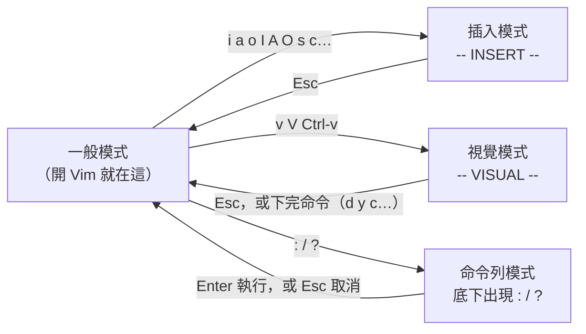

# Vim 為什麼有那麼多鍵？—— 模式切換與「運算子＋動作」的文法

> 日期：2026-11-06
> 情境：平常只會 `i` 進去打字、`:wq` 離開、用方向鍵移動，其他靠摸索；想系統化學 Vim 的核心觀念與操作。
> 適用範圍：Vim 9.1（Ubuntu 24.04 套件 `vim 2:9.1.0016-1ubuntu7.20`），本篇所有輸出都是在這台機器上實測。Neovim 的這些基本操作相同。
> 對應檔案：`~/.vimrc`（個人設定，不入 git；第九節有提到裡面的 `hlsearch`／`incsearch`）

**一句話結論：Vim 的指令不是一堆要硬背的快捷鍵，而是一套文法——`[次數]運算子[次數]動作`，例如 `d`（刪）＋`iw`（這個字）＝ `diw`。學會 16 個運算子裡常用的 4 個、加上一些動作和文字物件，就能組出上百種編輯；再用 `.` 重複上一次修改。**

---

## 目錄

- [一、為什麼 Vim 要有「模式」](#一為什麼-vim-要有模式)
- [二、模式：基本 7 種、附加 7 種，日常用 4 種](#二模式基本-7-種附加-7-種日常用-4-種)
- [三、存檔與離開](#三存檔與離開)
- [四、實驗工具：怎麼不開畫面也能看到按鍵的結果](#四實驗工具怎麼不開畫面也能看到按鍵的結果)
- [五、移動（motion）](#五移動motion)
- [六、核心文法：運算子＋動作](#六核心文法運算子動作)
- [七、文字物件：i 和 a](#七文字物件i-和-a)
- [八、重複與復原：. u Ctrl-r](#八重複與復原-u-ctrl-r)
- [九、搜尋與取代](#九搜尋與取代)
- [十、暫存器：複製的東西放在哪](#十暫存器複製的東西放在哪)
- [十一、Visual 模式與區塊選取](#十一visual-模式與區塊選取)
- [十二、巨集：錄下按鍵、重播](#十二巨集錄下按鍵重播)
- [十三、錯誤訊息對照與「文法可以問 Vim」](#十三錯誤訊息對照與文法可以問-vim)
- [十四、自我測驗](#十四自我測驗)

---

## 一、為什麼 Vim 要有「模式」

一般編輯器（VS Code、記事本）按 `d` 就是打出字母 d，要做「刪除一個字」得配 Ctrl、Shift 或滑鼠。
Vim 走另一條路：**大部分時間你不是在打字，而是在移動、刪除、複製、修改**，所以它讓鍵盤在不同「模式」下有不同意思：

- 在**一般模式（Normal mode）**，每個鍵都是命令：`d` 是刪除、`w` 是「到下一個字」、`dw` 就是「刪到下一個字」。
- 在**插入模式（Insert mode）**，鍵才是打字。

代價是要知道自己在哪個模式；好處是手不用離開主鍵區，而且命令可以**組合**（第六節）。
這也是很多人覺得 Vim 難的根因：把它當成「一般編輯器加一堆快捷鍵」，就會覺得要背幾百個鍵；把它當成「一套文法」，要學的東西就少得多。

Vim 來自 1976 年的 `vi`（visual，相對於更早的逐行編輯器 `ex`）。`vi` 是 POSIX 標準規定的工具，幾乎所有 Unix 系統都有，
所以在一台沒裝任何東西的伺服器上，你通常還是有 `vi` 可用——這是值得學它的實際理由。
在 Ubuntu 上 `vi` 其實是指向 `vim`（見 [從dpkg反推套件的啟動命令.md](../linux/從dpkg反推套件的啟動命令.md) 的反查例子）。

---

## 二、模式：基本 7 種、附加 7 種，日常用 4 種

Vim 的說明文件（`:help vim-modes`）把模式分成 **7 種基本模式（BASIC modes）＋ 7 種附加模式（ADDITIONAL modes）**，全部列在下面：

**基本模式（7 種）**

| 模式 | 畫面底下顯示 | 做什麼 | 怎麼進去 |
|------|--------------|--------|----------|
| 一般模式（Normal） | （無） | 下命令：移動、刪除、複製……開 Vim 就在這裡 | 從其他模式按 `Esc` |
| 視覺模式（Visual） | `-- VISUAL --` | 像一般模式，但移動會**擴大反白範圍**，接著下的命令作用在反白的範圍 | `v`、`V`、`Ctrl-v`（第十一節） |
| 選取模式（Select） | `-- SELECT --` | 模仿 Windows：選好後打字會直接取代選取的內容 | `gh`；很少用 |
| 插入模式（Insert） | `-- INSERT --` | 打字 | `i`、`a`、`o` 等（下表） |
| 命令列模式（Command-line） | 底下出現 `:`、`/`、`?` | 在最底下打一行：`:` 開頭是 Ex 命令（`:w`），`/`、`?` 是搜尋，`!` 是過濾 | `:`、`/`、`?` |
| Ex 模式 | `Entering Ex mode` | 像命令列模式，但執行完**留在**這個模式（模擬古早的 `ex` 行編輯器） | `Q`（常常是誤按，見下方） |
| 終端機工作模式（Terminal-Job） | | 在 Vim 視窗裡跑一個 shell，按鍵送給那個程式 | `:terminal` |

**附加模式（7 種，基本模式的變形）**

| 模式 | 做什麼 |
|------|--------|
| 等待運算對象模式（Operator-pending） | 按了運算子（例如 `d`）之後，Vim 在等你給「範圍」（第六節）。這時打 `w` 是「到下一個字」的意思 |
| 取代模式（Replace） | `R` 進入，打的每個字**蓋掉**原本的字（像 Insert 鍵切換的覆寫） |
| 虛擬取代模式（Virtual Replace） | `gR` 進入，跟取代模式類似，但以「畫面上的格子」為單位（Tab 佔好幾格時才有差） |
| 插入中的一般模式（Insert Normal） | 在插入模式按 `Ctrl-o`，執行**一個**一般模式命令後自動回到插入模式（顯示 `-- (insert) --`） |
| 終端機一般模式（Terminal-Normal） | 在終端機視窗裡用一般模式捲動、複製；不能修改 |
| 插入中的視覺模式（Insert Visual） | 從插入模式 `Ctrl-o` 再按 `v`；選取結束後回到插入模式 |
| 插入中的選取模式（Insert Select） | 從插入模式用滑鼠或 `Shift-方向鍵`開始選取 |

日常會用到的是 **一般、插入、視覺、命令列** 這 4 種。它們之間的切換：



圖要看的重點：**一般模式是中心**，其他模式都是從它進去、做完回到它。所以「不知道自己在哪個模式」時，**按兩次 `Esc`** 一定回到一般模式（`:help mode-switching` 的原話）。
唯一例外是 Ex 模式：在一般模式誤按 `Q` 會進去，畫面顯示 `Entering Ex mode.  Type "visual" to go to Normal mode.`，`Esc` 沒用，要打 `:visual`（或 `vi`）再按 Enter 才回得來。

**進插入模式的命令**（都是從一般模式按）：

| 鍵 | 從哪裡開始打字 | 記法 |
|----|----------------|------|
| `i` | 游標**前面** | insert |
| `a` | 游標**後面** | append |
| `I` | 這一行第一個非空白字元前面 | 大寫＝整行的版本 |
| `A` | 這一行**最後面** | 在行尾加分號最常用 |
| `o` | 在下面**開新的一行** | open |
| `O` | 在上面開新的一行 | |
| `s` | 刪掉游標上的字元再打字 | substitute |
| `S` | 刪掉整行內容再打字（等於 `cc`） | |
| `c{動作}` | 刪掉一個範圍再打字 | change，第六節 |

這是常用的 9 個；插入模式本身還有 97 個按鍵命令（例如 `Ctrl-w` 刪掉前一個字、`Ctrl-n` 自動補完），完整清單見 `:help insert-index`。

---

## 三、存檔與離開

存檔、離開都是**命令列模式**的命令：先在一般模式按 `:`，打命令，按 Enter。

| 命令 | 做什麼 | 檔案有改過、沒存時 |
|------|--------|--------------------|
| `:w` | 寫入（write）檔案 | — |
| `:w 新檔名` | 另存到新檔名（目前編輯的仍是原檔） | — |
| `:q` | 離開（quit） | **拒絕**，報 `E37`（見下） |
| `:q!` | 不存、強制離開；改的東西全丟掉 | 直接丟掉 |
| `:wq` | 寫入再離開；**不管有沒有改都會寫**（檔案修改時間會變） | — |
| `:x` | 有改才寫，然後離開 | — |
| `ZZ` | 一般模式的鍵，等於 `:x`（不用按 `:` 和 Enter） | — |
| `ZQ` | 一般模式的鍵，等於 `:q!` | — |
| `:qa`／`:wqa`／`:qa!` | 加 `a`（all）＝對所有開著的檔案做 | |
| `:w !sudo tee %` | 忘了用 `sudo` 開、沒權限存檔時的救急法：把內容交給 `sudo tee` 寫回目前的檔案（`%` 代表目前檔名） | |

`!` 在這些命令後面的意思是「我知道，照做」（強制）。沒存就 `:q` 的實測錯誤訊息：

```
E37: No write since last change (add ! to override)
```

訊息自己就講了解法：要嘛先 `:w`，要嘛加 `!` 變成 `:q!` 放棄修改。（這行是用第四節的方法，在刪掉一行後下 `:q` 得到的。）

---

## 四、實驗工具：怎麼不開畫面也能看到按鍵的結果

為了讓本篇每個例子都是真的跑出來的，我用下面這個腳本讓 Vim 在**不開畫面**的情況下執行一串按鍵、再把整個檔案印出來。
你也可以拿它驗證自己對某個命令的猜測。

`vk.sh` 完整原始碼：

```sh
#!/bin/sh
# 用法：./vk.sh <檔案> '<按鍵>'
# 用乾淨設定（-u NONE）開 vim，把游標放到第 1 行第 1 欄，執行按鍵後印出整個緩衝區
vim -Nu NONE -i NONE -n -es -c 'call cursor(1, 1)' -c "normal $2" -c '%print' -c 'q!' "$1"
```

建檔與使用：

```sh
chmod +x vk.sh
printf 'int count = 0;\n' > w.txt
./vk.sh w.txt 'wdiw'     # 從行首按 w（到下一個字）、再按 diw（刪掉這個字）
```

每個選項的意思：

| 選項 | 意思 |
|------|------|
| `-N` | 不相容（nocompatible）模式：用 Vim 自己的行為，不模仿老 `vi` |
| `-u NONE` | 不讀任何設定檔（包括 `~/.vimrc`），結果才不受個人設定影響 |
| `-i NONE` | 不讀寫 viminfo（記錄歷史、暫存器的檔案），避免上次的暫存器內容混進來 |
| `-n` | 不建 swap 檔（`.w.txt.swp`） |
| `-es` | Ex 模式＋安靜（silent）：不開畫面，從命令列讀命令 |
| `-c '命令'` | 開檔後依序執行這個 Ex 命令，可以給很多個 |
| `call cursor(1, 1)` | 把游標放到第 1 行第 1 欄（Ex 模式開檔時游標預設在**最後一行**，不放的話結果會不一樣） |
| `normal 按鍵` | 把後面的字當成**在一般模式按的鍵**來執行 |
| `%print` | 印出所有行（`%` 是整個檔案，第九節） |
| `q!` | 不存檔離開，所以原檔不會被改 |

特殊鍵要放真的控制字元：`Esc` 用 `$(printf '\033')`、`Ctrl-v` 用 `$(printf '\026')`。下面例子裡寫成 `<Esc>`、`<C-v>` 的地方就是這樣傳進去的。

要看訊息（例如錯誤訊息、暫存器內容）時，因為 `-es` 不印訊息，改用 `redir` 把訊息存到檔案：

```sh
# 第十節看暫存器用的寫法：執行 yyjdd 後，把 :registers 的輸出存進 out 再印出來
vim -Nu NONE -i NONE -n -es -c 'call cursor(1,1)' -c 'redir! > out' \
    -c 'normal yyjdd' -c 'registers 0 1 "' -c 'redir END' -c 'q!' r.txt
sed '/^$/d' out
```

**限制**：`normal` 執行的按鍵裡如果有命令失敗（例如游標已經在最後一行還按 `j`），**後面的按鍵全部不會執行**——這跟你在畫面上按鍵時的「失敗就停下」是同一個規則，第十二節的巨集會再碰到。

---

## 五、移動（motion）

移動命令有兩個用途：單獨按是移游標；**接在運算子後面是「範圍」**（第六節）。所以移動學得越多，能組出的編輯就越多。

用這一行實測（每個字元的欄號標在下面，欄號從 1 起算）：

```text
printf("hello, world\n", x);
         1111111111222222222
1234567890123456789012345678
```

從第 1 欄出發，按下各鍵後游標停的欄（用 `col(".")` 量出來的實測值）：

| 按鍵 | 停在第幾欄 | 停在哪個字元 | 說明 |
|------|-----------|--------------|------|
| `w` | 7 | `(` | 到下一個 **word** 的開頭。word＝連續的字母數字底線，**或**連續的其他符號；`printf` 和 `(` 是不同 word |
| `ww` | 9 | `h` | `("` 兩個符號連在一起算**一個** word，所以第二次跳過它們到 `hello` |
| `www` | 14 | `,` | |
| `W` | 16 | `w` | 到下一個 **WORD** 的開頭。WORD＝**用空白分隔**的一串，`printf("hello,` 整串是一個 WORD |
| `WW` | 26 | `x` | |
| `e` | 6 | `f` | 到這個 word 的**結尾**（end） |
| `E` | 14 | `,` | 到這個 WORD 的結尾 |
| `$` | 28 | `;` | 到行尾 |
| `0` | 1 | `p` | 到行首（第 0 欄的意思） |
| `^` | 1 | `p` | 到這行第一個**非空白**字元（這行沒有縮排，所以跟 `0` 一樣） |
| `f,` | 14 | `,` | 往右找（find）`,`，停**在**它上面 |
| `t,` | 13 | `o` | 往右找 `,`，停在它**前一格**（till） |
| `f,;` | 24 | `,` | `;` 重複上一次的 `f`／`t`，找下一個 `,` |
| `f,,` | 14 | `,` | `,` 是**反方向**重複；左邊已經沒有 `,`，所以沒動 |
| `%` | 27 | `)` | 跳到配對的括號；游標不在括號上時，先往右找這行第一個括號（第 7 欄的 `(`），再跳到它的配對 |

小寫 `w` 跟大寫 `W` 的差別是最常搞混的：**小寫看標點、大寫只看空白**。寫程式時 `W` 適合一口氣跳過 `foo->bar(x)` 這種一整串。

常用移動的完整分類（這裡列 30 個左右，Vim 的一般模式命令總共 202 個、加上 `g`／`z`／`[`／`]` 開頭的另外 165 個，完整清單見 `:help motion.txt` 與 `:help normal-index`）：

| 類別 | 鍵 | 說明 |
|------|----|------|
| 字元 | `h` `j` `k` `l` | 左、下、上、右。手不用離開主鍵區；方向鍵也能用 |
| 字 | `w` `b` `e` `ge` | 下一個字的頭、上一個字的頭（back）、這個字的尾、上一個字的尾 |
| 字（WORD） | `W` `B` `E` `gE` | 同上，只看空白 |
| 行內 | `0` `^` `$` | 行首、第一個非空白、行尾 |
| 行內找字元 | `f{c}` `F{c}` `t{c}` `T{c}` `;` `,` | 往右找／往左找、停在上面／停在前一格；`;` 同方向重複、`,` 反方向重複 |
| 檔案 | `gg` `G` `{N}G` `:{N}` | 第一行、最後一行、第 N 行（`42G` 或 `:42`） |
| 段落 | `{` `}` | 上一個／下一個空行 |
| 配對 | `%` | 對應的 `()`、`[]`、`{}` |
| 畫面 | `Ctrl-d` `Ctrl-u` `Ctrl-f` `Ctrl-b` | 往下／上捲半頁，往下／上捲一頁 |
| 畫面內 | `H` `M` `L` | 跳到畫面的頂端、中間、底端 |
| 搜尋 | `/{字}` `?{字}` `n` `N` `*` `#` | 第九節 |
| 跳回 | `Ctrl-o` `Ctrl-i` | 回到上一個跳之前的位置（例如 `G` 或搜尋前）、再跳回來 |

**次數（count）**：大部分移動前面可以加數字，`3w` 是往右三個字、`5j` 是往下五行。開 `:set relativenumber` 會在每行顯示「離游標幾行」，搭配 `5j` 很方便。

---

## 六、核心文法：運算子＋動作

### 文法骨架

```text
["暫存器][次數]運算子[次數]{動作 或 文字物件}
```

逐個位置說明：

| 位置 | 必要？ | 是什麼 | 省略時 |
|------|--------|--------|--------|
| `"暫存器` | 可省 | 把刪掉／複製的內容放到哪個暫存器，例如 `"a`（第十節） | 放進無名暫存器 `""` |
| 次數（前） | 可省 | 重複幾次 | 1 次 |
| 運算子（operator） | **必要** | 要**做什麼**：刪、複製、改…… | — |
| 次數（後） | 可省 | 動作要走幾次；跟前面的次數**相乘** | 1 次 |
| 動作（motion）／文字物件（text object） | **必要** | 作用在**哪個範圍**：從游標走到動作停下的地方，或一個文字物件（第七節） | 不能省，Vim 會一直在「等待運算對象模式」等你 |

所以 `d` 本身什麼都不會做，要等你補上範圍。按了 `d` 之後後悔，按 `Esc` 取消。

### 運算子：全部 16 個

`:help operator` 列出的全部運算子：

| 運算子 | 做什麼 | 常用度 |
|--------|--------|--------|
| `d` | 刪除（delete），刪掉的內容放進暫存器（所以「剪下」就是 `d`） | ★★★ |
| `c` | 修改（change）＝刪除後進入插入模式 | ★★★ |
| `y` | 複製（yank）進暫存器，不改文字 | ★★★ |
| `>` | 往右縮排一層 | ★★ |
| `<` | 往左縮排一層 | ★★ |
| `=` | 自動排版縮排（照 `equalprg` 選項，空的話用內建的 C 縮排規則） | ★★ |
| `gU` | 轉大寫 | ★ |
| `gu` | 轉小寫 | ★ |
| `g~` | 大小寫互換 | ★ |
| `~` | 大小寫互換，**只有開了 `tildeop` 選項才是運算子**；預設的 `~` 只換游標上一個字元 | |
| `!` | 把範圍交給外部程式過濾，用輸出取代（例如 `!ip sort` 把段落排序） | ★ |
| `gq` | 排版文字（把長段落折成固定寬度），游標移到最後 | |
| `gw` | 同 `gq`，但游標不動 | |
| `g?` | ROT13 編碼（字母轉 13 位） | |
| `zf` | 建立摺疊（fold） | |
| `g@` | 呼叫 `operatorfunc` 選項設定的函式（給外掛自訂運算子用） | |

### 規則一：運算子 × 動作 自由組合

`d` 能配的每個動作，`c`、`y`、`>`、`gU` 也都能配——這就是「學 4 個運算子＋20 個動作＝ 80 種編輯」的來源。實測（檔案 `words.txt` 只有一行 `one two three four five six seven eight`，游標在行首）：

```sh
printf 'one two three four five six seven eight\n' > words.txt
./vk.sh words.txt 'dw'      # 刪到下一個字的開頭
./vk.sh words.txt 'dte'     # 刪到第一個 e 的前一格
./vk.sh words.txt 'dfe'     # 刪到第一個 e（含）
./vk.sh words.txt 'gUiw'    # 把這個字轉大寫
```

輸出（依序）：

```
two three four five six seven eight
e two three four five six seven eight
 two three four five six seven eight
ONE two three four five six seven eight
```

- `dw`：「刪掉從游標到下一個字開頭」，所以 `one ` 連同後面的空白一起不見。
- `dte` 與 `dfe`：同一個 `e`（`one` 的最後一個字母），`t` 停在它前一格所以 `e` 留下來，`f` 停在它上面所以連 `e` 一起刪，剩下開頭的空白。
- `gUiw`：運算子換成 `gU`、範圍換成文字物件 `iw`，文法一樣。

### 規則二：次數相乘

```sh
./vk.sh words.txt '3dw'     # 做 3 次 dw
./vk.sh words.txt '2d3w'    # 2 × 3 = 刪 6 個字
```

```
four five six seven eight
seven eight
```

`2d3w` 刪了 `one`～`six` 共 6 個字（`:help motion-count-multiplied` 的原例就是這個）。

### 規則三：運算子按兩次＝作用在整行

`dd` 刪整行、`yy` 複製整行、`cc` 改整行、`>>` 整行縮排、`gUU`（或 `gUgU`）整行大寫。加次數就是「從這行起往下幾行」。
用 5 行的 `lines.txt`（`line1`～`line5`，游標在第 1 行）實測，輸出用 `|` 接成一行方便看：

```sh
printf 'line1\nline2\nline3\nline4\nline5\n' > lines.txt
./vk.sh lines.txt 'dd'   | paste -sd'|'    # 刪第 1 行
./vk.sh lines.txt '2dd'  | paste -sd'|'    # 刪 2 行
./vk.sh lines.txt 'jdj'  | paste -sd'|'    # 到第 2 行，刪「這行到下一行」
./vk.sh lines.txt 'jdG'  | paste -sd'|'    # 到第 2 行，刪到檔尾
./vk.sh lines.txt '>>'   | paste -sd'|'    # 第 1 行縮排
./vk.sh lines.txt 'ddp'  | paste -sd'|'    # 刪第 1 行、貼在下面
./vk.sh lines.txt 'jyyP' | paste -sd'|'    # 到第 2 行，複製這行、貼在上面
```

```
line2|line3|line4|line5
line3|line4|line5
line1|line4|line5
line1
        line1|line2|line3|line4|line5
line2|line1|line3|line4|line5
line1|line2|line2|line3|line4|line5
```

- `jdj`：`j` 是**行動作（linewise）**，所以 `dj` 刪的是「這行和下一行」兩整行，不是半行。`dk`、`dG`、`dgg` 同理。
- `>>` 縮了 8 格：`-u NONE` 用的是預設的 `shiftwidth=8`。寫 C 照 kernel coding style 剛好是一個 Tab（8 格）。
- `ddp`：**兩行互換**的慣用法——`dd` 把第 1 行剪進暫存器，游標落到原本的第 2 行，`p`（put，貼上）貼在它下面。
- 貼上：`p` 貼在游標**後面**（整行的內容就是貼在**下一行**）、`P` 貼在**前面**（上一行）。

### 規則四：大寫通常是「到行尾」或「整行」的縮寫

| 鍵 | 等於 | 意思 |
|----|------|------|
| `D` | `d$` | 刪到行尾 |
| `C` | `c$` | 改到行尾 |
| `Y` | `yy` | 複製整行（Vim 為了跟 vi 相容是 `yy`；Neovim 改成 `y$`） |
| `x` | `dl` | 刪游標上的字元 |
| `X` | `dh` | 刪游標前的字元 |
| `S` | `cc` | 改整行 |

---

## 七、文字物件：i 和 a

動作是「從游標走到某處」，所以範圍跟游標位置有關；**文字物件（text object）是「游標所在的那個東西」**，游標在字的中間也能整個抓到。
它**只能**接在運算子後面，或在視覺模式裡用（單獨按 `iw` 會被當成「進插入模式打一個 w」）。

文法是兩個字元：

```text
{i 或 a}{物件種類}
```

- 第一個字元：`i`＝inner（**只要裡面**，不含括號、引號、周圍空白）；`a`＝a／around（**連外殼一起**，含括號、引號或一個空白）。
- 第二個字元：物件種類。

### 實測：同一個位置，i 和 a 的差別

`call.txt` 內容是 `printf("hello, world\n", x);`，先用 `fh` 把游標移到 `hello` 的 `h`：

```sh
printf 'printf("hello, world\\n", x);\n' > call.txt
./vk.sh call.txt 'fhdiw'      # 刪這個字
./vk.sh call.txt 'fhdi"'      # 刪引號裡面
./vk.sh call.txt 'fhda"'      # 刪引號連引號
./vk.sh call.txt 'fhdi('      # 刪括號裡面
./vk.sh call.txt 'fhda('      # 刪括號連括號
./vk.sh call.txt 'fhci"bye<Esc>'   # 改引號裡面成 bye
```

```
printf(", world\n", x);
printf("", x);
printf(, x);
printf();
printf;
printf("bye", x);
```

- 游標在 `h`，但 `di"`、`di(` 仍然抓到**整個**引號／括號的內容——這就是跟「動作」的差別：不用先移到開頭。
- `ci"` 是寫程式最常用的組合之一：「改掉這個字串的內容」。同理 `ci(` 改參數、`ci{` 改函式內容。

`iw` 跟 `aw` 的差別在空白，換一個字後面有空白的例子（`w.txt` 是 `int count = 0;`，先 `w` 移到 `count`）：

```sh
./vk.sh w.txt 'wdiw'
./vk.sh w.txt 'wdaw'
./vk.sh w.txt 'wciwtotal<Esc>'
```

```
int  = 0;
int = 0;
int total = 0;
```

- `diw` 只刪 `count`，**兩邊的空白都留著**，所以剩兩個空格。
- `daw` 連後面一個空白一起刪，句子仍然通順——**刪一個字用 `daw`、換一個字用 `ciw`**。

### 文字物件：全部 36 個

`:help objects` 的完整清單，`i`／`a` 各 18 個，整理成 18 種物件：

| 物件 | `i`（inner） | `a`（around） | 別名 |
|------|--------------|---------------|------|
| `w` word | 這個字 | 這個字＋一邊的空白 | |
| `W` WORD | 這個 WORD | 這個 WORD＋空白 | |
| `s` sentence 句子 | 這一句 | 這一句＋空白 | |
| `p` paragraph 段落 | 這一段（到空行為止） | 這一段＋後面的空行 | |
| `"` | 雙引號裡面 | 連雙引號 | |
| `'` | 單引號裡面 | 連單引號 | |
| `` ` `` | 反引號裡面 | 連反引號 | |
| `(` | 小括號裡面 | 連小括號 | `)`、`b`（block） |
| `[` | 中括號裡面 | 連中括號 | `]` |
| `{` | 大括號裡面 | 連大括號 | `}`、`B`（Block） |
| `<` | 角括號裡面 | 連角括號 | `>` |
| `t` tag | HTML/XML 標籤之間的內容 | 連開頭、結尾標籤 | |

所以真正要記的只有 12 種物件；`i(`、`i)`、`ib` 三個是同一件事，選順手的就好（`:help objects` 寫的是 `same as ib`）。

---

## 八、重複與復原：. u Ctrl-r

| 鍵 | 做什麼 |
|----|--------|
| `.` | **重複上一次的修改**（含運算子、範圍、插入的文字） |
| `u` | 復原（undo）上一次修改 |
| `Ctrl-r` | 重做（redo），取消 `u` |
| `U` | 復原這一行最近的所有修改（本身也算一次修改，所以很少用） |

`.` 是 Vim 效率的另一半：把一次修改設計成「一個完整的命令」，就能一直用 `.` 重做。實測：

```sh
./vk.sh words.txt 'dw..'                  # dw，再重複兩次
./vk.sh lines.txt 'dd.'  | paste -sd'|'   # dd，再重複一次
./vk.sh lines.txt 'ddu'  | paste -sd'|'   # dd，再復原
```

```
four five six seven eight
line3|line4|line5
line1|line2|line3|line4|line5
```

- `dw..` 跟 `3dw` 結果一樣（都剩 `four …`）。差別：`.` 可以**一邊看一邊決定**要不要再做，甚至先移到別的地方再按 `.`。
- 「一次修改」的單位：**從進插入模式到按 `Esc` 算一次**。所以 `ciwtotal<Esc>` 之後，移到另一個字按 `.`，那個字也會被換成 `total`。
  這也是為什麼不要在插入模式裡用方向鍵移動：移動會把一次修改切成好幾次，`.` 和 `u` 都只會處理最後一段。

---

## 九、搜尋與取代

### 搜尋

| 鍵 | 做什麼 |
|----|--------|
| `/字串` Enter | 往下搜尋 |
| `?字串` Enter | 往上搜尋 |
| `n` | 跳到下一個（同方向） |
| `N` | 跳到上一個（反方向） |
| `*` | 搜尋游標上這個字（整個字比對），往下 |
| `#` | 同上，往上 |
| `:noh` | 暫時關掉搜尋結果的反白（`nohlsearch`），下次搜尋又會亮 |

你的 `~/.vimrc` 開了 `hlsearch`（把所有符合的地方反白）和 `incsearch`（邊打邊跳），所以搜尋完整個畫面都是黃底——用 `:noh` 關掉，而不是去改設定。

搜尋的字串是**正規表示式（regular expression）**，`.`、`*`、`[` 有特殊意思；要找字面上的 `.` 寫 `\.`。
在字串後加 `\c` 不分大小寫（`/foo\c`）。

### 取代：`:s` 的文法

```text
:[範圍]s/模式/取代成/[旗標]
```

逐個位置：

| 位置 | 必要？ | 是什麼 | 省略時 |
|------|--------|--------|--------|
| `範圍` | 可省 | 作用在哪些行 | **只有游標所在的那一行** |
| `s` | 必要 | substitute 命令名（全名 `:substitute`） | — |
| `/` | 必要 | 分隔符號；可以換成別的字元，例如路徑多時用 `:s#/usr/bin#/opt#` 就不用跳脫 `/` | — |
| `模式` | 可省 | 要找的正規表示式 | 用上一次搜尋的模式 |
| `取代成` | 可省 | 換成什麼；`&` 代表整個符合的字串，`\1`～`\9` 是第幾個 `\(…\)` 抓到的部分 | 空的＝刪掉符合的部分 |
| `旗標` | 可省 | 見下表 | 每行只換**第一個**、分大小寫依選項、找不到會報錯 |

**範圍**（`:help :range`）：

| 寫法 | 意思 |
|------|------|
| `5` | 第 5 行 |
| `.` | 游標所在行 |
| `$` | 最後一行 |
| `%` | 整個檔案（等於 `1,$`） |
| `2,3` | 第 2 到 3 行 |
| `.,+3` | 這行到往下 3 行 |
| `'<,'>` | 視覺模式選的行（選好後按 `:` 會自動填上） |
| `'a` | 標記 a 所在的行（`ma` 設標記） |
| `/模式/` `?模式?` | 往下／往上第一個符合模式的行 |

**旗標：全部 11 個**（`:help :s_flags`）：

| 旗標 | 意思 |
|------|------|
| `g` | global：一行裡**每一個**符合的都換，不是只換第一個 |
| `c` | confirm：每一處都問你 `y/n/a/q/l` |
| `i` | 不分大小寫 |
| `I` | 分大小寫（蓋過 `ignorecase` 選項） |
| `e` | 找不到時**不報錯**（腳本、巨集裡用，錯誤會讓巨集中斷） |
| `n` | 只**計數**，不換 |
| `p` | 印出最後換過的那一行 |
| `#` | 同 `p`，加行號 |
| `l` | 同 `p`，用 `:list` 的格式（看得到 Tab、行尾） |
| `&` | 必須放第一個：沿用上一次 `:s` 的旗標 |
| `r` | 只跟 `:&` 或不帶參數的 `:s` 一起用：改用上一次**搜尋**的模式 |

### 實測

`s.txt`：

```sh
printf 'foo bar foo\nfoo baz\nFOO qux foo\n' > s.txt
```

每次都從原檔開始、游標在第 1 行，結果用 `|` 接成一行。執行方式（把下表的命令代入 `$cmd`）：

```sh
vim -Nu NONE -i NONE -n -es -c 'call cursor(1,1)' -c "$cmd" -c '%print' -c 'q!' s.txt | paste -sd'|'
```

| 命令 | 結果 |
|------|------|
| `s/foo/X/` | `X bar foo\|foo baz\|FOO qux foo` |
| `%s/foo/X/` | `X bar foo\|X baz\|FOO qux X` |
| `%s/foo/X/g` | `X bar X\|X baz\|FOO qux X` |
| `%s/foo/X/gi` | `X bar X\|X baz\|X qux X` |
| `2,3s/foo/X/g` | `foo bar foo\|X baz\|FOO qux X` |
| `%s/\(\w\+\) \(\w\+\)/\2 \1/` | `bar foo foo\|baz foo\|qux FOO foo` |

逐列解釋：

- `s/foo/X/`：沒寫範圍＝只有游標那一行（第 1 行），而且沒有 `g`＝那行只換**第一個** `foo`。
- `%s/foo/X/`：每一行都做，但每行仍只換第一個；第 3 行的第一個 `foo` 是小寫那個（`FOO` 大小寫不符，不算）。
- 加 `g`：第 1 行兩個 `foo` 都換了。這是最常用的形式 `:%s/舊/新/g`。
- 加 `i`：連 `FOO` 也算。
- `2,3`：第 1 行不動。
- 最後一列：`\(…\)` 抓兩個字、取代成 `\2 \1`，**交換每行的前兩個字**。`\w` 是字母數字底線、`\+` 是一個以上（Vim 的正規表示式裡 `+` 要加反斜線）。

旗標 `n` 與 `e` 的實測（用第四節的 `redir` 拿訊息）：

```text
:%s/foo//gn    →  4 matches on 3 lines
:%s/foo//gni   →  5 matches on 3 lines
:%s/nope/X/    →  E486: Pattern not found: nope
:%s/nope/X/e   →  （沒有訊息）
```

- 有 `n` 就只數不換：分大小寫時 4 個，加 `i` 多算 `FOO` 變 5 個。想知道「某個字在檔案裡出現幾次」就用這招。
- `e` 把 `E486` 壓掉。

### `:g`：先挑行、再對這些行做事

`:s` 的近親，格式是 `:[範圍]g/模式/命令`：對**每一行符合模式的行**執行後面的 Ex 命令。`:v`（或 `:g!`）是反過來，對**不符合**的行做。

```sh
vim -Nu NONE -i NONE -n -es -c 'g/baz/d' -c '%print' -c 'q!' s.txt | paste -sd'|'   # 刪掉含 baz 的行
vim -Nu NONE -i NONE -n -es -c 'v/foo/d' -c '%print' -c 'q!' s.txt | paste -sd'|'   # 刪掉不含 foo 的行
```

```
foo bar foo|FOO qux foo
foo bar foo|foo baz|FOO qux foo
```

第二個沒有刪掉任何一行：三行都含有小寫 `foo`（第 3 行結尾那個），所以「不含 `foo` 的行」一行都沒有。
`grep` 這個名字就來自 `:g/re/p`（global／regular expression／print）。

---

## 十、暫存器：複製的東西放在哪

`d`、`y`、`c`、`x` 都會把文字放進**暫存器（register）**，`p` 從暫存器貼出來。Vim 不是只有一個剪貼簿，而是有很多格；
用 `"{名字}` 放在命令前面指定（例如 `"ayy` 複製到 a、`"ap` 從 a 貼），`:registers`（簡寫 `:reg`）看全部的內容。

### 全部 10 類（`:help registers`）

| 類別 | 名字 | 什麼時候被寫入 |
|------|------|----------------|
| 1. 無名暫存器 | `""` | **每次** `d` `c` `s` `x` `y` 都寫（`"_` 除外）；`p` 沒指定暫存器就貼它 |
| 2. 編號暫存器 | `"0`～`"9` | `"0`：最近一次**複製（yank）**；`"1`：最近一次刪除**整行或多行**，舊的往 `"2`…`"9` 推 |
| 3. 小刪除暫存器 | `"-` | 刪除**不到一行**的內容（例如 `diw`、`x`） |
| 4. 具名暫存器 | `"a`～`"z` | 只有你指定時才寫；用**大寫** `"A` 是**附加**到 a 的後面 |
| 5. 唯讀暫存器 | `":` `".` `"%` | 上一個命令列命令、上一次插入的文字、目前的檔名 |
| 6. 交替緩衝區 | `"#` | 上一個編輯的檔名 |
| 7. 運算式暫存器 | `"=` | 輸入一個運算式，用它的結果（例如插入模式 `Ctrl-r =2*21` Enter 插入 `42`） |
| 8. 選取與拖放 | `"*` `"+` `"~` | 系統的選取區與剪貼簿、拖放進來的文字 |
| 9. 黑洞暫存器 | `"_` | 寫進去就消失；`"_dd` 刪行**不影響**任何暫存器 |
| 10. 上次搜尋 | `"/` | 上一次的搜尋模式 |

### 實測：複製的東西為什麼被蓋掉了

最常見的困惑：「我 `yy` 複製了一行，再 `dd` 刪了別的行，按 `p` 貼出來的卻是刪掉的那行」。

`r.txt` 是 `alpha`、`beta`、`gamma` 三行，從第 1 行開始：

```sh
printf 'alpha\nbeta\ngamma\n' > r.txt
# 複製 alpha，往下到 beta 把它刪掉，再刪掉 gamma 這個字
vim -Nu NONE -i NONE -n -es -c 'call cursor(1,1)' -c 'redir! > out' \
    -c 'normal yyjdd' -c 'normal diw' -c 'registers 0 1 - "' -c 'redir END' -c 'q!' r.txt
sed '/^$/d' out
```

```
Type Name Content
  c  ""   gamma
  l  "0   alpha^J
  l  "1   beta^J
  c  "-   gamma
```

- `Type` 欄：`l` 是整行（linewise），`c` 是字元（characterwise）；`^J` 是換行字元。
- `yy` 的 `alpha` 在 `"0`；`dd` 的 `beta` 是整行刪除，進 `"1`；`diw` 的 `gamma` 不到一行，進 `"-`。
- **`""` 永遠是最後一次**，所以 `p` 貼出 `gamma`。要貼回複製的 `alpha`，用 `"0p`——**`"0` 只有 yank 會寫，刪除不會蓋掉它**。

換成用黑洞暫存器刪：

```sh
vim -Nu NONE -i NONE -n -es -c 'call cursor(1,1)' -c 'redir! > out' \
    -c 'normal yyj"_dd' -c 'registers 0 1 "' -c 'redir END' -c 'q!' r.txt
sed '/^$/d' out
```

```
Type Name Content
  l  ""   alpha^J
  l  "0   alpha^J
```

`"_dd` 刪的 `beta` 哪裡都沒存，`""` 還是 `alpha`，直接 `p` 就貼得出來。

大寫附加：

```sh
vim -Nu NONE -i NONE -n -es -c 'call cursor(1,1)' -c 'redir! > out' \
    -c 'normal "ayyj"Ayy' -c 'registers a' -c 'redir END' -c 'q!' r.txt
sed '/^$/d' out
```

```
Type Name Content
  l  "a   alpha^Jbeta^J
```

`"ayy` 把 `alpha` 放進 a，`"Ayy` 把 `beta` **接在後面**——收集散在各處的行時很好用。

### 這台機器的 Vim 不能直接用系統剪貼簿

```sh
vim -Nu NONE -i NONE -n -es -c 'redir! > out' -c 'echo has("clipboard")' -c 'redir END' -c 'q!'
sed '/^$/d' out
vim --version | grep -o '[+-]clipboard'
```

```
0
-clipboard
```

本機裝的是 `vim` 套件（沒有圖形介面的版本），編譯時**沒開剪貼簿功能**（`-clipboard`），所以 `"+y` 不會複製到系統剪貼簿；
實測 `"+yy` 之後 `:registers + "` 連 `""` 都是空的——不會報錯，只是什麼都沒做。要用 `"+` 有兩個方法：

- 改裝有編譯剪貼簿的版本：`sudo apt install vim-gtk3`（裝了之後 `vim --version` 會變 `+clipboard`；本機查到候選版本 `2:9.1.0016-1ubuntu7.20`，**未實際安裝**）。
- 不換 Vim，交給外部程式：`:w !xclip -selection clipboard`（把整個檔案送進剪貼簿）或在視覺模式選好後 `:'<,'>w !xclip -selection clipboard`。
  `xclip` 為什麼要加 `-selection clipboard`，見 [把檔案內容複製到剪貼簿.md](../linux/把檔案內容複製到剪貼簿.md)。

---

## 十一、Visual 模式與區塊選取

| 鍵 | 選取單位 |
|----|----------|
| `v` | 字元（從這裡到那裡） |
| `V` | 整行 |
| `Ctrl-v` | **矩形區塊**（block） |
| `gv` | 重新選取上一次的範圍 |
| `o` | （選取中）跳到選取範圍的另一端 |

視覺模式的順序跟一般模式**相反**：一般模式是「運算子 → 範圍」（`dw`），視覺模式是「先選範圍 → 再下運算子」（`v` 移動 `d`）。
看得到範圍比較安心，但不能用 `.` 精準重複，所以熟了以後能用文字物件就用文字物件。

選取中可用的命令有 83 個（`:help visual-index`）；常用的就是運算子（`d` `y` `c` `>` `<` `=` `gU` `gu`）加上下面兩個區塊專用的：

**區塊選取最實用的兩招：在多行前面或後面一起加字**

```sh
./vk.sh lines.txt '<C-v>jjIX <Esc>'  | paste -sd'|'   # 選前 3 行的第 1 欄，I 在前面插入 "X "
./vk.sh lines.txt '<C-v>jj$A;<Esc>'  | paste -sd'|'   # 選前 3 行到行尾，A 在後面加 ";"
```

```
X line1|X line2|X line3|line4|line5
line1;|line2;|line3;|line4|line5
```

- `Ctrl-v` 往下選 3 行，`I` 在區塊**左邊**插入，打完按 `Esc`，**打的字才會出現在每一行**（打的過程只看到第一行在變）。
- `$` 讓區塊延伸到每行的行尾（各行長度不同也沒關係），再 `A` 在**右邊**附加。
- 註解掉一段程式（每行前面加 `// `）就是第一招。

---

## 十二、巨集：錄下按鍵、重播

當一串修改要在很多地方重複、又不是一個 `.` 能涵蓋的，就錄成巨集（macro）：

| 鍵 | 做什麼 |
|----|--------|
| `q{a-z}` | 開始錄製，按鍵存進那個暫存器（畫面顯示 `recording @a`） |
| `q` | 停止錄製 |
| `@{a-z}` | 執行那個暫存器的巨集 |
| `@@` | 再執行一次上一個巨集 |
| `{次數}@a` | 執行幾次 |

巨集**就是存在具名暫存器裡的按鍵**——跟第十節是同一批暫存器，所以 `"ap` 能把巨集貼出來看、改完再 `"ayy`… 存回去。

### 實測：每行行尾加分號

錄製要在真的終端機裡按鍵，第四節的 `normal` 方法做不到（`normal` 裡按 `q` 錄製，命令一結束錄製就跟著結束）。
所以這裡用 `vim -s`（從檔案讀按鍵、當成鍵盤輸入）加 `script`（給它一個假的終端機）：

```sh
cp lines.txt m.txt
# 按鍵：qa 開始錄到 a；A;<Esc> 行尾加分號；j 到下一行；q 停止；3@a 再跑 3 次；:wq 存檔離開
printf 'qaA;\033jq3@a:wq\n' > keys
script -qc 'vim -Nu NONE -i NONE -n -s keys m.txt' /dev/null > /dev/null
cat m.txt
```

```
line1;
line2;
line3;
line4;
line5
```

錄的那一次處理第 1 行、`3@a` 處理第 2～4 行，所以第 5 行沒有分號。

**巨集遇到錯誤會停下來**：把 `3@a` 改成 `10@a`（只有 5 行，跑 10 次一定會超過）：

```sh
cp lines.txt m2.txt
printf 'qaA;\033jq10@a:wq\n' > keys2
script -qc 'vim -Nu NONE -i NONE -n -s keys2 m2.txt' /dev/null > /dev/null
cat m2.txt
```

```
line1;
line2;
line3;
line4;
line5;
```

5 行剛好都加上了，沒有報錯也沒有亂掉：處理完第 5 行後巨集裡的 `j` 失敗（已經是最後一行），**整個巨集就停了**。
所以實務上可以直接給一個很大的次數（`100@a`），讓「移不動了」當作結束條件。
這也是巨集裡搜尋、取代要小心的原因：找不到會中斷，需要時加 `:s` 的 `e` 旗標。

---

## 十三、錯誤訊息對照與「文法可以問 Vim」

### 常見錯誤訊息

| 訊息 | 什麼情況 | 怎麼辦 |
|------|----------|--------|
| `E37: No write since last change (add ! to override)` | 改了沒存就 `:q` | `:w` 再離開，或 `:q!` 放棄 |
| `E486: Pattern not found: nope` | 搜尋或 `:s` 找不到 | 檢查拼字、大小寫；巨集裡加 `e` 旗標 |
| `E492: Not an editor command: …` | `:` 後面打了不存在的命令（常見：在一般模式忘了按 `i` 就打字，結果字被當命令，再按 `:` 開頭的東西） | 按 `u` 復原誤操作 |
| `E45: 'readonly' option is set (add ! to override)` | 檔案是唯讀狀態：用 `view`／`vim -R` 開的，**或你對這個檔沒有寫入權限**（Vim 開檔時發現寫不進去，會自動設成唯讀） | 自己的檔：`:w!`；沒權限的檔：`:w!` 也會失敗，見下一列 |
| `"/etc/hostname" E212: Can't open file for writing` | 沒有寫入權限還硬寫（實測：一般使用者開 `/etc/hostname`，`:w` 先報 `E45`，`:w!` 才報這個） | `:w !sudo tee %`（第三節） |
| `Found a swap file by the name ".x.swp"` | 這個檔已經在別的地方開著，或上次 Vim 異常結束 | 看清楚訊息：別的視窗還開著就 `q` 不要開；確定是當掉留下的，`r` 復原後刪掉 `.swp` |
| 畫面底下 `Entering Ex mode` | 誤按 `Q` | 打 `visual` Enter |
| 畫面卡住不動 | 誤按 `Ctrl-s`（終端機的暫停輸出，不是 Vim 的功能） | 按 `Ctrl-q` |

### 怎麼查

| 查法 | 用途 |
|------|------|
| `vimtutor` | 在 shell 打，30 分鐘的互動教學（本機有：`/usr/bin/vimtutor`）。**只會基本操作時最該先做的一件事** |
| `:help {主題}` | 例如 `:help dw`、`:help iw`、`:help :s_flags`；`Ctrl-]` 跟進連結，`Ctrl-o` 返回，`:q` 關掉說明 |
| `:help i_Ctrl-w` | 前綴表示模式：`i_` 插入、`v_` 視覺、`c_` 命令列、`:` Ex 命令 |
| `:help index` | 所有命令的總表，分 6 大類（下表） |
| `:help {主題}` 後按 `Ctrl-d` | 列出所有符合的說明主題 |

`:help index` 的分類與每類的項目數（本機 9.1 的 `index.txt` 實際數出來的）：

| 分類 | 項目數 |
|------|--------|
| 1. 插入模式 | 97 |
| 2. 一般模式 | 202 |
| 2.1 文字物件 | 36 |
| 2.2 視窗命令（`Ctrl-w` 開頭） | 76 |
| 2.3 中括號命令（`[`、`]` 開頭） | 46 |
| 2.4 `g` 開頭的命令 | 67 |
| 2.5 `z` 開頭的命令 | 52 |
| 2.6 等待運算對象模式 | 3 |
| 3. 視覺模式 | 83 |
| 4. 命令列編輯 | 55 |
| 5. 終端機工作模式 | 9 |
| 6. Ex 命令（`:` 開頭） | 590 |

本篇沒有教的大類：多視窗與分頁（`Ctrl-w`、`:split`、`:tabnew`）、多檔案（緩衝區 `:ls` `:bn`）、摺疊（`z`）、標記（`m`）、設定檔與外掛（例如你 `~/.vimrc` 裡的 `vim-plug`、`fugitive`、`gitgutter`）。
這篇教的是**一切的基礎**：模式、文法、文字物件、`.`、搜尋取代、暫存器、巨集；其他主題之後有需要再各自寫成筆記。

---

## 十四、自我測驗

> 參考答案寫在每題下面（第一次作答、批改完才補上），作答時先遮住答案。

1. 同事說：「Vim 太難了，光是刪除就有 `dw`、`de`、`d$`、`dd`、`diw`、`daw`、`dap`、`D`……一大堆要背。」
   用本篇的文法說明為什麼這些**不是**要一個一個背的。照這個邏輯，如果已經會 `dap`（刪掉一整段），「複製一整段」和「把一整段往右縮排」應該怎麼按？
   為什麼 `d` 單獨按下去什麼事都不會發生？

2. 你先用 `yy` 複製了一行設定，接著往下移動、用 `dd` 刪掉一行不要的，回到要貼的位置按 `p`，貼出來的卻是剛刪掉的那行。
   為什麼會這樣？要怎麼把一開始複製的那行貼出來？下次如果想刪掉那行、又不想影響要貼的內容，應該怎麼刪？

3. 游標在這行的 `hello` 的 `e` 上：

   ```c
   printf("hello, world\n", x);
   ```

   (a) `dw` 和 `diw` 刪掉的範圍有什麼不同？為什麼游標在字中間時會不同？
   (b) 想把雙引號裡的整個字串改成 `bye`，最少要按哪些鍵？為什麼不用先把游標移到引號開頭？

4. 有一個檔案共 200 行，你想把**整個檔案**裡所有的 `fd` 改成 `file`，但結果第 3 行的 `fd = open(path); close(fd);` 只有第一個被換掉，而且其他行完全沒變。
   你下的命令最可能是什麼？錯在哪兩個地方，為什麼會造成這個結果？另外，如果想先知道檔案裡總共有幾個 `fd`、又不想真的改，該怎麼做？

5. 你要在 50 行程式的每一行結尾加上 `;`，同事建議錄巨集：`qa` `A;<Esc>` `j` `q`，然後 `100@a`。
   檔案只有 50 行，跑 100 次不會出問題嗎？為什麼？另外，這個任務還有哪一種不用巨集的做法（提示：視覺模式）？
